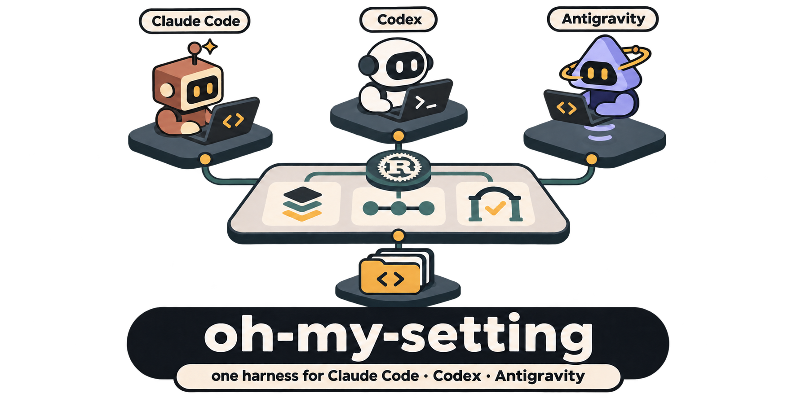
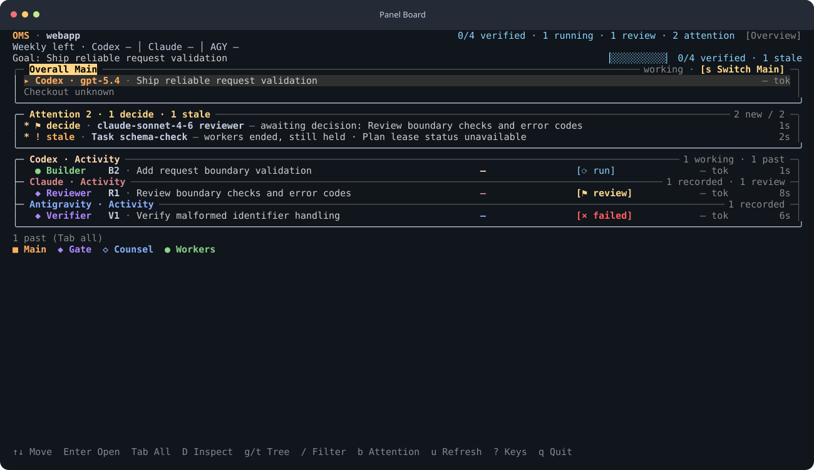
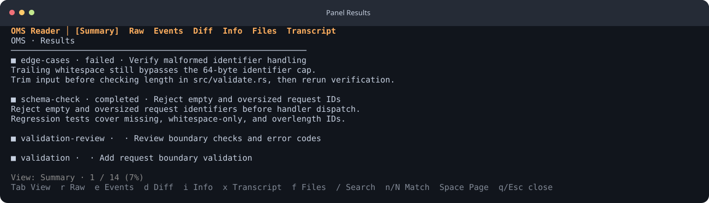

<p align="center"></p>

<p align="center">
  <a href="https://github.com/eightmm/oh-my-setting/actions/workflows/test.yml"></a>
  
  
  <a href="LICENSE"></a>
</p>

<p align="center"><a href="README.md">English</a></p>

**oh-my-setting (`oms`)**은 **Codex**, **Claude Code**, **Antigravity**가 프로젝트 규칙, 작업 계획, 격리된 작업 트리, 독립 리뷰 게이트, 검증된 착지(landing)까지 하나의 하네스에서 공유하도록 만드는 순수 Rust 기반 멀티 에이전트 컨트롤 플레인입니다. 아무 저장소에서나 **`oms`**를 실행하면 진행 중인 작업과 대기 항목을 한눈에 살피고 안전하게 이어 갈 수 있습니다.

---

## 주요 기능

| 기능 | 제공하는 가치 | 안내 문서 |
|---|---|---|
| **컨트롤 패널 (`oms`)** | main·worker·council 호출 트리, 주의/대기 알림, provider 쿼터 잔량, diff·아티팩트 리더를 한 화면에서 조회 | [패널 안내](docs/TERMINAL-PANEL.md) |
| **역할 기반 병렬 위임** | `.oms/tmp` 격리 Git worktree, 비중복 경로 scope 잠금, warm Cargo 빌드 슬롯, main당 쓰기 WIP 제어 (`WIP_LIMIT = 10`, `OMS_PANEL_WIP_LIMIT` 지원) | [역할 라우팅](custom-skills/oms-agent-harness/references/provider-routing.md) |
| **독립 Council & 리뷰 게이트** | 다중 모델 토론 (`oms peer-ask --debate`), 타 패밀리 교차 리뷰 (`oms peer-review --gate`), 2단계 패치 검증 (`oms patch-admit` / `oms patch-land`) | [구성 요소](docs/COMPONENTS.md#asking-other-agents) |
| **공유 상태·원격·HPC** | 통합 대시보드 (`oms dashboard`), Work Journal·인수인계, 데이터 누수 검사, 원격 SSH·Slurm 상태 투영, 타입 기반 런타임 계약 | [대시보드](docs/DASHBOARD.md) · [Journal](docs/WORK-JOURNAL.md) · [Runtime](docs/OMS-RUNTIME.md) |
| **검증된 릴리스 착지** | `oms land` 단일 명령으로 게이트·push·CI 대기까지 수행하고, 설치·업데이트·제거를 완전히 되돌릴 수 있음 | [착지와 릴리스](docs/COMPONENTS.md#verification-and-release) |

---

## 빠른 시작

```bash
curl -fsSL https://raw.githubusercontent.com/eightmm/oh-my-setting/main/install.sh | bash
```

설치 후 프로젝트 디렉터리에서 Codex, Claude Code 또는 Antigravity를 열고 **“이 프로젝트 시작해줘.”**라고 말하면 됩니다.

| 호스트 | 요구 사항 |
|---|---|
| **Linux (glibc, Ubuntu 20.04+)** | Bash 5.0+, `curl`, `git`, `tar`, `gzip`. |
| **macOS** | Bash 5.0+ (`brew install bash`), `curl`, Command Line Tools (`xcode-select --install`). |
| **Windows (WSL2)** | WSL2 Linux 파일시스템 내부의 glibc 배포판 (네이티브 Git Bash / MSYS2 미지원). |

OMS는 독립된 네이티브 Rust 바이너리(`~/.local/bin/oms`)로 동작하므로 별도 시스템 Python 설정이 필요하지 않으며 기존 환경을 건드리지 않습니다. 프로필 및 상세 설치 안내는 [docs/INSTALL.ko.md](docs/INSTALL.ko.md)를 참고하세요.

<details>
<summary>설치 시 구성되는 항목 (제거 시 자동 복원)</summary>

- **전역 규칙 링크:** `~/.claude/CLAUDE.md`, `~/.codex/AGENTS.md`, `~/.gemini/AGENTS.md`가 OMS 공유 규칙을 가리킵니다. 기존 파일은 `<파일>.backup.<타임스탬프>`로 백업되며 `oms uninstall` 시 원복됩니다.
- **Provider 연동:** 세 CLI에 `oms-*` 스킬, 훅·HUD·플러그인을 설치하고, Claude Code와 Codex에는 네이티브 `oms` MCP 서버를 등록합니다.
- **네이티브 CLI 및 상태:** `~/.local/bin/oms` 바이너리와 `~/.oh-my-setting` 체크아웃을 구성하며 시스템 Python을 변경하지 않습니다.
- **자동 업데이트:** 로컬 수정이 없는 체크아웃은 매일 fast-forward됩니다(끄려면 `| bash -s -- --no-auto-update`). 버전별 변경점은 [마이그레이션 노트](docs/MIGRATION.md#07)를 확인하세요.

</details>

```bash
oms doctor       # 하네스 연결 상태 및 provider 점검
oms update       # 체크아웃 최신화 및 네이티브 바이너리 재스테이징
oms uninstall    # 관리 링크 정리 및 백업된 기존 설정 복원
```

---

## 동작 방식

<p align="center"></p>

1. **온보딩 (`PROJECT.md`):** 빈 폴더는 짧은 스펙 인터뷰로, 기존 저장소는 코드를 먼저 읽고 빈틈만 물어 `PROJECT.md` 계약을 확정합니다. 진행 중인 저장소는 직전 상태와 다음 행동부터 이어 갑니다.
2. **병렬 위임:** 수정 작업은 경로 범위(`--scope`)가 겹치지 않는 한 독립 `.oms/tmp` Git worktree에서 동시에 실행되며, 읽기 전용 `researcher`/`advisor` 호출은 쓰기 WIP 한도를 소모하지 않습니다.
3. **독립 검증:** 생성된 패치는 diff 기반 검증, 다른 모델 패밀리의 리뷰 게이트(`oms peer-review --gate`), 클린 샌드박스 2단계 승인(`oms patch-admit` -> `oms patch-land`)을 거칩니다.
4. **안전한 착지:** `oms land`가 검증 게이트·push·CI 확인과 Work Journal/handoff 기록을 마무리합니다. 모든 병합·게시 권한은 사용자에게 있습니다.

<details>
<summary>자주 쓰는 요청 예시</summary>

```text
이 프로젝트 시작해줘.
지금 diff를 peer review 해줘.
세 모델에게 토론 1라운드로 물어봐: vector DB와 pgvector 중 뭐가 나아?
codex에게 맡겨줘: scripts/train.py에 입력 검증 추가.
확정된 PROJECT.md를 구현부터 Draft PR까지 진행해줘.
학습 전에 이 데이터셋의 group split 누수를 확인해줘.
Slurm job 12345가 끝나면 로그를 요약해서 알려줘.
oh-my-setting 업데이트하고 doctor 다시 돌려줘.
```

</details>

---

## 컨트롤 패널

`oms` (또는 `oms panel --watch`)를 실행하면 main/worker/council 호출 계층, 미확인 알림, provider 쿼터, 계획 진행도를 깜빡임 없는 터미널 UI로 실시간 확인할 수 있습니다.

`oms list`에는 일상 작업·협업·반영·설치 관리에 쓰는 명령 13개를 표시합니다.
현재 프로젝트에서 확인할 일은 `oms inbox --repo .`, 설치 상태는 `oms status`로
확인합니다. `agent-plan`은 실행 작업과 검토 상태를 관리하고, `agent-task`는
작업을 이어 갈 때 읽는 짧은 메모를 보관합니다. 저널은 과거 기록이므로 최근
관찰한 장애가 현재 작업에서는 이미 해결됐을 수 있습니다.

`oms list --all`에서 선택적 자동화, 대체 하네스, 연구·런타임 도구와 세부 반영
명령을 볼 수 있습니다. 각 기능은 해당 작업에 필요할 때 사용하며, 일반적인
코딩에 실험 등록이나 캠페인 실행이 필수인 것은 아닙니다.

<p align="center"></p>

<details>
<summary>결과 리더 및 대시보드 미리보기</summary>

- **결과·Diff 리더:** 검증된 요약, 원문 로그, 변경 파일 목록, 마스킹된 diff를 패널 안에서 바로 탐색합니다.

<p align="center"></p>

- **프로젝트 대시보드 (`oms dashboard`):** 목표 계약, 작업 준비 상태, 최근 시도, 원격/Slurm 상태, 다음 권장 명령을 출력합니다.

<p align="center"></p>

</details>

---

## 저장소 구조

```text
.
├── Cargo.toml             # 전체 네이티브 Rust 크레이트 workspace 루트
├── crates/                # `oms` 바이너리 및 모듈형 컨트롤 플레인 크레이트
├── scripts/               # 얇은 Bash 진입점(`scripts/oms`) 및 검증 게이트
├── custom-skills/         # 공유 `oms-*` 스킬 및 provider 라우팅 레퍼런스
├── roles/                 # 기본 제공 역할 정의 (builder, reviewer, advisor 등)
├── templates/             # 프로젝트 계약 및 워크플로 템플릿
├── config/                # 패널·작업 기본 라우팅 정책
├── docs/                  # 아키텍처, CLI, 설치, 패널 가이드 문서
└── tests/                 # 포터빌리티 및 설치 라이프사이클 스모크 테스트
```

상세 가이드는 [문서 지도](docs/README.md), 기여 및 로컬 검증 규칙은 [CONTRIBUTING.md](CONTRIBUTING.md)에서 확인할 수 있습니다.
다른 CLI UI에서 Codex 구독 모델을 실행하는 실험적 [Codex 하네스 실행기](docs/CODEX-HARNESSES.md)(`oms harness claude --model ...`)도 함께 제공합니다.

## 설계 원칙

- **로컬 우선 · 격리 실행:** 기본은 로컬 파일과 CLI이며, 쓰기 워커는 분리된 worktree와 허용 경로 안에서만 수정합니다.
- **아웃바운드 비밀·경로 차단:** 내장 스크러버가 토큰, 개인 데이터, 로컬 절대 경로가 커밋이나 외부 프롬프트로 나가지 않도록 차단합니다.
- **자가 승인 금지:** 워커는 자신의 패치를 스스로 승인하거나 사용자 허가 없이 공유 브랜치에 push하지 않습니다.

작업 흐름에 도움이 됐다면 [GitHub](https://github.com/eightmm/oh-my-setting)에 ⭐ 하나 남겨 주세요!
