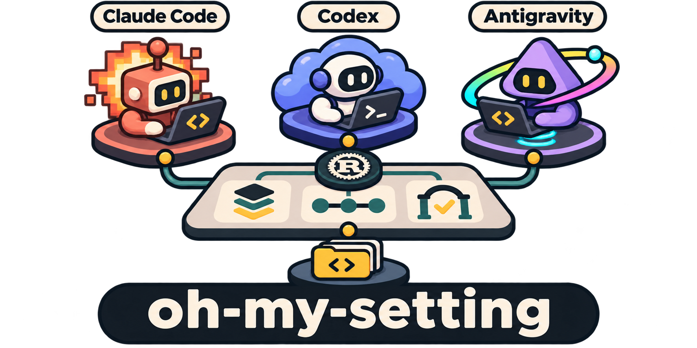
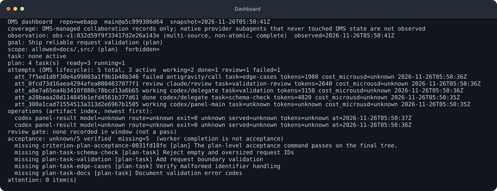
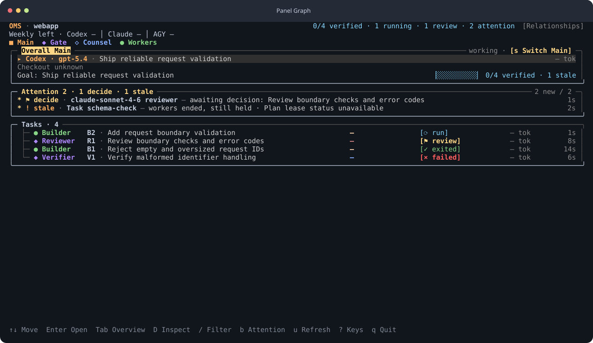

<p align="center"></p>

<p align="center">
  <a href="https://github.com/eightmm/oh-my-setting/actions/workflows/test.yml"></a>
  
  
  <a href="LICENSE"></a>
</p>

<p align="center"><a href="README.md">English</a></p>

**oh-my-setting (`oms`)**은 **Codex**, **Claude Code**, **Antigravity**가 프로젝트 규칙, 작업 계획, 격리된 작업 트리, 독립 리뷰 게이트, 검증된 착지(landing)까지 하나의 하네스에서 공유하도록 만드는 순수 Rust 기반 멀티 에이전트 컨트롤 플레인입니다. 이 작업은 하나의 **OMS 패널**로 봅니다. 터미널에서도, Codex 데스크톱 앱·ChatGPT Work·Claude Desktop·Antigravity App 안에서는 MCP App으로도 같은 패널을 봅니다.

---

## OMS로 할 수 있는 일

| 작업 | OMS 명령과 동작 | 안내 문서 |
|---|---|---|
| **패널에서 프로젝트 운영하기** | `oms`로 터미널에서 패널을 엽니다. Codex 데스크톱 앱과 ChatGPT Work에서는 `@OMS`로 대화에서 같은 Main을 움직이고, 다른 에이전트 앱은 읽기 전용 화면을 보여 줍니다([하나의 패널, 모든 호스트](#하나의-패널-모든-호스트)). 터미널에서는 설치된 Codex, Claude Code, Antigravity(Agy), 또는 Codex 게이트웨이를 쓰는 Pi를 Main으로 선택할 수 있습니다. tmux 관리 패널은 별도 창에 provider 오케스트레이터를 열고, 실행 중인 Main에 다시 연결할 수 있습니다. Board와 Detail에는 provider 또는 OMS 기록으로 확인할 수 있는 주간 쿼터, 토큰 사용량, 활동이 표시됩니다. | [터미널 패널](docs/TERMINAL-PANEL.md) |
| **작업을 위임하고 배정하기** | Overall Main은 관리만 합니다. 범위를 정해 작업을 위임하고 증거를 검토해 수락을 결정하며 저장소를 직접 수정하지 않습니다. Provider Lead는 배정 하나를 맡는 팀리더로 지원되는 네이티브 워커를 조율합니다. `oms peer-delegate`는 빌더의 수정 작업을 격리합니다. `oms agent-role`로 역할 프로필을, `oms panel --routes`로 쿼터를 고려하는 라우팅 정책을 확인합니다. `oms connect-services`로 Codex, Claude, Pi의 별도 계정 홈을 라우팅에 등록합니다. 패널에서 `L`을 누르거나 `oms connect-services --login PROVIDER`를 실행해 Codex, Claude Code, Antigravity에 로그인할 수 있으며, 이 로그인은 기본 계정 홈을 사용합니다. | [Main 정책](docs/TEAM-ORCHESTRATION-MAIN-POLICY.md) · [라우팅](docs/TERMINAL-PANEL.md#roles-and-automatic-allocation) · [계정](docs/TERMINAL-PANEL.md#provider-accounts) |
| **독립 자문과 리뷰 받기** | `oms consult`로 한 에이전트에게 묻고, `oms peer-ask --debate`로 provider별 응답을 비교합니다. `oms peer-review`로 독립 diff 리뷰를 요청합니다. Overall Main은 리뷰 결과를 종합해 수락 여부를 판단합니다. | [에이전트 협업](docs/COMPONENTS.md#asking-other-agents) |
| **프로젝트 의도를 기록하고 영향 범위 찾기** | `oms init`으로 프로젝트 정책을 구성하고, 합의한 범위·결정·검증 조건을 `PROJECT.md`에 기록합니다. `oms graph project`로 심볼·의존 관계·영향 경로를 찾고, `oms runtime context`로 필요한 작업 맥락을 제한된 분량으로 구성합니다. | [프로젝트 맥락](docs/PROJECT-CONTEXT.md) · [그래프 안내](docs/GRAPH-ENGINEERING.md#project-graph) |
| **계획을 추적하고 인수인계하기** | `oms agent-plan`은 의존 관계와 검토 상태를 추적합니다. `oms inbox`와 `oms dashboard`에서 확인이 필요한 일을 찾고, `oms agent-task`, `oms journal`, `oms session-handoff`로 재개 메모·작업 이력·세션 요약을 남깁니다. | [계획](docs/COMPONENTS.md#plans-and-bounded-autonomy) · [상태와 인수인계](docs/COMPONENTS.md#state-memory-and-handoff) |
| **변경을 검증하고 게시하기** | `oms patch-admit`과 `oms patch-land`로 위임 패치를 검사하고 적용합니다. `oms land`는 커밋된 변경을 검증한 뒤 승인된 GitHub pull request를 열고 CI 결과를 기다립니다. 병합은 `--merge`를 줄 때만 합니다. `oms draft-pr`는 권한이 승인되면 검증한 HEAD를 draft PR로 게시합니다. | [검증과 릴리스](docs/COMPONENTS.md#verification-and-release) |
| **OMS 설치와 유지 관리하기** | 필요한 기능 프로필을 선택하고, `oms status`와 `oms doctor`로 구성을 점검합니다. `oms update`로 갱신하고, `oms uninstall`로 관리 대상 설정을 복원합니다. | [설치와 업데이트](docs/INSTALL.ko.md) |
| **선택 기능으로 작업 확장하기** | `oms runtime`으로 작업 근거, 실험, 지원되는 실행 백엔드를 사용합니다. `oms recipe`와 `oms autopilot`은 명시적으로 선택한 워크플로를 실행합니다. 연구·HPC 도구는 데이터셋 검사, 로컬 큐, 원격 SSH 대상, Slurm 제출과 실행 기록 대조를 지원합니다. `oms harness`는 Pi와 Claude Code에서 Codex 추론을 사용할 수 있는 실험적 브리지를 제공합니다. | [런타임](docs/OMS-RUNTIME.md) · [레시피](docs/RECIPES.md) · [ML과 HPC](docs/COMPONENTS.md#ml-and-hpc-components) · [대체 하네스](docs/CODEX-HARNESSES.md) |

---

## 빠른 시작

```bash
curl -fsSL https://raw.githubusercontent.com/eightmm/oh-my-setting/main/install.sh | bash
```

Git 저장소에서 `oms`를 실행하면 터미널 패널을 열 수 있습니다. 프로젝트 디렉터리에서 Codex, Claude Code 또는 Antigravity를 열고 **“이 프로젝트 시작해줘.”**라고 요청해도 됩니다.

| 호스트 | 요구 사항 |
|---|---|
| **Linux (glibc, Ubuntu 20.04+)** | Bash 5.0+와 `curl`. `git`, `tar`, `gzip`, `find`가 없으면 설치기가 root 또는 sudo 권한으로 추가할 수 있습니다. |
| **macOS** | Bash 5.0+ (`brew install bash`), `curl`, Command Line Tools (`xcode-select --install`). |
| **Windows (WSL2)** | WSL2 Linux 파일시스템 내부의 glibc 배포판 (네이티브 Git Bash / MSYS2 미지원). |

OMS는 `~/.local/bin/oms`에서 네이티브 Rust CLI로 실행됩니다. 핵심 명령에는 시스템 Python 설정이 필요 없습니다. 기본 `core` 설치는 코딩 에이전트 provider 하나를 구성하며, 관리 패널은 tmux를 사용합니다. [설치 안내](docs/INSTALL.ko.md)

에이전트 앱에서도 같은 OMS 패널을 볼 수 있습니다. [하나의 패널, 모든 호스트](#하나의-패널-모든-호스트)를 참고하세요.

<details>
<summary>설치 시 구성되는 항목</summary>

- **전역 규칙**은 provider의 설정 파일을 OMS 공유 규칙에 연결합니다. 기존 파일은 `<파일>.backup.<타임스탬프>`로 백업하여 `oms uninstall`에서 복원할 수 있게 합니다.
- **Provider 연동**은 provider와 설치 옵션에 따라 지원되는 스킬, 훅, HUD, 플러그인과 MCP 서버를 구성합니다.
- **네이티브 CLI**는 `~/.oh-my-setting` 관리 체크아웃과 `~/.local/bin`의 실행기를 사용합니다.
- **예약 업데이트**는 대상 SHA의 CI 성공을 요구하며 로컬 수정 사항을 보존합니다. 설치 시 `--no-auto-update`를 지정하면 일정을 등록하지 않습니다. [업데이트 정책](docs/INSTALL.md#verification-policy)

</details>

```bash
oms doctor       # 하네스 연결 상태 및 provider 점검
oms update       # 설정된 ref를 따라 OMS 설치 갱신
oms uninstall    # 관리 링크 정리 및 백업된 기존 설정 복원
```

---

## 하나의 패널, 모든 호스트

oh-my-setting의 목표는 어느 에이전트에서 일하든 따라오는 하나의 프로젝트 패널입니다. Rust 런타임이 프로젝트 상태(목표, 계획, 시도, 리뷰, 사용량)를 관리하고 Git·GitHub 상태는 그때그때 읽으며, 모든 호스트는 따로 사본을 두지 않고 OMS에서 화면을 그립니다. 터미널에서는 `oms`가 Main 선택·전환, provider 개요, 쿼터, 결과 리더를 갖춘 전체 Board를 엽니다([터미널에서](#터미널에서) · [안내](docs/TERMINAL-PANEL.md)). 에이전트 앱은 `oms mcp-server`에서 MCP App으로 패널을 받고, Claude Code pane은 같은 머신의 OMS를 직접 읽습니다.

`oms --version`으로 런타임과 기본 제공 플러그인의 공통 릴리스 번호를 확인할 수 있으며, 패널 리소스 이름 끝의 `v35` 같은 표기는 화면 캐시를 구분합니다. 훅과 패널 플러그인은 별도로 동작하므로 훅을 켜지 않아도 패널을 사용할 수 있습니다.

### 플러그인과 연동

| 플러그인 또는 마켓플레이스 항목 | 호스트 | 추가되는 기능 | 설치 방법 | 매니페스트 |
|---|---|---|---|---|
| **`oms@oh-my-setting-local`** | Codex 데스크톱, ChatGPT Work (로컬 OMS) | 대화형 [MCP App 패널](docs/assets/oms-chat-panel.png)과 `@OMS`(`oms-connect`, `oms-project` 스킬): 대화에서 Main 선택, 목표 전달, Lead 추적, 승인 결정 | 마켓플레이스: 저장소 루트 카탈로그를 가져온 뒤 **OMS** 설치 ([안내](docs/DASHBOARD.md#oms-in-codex-and-chatgpt-work)) | [`plugins/oms/plugin.json`](plugins/oms/plugin.json) · [`.agents/plugins/marketplace.json`](.agents/plugins/marketplace.json) |
| **`oms@oms-ssh`** | Codex 데스크톱, ChatGPT Work (SSH 원격 OMS) | `oms-runtime` OpenSSH 호스트 별칭으로 연결하는 동일한 대화형 [MCP App 패널](docs/assets/oms-chat-panel.png)과 `@OMS` | 마켓플레이스: 카탈로그 경로 `plugins/oms-ssh`를 가져온 뒤 **OMS** 설치 ([안내](docs/DASHBOARD.md#oms-in-codex-and-chatgpt-work)) | [`plugins/oms-ssh/oms/plugin.json`](plugins/oms-ssh/oms/plugin.json) · [`plugins/oms-ssh/.agents/plugins/marketplace.json`](plugins/oms-ssh/.agents/plugins/marketplace.json) |
| **`oms-panel`** (`plugins/oms-app`) | Claude Desktop, Antigravity App 2.34+ | 읽기 전용 [MCP App 패널](docs/assets/oms-chat-panel.png)(프로젝트, Board, Git·GitHub, 사용량, 명령 목록)을 인라인·확장 또는 허용된 환경의 사이드 패널로 표시. 기본 설정은 `oms-runtime` SSH 사용 | 수동: Claude Desktop에 `mcp_config.json`의 `oms-panel` 추가, 또는 Antigravity App에 `plugins/oms-app` 설치 ([안내](docs/DASHBOARD.md#claude-and-antigravity)) | [`plugins/oms-app/plugin.json`](plugins/oms-app/plugin.json) · [`plugins/oms-app/mcp_config.json`](plugins/oms-app/mcp_config.json) |
| **`oms-panel@oh-my-setting`** | Claude Code v2.1.287+ | `oms dashboard --json`으로 그리는 대화 옆 읽기 전용 `oms-panel` pane (`/oms-panel`) | 마켓플레이스: `claude plugin marketplace add eightmm/oh-my-setting` 실행 후 user 범위로 `claude plugin install oms-panel@oh-my-setting` (또는 로컬 `claude --plugin-dir plugins/claude-code`; [README](plugins/claude-code/README.md)) | [`plugins/claude-code/.claude-plugin/plugin.json`](plugins/claude-code/.claude-plugin/plugin.json) · [`.claude-plugin/marketplace.json`](.claude-plugin/marketplace.json) |
| **`oh-my-setting@oh-my-setting-local`** | Codex CLI, Codex 데스크톱 | 하네스 훅(`OMS Hooks`): 스킬 라우팅, 압축 전 인수인계, 턴 가드, 본문 없는 라이프사이클 카운터 | 설치기: `codex`가 `PATH`에 있으면 자동 등록 ([설치 안내](docs/INSTALL.ko.md)) | [`plugins/oh-my-setting/.codex-plugin/plugin.json`](plugins/oh-my-setting/.codex-plugin/plugin.json) · [`.agents/plugins/marketplace.json`](.agents/plugins/marketplace.json) |
| **`oh-my-setting`** (`plugins/antigravity`) | Antigravity CLI, Antigravity IDE | MCP 기반 하네스 상태: 작업 패킷, 실패 원장, 인수인계 요약, Work Journal | 설치기: Antigravity가 있으면 자동 설치 ([설치 안내](docs/INSTALL.ko.md)) | [`plugins/antigravity/plugin.json`](plugins/antigravity/plugin.json) |
| **`oms-skills@oh-my-setting`** | Claude Code (플러그인 전용 스킬 환경) | 선택적 공유 `oms-*` 스킬 번들. `oms` 설치가 필요하며, 일반 설치에서는 링크된 스킬이 두 번 보이므로 불필요 | 마켓플레이스(수동, 선택): `claude plugin marketplace add eightmm/oh-my-setting` 실행 후 `claude plugin install oms-skills@oh-my-setting` ([참고](docs/COMPONENTS.md#local-skills-and-optional-bundle-operations)) | [`.claude-plugin/marketplace.json`](.claude-plugin/marketplace.json) |

### 터미널에서

tmux를 쓸 수 있는 터미널에서 `oms`를 실행하고 설치된 Main을 고릅니다. 실행
중인 Main이 확인되면 Enter로 **Continue current Main**을 선택합니다.
`oms panel --reopen`은 선택 메뉴 없이 Board를 복원하고, `OMS_PANEL_MAIN`으로
하네스를 미리 지정합니다. [시작과 복구](docs/TERMINAL-PANEL.md#default-main-selection)

검증된 관리 Codex Main에서는 Board의 `s`로 AGY 등 대상을 고르고 `Y`로
확정합니다. AGY, Claude, Pi Main에서는 현재 Main을 종료한 뒤 시작 메뉴에서 다음
하네스를 고릅니다. [Main 전환](docs/TERMINAL-PANEL.md#swap-the-main)

**Direct work**에는 Main이 직접 맡긴 호출이 보이고(Enter로 결과 열기),
**Needs you**는 입력을 기다리는 항목을, `w`는 보고된 주간 쿼터를 보여 줍니다.
근거가 없는 값은 미확인으로 둡니다. Board만 보려면 `oms panel --watch`를
실행합니다. [패널 조작법](docs/TERMINAL-PANEL.md#keys)

`oms list`는 일상 명령을, `oms list --all`은 전체 목록을 보여 줍니다. [명령 목록](docs/COMPONENTS.md)

<p align="center"></p>

<details>
<summary>MCP App, 결과 리더 및 대시보드 미리보기</summary>

- **MCP App 패널 (`oms mcp-server`)**에서 Codex 데스크톱, ChatGPT Work, Claude Desktop, Antigravity App 안에서도 같은 프로젝트 목표, 배정된 계획 작업, 결과 유무와 프로젝트 지도를 봅니다.

<p align="center"></p>

- **결과·diff 리더**에서 보관한 요약, 변경 파일, 마스킹된 diff와 캡처가 있는 대화 기록을 엽니다.

<p align="center"></p>

- **프로젝트 대시보드 (`oms dashboard`)**에서 목표, 계획 준비 상태, 최근 시도, 다음 명령을 확인합니다. [대시보드 안내](docs/DASHBOARD.md)

<p align="center"></p>

</details>

---

## 동작 방식

<p align="center"></p>

1. **목표를 합의합니다.** 새 프로젝트는 에이전트와 짧게 요구 사항을 확인할 수 있습니다. 기존 저장소에서는 프로젝트 정책, 코드, 남겨 둔 상태를 먼저 읽습니다. 합의한 제약과 완료 검사는 `PROJECT.md`에 남깁니다.
2. **작업을 나누어 맡깁니다.** Builder별 수정 경로를 겹치지 않게 정하고, 읽기 전용 조사와 리뷰를 따로 배정합니다. 쓰기 워커는 기본적으로 `${XDG_CACHE_HOME:-$HOME/.cache}/oh-my-setting/worktrees` 아래 격리된 Git worktree에서 실행됩니다.
3. **결과를 검증합니다.** 영향 범위에 맞는 검사를 돌리고 변경에 필요한 독립 리뷰를 요청합니다. 위임 패치를 적용하기 전에 배정 범위와 검증 근거에 맞는지 확인합니다.
4. **게시하고 넘겨줍니다.** 검증한 변경은 `oms land`로 승인된 pull request로 게시하고, 병합은 요청받았을 때만 `--merge`로 합니다. 다음 세션이 이어받을 수 있도록 검증·반영 근거와 남은 일을 저널이나 인수인계 기록에 적습니다.

<details>
<summary>자주 쓰는 요청 예시</summary>

```text
이 프로젝트 시작해줘.
지금 diff를 peer review 해줘.
세 모델에게 토론 1라운드로 물어봐: vector DB와 pgvector 중 뭐가 나아?
codex에게 맡겨줘: scripts/train.py에 입력 검증 추가.
확정된 PROJECT.md를 구현부터 Draft PR까지 진행해줘.
학습 전에 이 데이터셋의 group split 누수를 확인해줘.
Slurm job 12345가 끝나면 로그를 요약해서 알려줘.
oh-my-setting 업데이트하고 doctor 다시 돌려줘.
```

</details>

---

## 저장소 구조

```text
.
├── Cargo.toml             # 전체 네이티브 Rust 크레이트 workspace 루트
├── crates/                # `oms` 바이너리 및 모듈형 컨트롤 플레인 크레이트
├── scripts/               # 얇은 Bash 진입점(`scripts/oms`) 및 검증 게이트
├── custom-skills/         # 공유 `oms-*` 스킬 및 provider 라우팅 레퍼런스
├── roles/                 # 기본 제공 역할 정의 (builder, reviewer, advisor 등)
├── templates/             # 프로젝트 계약 및 워크플로 템플릿
├── config/                # 패널·작업 기본 라우팅 정책
├── docs/                  # 아키텍처, CLI, 설치, 패널 가이드 문서
└── tests/                 # 포터빌리티 및 설치 라이프사이클 스모크 테스트
```

상세 가이드는 [문서 지도](docs/README.md), 기여 및 로컬 검증 규칙은 [CONTRIBUTING.md](CONTRIBUTING.md)에서 확인할 수 있습니다.

## 설계 원칙

- **로컬 실행과 작업 격리.** OMS는 로컬 파일과 네이티브 provider CLI를 연결합니다. 쓰기 워커에는 분리된 worktree와 수정 경로가 주어집니다.
- **외부로 나가는 데이터 보호.** 스크러버는 외부 전송 텍스트의 비밀 패턴을 검사하고 지원되는 화면과 출력에서 로컬 경로를 마스킹합니다. [보안 경계](docs/COMPONENTS.md#security-boundary)
- **명확한 승인 권한.** 워커는 변경과 근거를 반환합니다. 소유자가 패치를 검토해 수락하고, 사용자에게 받은 권한 범위에서 게시합니다.

작업 흐름에 도움이 됐다면 [GitHub](https://github.com/eightmm/oh-my-setting)에 ⭐ 하나 남겨 주세요!
