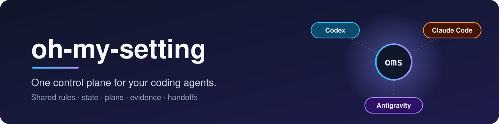
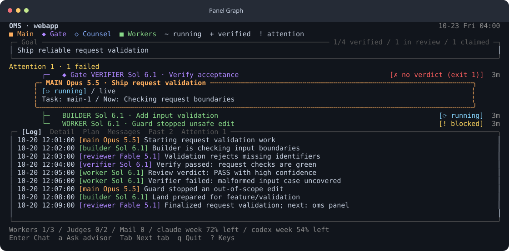
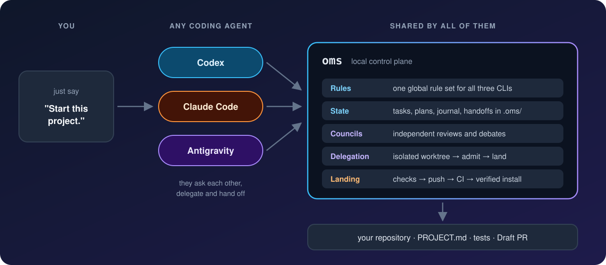
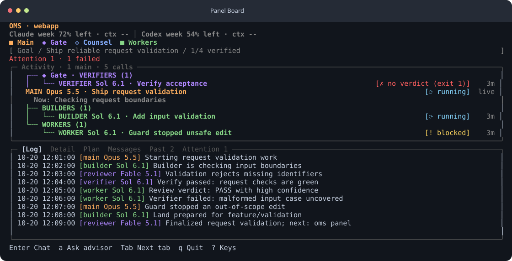
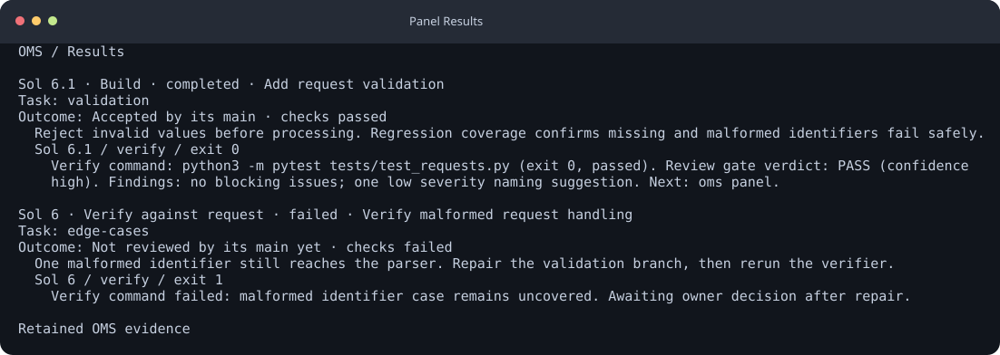
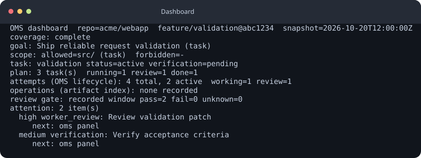

<p align="center">
  
</p>

<p align="center">
  <a href="https://github.com/eightmm/oh-my-setting/actions/workflows/test.yml"></a>
  
  <a href="LICENSE"></a>
</p>

<p align="center"><a href="README.md">English</a></p>

oh-my-setting은 Codex, Claude Code, Antigravity가 프로젝트 규칙, 상태, 계획,
근거와 인수인계를 함께 쓰도록 돕는 하나의 하네스다. **`oms`**를 실행하면
공유 컨트롤 패널에서 진행 상황을 볼 수 있다.

<p align="center"></p>

패널은 목표, 호출, 리뷰 상태와 최근 활동을 한 화면에 보여 준다. 시작,
탐색, 역할 라우팅은 [패널 안내](docs/TERMINAL-PANEL.md)를 참고한다.

## 설치

```bash
curl -fsSL https://raw.githubusercontent.com/eightmm/oh-my-setting/main/install.sh | bash
```

| 호스트 | 필요한 것 |
|---|---|
| Linux, WSL (glibc) | Bash, curl. Git·tar·gzip·find는 없으면 설치한다. **Python 불필요.** |
| macOS | Bash, curl, Command Line Tools(`xcode-select --install`). **Python 불필요.** |
| Windows (Git Bash) | Git, Python 3.9+, Node 기반 agent를 고르면 네이티브 Node.js |

기본 `core` 프로필은 하네스와 코딩 agent 하나를 설치한다. Alpine 같은 musl
기반 Linux는 지원하지 않는다. 프로필과 Windows 참고 사항은
[설치 안내](docs/INSTALL.ko.md)에 있다.

### 설치하면 바뀌는 것

- **전역 규칙.** `~/.claude/CLAUDE.md`, `~/.codex/AGENTS.md`,
  `~/.gemini/AGENTS.md`가 OMS 규칙을 가리키는 링크가 된다. 기존 파일은
  `<파일>.backup.<타임스탬프>`로 옮기고 제거할 때 복원한다.
- **agent 설정.** Claude Code에는 훅, 상태 줄 HUD, Opus 5.5의 `high` effort
  기본값(미설정 시)을 적용한다. Codex에는 OMS 플러그인, footer와 사용 기본값을,
  Antigravity에는 OMS 플러그인을 설치한다. Claude Code와 Codex에는 OMS MCP
  서버를 등록한다.
- **홈 파일.** 세 CLI용 `oms-*` 스킬, `~/.local/bin`의 `oms` 명령,
  `~/.local/share/oh-my-setting` 아래의 전용 Python을 설치한다.
- **매일 업데이트.** 수정하지 않은 체크아웃은 매일 fast-forward된다. 끄려면
  설치 명령 끝에 `| bash -s -- --no-auto-update`를 붙인다.

### 업데이트와 제거

agent에게 `oms update` 또는 `oms uninstall` 실행을 요청한다. 제거하면 교체했던
파일이 복원되고 agent CLI는 남는다. 릴리스별 변경은
[마이그레이션 노트](docs/MIGRATION-0.7.md)를 참고한다.

## 동작 방식

<p align="center">
  
</p>

코딩 agent를 아무 디렉터리에서나 열고(빈 디렉터리, 진행 중 프로젝트, 기존
repo) 이렇게 말한다.

```text
이 프로젝트 시작해줘.
```

빈 디렉터리는 짧은 spec 인터뷰를 거쳐 `PROJECT.md`와 템플릿을 만든다. 기존
repo는 먼저 코드를 읽고 빈 곳만 묻는다. 진행 중 프로젝트는 상태와 다음 할
일을 보고한다. `PROJECT.md`를 확정하면 검토한 작업, 검사, Draft PR까지 맡길
수 있다. 생성된 작업은 스스로 승인되지 않고, merge와 release는 사용자가
정한다.

## 이렇게 말하면 된다

```text
이 프로젝트 시작해줘.
지금 diff를 peer review 해줘.
세 모델에게 토론 1라운드로 물어봐: vector DB와 pgvector 중 뭐가 나아?
codex에게 맡겨줘: scripts/train.py에 입력 검증 추가.
확정된 PROJECT.md를 구현부터 Draft PR까지 진행해줘.
학습 전에 이 데이터셋의 group split 누수를 확인해줘.
Slurm job 12345가 끝나면 로그를 요약해서 알려줘.
oh-my-setting 업데이트하고 doctor 다시 돌려줘.
```

## 제공 기능

실험 기능인 [Codex 하네스 실행기](docs/CODEX-HARNESSES.md)는 기존 Codex 구독
로그인으로 Codex CLI·pi·Claude Code의 UI와 도구를 유지하며 OpenAI 모델을
사용한다. 예: `oms harness claude --model gpt-6.1-sol`.

### 컨트롤 패널

목표, 조치 항목, 호출과 활동을 한 화면에서 살핀다. 시작과 탐색은
[패널 안내](docs/TERMINAL-PANEL.md)를 참고한다.

<p align="center"></p>

### 역할 위임과 리뷰 gate

역할별로 범위가 정해진 호출을 보내고 검증 및 리뷰 결과를 확인한다.
[패널의 역할 라우팅 안내](docs/TERMINAL-PANEL.md#roles-and-automatic-allocation)를 참고한다.

<p align="center"></p>

### 공유 상태와 대시보드

`oms dashboard`로 프로젝트 진행과 다음 결정을 읽는다. [대시보드 안내](docs/DASHBOARD.md)를
참고한다.

<p align="center"></p>

| **기능** | 설명 |
|---|---|
| **Council** | 독립 provider에게 변경 리뷰나 선택지 비교를 요청한다. [구성 요소](docs/COMPONENTS.md#asking-other-agents) |
| **검증된 착지** | `oms land`로 커밋된 작업을 검사하고 게시한다. [구성 요소](docs/COMPONENTS.md#verification-and-release) |
| **Work Journal과 handoff** | 제한된 프로젝트 기록과 세션 인수인계를 보존한다. [Work Journal](docs/WORK-JOURNAL.md) |
| **ML과 HPC** | 재현 가능한 실행, 데이터 검사, Slurm 도구를 제공한다. [구성 요소](docs/COMPONENTS.md#ml-and-hpc-components) |
| **Typed runtime** | 작업 계약과 증거 범위를 살핀다. [Runtime 안내](docs/OMS-RUNTIME.md) |

agent가 알아서 골라 쓴다. 전체 목록은 [docs/COMPONENTS.md](docs/COMPONENTS.md)에 있다.
설치된 peer CLI로 Muse(`muse`), Kimi Code(`kimi`), Kiro(`kiro-cli`),
Continue(`cn`), Goose(`goose`), Cline(`cline`), Kilo(`kilo`), OpenHands(`openhands`),
Auggie(`auggie`)도 사용할 수 있다. Junie와 Crush는 headless 쓰기 승인 동작을
확인할 때까지 custom adapter 후보로 남긴다. 접근 경계는 [provider 라우팅 안내](custom-skills/oms-agent-harness/references/provider-routing.md)를 참고한다.

## 참고

- **로컬 우선.** 기본은 로컬 파일과 CLI다. connector는 요청할 때만 쓴다.
- **비공개 정보는 커밋하지 않는다.** 토큰, 개인 데이터, 머신 정보는 git에
  들어가지 않고, 프로젝트별 agent 파일은 로컬에서만 무시 처리된다.
- **되돌릴 수 있다.** `oms uninstall`이 바꿨던 파일을 복원한다.

도움이 됐다면 [GitHub](https://github.com/eightmm/oh-my-setting)에 ⭐ 하나 부탁드린다.
