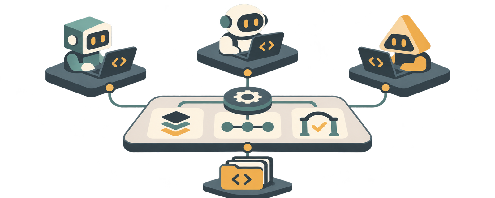
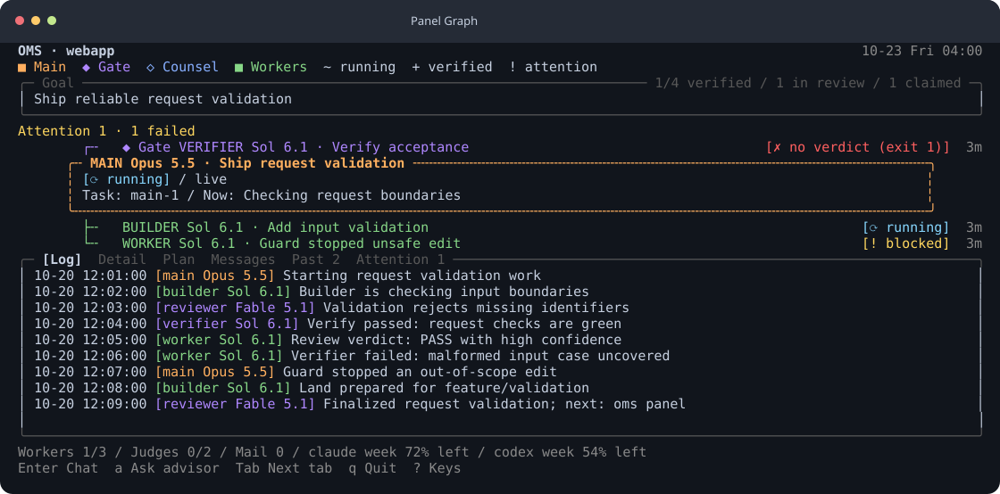
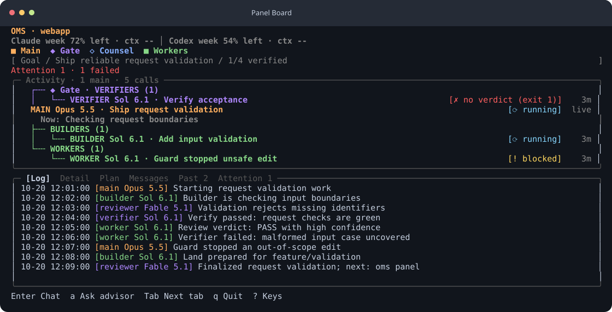
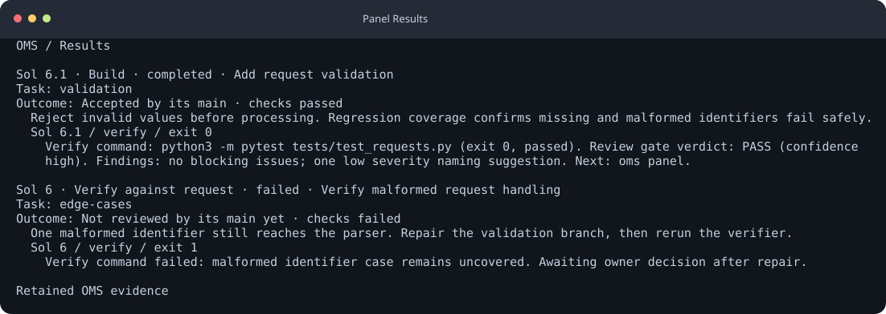
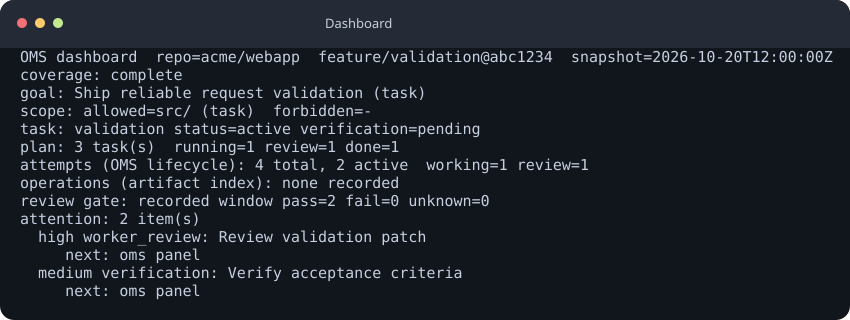

<p align="center"></p>

<p align="center">
  <a href="https://github.com/eightmm/oh-my-setting/actions/workflows/test.yml"></a>
  
  <a href="LICENSE"></a>
</p>

<p align="center"><a href="README.ko.md">한국어</a></p>

oh-my-setting lets Codex, Claude Code and Antigravity share project rules, state,
plans, evidence and handoffs. Run **`oms`** to see work in progress and keep
reviewed work moving through one shared harness.

## Quick start

```bash
curl -fsSL https://raw.githubusercontent.com/eightmm/oh-my-setting/main/install.sh | bash
```

Then open a coding agent in your project and say **“Start this project.”**

| Host | Needs |
|---|---|
| Linux (glibc) | Bash, curl. Git, tar, gzip and find are installed if missing. |
| macOS | Bash, curl, Command Line Tools (`xcode-select --install`). |
| Windows via WSL2 | A glibc Linux distribution inside WSL2; use the Linux requirements above |

OMS provisions Python 3.11+ as a managed runtime; system Python stays unchanged.
The default `core` profile installs the harness and one coding agent. musl-based
Linux such as Alpine is not supported. Profiles and Windows notes are in
[docs/INSTALL.md](docs/INSTALL.md).

<details>
<summary>What the installer changes</summary>

- **Global rules.** `~/.claude/CLAUDE.md`, `~/.codex/AGENTS.md` and
  `~/.gemini/AGENTS.md` link to the OMS rules. Existing files move to
  `<file>.backup.<timestamp>` and are restored on uninstall.
- **Agent settings.** Claude Code gets hooks, a status-line HUD and a `high`
  effort default for Opus 5.5 when unset. Codex gets the OMS plugin, a footer
  and usage defaults; Antigravity gets the OMS plugin. Claude Code and Codex
  register the OMS MCP server.
- **Home files.** `oms-*` skills for all three CLIs, the `oms` command in
  `~/.local/bin`, and private Python under `~/.local/share/oh-my-setting`.
- **Daily update.** Clean checkouts fast-forward daily. To opt out, end the
  install command with `| bash -s -- --no-auto-update`.
</details>

### Update and uninstall

Ask your agent to run `oms update` or `oms uninstall`. Uninstall restores
replaced files and leaves agent CLIs in place. See the
[migration notes](docs/MIGRATION.md#07) for release changes.

## How it works

<p align="center"></p>

An empty directory gets a short spec interview, a `PROJECT.md` and a template.
An existing repository is inspected first and interviewed only for gaps. An
ongoing project gets a status report and the next step. From a confirmed
`PROJECT.md`, the agent can carry work through reviewed tasks, checks and a
Draft PR. Generated work never approves itself, and merge and release stay your
call.

## What you can say

```text
Start this project.
Run a peer review of the current diff.
Ask all three models with one debate round: vector DB or pgvector?
Delegate this to codex: add input validation to scripts/train.py.
Take this confirmed PROJECT.md through implementation to a Draft PR.
Check this dataset's group split for leakage before I train.
Wait for Slurm job 12345, then digest its log and report.
Update oh-my-setting and re-run its doctor.
```

## What you get

The experimental [Codex harness launcher](docs/CODEX-HARNESSES.md) runs Codex
subscription models in Codex CLI, Pi, or Claude Code while retaining the chosen
harness's UI and tools: `oms harness claude --model gpt-6.1-sol`.

### Control panel

Track the goal, attention items, calls and activity in one view. See the
[panel guide](docs/TERMINAL-PANEL.md) for startup and navigation.

<p align="center"></p>

### Role-routed delegation and review gate

Route bounded calls by role and inspect their verification and review results.
See [role routing in the panel guide](docs/TERMINAL-PANEL.md#roles-and-automatic-allocation).

<p align="center"></p>

### Shared state and dashboard

Read project progress and next decisions with `oms dashboard`. See the
[dashboard guide](docs/DASHBOARD.md).

<p align="center"></p>

| **Feature** | Description |
|---|---|
| **Councils** | Independent providers review changes or compare options. [Components](docs/COMPONENTS.md#asking-other-agents) |
| **Verified landing** | Gate and publish a committed worktree with `oms land`. [Components](docs/COMPONENTS.md#verification-and-release) |
| **Work Journal and handoffs** | Keep bounded project memory and session handoffs. [Work Journal](docs/WORK-JOURNAL.md) |
| **ML and HPC** | Run reproducible work, data checks and Slurm tools. [Components](docs/COMPONENTS.md#ml-and-hpc-components) |
| **Typed runtime** | Inspect task contracts and evidence coverage. [Runtime guide](docs/OMS-RUNTIME.md) |

Use the [documentation map](docs/README.md) to choose a guide. The
[provider routing reference](custom-skills/oms-agent-harness/references/provider-routing.md)
lists additional peer CLIs and their read/write boundaries.

## Notes

- **Local-first.** Local files and CLIs by default; connectors only when asked.
- **Nothing private is committed.** Tokens, private data and machine details
  stay out of git; per-project agent files are ignored locally.
- **Reversible.** `oms uninstall` restores the files it replaced.

If it helps, a ⭐ on [GitHub](https://github.com/eightmm/oh-my-setting) is appreciated.
