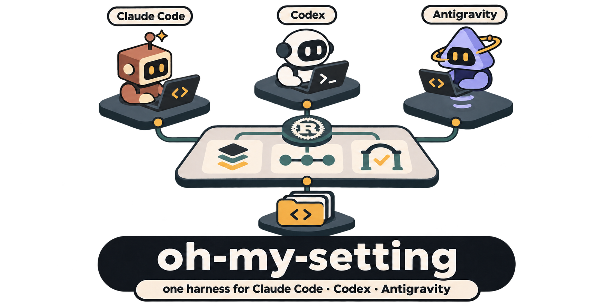
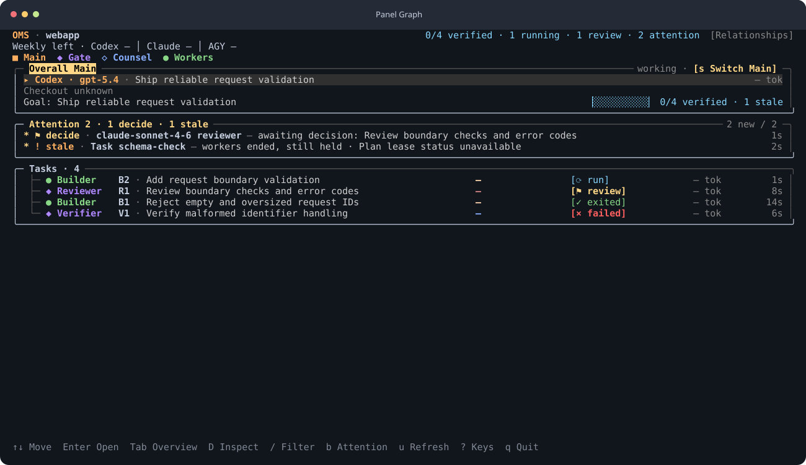
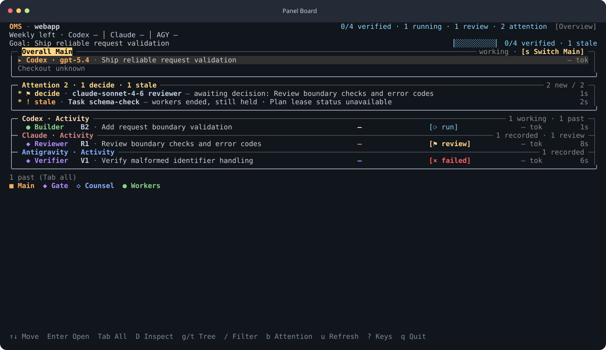
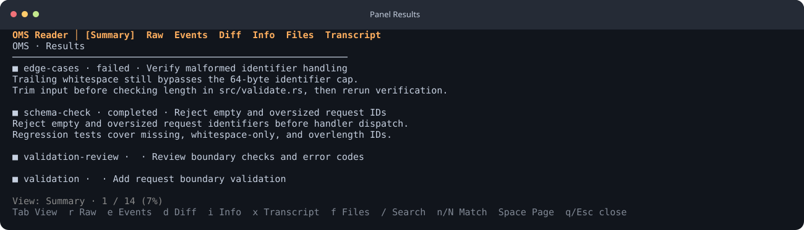
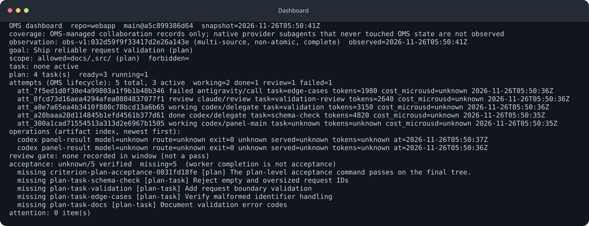

<p align="center"></p>

<p align="center">
  <a href="https://github.com/eightmm/oh-my-setting/actions/workflows/test.yml"></a>
  
  
  <a href="LICENSE"></a>
</p>

<p align="center"><a href="README.ko.md">한국어</a></p>

**oh-my-setting (`oms`)** is a native Rust multi-agent harness that lets **Codex**, **Claude Code**, and **Antigravity** share project rules, task plans, isolated worker worktrees, independent review gates, and verified landings. Run **`oms`** in any repository to inspect work in progress and move reviewed changes cleanly to completion.

---

## Highlights

| Capability | What it gives you | Guide |
|---|---|---|
| **Control Panel (`oms`)** | Interactive TUI for live main, worker, and council calls, attention alerts, provider quota windows, and diff/artifact inspection | [Panel guide](docs/TERMINAL-PANEL.md) |
| **Role-Routed Parallel Workers** | Isolated `.oms/tmp` Git worktrees, non-overlapping scope checks, warm Cargo target slots, and per-main WIP pacing (`WIP_LIMIT = 10`, override via `OMS_PANEL_WIP_LIMIT`) | [Role routing](custom-skills/oms-agent-harness/references/provider-routing.md) |
| **Independent Councils & Gates** | Cross-family debate (`oms peer-ask --debate`), review gates (`oms peer-review --gate`), and two-phase admission (`oms patch-admit` / `oms patch-land`) | [Components](docs/COMPONENTS.md#asking-other-agents) |
| **State, Fleet & HPC** | Unified dashboard (`oms dashboard`), Work Journal and handoffs, dataset/leakage checks, remote SSH/Slurm projections, and typed runtime contracts | [Dashboard](docs/DASHBOARD.md) · [Journal](docs/WORK-JOURNAL.md) · [Runtime](docs/OMS-RUNTIME.md) |
| **Verified Landing** | Single-command gating, push, and CI wait via `oms land`, plus reversible install, update, and uninstall | [Release landing](docs/COMPONENTS.md#verification-and-release) |

---

## Quick start

```bash
curl -fsSL https://raw.githubusercontent.com/eightmm/oh-my-setting/main/install.sh | bash
```

Then open Codex, Claude Code, or Antigravity inside a project directory and say: **“Start this project.”**

| Host | Requirements |
|---|---|
| **Linux (glibc, Ubuntu 20.04+)** | Bash 5.0+, `curl`, `git`, `tar`, `gzip`. |
| **macOS** | Bash 5.0+ (`brew install bash`), `curl`, Command Line Tools (`xcode-select --install`). |
| **Windows via WSL2** | A glibc Linux distro on WSL2 filesystem (native Windows Git Bash / MSYS2 is refused). |

OMS compiles and runs as a self-contained native Rust CLI (`~/.local/bin/oms`); it requires no system Python setup and leaves system runtimes untouched. See [docs/INSTALL.md](docs/INSTALL.md) for installation profiles and details.

<details>
<summary>What the installer configures (and restores on uninstall)</summary>

- **Global rules:** `~/.claude/CLAUDE.md`, `~/.codex/AGENTS.md`, and `~/.gemini/AGENTS.md` symlink to OMS shared rules. Existing files are backed up to `<file>.backup.<timestamp>` and restored by `oms uninstall`.
- **Provider integrations:** Installs hooks, status-line HUD, plugins, and `oms-*` skills across Claude Code, Codex, and Antigravity, and registers the native `oms` MCP server for Claude Code and Codex.
- **Native CLI & state:** Installs the `oms` binary under `~/.local/bin` and stages local artifacts under `~/.oh-my-setting` without touching global system Python.
- **Daily updates:** Clean checkouts fast-forward automatically when enabled (opt out with `| bash -s -- --no-auto-update`). See [migration notes](docs/MIGRATION.md#07) for release changes.

</details>

```bash
oms doctor       # Verify harness wiring and provider readiness
oms update       # Fast-forward clean installation and restage binary
oms uninstall    # Remove managed links and restore backed-up config files
```

---

## How it works

<p align="center"></p>

1. **Onboard (`PROJECT.md`):** Empty folders run a concise spec interview; existing repositories are inspected first and asked only about genuine gaps; active projects resume from retained state.
2. **Delegate in parallel:** Write tasks launch in detached `.oms/tmp` Git worktrees with non-overlapping path scopes while read-only researchers run freely without consuming write WIP slots.
3. **Verify independently:** Candidate patches undergo automatic diff-based checks and cross-family review (`oms peer-review --gate`) plus isolated base/candidate re-verification (`oms patch-admit` -> `oms patch-land`).
4. **Land cleanly:** `oms land` pushes committed work, waits for CI, and records journal & handoff state so the next agent starts with verified context. Nothing merges or releases without explicit user authority.

<details>
<summary>Example prompts you can use</summary>

```text
Start this project.
Run a peer review of the current diff.
Ask all three models with one debate round: vector DB or pgvector?
Delegate this to codex: add input validation to scripts/train.py.
Take this confirmed PROJECT.md through implementation to a Draft PR.
Check this dataset's group split for leakage before I train.
Wait for Slurm job 12345, then digest its log and report.
Update oh-my-setting and re-run its doctor.
```

</details>

---

## Control panel

Launch `oms` (or `oms panel --watch`) to monitor live main/worker trees, unread attention items, provider quota windows, and plan progress in one flicker-free terminal view.

<p align="center"></p>

<details>
<summary>Results reader and dashboard previews</summary>

- **Results & Diff Reader:** Inspect verified summaries, raw transcripts, files changed, and redacted diffs directly inside the panel.

<p align="center"></p>

- **Project Dashboard (`oms dashboard`):** Track goal contracts, plan readiness, recent attempts, fleet status, and suggested next commands.

<p align="center"></p>

</details>

---

## Repository structure

```text
.
├── Cargo.toml             # Workspace root for all native Rust crates
├── crates/                # Native oms binary and modular control-plane crates
├── scripts/               # Thin Bash launcher (`scripts/oms`) and check gates
├── custom-skills/         # Shared `oms-*` skills and provider references
├── roles/                 # Bundled role definitions (builder, reviewer, advisor, ...)
├── templates/             # Project contract and workflow templates
├── config/                # Default panel routing and task routing policies
├── docs/                  # Architecture, CLI, install, and panel documentation
└── tests/                 # Focused Bash portability and lifecycle smoke suites
```

See the [documentation index](docs/README.md) for detailed guides and [CONTRIBUTING.md](CONTRIBUTING.md) for local verification and contribution rules.
Experimental [Codex harness launcher](docs/CODEX-HARNESSES.md) (`oms harness claude --model ...`) is also available for running Codex models inside alternative CLIs.

## Design principles

- **Local-first & isolated:** Operates over local files and provider CLIs by default; write workers stay inside detached worktrees and declared path scopes.
- **Outbound secret & path protection:** Built-in scrubbers keep credentials, private data, and local machine paths out of commits, reviews, and peer prompts.
- **No silent self-approval:** Workers never mark their own patches accepted or push changes to shared branches without explicit owner/user authority.

If oh-my-setting helps your workflow, a ⭐ on [GitHub](https://github.com/eightmm/oh-my-setting) is appreciated.
