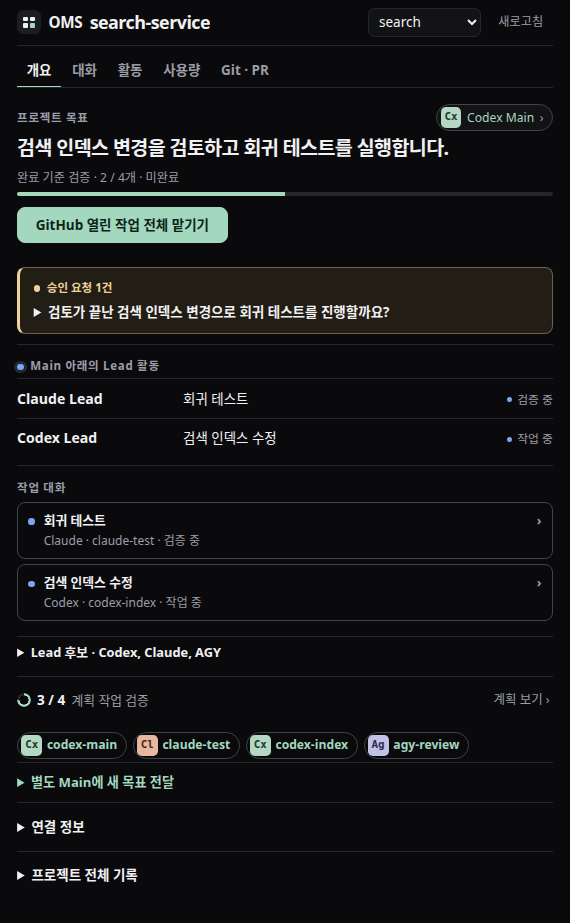

<p align="center"></p>

<p align="center">
  <a href="https://github.com/eightmm/oh-my-setting/actions/workflows/test.yml"></a>
  
  
  <a href="LICENSE"></a>
</p>

<p align="center"><a href="README.ko.md">한국어</a></p>

**oh-my-setting (`oms`)** is a native Rust multi-agent harness that lets **Codex**, **Claude Code**, and **Antigravity** share project rules, task plans, isolated worker worktrees, independent review gates, and verified landings. One **OMS panel** shows that work wherever you run it: in the terminal, and as an MCP App inside the Codex desktop app, ChatGPT Work, Claude Desktop and the Antigravity App.

---

## What you can do

| Task | OMS tools and behavior | Guide |
|---|---|---|
| **Run a project from the panel** | `oms` opens the panel in the terminal; in the Codex desktop app and ChatGPT Work, `@OMS` drives the same Main from chat, and other agent apps show a read-only view ([One panel, every host](#one-panel-every-host)). In the terminal, pick an installed Codex, Claude Code, Antigravity (Agy), or gateway-backed Pi Main. In a managed tmux panel, OMS can open native provider leads in the background and reconnect to a live Main. Board and Detail show weekly quota, token usage, and activity when provider or OMS records support them. | [Terminal panel](docs/TERMINAL-PANEL.md) |
| **Delegate and route work** | The Overall Main manages: it assigns scoped work, reviews evidence and decides acceptance without editing the repository itself. Provider leads run one assignment each and coordinate supported native workers. `oms peer-delegate` isolates builder changes. Inspect role profiles with `oms agent-role` and quota-aware routing with `oms panel --routes`. Use `oms connect-services` to register distinct Codex, Claude, and Pi account homes for routing. Sign in to Codex, Claude Code, or Antigravity from the panel with `L`, or with `oms connect-services --login PROVIDER`; this uses the default account home. | [Main policy](docs/TEAM-ORCHESTRATION-MAIN-POLICY.md) · [Routing](docs/TERMINAL-PANEL.md#roles-and-automatic-allocation) · [Accounts](docs/TERMINAL-PANEL.md#provider-accounts) |
| **Get independent advice and review** | `oms consult` asks one peer. `oms peer-ask --debate` compares provider responses. `oms peer-review` requests independent diff review. The Overall Main integrates review findings and decides acceptance. | [Peer collaboration](docs/COMPONENTS.md#asking-other-agents) |
| **Capture project intent and find affected code** | `oms init` sets up project policy. `PROJECT.md` records the agreed scope, decisions, and verification. `oms graph project` finds symbols, dependencies, and affected paths, and `oms runtime context` builds bounded context for a task. | [Project context](docs/PROJECT-CONTEXT.md) · [Graph guide](docs/GRAPH-ENGINEERING.md#project-graph) |
| **Plan, track, and hand off work** | `oms agent-plan` tracks dependencies and review state. `oms inbox` and `oms dashboard` surface work that needs attention. `oms agent-task`, `oms journal`, and `oms session-handoff` preserve resume notes, work history, and session summaries. | [Planning](docs/COMPONENTS.md#plans-and-bounded-autonomy) · [State and handoff](docs/COMPONENTS.md#state-memory-and-handoff) |
| **Verify and publish changes** | `oms patch-admit` and `oms patch-land` check and apply delegated patches. `oms land` gates a committed change, opens an authorized GitHub pull request and waits for CI; it merges only with `--merge`. `oms draft-pr` publishes a verified HEAD as a draft PR when authorized. | [Verification and release](docs/COMPONENTS.md#verification-and-release) |
| **Install and maintain OMS** | Choose capability profiles, inspect configuration with `oms status` and `oms doctor`, update through `oms update`, and restore managed configuration with `oms uninstall`. | [Installation and updates](docs/INSTALL.md) |
| **Extend into optional workflows** | `oms runtime` exposes task evidence, experiments, and supported execution backends. `oms recipe` and `oms autopilot` run explicit workflows. Research and HPC tools cover dataset checks, local queues, remote SSH targets, and Slurm submission and reconciliation. `oms harness` provides an experimental Codex inference bridge for Pi and Claude Code. | [Runtime](docs/OMS-RUNTIME.md) · [Recipes](docs/RECIPES.md) · [ML and HPC](docs/COMPONENTS.md#ml-and-hpc-components) · [Alternate harnesses](docs/CODEX-HARNESSES.md) |

---

## Quick start

```bash
curl -fsSL https://raw.githubusercontent.com/eightmm/oh-my-setting/main/install.sh | bash
```

In a Git repository, run `oms` to open the terminal panel. You can also open Codex, Claude Code, or Antigravity in a project directory and ask it to **“Start this project.”**

| Host | Requirements |
|---|---|
| **Linux (glibc, Ubuntu 20.04+)** | Bash 5.0+ and `curl`. The installer can add missing `git`, `tar`, `gzip`, and `find` with root or sudo. |
| **macOS** | Bash 5.0+ (`brew install bash`), `curl`, Command Line Tools (`xcode-select --install`). |
| **Windows via WSL2** | A glibc Linux distro on WSL2 filesystem (native Windows Git Bash / MSYS2 is refused). |

OMS runs as a native Rust CLI at `~/.local/bin/oms`. The core commands require no system Python setup. The default `core` install provisions one coding-agent provider, and the managed panel uses tmux. [Installation guide](docs/INSTALL.md)

Agent apps can show the same OMS panel; see [One panel, every host](#one-panel-every-host).

<details>
<summary>What the installer configures</summary>

- **Global rules** link provider files to OMS shared rules. The installer backs up existing files to `<file>.backup.<timestamp>` so `oms uninstall` can restore them.
- **Provider integrations** set up available skills, hooks, HUDs, plugins, and MCP server registrations according to the provider and install options.
- **Native CLI** uses the managed checkout at `~/.oh-my-setting` and the launcher under `~/.local/bin`.
- **Scheduled updates** require successful CI for the selected SHA and preserve local checkout edits. Pass `--no-auto-update` to the installer to skip scheduling. [Update policy](docs/INSTALL.md#verification-policy)

</details>

```bash
oms doctor       # Verify harness wiring and provider readiness
oms update       # Update the OMS installation through its configured ref
oms uninstall    # Remove managed links and restore backed-up config files
```

---

## One panel, every host

The goal of oh-my-setting is one project panel that follows you between agents. The Rust runtime keeps the project state (goal, plan, attempts, reviews, usage) and reads Git and GitHub status live, and every host draws its view from OMS instead of keeping its own copy. In the terminal, `oms` opens the full Board with Main selection and switching, provider overview, quota, and the results reader ([In the terminal](#in-the-terminal) · [guide](docs/TERMINAL-PANEL.md)). Agent apps receive the panel from `oms mcp-server` as an MCP App, and the Claude Code pane reads OMS on the same machine.

`oms --version` prints the release shared by the runtime and bundled plugins, while the panel resource suffix (for example, `v27`) identifies cached UI content. Hooks and panel plugins are independent, so projects can use the panel without enabling hooks.

### Plugins and integrations

| Plugin or marketplace entry | Host | What it adds | How to install | Manifest |
|---|---|---|---|---|
| **`oms@oh-my-setting-local`** | Codex desktop, ChatGPT Work (local OMS) | Interactive [MCP App panel](docs/assets/oms-chat-panel.png) plus `@OMS` (`oms-connect`, `oms-project` skills): choose a Main, give it a goal, follow its Leads, and decide approvals from chat | Marketplace: import the repository root catalog and install **OMS** ([guide](docs/DASHBOARD.md#oms-in-codex-and-chatgpt-work)) | [`plugins/oms/plugin.json`](plugins/oms/plugin.json) · [`.agents/plugins/marketplace.json`](.agents/plugins/marketplace.json) |
| **`oms@oms-ssh`** | Codex desktop, ChatGPT Work (remote OMS over SSH) | Same interactive [MCP App panel](docs/assets/oms-chat-panel.png) plus `@OMS` over the `oms-runtime` OpenSSH host alias | Marketplace: import catalog path `plugins/oms-ssh` and install **OMS** ([guide](docs/DASHBOARD.md#oms-in-codex-and-chatgpt-work)) | [`plugins/oms-ssh/oms/plugin.json`](plugins/oms-ssh/oms/plugin.json) · [`plugins/oms-ssh/.agents/plugins/marketplace.json`](plugins/oms-ssh/.agents/plugins/marketplace.json) |
| **`oms-panel`** (`plugins/oms-app`) | Claude Desktop, Antigravity App 2.34+ | Read-only [MCP App panel](docs/assets/oms-chat-panel.png) (projects, Board, Git and GitHub, usage, command catalog) inline, expanded, or as a side panel where the host and account allow it; checked-in config uses `oms-runtime` SSH | Manual: add `oms-panel` from `mcp_config.json` in Claude Desktop, or install `plugins/oms-app` in Antigravity App ([guide](docs/DASHBOARD.md#claude-and-antigravity)) | [`plugins/oms-app/plugin.json`](plugins/oms-app/plugin.json) · [`plugins/oms-app/mcp_config.json`](plugins/oms-app/mcp_config.json) |
| **`oms-panel@oh-my-setting`** | Claude Code v2.1.287+ | Read-only `oms-panel` pane beside the transcript (`/oms-panel`), drawn from `oms dashboard --json` | Marketplace: `claude plugin marketplace add eightmm/oh-my-setting`, then `claude plugin install oms-panel@oh-my-setting` at user scope (or local `claude --plugin-dir plugins/claude-code`; [README](plugins/claude-code/README.md)) | [`plugins/claude-code/.claude-plugin/plugin.json`](plugins/claude-code/.claude-plugin/plugin.json) · [`.claude-plugin/marketplace.json`](.claude-plugin/marketplace.json) |
| **`oh-my-setting@oh-my-setting-local`** | Codex CLI, Codex desktop | Harness hooks (`OMS Hooks`): skill routing, pre-compaction handoff, turn guards, and content-free lifecycle counters | Installer: registered automatically when `codex` is on `PATH` ([install guide](docs/INSTALL.md)) | [`plugins/oh-my-setting/.codex-plugin/plugin.json`](plugins/oh-my-setting/.codex-plugin/plugin.json) · [`.agents/plugins/marketplace.json`](.agents/plugins/marketplace.json) |
| **`oh-my-setting`** (`plugins/antigravity`) | Antigravity CLI, Antigravity IDE | Harness state over MCP: task packet, fail-ledger, handoff digests, and Work Journal | Installer: installed automatically when Antigravity is present ([install guide](docs/INSTALL.md)) | [`plugins/antigravity/plugin.json`](plugins/antigravity/plugin.json) |
| **`oms-skills@oh-my-setting`** | Claude Code (plugin-only skill setups) | Optional shared `oms-*` skills bundle; requires `oms` installed, and is not needed on normal installs where linked skills would appear twice | Marketplace (manual, optional): `claude plugin marketplace add eightmm/oh-my-setting`, then `claude plugin install oms-skills@oh-my-setting` ([note](docs/COMPONENTS.md#local-skills-and-optional-bundle-operations)) | [`.claude-plugin/marketplace.json`](.claude-plugin/marketplace.json) |

### In the terminal

Run `oms` in a foreground terminal with tmux and pick an installed Main. When
OMS verifies a running Main, Enter selects **Continue current Main**;
`oms panel --reopen` restores the Board without the picker, and
`OMS_PANEL_MAIN` preselects a harness. [Startup and recovery](docs/TERMINAL-PANEL.md#default-main-selection)

With a verified managed Codex Main, press `s` on the Board, pick a target such
as AGY and press `Y`; from an AGY, Claude or Pi Main, exit it and choose the
next harness at startup. [Main switching](docs/TERMINAL-PANEL.md#swap-the-main)

**Direct work** lists calls Main assigned itself (Enter opens the result),
**Needs you** links items that wait for input, and `w` shows reported weekly
quota; missing readings stay unknown. `oms panel --watch` opens a standalone
Board. [Panel controls](docs/TERMINAL-PANEL.md#keys)

`oms list` shows the everyday commands; `oms list --all` the full catalog. [Command catalog](docs/COMPONENTS.md)

<p align="center"></p>

<details>
<summary>MCP App, results reader, and dashboard previews</summary>

- **MCP App panel (`oms mcp-server`)** shows the project goal, claimed plan tasks, result availability, and project map inside Codex desktop, ChatGPT Work, Claude Desktop, and the Antigravity App.

<p align="center"></p>

- **Results and diff reader** opens retained summaries, changed files, masked diffs, and captured transcripts where available.

<p align="center"></p>

- **Project dashboard (`oms dashboard`)** shows the goal, plan readiness, recent attempts, and suggested next commands. [Dashboard guide](docs/DASHBOARD.md)

<p align="center"></p>

</details>

---

## How it works

<p align="center"></p>

1. **Agree on the goal.** For a new project, the agent can conduct a short requirements interview. For an existing repository, it reads project policy, source, and retained state first. Record agreed constraints and completion checks in `PROJECT.md`.
2. **Assign work in parallel.** Give builders distinct path scopes and assign read-only investigation and review separately. Write delegates run in detached Git worktrees under `${XDG_CACHE_HOME:-$HOME/.cache}/oh-my-setting/worktrees` by default.
3. **Check the result.** Run affected checks and request independent review where the change requires it. Admit a delegated patch against its scope and evidence before applying it.
4. **Land and hand off.** Use `oms land` to publish the verified change as an authorized pull request; merge with `--merge` only when asked. Record the delivery evidence and remaining work in the journal or handoff so the next session can resume.

<details>
<summary>Example prompts you can use</summary>

```text
Start this project.
Run a peer review of the current diff.
Ask all three models with one debate round: vector DB or pgvector?
Delegate this to codex: add input validation to scripts/train.py.
Take this confirmed PROJECT.md through implementation to a Draft PR.
Check this dataset's group split for leakage before I train.
Wait for Slurm job 12345, then digest its log and report.
Update oh-my-setting and re-run its doctor.
```

</details>

---

## Repository structure

```text
.
├── Cargo.toml             # Workspace root for all native Rust crates
├── crates/                # Native oms binary and modular control-plane crates
├── scripts/               # Thin Bash launcher (`scripts/oms`) and check gates
├── custom-skills/         # Shared `oms-*` skills and provider references
├── roles/                 # Bundled role definitions (builder, reviewer, advisor, ...)
├── templates/             # Project contract and workflow templates
├── config/                # Default panel routing and task routing policies
├── docs/                  # Architecture, CLI, install, and panel documentation
└── tests/                 # Focused Bash portability and lifecycle smoke suites
```

See the [documentation index](docs/README.md) for detailed guides and [CONTRIBUTING.md](CONTRIBUTING.md) for local verification and contribution rules.

## Design principles

- **Local-first and scoped.** OMS coordinates local files and native provider CLIs. Write delegates have a detached worktree and a declared path scope.
- **Protected outbound data.** Scrubbers check outbound text for secret patterns and mask local paths on supported surfaces. [Security boundary](docs/COMPONENTS.md#security-boundary)
- **Explicit ownership.** Workers return changes and evidence. The owner controls patch acceptance and acts within the user's publication authority.

If oh-my-setting helps your workflow, a ⭐ on [GitHub](https://github.com/eightmm/oh-my-setting) is appreciated.
