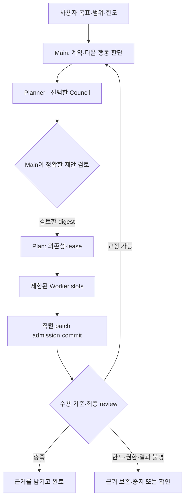

# 단일 프로젝트 자율 실행 엔진

이 문서는 **승인된 한 프로젝트의 목표를 계획·실행·검증·교정·종료까지 이어가는
기존 OMS 실행 경로**와 그 완료 기준을 설명한다. 구현 경로는 `autopilot →
goal-drive → plan-run → peer-delegate → patch-land`이며, canonical Plan이
task·lease·완료를 소유한다. UI와 상주 서비스는 이 엔진의 별도 소비자다.

여기서 자율 실행은 Main 에이전트가 사용자의 범위와 권한 안에서 다음 행동을
판단하고 진행하는 방식이다. 제안 검토와 복구는 Main의 일이며 매 단계 사용자의
확인을 요구하지 않는다. 새 목표, 권한 확대, 별도로 승인하지 않은 외부 게시가
필요할 때만 사용자 판단으로 돌아간다.

아래 표는 **소스에 구현된 계약과 이를 검사하는 테스트**를 연결한다. 테스트가
정의되어 있다는 사실과 해당 변경의 검증 통과는 다르므로, 통과 여부는 그
commit의 `./verify`와 CI 기록으로 확인한다.

## 실행 흐름과 책임



| 담당 | 실행 중 책임 |
|---|---|
| Main | 계약과 제안 검토, 작업 배분, 교정 선택, 통합 결과 확인, 허용된 게시 |
| Planner / Council / Lead | 범위 안의 분해·대안·비판·근거 제공. Lead의 검토 문맥은 정확한 task·Room·digest에 결합한다. |
| Worker | 배정된 scope·route·lease에서 구현하고 검증 자료를 반환한다. 자체 완료 승인이나 권한 확대는 하지 않는다. |
| Rust runtime | claim, 충돌 배제, 예산 예약, evidence binding, admission, 완료 전이, 재시작 기록을 강제한다. |

대화가 열린 native Lead와 canonical task를 맡은 Worker는 같은 상태가 아니다.
native Lead의 자식 실행·격리·cleanup은 해당 provider/host의 확인된 capability를
따른다. 기본 자율 실행 경로에 항상 세 Lead나 재귀적인 agent 조직이 필요한 것은
아니다. 자세한 역할 경계는 [Feature scope](FEATURE-SCOPE.md#roles-and-authority)를 따른다.

## 이번에 연결한 경계

| 경계 | 동작 |
|---|---|
| 목표 실행의 병렬성 | `goal-drive`와 `autopilot`의 `--max-writers 1..16`으로 독립 작업을 제한해 병렬 실행한다. 기본값은 1이다. 기존 receipt에서 필드가 없으면 1로 해석하며 resume 중 바꿀 수 없다. |
| 병렬 결과의 통합 | 실행 중이거나 review에 남은 작업의 scope·resource와 충돌하는 새 작업은 시작하지 않는다. 한 실행 window의 결과를 현재 HEAD에서 직렬 admission·commit한 뒤 다음 window로 간다. worker 실패 시 새 claim을 멈추고 이미 얻은 결과와 근거를 보존한다. |
| 완료 판정 | acceptance가 먼저 통과해도 canonical Plan의 미완료 task를 남긴 채 성공하지 않는다. task는 `done` 또는 정식 `cancelled` 상태여야 하며, 취소 자체는 criterion을 만족했다는 증거가 아니다. |
| 재시작과 cycle 예산 | worker 호출 전에 task attempt를 예약한다. 병렬 실행도 작업 수만큼 같은 한도를 사용하고 중단된 예약은 환불하지 않는다. standalone의 동일한 `--run-id`는 Plan·task 계약·acceptance·branch·route·한도를 고정한다. autopilot은 원래 owner의 누적 한도를 유지한다. |
| campaign의 남은 시간 | candidate용 scratch 생성과 verifier도 저장된 `started_at + deadline_s`의 남은 시간으로 제한한다. 만료 후 통과 응답이 와도 solved handoff를 발행하지 않는다. scratch 소유권 해제를 위한 제한된 cleanup은 계속 수행한다. |

일반 `plan-run --parallel`은 기존처럼 빈 slot을 채우는 독립 진입점이다.
goal-drive는 그 실행기를 재사용하면서 review를 먼저 통합하는 window와 목표의
누적 attempt 한도를 추가한다. `--max-writers`는 선택한 상한이며, 모델이 난이도를
판단해 인원 수를 자동 조절한다는 뜻은 아니다.

## 1단계의 10개 완료 기준

| 능력 | 구현과 완료 판정 | 대표 소스·회귀 근거 |
|---|---|---|
| Autonomous Main | 확인된 계약에서 제안하고, Main이 검토한 digest만 적용한다. 초기·교정 작업, acceptance, 최종 review가 동일 owner 아래 이어져야 한다. | [receipt][receipt], [native fixture][native-tests]의 `native_autopilot_review_repair_calls_the_worker_after_acceptance_passes` |
| Lead Council | 선택한 seat·round의 native artifact와 synthesis를 검증하고 대안·반론·불일치를 보존한다. 미완성 Council은 계획 실행을 승인하지 못한다. | [planning][planning], [autonomy contract][autonomy-tests]의 `council_evidence_requires_exact_rounds_and_native_output_bindings`, `reviewed_lead_context_is_pinned_before_claim_and_again_before_dispatch` |
| Dynamic Swarm | 준비된 독립 작업을 정해진 slot 상한 안에서 수행하고 scope·resource 충돌을 배제한다. review 중인 결과도 충돌 영역을 점유한다. | [parallel][parallel], [parallel fixture][parallel-tests]의 `goal_drive_parallel_windows_hold_review_scopes_until_serial_integration`, `overlapping_resources_never_run_together` |
| Task Lifecycle | Plan의 의존성·claim·lease·review·landing·완료 전이를 사용한다. acceptance 통과만으로 남은 task를 건너뛰지 못한다. | [Plan engine][plan], [parallel fixture][parallel-tests]의 `goal_drive_closes_reviewed_work_before_success_and_preserves_lifetime_budget` |
| Execution Contract | task·lease·frozen base·scope·검증 증거를 재확인한다. 오래된 결과나 다른 작업의 근거를 현재 완료로 바꾸지 못한다. | [runner][runner], [autonomy contract][autonomy-tests]의 `plan_run_never_rebinds_a_selected_review_or_worker_operation`, [combined verification][combined-tests] |
| Persistent Memory | goal/Plan/progress/receipt가 실행 상태를 보존한다. journal·eligible memory는 출처와 현재 적용 가능성을 검사한 계획 참고 자료다. | [adaptive][adaptive], [native fixture][native-tests]의 위 review-repair 시나리오가 source-checked experience 전달과 stale 문맥 배제를 확인한다. |
| Self-recovery | 같은 owner·lease·commit intent를 재조정한다. 전송 결과가 불명확하면 재전송하지 않고, 재시작해도 예약·교정 한도를 보존한다. | [receipt tests][receipt]의 `adaptive_revision_reservation_crash_replays_without_refund_or_provider_resend`, [autonomy contract][autonomy-tests]의 `plan_run_retains_exact_running_lease_on_unknown_worker_outcome` |
| Adaptive Reasoning | Main은 계획 Council 필요성을 선택한다. 지원되는 writer route에서는 기존 risk 기반 adaptive review를 사용하되 gate의 독립 reviewer와 기계 검증을 유지한다. | [peer review][peer-review], [peer contract][peer-tests]의 `adaptive_review_bounds_calls_and_keeps_gate_requirements` |
| Budget Management | goal attempt, 동시 writer, provider wall, campaign call/deadline과 선택적 usage admission을 각각 검사한다. 한도의 종류를 혼동하지 않는다. | [goal][goal], [campaign usage fixture][campaign-tests]의 `campaign_deadline_bounds_verifiers_and_keeps_cleanup_after_expiry`, `timeout_abandonment_and_unpriced_calls_keep_liabilities_across_restart` |
| Human Escalation | Main이 최신 decision digest의 허용 행동을 선택한다. 권한 밖의 판단은 사용자에게 돌리고, 명시한 stop은 자동으로 깨우지 않는다. | [receipt tests][receipt]의 `adaptive_decision_cas_stop_and_consumed_experiment_keep_existing_authority`, `reentry_refusal_orders_stage_digest_gate_and_controller_lock` |

## Main 내부 운영 예시

다음 명령은 에이전트가 수행한다. 사용자가 proposal 파일이나 내부 상태를 직접
다룰 필요는 없다. 먼저 confirmed `PROJECT.md`, 실제로 실행 가능한 acceptance,
필요한 verifier 파일, 사용 가능한 provider와 Git의 repository-local commit
identity를 확인한다. GitHub project mode라면 task의 issue binding도 필요하다.

```bash
oms autopilot --repo . --allowed src,tests --base main \
  --planner claude --worker claude --reviewer codex --review-mode gate \
  --collaboration auto --council-providers claude,codex --council-rounds 1 \
  --max-cycles 6 --max-writers 2 propose
```

Main이 실제 제안의 작업·의존성·범위·검증과 digest를 읽고, 출력된 continuation을
사용한다. 아래 대문자 표기는 검토한 실제 값으로 대체하는 자리다.

```bash
oms autopilot --repo . run --proposal PROPOSAL_PATH \
  --expected-proposal-sha256 REVIEWED_SHA256
oms autopilot --repo . status
```

`propose`의 exit 4는 Main의 검토 경계다. parked 상태에서는 최신 `next_action`과
근거를 확인해 `inspect`, `propose-revision`, `wait`, `resume`, `stop` 중 허용된
행동을 선택한다. 한 번의 bounded remainder도 검토한 제안으로만 적용한다.
동일 run의 한도를 늘리거나 새 owner로 재시작하여 소진 기록을 지우지 않는다.
`--retry-known`도 무조건 재시도하지 않는다. 병렬 작업 일부를 통합해 HEAD가
이동했다면 실패한 sibling의 기존 retry proof는 inspection hold로 남을 수 있다.

이미 검토된 Plan만 실행하려면 Main이 `goal-drive --run-id ID --max-cycles N
--max-writers N`을 사용한다. 재개에는 같은 run id와 같은 계약을 사용한다.
`--max-writers`를 생략하면 기존 직렬 실행이다. 기존 review를 통합하는 작업은
새 worker attempt를 소비하지 않는다.

이 예시는 로컬 구현·commit까지다. 승인된 Draft PR 게시가 필요할 때만 초기
autopilot 계약에 `--draft-pr`를 포함한다. 이 경로에는 merge, ready 전환, tag,
release 기능이 없다.

## 검증과 운영상 한계

변경한 범위의 회귀를 먼저 실행하고, 최종 통합본에는 루트 검증을 실행한다.

```bash
cargo +1.99.1 test --locked --offline -p oms-command-autonomy
cargo +1.99.1 test --locked --offline -p oms --test native_entry_contract native_autopilot
./verify
```

`./verify`는 workspace type check, architecture lint, unit/integration,
core E2E를 순서대로 검사한다. `fmt`/`clippy`와 PR의 affected gate도 저장소의
기존 절차를 따른다. fixture는 native CLI와 실제 Git/Plan/receipt 경계를
검사하지만 provider의 답변은 제어된 대역일 수 있다.

| 주장 | 별도로 필요한 근거 |
|---|---|
| 실제 provider가 장시간 자율 수행한다 | 해당 provider·model·host에서 실행한 목표, 사용량, review와 결과 기록 |
| native Lead의 모든 자식이 관리·격리·정리된다 | 그 host의 실제 child lineage와 supervision 증거 |
| macOS에서도 같은 감독 계약이 성립한다 | 지원되는 native service adapter와 해당 host의 실행 검증 |
| 일반 autopilot이 총 token·금액을 강제로 막는다 | 현재 제공하지 않는 계약이다. cycle 수는 비용이 아니며 campaign의 선택적 usage 제한도 soft admission이다. |
| Main이 없어도 계속 운영된다 | 별도 상주 실행·스케줄러 계약이 필요하다. 현재 흐름은 실행 중인 Main의 감독을 전제로 한다. |

확인되지 않은 모델의 독립성이나 live-provider 성능을 테스트 통과로 대신하지
않는다. 프로젝트 목표 달성은 정해진 acceptance, 필요한 task 완료, 근거에 결합된
최종 review로 판단한다. 다음 단계의 UI는 이 상태와 결정을 표현하고 기존 실행
진입점을 호출한다.

[goal]: ../crates/oms-command-autonomy/src/goal.rs
[receipt]: ../crates/oms-command-autonomy/src/receipt.rs
[planning]: ../crates/oms-command-autonomy/src/planning.rs
[runner]: ../crates/oms-command-autonomy/src/runner.rs
[parallel]: ../crates/oms-command-autonomy/src/parallel.rs
[adaptive]: ../crates/oms-command-autonomy/src/adaptive.rs
[plan]: ../crates/oms-command-plan/src/engine.rs
[autonomy-tests]: ../crates/oms-command-autonomy/tests/autonomy_contract.rs
[parallel-tests]: ../crates/oms-command-autonomy/tests/parallel_run.rs
[combined-tests]: ../crates/oms-command-autonomy/tests/combined_verification.rs
[campaign-tests]: ../crates/oms-command-autonomy/tests/campaign_usage.rs
[native-tests]: ../crates/oms/tests/native_entry_contract.rs
[peer-review]: ../crates/oms-command-peer/src/review.rs
[peer-tests]: ../crates/oms-command-peer/tests/peer_contract.rs
