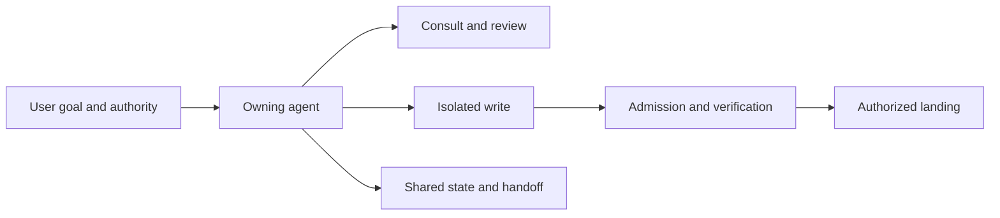

# Components

This catalog is for people using or maintaining the oh-my-setting (OMS) harness.
It maps each command to its purpose and detailed guide; OMS shares rules, state,
peer workflows and bounded patch handling across installed coding-agent CLIs,
with one verification boundary for OMS-managed delegated patches. The
[Codex harness launcher](CODEX-HARNESSES.md) runs Pi and Claude Code through an
invocation-scoped local gateway; the selected harness keeps its tool permissions.
Work rooms can also deliver to an explicitly enrolled
[Claude Desktop Code or terminal inbox](TERMINAL-PANEL.md#claude-desktop-code-and-claude-code-terminal-delivery),
with separate delivery receipts and an explicit opt-in to possible model wakeup.

## In this guide

| What you need | Read next |
|---|---|
| Set up or update OMS | [Install guide](INSTALL.md) · [한국어](INSTALL.ko.md) |
| Use the control panel | [Panel guide](TERMINAL-PANEL.md) |
| Ask for advice or review | [Asking other agents](#asking-other-agents) |
| Delegate implementation | [Delegating writes](#delegating-writes) |
| Run an approved plan | [Plans and bounded autonomy](#plans-and-bounded-autonomy) |
| Verify and publish | [Verification and release](#verification-and-release) |
| Inspect or clean up state | [State and memory](#state-and-memory) · [Cleanup](#cleanup) |

**Command catalog**

- [Panel and collaboration](#panel-and-collaboration)
- [Plans and landing](#plans-and-landing)
- [State and memory](#state-and-memory)
- [ML and HPC](#ml-and-hpc-components)
- [Install, update and doctor](#install-update-and-doctor)
- [Internals](#internals)
- [Architecture and contracts](#how-it-fits-together)

Use `oms list` for the front-door catalog, `oms list --all` for all commands,
and `oms <command> --help` for flags. The
[command-routing reference](../custom-skills/oms-agent-harness/references/command-routing.md)
explains overlapping entrypoints.

## Panel and collaboration

| Component | Purpose | Invoke | Details |
|---|---|---|---|
| `panel` | Open the terminal control panel for live collaboration. | `oms panel` | [Terminal panel](TERMINAL-PANEL.md) |
| `dashboard` | Read a terminal view of OMS collaboration state. | `oms dashboard` | [Panel and collaboration](TERMINAL-PANEL.md#shared-work-rooms-and-the-graph) |
| `inbox` | Prioritize attention from shared state. | `oms inbox` | [State, memory, and handoff](#state-memory-and-handoff) |
| `room` | Share task-scoped messages and room snapshots. | `oms room` | [Work rooms](TERMINAL-PANEL.md#shared-work-rooms-and-the-graph) |
| `intake` | Receive external tracker webhooks into an OMS Room and send outbound-scanned replies with retry-safe receipts. | `oms intake` | [External tracker intake](INTAKE.md) |
| `lease` | Declare time-limited, advisory intent to edit paths. | `oms lease` | [Delegating writes](#delegating-writes) |
| `input` | Capture source-aware attachments, edit steer/next inputs and deliver them explicitly through enrolled rooms; queue imported view feedback. | `oms input` | [Input queue](INPUT-QUEUE.md) |
| `thread` | Read and deliver shared conversation turns. | `oms thread` | [Asking other agents](#asking-other-agents) |
| `consult` | Ask one peer or continue a peer thread. | `oms consult` | [Asking other agents](#asking-other-agents) |
| `peer-ask` | Ask a provider council and save each answer. | `oms peer-ask` | [Asking other agents](#asking-other-agents) |
| `peer-review` | Review a diff with an independent provider council. | `oms peer-review` | [Asking other agents](#asking-other-agents) |
| `advise` | Request an adversarial pass at a decision point. | `oms advise` | [Asking other agents](#asking-other-agents) |
| `agent-call` | Run one read-only local peer call. | `oms agent-call` | [Asking other agents](#asking-other-agents) |
| `peer-delegate` | Send a bounded write task to an isolated worktree. | `oms peer-delegate` | [Delegating writes](#delegating-writes) |
| `agent-supervisor` | Queue and supervise attempts without landing them. | `oms agent-supervisor` | [Delegating writes](#delegating-writes) |
| `agent-events` | Record and project agent lifecycle events. | `oms agent-events` | [Delegating writes](#delegating-writes) |
| `agent-plan` | Maintain a shared task graph. | `oms agent-plan` | [Plans and bounded autonomy](#plans-and-bounded-autonomy) |
| `agent-role` | Manage reusable profiles for the three agent CLIs. | `oms agent-role` | [Models and reasoning effort](#models-and-reasoning-effort) |
| `agent-task` | Maintain the active handoff packet. | `oms agent-task` | [State, memory, and handoff](#state-memory-and-handoff) |
| `approval-inbox` | Request and consume fenced durable approvals. | `oms approval-inbox` | [Plans and bounded autonomy](#plans-and-bounded-autonomy) |

## Plans and landing

| Component | Purpose | Invoke | Details |
|---|---|---|---|
| `autopilot` | Drive bounded coding under plan and landing contracts. | `oms autopilot` | [Plans and bounded autonomy](#plans-and-bounded-autonomy) |
| `goal-drive` | Drive an existing approved plan to its acceptance command. | `oms goal-drive` | [Plans and bounded autonomy](#plans-and-bounded-autonomy) |
| `plan-from-spec` | Propose plan tasks from `PROJECT.md` or discovered work evidence. | `oms plan-from-spec` | [Plans and bounded autonomy](#plans-and-bounded-autonomy) |
| `plan-run` | Execute one pre-authorized plan task. | `oms plan-run` | [Plans and bounded autonomy](#plans-and-bounded-autonomy) |
| `recipe` | Run typed reusable recipes and workspace actions; import versioned local packs, link worksets and create due/event requests. | `oms recipe` | [Recipes and workspaces](RECIPES.md) |
| `patch-admit` | Check delegated patch scope and evidence. | `oms patch-admit` | [Delegating writes](#delegating-writes) |
| `patch-land` | Apply an admitted delegated patch. | `oms patch-land` | [Delegating writes](#delegating-writes) |
| `land` | Gate a committed worktree, publish it as a PR or push, and update. | `oms land` | [Verification and release](#verification-and-release) |
| `sync-shared` | Fetch and fast-forward an idle shared checkout. | `oms sync-shared` | [Verification and release](#verification-and-release) |
| `draft-pr` | Publish a verified clean HEAD as a draft pull request. | `oms draft-pr` | [Verification and release](#verification-and-release) |
| `ci-status` | Read the CI conclusion for a branch HEAD. | `oms ci-status` | [Verification and release](#verification-and-release) |
| `github` | Show GitHub project mode and cached issue/PR state; refresh, adopt merged PRs, post one evidence comment. | `oms github` | [Verification and release](#verification-and-release) |
| `change-guard` | Warn about concurrent agent edits. | `oms change-guard` | [Delegating writes](#delegating-writes) |
| `checkpoint` | Save a reversible snapshot of tracked Git state. | `oms checkpoint` | [Delegating writes](#delegating-writes) |
| `scratch-worktree` | Manage scratch worktrees around active workers, with rate-limited background hygiene on `add`. | `oms scratch-worktree` | [Delegating writes](#delegating-writes) |

## State and memory

| Component | Purpose | Invoke | Details |
|---|---|---|---|
| `state` | View active, stale, pending and changed harness state. | `oms state` | [State, memory, and handoff](#state-memory-and-handoff) |
| `state-verify` | Check consistency of repository harness state. | `oms state-verify` | [State, memory, and handoff](#state-memory-and-handoff) |
| `agent-memory` | Maintain shared harness memory. | `oms agent-memory` | [State, memory, and handoff](#state-memory-and-handoff) |
| `journal` | Read and manage the local-first Work Journal. | `oms journal` | [Work Journal](WORK-JOURNAL.md) |
| `report` | Preview and file a privacy-checked upstream bug or feature request. | `oms report` | [State, memory, and handoff](#state-memory-and-handoff) |
| `fail-ledger` | Record and inspect cross-session failures. | `oms fail-ledger` | [State, memory, and handoff](#state-memory-and-handoff) |
| `artifact-index` | Inspect and maintain indexed harness artifacts. | `oms artifact-index` | [Asking other agents](#asking-other-agents) |
| `output-digest` | Run a command and print a bounded, loss-marking digest of its output; the raw output stays in a local file. | `oms output-digest` | [Command output digests](#command-output-digests) |
| `session-handoff` | Build a compact digest from an agent session. | `oms session-handoff` | [State, memory, and handoff](#state-memory-and-handoff) |
| `session` | Search and bookmark repository-bound native conversations, fork current code with a conversation, and restore files or conversation independently. | `oms session` | [Session exploration](SESSION-EXPLORATION.md) |
| `snapshot` | Record private local context for agents. | `oms snapshot` | [State, memory, and handoff](#state-memory-and-handoff) |
| `gc` | Apply retention to repository-local state. | `oms gc` | [State, memory, and handoff](#state-memory-and-handoff) |

## ML and HPC components

| Component | Purpose | Invoke | Details |
|---|---|---|---|
| `candidate` | Keep per-candidate results from several tools and runs, each linked to its run or receipt. | `oms candidate` | [ML and HPC](#ml-and-hpc) |
| `cite` | Keep per-paper notes, check DOI or arXiv ids, export BibTeX. | `oms cite` | [ML and HPC](#ml-and-hpc) |
| `data-manifest` | Fingerprint dataset splits and detect drift or leakage. | `oms data-manifest` | [ML and HPC](#ml-and-hpc) |
| `experiment-board` | Coordinate shared research studies. | `oms experiment-board` | [ML and HPC](#ml-and-hpc) |
| `artifact-view` | Build offline case comparisons, molecular previews and editable decision reports; import source-bound selections and annotations. | `oms artifact-view` | [Artifact views](ARTIFACT-VIEWS.md) |
| `external` | Record version, hash, license, env lock and egress of external science tools. | `oms external` | [ML and HPC](#ml-and-hpc) |
| `job-digest` | Summarize training or Slurm logs and jobs. | `oms job-digest` | [ML and HPC](#ml-and-hpc) |
| `run-ledger` | Record a command and its execution metadata. | `oms run-ledger` | [ML and HPC](#ml-and-hpc) |
| `run-reconcile` | Reconcile long-running Slurm jobs with saved run records. | `oms run-reconcile` | [ML and HPC](#ml-and-hpc) |
| `slurm-lint` | Static check of a Slurm job script against the cluster snapshot's QOS; prints a preemption-aware template. | `oms slurm-lint` | [ML and HPC](#ml-and-hpc) |
| `slurm-submit` | Submit a Slurm job once per request key; a repeat is reported, not resubmitted. | `oms slurm-submit` | [ML and HPC](#ml-and-hpc) |
| `run` | Tie experiment and execution records together. | `oms run` | [ML and HPC](#ml-and-hpc) |
| `tsp-queue` | Queue local jobs through task-spooler. | `oms tsp-queue` | [ML and HPC](#ml-and-hpc) |
| `runtime` | Inspect typed projections and optional execution services. | `oms runtime` | [Runtime guide](OMS-RUNTIME.md) |
| `harness` | Run Codex, Pi or Claude Code harnesses with a Codex login. | `oms harness` | [Codex harnesses](CODEX-HARNESSES.md) |

## Install, update and doctor

| Component | Purpose | Invoke | Details |
|---|---|---|---|
| `install-profile` | Inspect or install tools for selected capabilities. | `oms install-profile` | [Install guide](INSTALL.md) |
| `connect-services` | Connect GitHub/Notion, register another account home, or sign in to a provider. | `oms connect-services --account codex:ID [--home PATH] [--first\|--last] [--repair\|--remove\|--verify]` · `oms connect-services --login PROVIDER \| --login-menu` | [Provider accounts](TERMINAL-PANEL.md#provider-accounts) |
| `status` | Show install, task and update status. | `oms status` | [Install and ownership](#install-and-ownership) |
| `doctor` | Check managed links, tools, skills and manifest sync. | `oms doctor` | [Install and ownership](#install-and-ownership) |
| `project-doctor` | Check project agent-facing files for agreement. | `oms project-doctor` | [Project onboarding](#project-onboarding) |
| `deps` | Show the version of a third-party package a project pins and has installed. | `oms deps show NAME` | [Project onboarding](#project-onboarding) |
| `skill-doctor` | Diagnose and rightsize installed skills. | `oms skill-doctor` | [Local skills and optional bundle operations](#local-skills-and-optional-bundle-operations) |
| `skill-forge` | Create, validate and manage project skills. | `oms skill-forge` | [Local skills and optional bundle operations](#local-skills-and-optional-bundle-operations) |
| `model-doctor` | Probe provider binaries and cached capabilities. | `oms model-doctor` | [Models and reasoning effort](#models-and-reasoning-effort) |
| `provider-permissions` | Check or grant provider CLI permissions. | `oms provider-permissions` | [Provider integrations](#provider-integrations) |
| `init` | Initialize a repository harness. | `oms init` | [Project onboarding](#project-onboarding) |
| `apply-project-template` | Apply managed project policy and scaffold files. | `oms apply-project-template` | [Project onboarding](#project-onboarding) |
| `remove-project-template` | Remove managed project policy blocks. | `oms remove-project-template` | [Project onboarding](#project-onboarding) |
| `project-private` | Keep project harness files out of Git commits. | `oms project-private` | [Project onboarding](#project-onboarding) |
| `intent` | Turn a broad goal into a reviewed project specification. | `oms intent` | [Project onboarding](#project-onboarding) |
| `update` | Update an installation transactionally. | `oms update` | [Install and ownership](#install-and-ownership) |
| `auto-update` | Check or apply source updates. | `oms auto-update` | [Install and ownership](#install-and-ownership) |
| `tick` | Run unattended maintenance for registered repositories. | `oms tick` | [Durable operations and optional frontends](#durable-operations-and-optional-frontends) |
| `cleanup` | Preview or remove safe install leftovers, dead residue and idle scratch Cargo build output. | `oms cleanup` | [Install and ownership](#install-and-ownership) |
| `uninstall` | Remove managed links and restore backups. | `oms uninstall` | [Install and ownership](#install-and-ownership) |

## Internals

| Component | Purpose | Invoke | Details |
|---|---|---|---|
| `models` | List cached provider model capabilities. | `oms models` | [Models and reasoning effort](#models-and-reasoning-effort) |
| `graph` | Query project and execution graphs. | `oms graph` | [Graph engineering](GRAPH-ENGINEERING.md) |

The catalog names the command front doors. Their variants and authority remain
separate; a shared index does not combine permissions.

### Consolidated paths

<details>
<summary>Maintainer reference: shared implementation paths</summary>

Agent guidance groups discovery into state, collaboration, implementation,
verification/landing, continuity, and operations. Public commands remain
compatible; these groups do not grant combined authority.

- Inbox projects shared state; detail-only lifecycle/approval reads remain
  separate because summaries truncate those lists. Reports are non-atomic
  across underlying stores. State and runtime reuse validated task/plan results
  within one query, without a persistent status cache or another CLI input.
- Recent log windows read backwards; MCP display reads at most 64 KiB before
  its existing output cap. Full artifact/thread references stream once so an
  early result is not lost. Peer and MCP share final Output/Exit interpretation.
- Runtime context reuses fresh Project Graph evidence selection, preserving
  explicit inputs and budgets. Missing/stale/unsupported graphs retain local
  discovery; read-only context neither builds graphs nor grants authority.
  Private delegation packs use the same freshness/path checks after their
  bounded build; they never refresh the parent's graph from a worker tree.
- Consult and advice share exact call-receipt validation; absent or ambiguous
  receipts cannot borrow the newest artifact. Advice is a prompt variant using
  the shared model router, not a separate fixed-high-effort routing policy.
  Consult prints the current result without replaying recent thread history;
  the thread retains that history for follow-up calls. Advice injects its
  bundled decision contract once, retaining the contract for custom roles.
- Tick and install auto-update share scheduler detection/selection while
  preserving distinct schedules, ownership markers, and repair transactions.
- Diagnostic, council, autonomy, profile, experiment, and continuity variants
  remain behind the existing front doors. Already shared engines are reused,
  not replaced with another orchestration layer or a combined memory store.

</details>

### Surface boundaries

<details>
<summary>Maintainer reference: compatibility and ownership decisions</summary>

Use `oms list --all` for the current catalog. Keep distinct authority and
provenance boundaries; remove duplicated routing and generated boilerplate.

| Surface | Decision |
|---|---|
| State, threads, memory, journal, graph/context | Keep shared evidence and incremental collaboration; reuse injected resume/digest context before extra journal reads. |
| Plans, delegation, admission, recovery, release | Keep leases, reviewed bytes and explicit authority; model capability cannot replace concurrency or recovery guarantees. |
| Install, update, repair, scheduler | Keep reversible ownership. Tick's backlog and current-day journal sync have different scopes. |
| Councils, runtime experiments, HPC, external frontends | Keep explicit workflows; no new default calls. One peer precedes a council when sufficient. |
| Daily and task-close skill-creation recommendations | Removed: resolved failures and frequent tool use alone do not justify another skill. Explicit forge and existing skill verification reminders remain. |
| Tool-family telemetry | Opt-in with `OMS_USAGE_TRACK=1`; historical usage remains readable and GC-managed. No daily scan of usage/skill bodies to recommend new skills. |
| Skill selection and onboarding | ASCII trigger boundaries prevent `oom` matching `room`; generic continuation/model questions no longer force the harness. Keep specific collaboration/graph/autopilot triggers. Store ordinary build/test facts in the existing contract. |
| Generic keyword skill hints | Off by default; native skill discovery remains. `OMS_SKILL_HINTS=1` restores keyword hints without changing live collaboration or journal delivery. |
| Stop session budgets | Answer-format blocking is removed, including legacy opt-ins. Positive `OMS_SESSION_BUDGET_TURNS` or `OMS_SESSION_BUDGET_HOURS` enables a session cap. Journal finalization remains. |
| External adapters | Removed the old Herdr pane-control command and standalone A2A HTTP bridge/card. The panel has a separate optional local Herdr terminal host for wrapper launch, identity-checked navigation and reported footer values; it grants no landing authority. Native peer calls, live threads and CLI/MCP state reads remain. No extras dispatcher remains. |

The eight skills retain distinct installation, coordination, specification, diagnosis,
security, careful collaboration, Slurm and local-GPU responsibilities. Combining them
would load unrelated procedures or blur safety boundaries. Trace requires competing
hypotheses only when real alternatives remain, not a fixed worksheet. `oms-careful` is
an opt-in careful collaboration mode where the agent confirms understanding and plans
before editing, explains reasoning, data flow and impact, and separates verified facts
from hedged inference with confidence levels.

Trigger it per session with `"careful mode"`, `"careful collaboration"`, `"신중 모드"`, `"신중
협업 모드"`, `$oms-careful`, or `/oms-careful`; enable it per project by adding the line
`Collaboration mode: careful` to the project `AGENTS.md`; and turn it off in the session
by asking to exit careful mode (or remove that line from `AGENTS.md`). Retired daily
hint knobs (`OMS_USAGE_HINT_MIN`, `OMS_USAGE_HINT_DAYS`, `OMS_USAGE_SKILL_ROOTS`) no
longer affect prompts; no stored skills or history are deleted. `OMS_SKILL_FORGE_HINT`
still controls existing skill-contract verification reminders at task close.

</details>

## How it fits together



<details>
<summary>Command-level flow</summary>

```text
user request
  -> provider skill/router
  -> oms <tool>
       -> read: consult / peer-ask / peer-review / advise
       -> write: peer-delegate -> isolated worktree -> patch
                                      -> patch-admit -> patch-land
       -> orchestrate: agent-supervisor -> agent-events -> approval-inbox
       -> operate: runtime backend
       -> observe: inbox / targeted state queries
  -> local state in .oms/
       -> inbox / state / handoff / MCP / Work Journal
```

</details>

The owning agent remains responsible for scope, admission, verification,
commit, push, and release decisions. Peer agreement is evidence, not approval.

## Install and ownership


### Installation rollback

Systemd auto-update setup stages unit files and restores prior files, timer
enablement/activity and any newly enabled linger if activation fails. Failed
restoration retains the backup and reports its location; this cannot undo an
update process that already started.


### Profiles and ownership

The default `core` profile installs the harness, Bash, Git, the native OMS runtime and one
coding-agent provider. Selected required CLIs must be present; optional
capabilities add tools without making them core dependencies. See
[profiles and integrations](INSTALL.md#profiles-and-integrations) for selection
and receipts, and [tool installation and updates](INSTALL.md#tool-installation-and-updates)
for current releases, vendor refresh, explicit pins and payload verification.

> **Pi:** Pi refresh runs only through `install-tools.sh --providers`.
> Full-tool installs and profile reapply leave Pi unchanged.

Default-channel agy is vendor-managed after a checksum-verified bootstrap;
refresh validates its ownership sidecar before the version probe, then revalidates
and retires it immediately before vendor handoff. A failed probe preserves it;
a stale sidecar remains a refusal. An unrelated tool rollback cannot restore the
old digest over vendor-updated bytes. Explicit locks retain strict checks for
existing OMS-owned digests.

Direct platform payloads and npm wrapper/native archives are verified before managed
publication. Install, update, repair, and uninstall
share one user-wide lifecycle lock. Lock ownership survives installer `exec` handoff. A
checkout-selected foreground child may borrow the live parent's critical section only
after matching its owner, PID, start token, and canonical path; ownership and release
authority remain parent-only, and the borrow cannot pass to another child. Managed
direct binaries and npm package/shim swaps carry recovery state, and doctor reports
digest drift or an interrupted transaction separately from lock schema validity.

PATH persistence follows Bash's existing login-file priority instead of creating a
higher-priority profile. Optional provider registrations report a warning and remain
visible to `oms doctor --contract`. Setup installs Node when the selected profile
requires it. Native Windows is refused before setup; WSL2 uses the Linux installation
path.

Managed rules and skills use symlinks by default, with verified copies when
copy mode is selected. Existing user files move to timestamped backups and return
on `oms uninstall`. Uninstall stops before unlink or purge if any integration
cannot be removed. It intentionally leaves external CLIs and the user-local
PATH entry installed.


### Updates

The source installer follows `edge` by default. The daily updater applies only
clean fast-forwards and skips dirty or diverged checkouts. Set
`OH_MY_SETTING_AUTO_UPDATE_MODE=check` for notification-only updates, or pin a
ref when reproducibility matters. A missing pinned ref fails closed unless the
operator explicitly chooses `--fallback-to-edge`.

Scheduled apply uses the native updater's fast-forward, payload and doctor
checks. It does not query GitHub Actions or attest test-suite success. The CI
proof required by `oms land` is a separate contract.

`oms update --prepare` prepares an exact payload while leaving the active
installation unchanged; `--status [--json]` reports it, and `--apply-prepared`
activates that exact target without fetching. Busy activation preserves the
candidate for explicit retry. `--prepare --from FILE --sha256 HASH` imports a
locally supplied, independently trusted native bundle without receiver-side
Cargo compilation. See [Native update distribution](UPDATE-DISTRIBUTION.md).

<details>
<summary>Scheduled updates: native transaction, timer persistence and cron ownership</summary>

Scheduled `auto-update` calls the same Rust lifecycle implementation as manual
updates. It resolves the installation's saved ref, prepares a cold native payload
in an isolated checkout, and applies the incoming installer with transaction
recovery. It does not provision Python or require an authenticated GitHub CLI.
A failed core verification retains rollback evidence; provider refresh occurs
only after core commit and has its own result. Check-only schedules remain
check-only. Manually prepared candidates are not an implicit scheduled apply
request.

#### Timer persistence

`attention` reports skipped updates as `blocked` and a logout-dependent user
timer as `session-only`; systemd's `Persistent=true` alone does not keep the
user manager alive after logout. Linger is opt-in because it affects every user
service. Custom systemd drop-ins and private user skills remain user-owned.


#### Cron ownership

Cron ownership is one exact begin/end marker pair. Install, removal, status,
and legacy receipt inference share the same `absent | valid | malformed`
classification; a malformed block is reported but never rewritten, so an
orphan marker cannot consume unrelated user cron entries. That malformed
verdict takes precedence over another installed trigger and is identical in
dry-run and apply mode.

</details>

Useful maintenance commands:

```bash
oms status
oms doctor
oms doctor --repo . --json
oms doctor --repo . --remediation-plan
oms update
oms uninstall
```

### Cleanup

`oms cleanup` previews removals; `--apply` performs them only when the preservation
proof succeeds. Every kept item reports its reason.

In both modes it also prints a read-only report of local `oms/*` work branches against
the base (`origin/HEAD`, else `origin/main`, `main`, `master`): `safe to delete` (tip is
an ancestor), `landed by equivalent commits` (every commit has a patch-id twin on the base,
for work the owner landed by committing), `still unique`, and `in use` (a worktree has the
branch checked out; a live harness marker is noted). Each row shows the tip, the age of the
last commit and the upstream. It prints `git branch -d` / `-D` commands for you to run and
never deletes a branch; a branch holding a merge commit counts as unique.

> **Preserve ignored work before applying.** Eligible ignored trees in a settled,
> dead delegate worktree can be discarded, including hand edits. The preserved
> patch does not include that content.

| Worktree | Removal requires |
|---|---|
| Dead delegate | One finished recorded run, exact preserved patch, regenerable ignored files and settled harness state. |
| Failed or timed-out delegate | The same proof, plus an owner decision or the configured aging period (default 7 days). |
| Scratch | A clean tree at a referenced HEAD and no protected harness records. |

<details>
<summary>Full cleanup rules: ignored trees, symlinks, scan limits and scratch records</summary>

`oms cleanup` dry-runs unless `--apply` is given. It removes a dead delegate worktree
with uncommitted work only when exactly one recorded run names it and that run finished
(a failed or timed-out run only after an owner decision or
`OMS_HARNESS_RESIDUE_AGED_DAYS` days, default 7), its changed files equal the run's
preserved patch applied to HEAD byte for byte, its ignored files are regenerable, its
`.oms` holds only hook telemetry, caches and empty locks, and the owning repo survives;
it repeats that proof just before removal.

#### Eligible ignored trees

Regenerable ignored content includes Python bytecode, `.venv/` or `venv/` with a regular
`pyvenv.cfg` at its root, `.pytest_cache/`, `.mypy_cache/`, `.ruff_cache/`, and
`node_modules/` with a sibling `package.json` tracked in HEAD and present as a regular
file on disk, at any depth. These trees must have real directory roots and parents.

#### Scan and refusal conditions

Cleanup independently scans each recognized tree without following links and keeps it if
it contains Git metadata (including incomplete `.git`, case variants or bare layouts
with linked storage or `HEAD`), non-symlink reparse points or special files, or more
than 200,000 descendant entries.

#### Symlinks and proof

Interior symlinks are leaves, including absolute, outside and dangling targets: removal
unlinks them without following their targets. Its proof binds each entry's type, size
and nanosecond modification time, plus each symlink's target bytes; retargeting a link
between proofs keeps the worktree.

#### Quiescence and discarded content

After the final scan it relies on the dead worktree remaining quiescent until removal.
In a dead, otherwise settled delegate worktree, eligible ignored-tree content is
discarded, including hand edits: names and markers do not establish reproducible bytes.
The delegate's deliverable is its preserved patch; ignored content was never part of it.
`oms cleanup --apply` has no persistent daemon or tick caller; `oms scratch-worktree add`
starts one best-effort `oms cleanup --apply` pass in the background for the same
repository after creating the worktree (rate-limited to at most once per hour per managed
root via an atomic stamp file, skipped for harness children, printing at most one notice
line on stderr when started and returning immediately).
Non-ignored files still need preservation, and dry-run lines name any regenerable tree
classes in settled delegates.

#### Scratch worktrees

A scratch worktree stays kept while it has uncommitted or untracked files, its HEAD is
on no branch, tag or remote ref, or it holds `.oms/plan/tasks.json`,
`.oms/failures.jsonl`, `.oms/landings.jsonl` or `.oms/artifacts/index.jsonl`; a clean
scratch worktree at a referenced HEAD is removable. Worktrees holding other `.oms`
records stay kept, and every kept item prints its reason.

Across user-owned `oh-my-setting-scratch.*` worktrees under the managed root (dead
scratch worktrees only — proven dead owner, any repository, including kept worktrees;
live or unproven owners are skipped), `oms cleanup` also classifies an idle top-level
Cargo `target/` directory as regenerable build output when it is a real user-owned
directory containing Cargo's `CACHEDIR.TAG` and none of `target/`, `target/*/` or
`target/*/.fingerprint` was modified in the last 24 hours. Dry-run lists each match as
`would remove build output` and `--apply` removes only `target/`, never the worktree
itself, tracked files or `.oms/`.

</details>


### Doctor reports

Structured doctor reports adapt the existing checks; they do not create a
second health engine. Findings carry stable IDs, severity, and content-free
remediation metadata. `--remediation-plan` prints commands and their authority
class but never executes them, and it cannot be combined with `--repair`.
Doctor checks installed Git HEAD/ref validity without fetching or rewriting
refs. Damaged references require targeted recovery with preserved originals;
link repair is not Git recovery.

Managed inventory reports `owned` separately from `source_freshness`. A managed
copy can still be owned while its source has changed: doctor reports `stale`
and points to the existing `oms doctor --repair` path. Missing or unsafe source
content leaves freshness `unknown`; a modified or foreign target remains an
ownership failure. Matching files do not prove that a running provider loaded
them. The existing install, repair and removal ownership rules are unchanged.

Doctor also projects the saved tool capability selection. It reports missing,
invalid and unreadable receipts explicitly and includes only bounded selection
fields, never the receipt path or extra contents. This selection is separate
from the installation component profile and repository runtime configuration.
On Linux, the `mcp servers` section inspects the current user's running `oms mcp-server` processes in `/proc` read-only and warns when any still serves an older native build than the installed revision (other platforms report an `info` row).


### Workspace and installation status

`oms status --repo PATH` selects a Git workspace and its active task from any
working directory; `--json` emits its branch, alignment, task and auto-update
fields as one object. Without `--repo`, existing workspace selection applies.

`oms status` separates the active OMS workspace revision/changed-entry count
from the canonical installation's actual revision/changed-entry count. Alignment
is `in-sync`, `pending-source-changes`, `different-revision`,
`installed-uncommitted`, or `unknown`; receipt SHA alone does not prove live
checkout identity. This display neither updates an installation nor proves
plugin-cache freshness or verification.

`oms status --fingerprint` prints a content-free JSON fingerprint of the
installation: OMS version, receipt scalars (commit, channel, ref, profile,
link mode, dirty), component flags and modes, plugin hash, and sha256 digests of
`rules/global-AGENTS.md`, `skills.manifest.json`, and `custom-skills/`.
`digests.tools_lock` describes an explicit `OH_MY_SETTING_TOOL_LOCK` override or
`not configured`; `digests.tool_releases` describes the local release observations
with `resolved_at` removed, or `missing` before any resolution. Neither digest
proves that recorded versions are installed. It omits paths, user names,
observation timestamps and file contents,
never runs a provider CLI and never writes. Save it and move it yourself
(git, scp); OMS runs no sync and moves no credentials. `oms status --compare
FILE [--json]` diffs the local fingerprint against such a file: exit 0 when
identical, 1 with one `- field: local=… file=…` line per difference, 2 when the
file is not a schema-1 fingerprint. It reports; it does not repair.

`oms status --json` adds `install_profile_scope` and `capability_selection` to
make that distinction visible. The latter identifies whether the default
receipt or an environment override supplied the selection, and reports its
status and recorded `requested`, `primary_provider` and `allow_missing` fields.
Its runtime application remains `unknown`. These fields are deliberately
outside the existing schema-1 fingerprint: saved fingerprints and comparisons
retain their original identity and cannot detect a capability selection change.

## Project onboarding

Say “Start this project.” or “이 프로젝트 시작해줘.” The
`oms-spec-interview` skill routes by state:

- Empty directory: clarify the goal, write `PROJECT.md`, apply a template, run
  the project doctor.
- Existing repository: inspect first, then ask only about gaps that change the
  implementation.
- Ongoing harness project: report current state and the next actionable step.

A decision that needs its alternatives, interface or risks kept can use the
skill's optional design-note form (Context, Alternatives, Decision, Interface,
Risks, Verification) in a tracked file that `Decisions` names under
`- References:`; `oms plan-from-spec` already reads those documents before it
decomposes. The form is never required, and a note is not approval or
verification evidence.

`general`, `ml`, and `slurm` templates add a managed policy block and a small
verification contract without overwriting user content. `oms project-private`
keeps `AGENTS.md`, `CLAUDE.md`, `GEMINI.md`, and `PROJECT.md` out of commits via
`.git/info/exclude`; tracked files require an explicit untrack action.
Before a first write worker, make its `--verify` work from a clean checkout; see
[native dependencies in verify](../custom-skills/oms-agent-harness/references/delegation-artifacts.md#native-dependencies-in-verify).

```bash
oms init
oms apply-project-template general .
oms project-doctor .
oms project-private --check
```

In a git project, `project-doctor` also reads each tracked `.ipynb` (at most 50,
plain JSON, read-only) and warns when it stores 1 KiB or more of cell outputs or
its `execution_count` values do not increase in file order. It never strips or
rewrites a notebook.

`oms project-doctor --contract .` is a separate read-only look at what the contract
points at: every `Required check files` entry, `Decisions` `References` path and relative
Markdown link in `PROJECT.md` must exist, and a plan task's `covers` must name a criterion
the spec still carries. A missing target is a `warn:` (a failure only with `--strict`).
Each acceptance criterion is then listed with its current evidence status and the plan
tasks that cover it, as `note:` lines: an unproven criterion is unfinished work, not drift.
Nothing is written and no model is called.

`oms project-doctor --budget [--json] [--strict]` is a separate read-only report of the
instruction files every session pays for: per provider, the always-loaded rule files for
a session started in the project (user-level rules, then the chain from the Git top level
down), each with bytes, words and lines. For Claude Code it follows `@path` imports up
to four hops, and says when an `AGENTS.md` is not read because a `CLAUDE.md` is present
and does not import it; both rules come from Claude's memory documentation. Codex's and
Antigravity's lists are what OMS installs plus their `AGENTS.md`/`GEMINI.md` convention
and are labelled as not confirmed against the provider's page. A paragraph of twelve or
more words that one provider loads from two files is named once. Limits are
`OMS_RULES_MAX_LINES` (200 lines per file) and `OMS_RULES_MAX_TOTAL_BYTES` (32768 per
provider); these are OMS budgets, not provider limits. Findings are warnings and fail
only under `--strict`. Files are read as text: nothing runs, no model is called, and
on-demand skills, hooks and path-scoped rules are not counted.

`oms project-doctor --prompts [--json] [--strict] [SOURCE_DIR]` audits the prompt text OMS
ships (`rules/`, `roles/`, `templates/*AGENTS.md`, `prompts/`, `output-styles/`, and
`SKILL.md` plus `references/**/*.md` in custom and project-template skills; the
installation by default). Skill trees are scanned up to six directory levels; other
listed directories are scanned at their top level. Symlink entries inside these
directories are skipped and each file is limited to 1 MiB. Skill assets and unrelated
Markdown are excluded.
The JSON report lists words, bytes, declared injection class and pattern matches per
file. Injection classes describe source conventions; they do not verify live provider
delivery or mean every on-demand reference is loaded together. Findings count each
file/pattern pair with a match from `config/prompt-audit-patterns.txt`; per-file hit
counts retain the number of matching lines. `coverage` records the searched directories
and limits, and explicitly marks runtime-generated prompts, live delivery, duplicate
analysis and semantic conflicts as unchecked. The legacy `duplicates: []` field is
retained for compatibility and is not evidence that no duplicates exist. Use `--budget`
for its separate loaded-instruction duplicate report. The text summary also states the
coverage limits. Advisory: exit 0 unless `--strict` and a pattern finding exists.
Nothing runs and no model is called.

Provider prompt caches match a byte-exact prefix, so text OMS loads ahead of the task
must not change per render. `scripts/check.sh invariants` (`test_global_rules_stay_compact_and_route_workflows`,
`test_agent_role_and_delegate_injection`) fails when the global rules, project templates,
roles or output style hold a timestamp, `$(date)`, `$RANDOM`, `$$`, `mktemp`, a temp path,
a UUID or an epoch (naming `file:line`), when the delegated-worker prompt before `## Brief`
differs between two renders under a different clock second, `TZ`, `TMPDIR`, cwd and artifact
dir, or when `oms runtime context` compiles different bytes for the same files created in
another order. The SessionStart resume block and per-turn hints are not covered: the first
carries day-granular idle counts and an mtime-ordered room list, and both are computed once.

A team can pin the OMS baseline it expects in a tracked `.oms-team.json`
at the project root (`.oms/` and `PROJECT.md` are untracked by default, so
neither can carry it):

```json
{"schema": 1, "min_oms_version": "0.7.0", "capabilities": ["core", "github"],
 "digests": {"custom_skills": "<sha256 from oms status --fingerprint>"}}
```

Every key but `schema` is optional and unknown keys are rejected.
`oms project-doctor --team [DIR]` is a standalone, report-only check against
this installation: version from `VERSION`, requested capabilities from the
capability receipt (`full` satisfies any), and digests with the names that
`oms status --fingerprint` prints. Each unmet item prints the command a person
could run (`oms update`, `oms install-profile --apply --add --profile NAME`);
nothing is executed. Exit 0 when met or when no file exists, 1 when any item is
unmet, 2 when the file cannot be read.

Council and panel workers need no `PROJECT.md`; autopilot needs a confirmed
`PROJECT.md`; goal-drive needs an agent-plan with verify commands and a clean tree. `oms
init` suggests verification from existing repository files (check.sh, pytest, npm, make,
Cargo, then Go), or `<your test command>` when no runner is recognized.

`oms deps show NAME [--repo PATH] [--json]` answers "which version of this
library does this project really use" without a hosted documentation
service. It prints the version each root lockfile pins (`requirements*.txt`,
`constraints*.txt`, `uv.lock`, `poetry.lock`, `pdm.lock`, `Pipfile.lock`,
`environment*.yml`, `package-lock.json`, `Cargo.lock`), the range
`pyproject.toml` declares, and for Python the installed version, location
and the URLs the package's own `METADATA` declares, from `./.venv`,
`./venv`, `VIRTUAL_ENV` or `CONDA_PREFIX`. It notes lockfiles that disagree
and an installed version that is not a pinned one. Nothing is fetched,
imported or run, and nothing is written: URLs are shown as declared, without
credentials or query strings, and are not checked. Exit 0 found, 1 not
found, 2 bad request.

## Local skills and optional bundle operations

Skills load in three layers: general-purpose skills everywhere,
machine-conditional skills only where their command exists (`oms-slurm`,
`oms-gpu-workstation`), and per-repo skills forged into `.oms/skills/`. Global
skills are named `oms-*` so they cannot collide with your own skills in the
shared skill roots. Newly forged project skills are also `oms-*`; stored legacy
names remain readable and are not renamed automatically.

The existing `skill-manifest` check routes through native `install-skills` and
validates every enabled bundle before applying its host `requires` filter.
Manifest and frontmatter names must match the source directory. The existing
skill validator checks portable frontmatter, content budgets, sensitive content
and managed references, including missing, unsafe and orphan references. Thus
Slurm and GPU skill content is checked even on a host without their commands.
No model or host command runs. The printed count still means enabled sources
available on this host; install, link and doctor retain that selection rule.

`oms skill-doctor` ends with an advisory listing budget: per CLI, how many
skills are installed and how long their descriptions are in total, against
`OMS_SKILL_LISTING_CHARS` (default 8000 characters, the fallback Codex
documents for its initial skill list; an OMS budget, not a provider limit
OMS measured). It also names a Claude skill whose description plus
`when_to_use` passes the 1,536 characters Claude Code documents as the listing
cut, a user-level skill that a Claude plugin in `~/.claude/plugins/cache` also
ships, and two skills whose descriptions share at least 80% of their words.
Only frontmatter is read, no description is printed, and none of it fails the
doctor. Codex plugin and Gemini extension skills are not read.

For a Claude Code setup that loads skills only from plugins, the repository
is also a marketplace: `.claude-plugin/marketplace.json` offers the enabled
`custom-skills/` as one plugin, `oms-skills`.

```text
claude plugin marketplace add eightmm/oh-my-setting
claude plugin install oms-skills@oh-my-setting
```

The manifest is static. OMS installation and update do not automatically register
this optional marketplace; a normal install keeps linking skills as before.
Using both lists each skill twice (once as `oms-skills:NAME`). The plugin carries
skills only, no hooks, MCP tools or panel, and the skills call `oms`, so they still
need an oh-my-setting install. The Slurm and GPU skills are offered on every
machine, where linking installs them only when the tool is present.
The native `oms skill-doctor` reads the marketplace manifest and fails when its
skill paths disagree with the enabled custom skills in `skills.manifest.json`.
There is no Gemini extension manifest.

`oms skill-doctor` ends with one `note: always-loaded OMS text is N bytes`
line: the global rules plus one listing description per catalog skill, which
is what a session carries before any task (a skill body loads only when the
skill is used). It is a total with no budget to fail; provider-added text and
third-party skills are not counted.

Use `oms skill-forge add|validate|link` for ordinary local guidance. Neither
external bundle management nor evaluation is required for a local edit.
`oms skill-forge status` gives kind-specific recovery guidance for skills that
differ from same-name OMS templates; local replacement warns that local edits
will be lost, while imported updates remain explicit.
`oms skill-forge add` also appends one admission row to
`.oms/skill-admissions.jsonl` (skill name, source as given, SKILL.md digest,
file-set digest, admitting git user, time). `oms skill-forge admit NAME` records a
reviewed edit again. `oms skill-doctor` warns `changed since admission` or
`unrecorded` for local skills in the current repo; it never changes the exit
code. Imported bundles keep their own digest pin in
`.oms/skill-store/NAME/lock.json` and are not repeated in this ledger.
`oms skill-forge` remains the single project-skill authority. Local authored
skills live under `.oms/skills`; explicitly imported bundles first pass a bounded,
no-follow preview and then live as content-addressed immutable revisions under
`.oms/skill-store`. Import, update, and rollback require explicit apply plus
digest CAS. They reject links, hardlinks, nonregular entries, sensitive file
names/content, embedded URL credentials, oversized trees, and an unprefixed
skill name. Import never executes a bundle script.

```bash
oms skill-forge preview --source PATH_OR_GIT --json
oms skill-forge import --source PATH_OR_GIT --expected-bundle-sha256 SHA --apply
oms skill-forge update --source PATH_OR_GIT --expected-current-sha256 OLD --expected-bundle-sha256 NEW --apply
oms skill-forge rollback oms-NAME --to SHA --expected-current-sha256 CURRENT --apply
```

A preview (and an unapplied import or update) carries a `risk_summary`: where
a person should read before applying. It lists, by path and line, the bundle's
scripts, sentences that tell an agent to fetch or run something, hidden
Unicode, HTML comments in prose, the hosts of external URLs and the
`allowed-tools` the skill asks for. It reports locations and counts only,
never the flagged text, runs no bundle file and calls no model. It is not a
verdict: an empty list does not mean the bundle is safe, and what import
refuses is unchanged.

`oms skill-forge outdated [--json]` asks whether an imported git bundle's
upstream moved. For each lock receipt with a git source it runs `git ls-remote`
on the recorded ref and compares the answer with the revision the import
resolved: `current`, `moved` or `unknown` with a reason (unreachable remote,
vanished ref, a local-directory import that records no upstream). A bundle
pinned to a commit is current. It exits 1 when one moved and 0 otherwise, so
unknown is printed, never counted as current. This is the only network use,
it happens only when the command is run by hand (no tick or auto-update calls
it), each lookup is bounded by `OMS_SKILL_OUTDATED_TIMEOUT` (1–120 seconds,
default 20), and nothing is fetched, stored or applied.

Skill evaluation is an explicit black-box experiment. A suite declares near-
miss trigger cases and baseline/treatment task commands; host commands run only
with `--allow-host-commands`. The result contains aggregate counts and command
digests, never prompts or outputs. `--record` appends content-free metrics that
`oms runtime benchmark` projects. Write useful guidance directly from reviewed
source evidence, then use `skill-forge add|link` for local skills or the
preview/import flow for bundles. Automatic draft generation is not required.

## Asking other agents

| Need | Front door | Result |
|---|---|---|
| One independent read or continued peer thread | `oms consult [--to PROVIDER]` | Threaded answer |
| Council or debate | `oms peer-ask` | Per-seat artifacts and family count |
| Diff review | `oms peer-review --gate` | Verdicts plus mechanical backstop |
| High-risk decision | `oms advise` | Adversarial recommendation |

`oms consult --repo-context` attaches sanitized git status to that question;
`--diff` also attaches the sanitized, budgeted diff. Follow-up questions retain
the thread and attach fresh repository context only when requested.


### Prompt and debate budgets

Blocking review gates default to 192 KiB; set `OMS_PROMPT_DIFF_BYTES` to raise the
complete-diff budget, increasing prompt usage and provider cost.

Debate rounds after the initial independent answers share a 64 KiB prompt budget across
all seats (`OMS_DEBATE_ROUND_BYTES`). Each fresh call receives section-balanced excerpts
of current claims/findings, evidence, changes and remaining disagreements, including its
own position. Structured excerpts use at most 4 KiB each; freeform and undersized
section budgets use a bounded head-and-tail excerpt, retaining the leading conclusion
and final objections. Original artifacts remain linked, and omitted content is marked
rather than presented as a complete summary.

All prompts are prepared before any seat is started; a frame too large to retain
evidence fails without partial calls. Within a round, identical artifact/quota pairs
reuse the sanitized excerpt; different quotas and later rounds are processed separately.
This reduces local processing, not the number of model calls or the prompt's token
count. Round-byte reporting excludes provider-native context, reads, retries and
synthesis, and must not be reported as measured token savings. An agy print-timeout
diagnostic is incomplete output even with exit status zero; it cannot count as an
answered seat, enter a later round, or pass a review gate.

Excerpts recognize plain and Markdown section headings without treating fenced or
indented code and `>`-quoted examples as new answers; short sections donate unused space
to longer ones. Early stopping requires every called seat to answer and its entire
change section to explicitly declare no change. A dropped seat's last good answer
remains available, labeled as stale in the synthesis.


### Live council threads

Councils with `--thread ID` publish every completed turn without waiting for slower
seats. Native OMS opening answers and rebuttal rounds run with at most four active seats,
with one prior-round
evidence/notes snapshot and all-seat budget preflight per round. Coordinator
notes/decisions use `thread context --notes-only` (2 KiB, eight turns); answers and
provider failure notes are not duplicated there. Notes arriving during a round apply
only if another configured round runs. MCP `kind=ask` returns a ready thread and accepts
`debate_rounds=0..3` (default zero); its suggested operation wait is zero while
exchanging messages.

On Linux the native host gives each concurrent provider call an isolated
whole-tree supervisor and waits for its descendant cleanup. Embedded executors
retain serial seats unless they explicitly support concurrent cleanup; one
seat runs inline. Both paths use the same round snapshots and publication rules.

Threads stay open for authorized focused follow-up through `consult`; neither notes nor
reads start new calls. CLI export-only does not create/publish turns. Closing a council
rejects new CLI/MCP council starts and its next configured round before provider
dispatch. Ordinary history reads remain available; already-running calls are not
interrupted. `thread context --require-open` is the shared preflight, not a lock across
an entire provider call. There is one parallel council, not a separate sequential
scheduler, persistent provider session, token stream, or mid-generation interruption.


### Blind review lenses

`oms panel --council --lenses correctness,security,compatibility` assigns one
blind seat per unique `[a-z0-9-]+` name of 1..32 characters, cycling over the
selected workload's exact council routes. It requires 2..12 seats, two provider families and
`--rounds 0` (the default with lenses). Fresh run threads and distinct seat
identities keep repeated targets apart through prompts, artifacts, repairs,
thread turns and local synthesis. Zero rebuttals retain the full deliberation
output contract. Failed and byte-budget-omitted seats remain labelled; the
12-primary-call budget and existing transport apply. Ordinary councils retain
their existing behavior without this panel-only flag. `--rounds` requires
`--council`, including an explicit `--rounds 1`.

Every `oms peer-ask` synthesis carries an `## Agreement tally`: seats that
answered, grouped by the first `Verdict:`, `Recommendation:` or `Answer:` line of
their final answer (lowercased, whitespace collapsed, 80 bytes), or `(no verdict
line)`. It counts identical lines mechanically, is labelled "not a decision", and
involves no model call; matching text is not agreement on substance.

`oms panel --council --until-agreement [--max-rounds N]` (also `oms peer-ask
--until-agreement`) is opt-in and replaces `--rounds`/`--debate`: after each debate
round it applies the tally's own grouping and stops once at least two answering seats
share one group and none lacks a verdict line; otherwise it continues to the cap
(default 4, at most 6, still bounded by the 12-primary-call budget, so two seats allow
a cap of 5). A seat that fails stops the loop with its reason and is never retried;
the synthesis records rounds run, the stop reason (`agreed`, `cap reached`, `seat
failed`), which seats changed their verdict line each round, and at the cap or on a
failure the remaining groups under "no agreement". Agreement is a tally of identical
lines, not correctness, and cost scales with rounds (each round is one call per
seat). It cannot be combined with `--lenses` (blind seats never see each other).


### Provider output and evidence

Claude read calls retain public assistant text from `stream-json --verbose` alongside
the terminal result, so a closing remark cannot erase earlier evidence.
User/tool/thinking/subagent events are not answers; absent terminal results are marked
truncated. Existing JSON envelopes and write/interactive transports remain supported,
with unchanged permissions. The transport follows the [official streaming
contract](https://code.claude.com/docs/en/headless#stream-responses); fixture validation
is not a live-provider guarantee or measured cost saving.

Initial and subsequent debate prompts share evidence/verification framing, while
honoring explicitly requested answer formats. Claims use stable IDs and
provider-reported confirmed/refuted/unverified labels; agreement never promotes them to
owner-verified evidence. Retractions must accompany subsequent claims. Each run keeps a
bounded, sanitized initial request and answer copies, mirrored into isolated read
worktrees. Tracked base/state identity is shared and a tracked source change stops later
rounds. Base plus supplied diff is the shared view; untracked or omitted bytes remain
explicit uncertainty, not an identical full checkout promise.

The copies are removed after the run; original artifacts stay. Usage details retain
input/output and cache-read/write counts with unknowns as null. Codex cache reads are
included in its input count; Claude reports caches separately. Historical `tokens used`
semantics remain unchanged. Details are cached in the existing artifact index, not a new
store or a billable-cost claim.


### Outbound context and export

Read calls scan outbound context for credentials and machine-sensitive data.
`--export-only` writes a prompt without invoking another CLI; import the answer
through `oms artifact-index import`.


### Artifact storage and recovery

The artifact index is a repo-bound, no-follow, copy-on-write JSONL store.
Normal views and mutations reject structural corruption. Agent recovery is
two-step: `oms artifact-index salvage` plans without writes, while
`salvage --apply` preserves the exact raw bytes in a content-addressed 0600
quarantine before one CAS repair and receipt. Legacy schema repair remains the
separate `migrate` operation. A row over 1 MiB or recovery snapshot over 256
MiB is refused without mutation. A write that would exceed the 16 MiB healthy
ceiling first applies lineage-aware retention and refuses only when its required
new rows still cannot fit; salvage uses the same output ceiling. Its receipt
references the raw quarantine, so ordinary artifact retention preserves it
until that receipt is pruned.

### Command output digests

`oms output-digest -- COMMAND` runs the command, keeps its whole output
(stdout and stderr, in order) in `.oms/artifacts/output-digest/` and prints a
bounded digest instead of the log: the exit code, line and byte counts, the raw
file's path and sha256, the failure lines a recogniser matched (pytest,
unittest, smoke `FAIL:`, tracebacks, compiler and lint errors, common runtime
failures), a head and a tail, and how many lines and bytes it left out. Its
exit code is the command's. Output that fits `--max-bytes` (default 4000) is
shown whole. When cutting, failure lines are spent first, then the tail, then
the head; escape codes are stripped from the view, a line past 300 characters
is cut with the cut counted, and a capture that ends mid-line says so. A
failing log no recogniser matches is shown as a raw head and tail and labelled
as such, not as a diagnosis. `--file PATH [--exit-code N]` digests an existing
capture without running or storing anything; `--json` prints schema 1.

With the default `auto` strategy, Cargo's JSON `compiler-message` records
(including Clippy diagnostics) become readable diagnostic blocks. The view
retains rendered source spans and help; records without rendered text use their
level, code, message, spans and child notes. Errors are selected first, then
warnings and other diagnostics, within the same byte budget. Mixed stderr and
unknown or malformed JSON remain ordinary output. Repeated warnings are not
deduplicated. Oversized diagnostics and omitted records are explicitly marked;
the `rust-diagnostics` representation is always labelled as a derived, lossy
view, and the raw capture and command exit code are unchanged. `legacy` keeps
the original generic line selection. Individual JSON records over 1 MiB and
captures with more than 10,000 records use that generic fallback.

No model is called. Before the capture is kept, every line the shared secret
scan flags (the outbound scrubber's pattern and env-value check, no second
list) is replaced by `[oms-redacted:CLASS]`, CLASS being the scrubber's pattern
label and never the value; a private-key block becomes one marker, other line
numbers are unchanged, and a failed scan leaves one `[oms-redacted:scan-failed]`
line. The stored file is therefore the command's output minus those lines, and
the digest a derived view of it. A verifier's input and receipt stay the
command's own output, not this file, and the byte counts are measured bytes; the JSON's token figure is a
labelled bytes/4 heuristic, not a tokenizer and not a quota or billing saving.
The tool is opt-in: no hook rewrites a command to use it. The one built-in
caller is `scripts/check.sh`: a failing stage whose output exceeds 4000 bytes
prints this digest (`--file`, the stage's exit code) and names the retained
full log instead of a 64 KiB tail; smaller output is still printed whole.

Raw captures are mode 600 and the newest 50 are kept; the store retains itself,
so `oms gc --delete-orphan-files` never treats it as unindexed orphans. If the lines to be
shown still look like they carry a secret, they are withheld and only the
counts, the exit code and the path are printed. `--no-store`
keeps no file, and a harness child never keeps one. In run mode the tool's own
failure is exit 125 and a bad request exit 2, before anything runs.

### Provider discovery and adapters

Provider count is not independence. Two routes backed by the same model family
remain one opinion for diversity reporting.

Provider discovery separates an executable transport from its model family.
`glm` is therefore never guessed as a provider: a GLM route names its carrier
and exact model, for example `opencode:model=zai/glm-4.7`. Likewise,
`deepseek` names the official DeepSeek Harness transport, while a DeepSeek model
behind Aider is expressed as `aider:model=deepseek/deepseek-chat` (or the exact
model name configured by that carrier).

`oms models --providers auto` is a no-exec physical inventory; its `usable`
field is unknown until `--refresh`. Refresh and `model-doctor --providers auto`
run bounded local version/help probes without inference, login, install, update,
or configuration changes. A visible but broken shim remains in diagnostics as
`broken`, while automatic routing admits only a probe-proven usable transport.
Optional agents do not become default council seats merely because they appear
on PATH: a custom adapter is excluded from every automatic pool (advisor
auto-pick, consult auto-pick and failover) and runs only when named with `--to`
or under an explicit `consult --all` fan-out.

Provider-native user, organization, and previously trusted project
configuration remains part of the trusted host boundary. OMS pins the
documented noninteractive mode, tool/permission surface, and outer worktree
fences, but those flags are not a substitute for reviewing native hooks,
plugins, MCP servers, credentials, or managed policy loaded by the provider.

Custom transports must be executable as `oms-agent-adapter-ID` on PATH or in
the configured adapter directory. Their protocol is a prompt-file based
`run --access read|write --workdir PATH` call. Read calls use a disposable
worktree. Write is refused unless `ID` appears in
`OMS_PROVIDER_WRITE_ADAPTERS`, then still returns through the normal isolated
delegation and patch gate. The adapter remains a trusted host executable, not
an OS sandbox, and carries no landing, commit, push, or publication authority.

The [terminal panel](TERMINAL-PANEL.md#additional-clis-and-adapters) reuses this
registry for its read-only CLI inventory and explicit `--dispatch --to` routes.
Installing an adapter does not require panel-specific provider code and does
not opt it into preset routing or native session messaging.

### Provider-child authority

A provider subprocess is a harness child, not a new owner. Child-marked
processes may inspect saved review verdicts, but every peer-call and delegation
front door refuses a recursive start. The child reports that another opinion or
worker is needed and the parent decides whether to spend or fan out.
Global or explicit-file memory source/derived-state changes, global role
creation, journal configuration/sync, model-capability refresh, and host queue
enqueue/cancel are parent-owned as well. Pure inspection and project-local
counterparts remain available where applicable.

## Models and reasoning effort

Routing is deliberately small:

- No `--model`: judging calls use the provider default; write workers use the
  second seeded price rank among routable models. An explicitly declared
  `--workload routine` selects the lowest seeded routable rank. Unseeded
  generations use the provider default; `OMS_ROLE_ROUTING=0` disables presets.
- `--model NAME`: use that exact model with no implicit switch.
- DeepSeek Harness and Vibe currently expose no documented per-invocation model
  selector on their OMS headless surfaces. An explicit `--model` for either is
  refused instead of being silently ignored; configure the native profile or
  omit the flag.
- `--fallback-model NAME`: on a recognized capacity error, retry once with
  that model. A write attempt that changed its worktree is never retried.
- An unpinned provider-default route may use bounded catalog recovery for a
  model safeguard or unavailable-name error.
- Recognized policy declines are terminal. Authentication, permission, context,
  and verification failures are not model-capacity fallbacks.

`--reasoning-effort` accepts `auto`, `low`, `medium`, `high`, `xhigh`, `max`, or
`ultra`, then validates the value against the selected provider/model capability
snapshot. `oms models` reads the cache; `oms models --refresh` and `oms model-doctor`
perform explicit probes. `oms models` reports catalog age separately from snapshot age.
The hourly tick checks installed provider catalogs at most once daily and refreshes
listings older than seven days; a failed listing keeps the previous catalog and is
retried no earlier than the next day. Hosts without the trigger heal on read: `oms
models` (the read behind `oms panel --providers` and dispatch routing) finding an
installed provider's catalog older than seven days starts `oms tick refresh-catalogs`
detached, behind the same daily stamp and lock, so the two never both run; the call
reports the cached data plus a one-line note (`catalog_refresh: started` in `--json`)
and a harness child never starts one.

Cached catalog reads separate tab-delimited model IDs from display labels and discard
listing banners, so labels cannot leak into automatic recovery routes. `oms models --json`
lists selector IDs in `models`, derives per-base-model `model_effort_scales` and
`selectors` for Antigravity at read time from cached catalog rows, and reports Codex's
provider-level `effort_values` as the scale-ordered union of cached per-model scales when
present. `oms models` text output groups each provider's catalog by base model with its
effort scale (`fixed` for fixed-effort models, and `(not routed)` when not routable).

Artifacts record requested and selected models, reasoning effort, fallback use,
and reason.

The [model-routing contract](../custom-skills/oms-agent-harness/references/model-routing.md)
separates parent judgment from bounded execution and defines decision-point
reviews. Generic role prompts do not select a model or grant delegation authority. Native
subagents remain outside the shell router.

[Role contracts](../config/role-contracts.json) record access, return requirements
and delegation limits for bundled roles. [Panel routing](../config/panel-routing.json)
owns capability tiers. The native role command validates policy and reports
access, tool profiles and MCP settings with `oms agent-role surface [--json]`.
The peer delegate reads the bundled role contract when choosing its default
access. The launcher and provider govern effective permissions.
[Role policy](../crates/oms-command-agent-role/src/policy.rs) · [Delegation](../crates/oms-command-peer/src/delegate.rs) · [Role tests](../crates/oms-command-agent-role/tests/native.rs)

### Collaboration visibility

The [terminal control panel](TERMINAL-PANEL.md) is the human entrypoint: bare
`oms` on a TTY or `oms panel`. It opens Codex/Claude native sessions, resumes
explicit session IDs, and connects either owner to the same consult/delegate/
review paths. Optional installed tmux keeps native conversations beside shared
status; the portable inline menu works without it. Provider workers do not gain
owner or recursive delegation authority. The panel adds an explicit role policy:
Sol/Opus mains, Haiku/Luna light research, Sonnet/Terra routine implementation or
explanation, and Astra/Fable advisors and reviewers. The native main judges the workload and dispatches
through existing front doors. Separate advisor/worker sections show recorded
model, task, authority and execution location, bound to the native main's
lifecycle attempt. Generic provider defaults stay separate from this policy.

Use compact status during ordinary work and drill down when coordination or a
blocker needs explanation. `oms dashboard` composes existing state, lifecycle,
artifact and inbox projections into a read-only terminal view. `--watch`
refreshes the view and `--json` returns a bounded schema-1 projection. There is
no second state store or model call to render it. The retired `ops-cockpit`
remains retired. See [the dashboard guide](DASHBOARD.md) for coverage and controls.

An illustrative layout, not a live run:

```text
Goal / requested scope
Parent: planning | execution | integration | verification
Task       Owner / selected model   Route reason        Observed state
lookup     local tool               known path          evidence returned
implement  worker / recorded model  routine assignment  ready for review
Acceptance: required check / exact tree / pass, fail, missing or stale
Attention: blocker / review finding / next decision
```

Display an owner, model or route reason only when recorded; otherwise mark it
unknown. Identify snapshot time and evidence freshness. Distinguish agent
completion from integrated verification, and review not requested from a
passing review. Tokens, costs and durations need a measured source and scope;
absent values are unknown, not zero. Do not expose raw prompts or transcripts.
Session-native HUD data and OMS-managed attempt records have different
coverage; a view must say which it observes rather than implying that every
native agent is tracked. Viewing state grants no execution or publication
authority.

## Delegating writes

Choose `oms consult` (or the lower-level `agent-call`) for a read and
`oms peer-delegate` for a patch. The `agent-run` wrapper and keyword mode
classifier were removed. Task-aware calls/delegates record outcomes directly;
existing artifact and task history is preserved.

Delegated work already has overlap detection (plan waves, `oms room scope`
and write-dispatch refusal). `oms lease` covers what those do not: an ad-hoc
edit by any session outside a plan task or room. `oms lease add PATH_OR_GLOB...
[--ttl 30m] [--reason TEXT] [--shared]` appends an advisory row to
`.oms/leases.jsonl` (quote globs; paths resolve from the current directory and
must stay inside the repository; TTL 1m to 8h). `list [--json]` shows active and
`expired` leases (expiry is computed on read; nothing is deleted or killed) and
`release ID|--mine` appends a release row. `check PATH...` or `check --staged`
(for a person's own pre-commit hook) names the holder, reason and time left and
exits 1 when an exclusive lease held by someone else covers a path, 0 when free, 2
on usage errors. The holder is `OMS_ATTEMPT_ID`, else `OMS_ROOM_PARTICIPANT`,
else `unknown-session` (such sessions cannot be told apart and count as one
holder). Overlap is conservative: a glob against a deeper or glob-led path
counts as overlapping, shared leases do not conflict with each other, and `add`
warns about an overlap but still records it. No hook calls `check`; run it
before editing a shared path.

A write delegation:

1. Creates a detached worktree from the current `HEAD` under the private
   `${XDG_CACHE_HOME:-$HOME/.cache}/oh-my-setting/worktrees` root (override
   with `OMS_DELEGATE_WORKTREE_ROOT`).
2. Injects the brief, optional role, and bounded context.
3. Runs the provider and the declared verification command.
4. Returns an artifact and binary-safe patch; it does not commit or push.
5. Optionally uses bounded repair rounds with the prior failure attached.

Attached review/repair findings use bounded, sanitized reference quotes: local
paths are masked and sensitive lines redacted without rewriting the original
evidence. Long reviews keep their opening findings; unterminated final lines
remain readable. The operator brief still passes the strict outbound guard.
Quoted provider output also has invisible Unicode (tag characters, bidi
controls, zero-width characters) replaced by visible `<U+XXXX>` markers
for inspection. The marker covers the Unicode categories selected by the
[peer output sanitizer](../crates/oms-command-peer/src/safety.rs).

Explicit `--verify` and plan-task checks win. Otherwise writes default only to
an implemented `scripts/check.sh fast`; ML project detection does not select a
heavier suite. A check script without `fast` requires a chosen verification
command or an explicit `--no-verify`, before graph work or provider startup.
Review and patch admission use the same selector. Admission has no implicit
full-suite fallback or no-verify override; choose an explicit command when
`fast` is absent. An explicit ML preset still selects an available `ml-smoke`.
Read-only reports do not auto-run tests. Missing or blocked providers skip
verification with a non-success result, rather than test unchanged code.

The delegate records verification outcomes and returns the patch or its
diagnostics according to the result.
[Delegate verifier and retry handling](../crates/oms-command-peer/src/delegate.rs)

With `--repair 2|3`, compact candidate/diagnostic hashes and exit codes go into
the existing artifact-index `repair_replay` field. Replay compares the requested
budget with stopping consecutive identical failures; single-repair runs skip
this overhead. Selection requires 12 distinct prompts with the same base SHA,
selected model/effort/provider, verifier command and cap. Latest complete baseline
runs form chronological two-thirds development and one-third held-out sets;
both must save calls. Any recorded success lost by early stopping, including
duplicate-prompt reruns, vetoes selection. After four challenger runs, the next
run retains the original cap to replenish uncensored evidence. These thresholds
are OMS heuristics, not paper results or statistical guarantees.

Reads are bounded to 1000 rows/2MiB. Censored failures, sparse/invalid history,
unknown models and fallback routes cannot justify early stopping. A stop remains
a failure. `OMS_REPAIR_REPLAY=0` retains the cap and records outcomes without
reading history; `oms artifact-index telemetry` reports recorded/delegation
counts, selections and stops, not a measured token or wall-clock saving.
Telemetry also reports complete provider usage details by recorded route, with input, cached and output subtotals; incomplete reports are omitted, and so is a
resumed session's running total (counted on a `cumulative:` line; `--json` carries
the count as `cumulative_reports_excluded` per route and under `usage`).
`oms artifact-index telemetry --by day|model|provider|task` groups the same routed
operations and prints, per group, calls, provider-reported tokens, complete
input/cached/output reports and provider-reported cost. `-` means no call in the
group reported the value and `N+?` that only some did; a resumed session's
running total is left out of input/cached/output rather than added twice; cost
is never derived from tokens and groups are not summed. `--since`/`--until` take
`YYYY-MM-DD` (the whole UTC day) or an ISO-8601 time and apply before `N`; the
header says how many rows matched and whether `N` cut the oldest off. The index
is pruned, so this covers retained rows only. `--json` carries the groups under `usage_by`.
`--by role` groups by the role a delegate row recorded (new rows only; older and
non-delegate rows are `unknown`) and adds cache-read share (cache_read / (input +
cache_read) over complete usage reports; input already containing the cache is
not added twice), delegations whose patch digest a later successful
`patch-admit`/`patch-land` row carries, group tokens per admitted result, and
tokens on delegations not admitted. It warns when a share is under
`OMS_TELEMETRY_CACHE_MIN_PCT` (80) with at least `OMS_TELEMETRY_CACHE_MIN_REQUESTS`
(10) usage reports. These are provider-reported values: never approval or
verification evidence, and nothing is priced from tokens.
`--by effort` groups by the reasoning effort a row recorded (`selected_reasoning_effort`,
else `reasoning_effort`; rows without one are `unrecorded`, never defaulted), and
`--by role` adds an `effort` column (calls per effort) once any row recorded one.
`oms artifact-index telemetry --waste [--top N] [--json]` is a read-only view of
where recorded tokens went unused, from rows that already exist (no new store or
writer field): delegate tokens whose patch no later `patch-admit`/`patch-land`
accepted; delegations sharing a brief digest (`prompt_sha256`) or task id where
every attempt failed; a model change between consecutive main-session hook
telemetry rows of one session (the ledger records no effort and index rows no
session, so effort changes are not visible); the largest hook-injected byte
totals per session (injection ledger); and the largest `output-digest` captures
(file sizes only). Each line names its source record and each category prints a
share of its total. Values are reported, never approval evidence, and a category
that is absent or `not recorded` means the data was not recorded, not that
nothing was wasted. The last three ignore `--since`/`--until`.
No extra run, timer, model, test omission or automatic delegation is introduced.
Explicit repeated-failure advice bypasses replay: a different agent contributes
to that trajectory and its cost, so single-worker evidence is not comparable.

This is a narrow adaptation of [Dream-RSI §3](https://arxiv.org/html/2609.14858v1#S3),
not a reproduction of its full exploration system: two fixed stopping policies,
no generated policy code, no concurrency optimization. The [upstream repository](https://github.com/zhengkid/Dream-RSI)
listed its full implementation as pending on 2026-09-15. Historical non-regression
does not guarantee future task success or equivalent environments; a changed
base/verifier/model cohort starts without transferable evidence.

The worker does not see the caller's uncommitted changes. `patch-admit` checks
applicability, path scope, sensitive content, syntax, and the stored test contract in
another temporary worktree. Changed shell files also run ShellCheck at warning severity
without following sources, excluding cross-file codes `SC1090`, `SC1091`, `SC2034`, and
`SC2154`, plus the missing-dialect diagnostic `SC2148` because `bash -n` already checks
their syntax. `OMS_SHELLCHECK_BIN` (default `shellcheck`) selects the binary and the
existing per-call verification timeout applies; a missing binary is reported as skipped
and does not block admission.

If a patch changes its verifier, tests, or common verification config, admission also
runs the same command in a second projection with that verification surface restored
from HEAD. Conventional repo-owned check/test/verify/lint helpers are included even when
the top-level command does not name them directly. A failed pre-verification
policy/integrity gate skips project-code execution; an explicit override opts into the
corresponding candidate run. `patch-land` is the single mutation boundary and requires a
clean main tree (including untracked files) plus lease checks.

A policy can require a one-use, exact-action approval; `--request-approval` creates the
request without applying the patch.

Write providers receive task context but not the primary `.oms` pointer, or
attempt/lease capability. The default guard preserves parallel agent state, rejects
destructive rewrites, and binds the selected task/lease objects exactly while other
tasks may move. On a violation the failing run also repairs the operation's own
authority from its hash-verified pre-launch snapshot: scope, verifier, and review
evidence always restore, while claim-cycle fields restore only under the operation's own
lease and are otherwise kept and named. A caller that guarantees no sibling writer may
set `OMS_WORKER_AUTHORITY_EXCLUSIVE=1` for complete authority-state comparison and
rollback.

Plan landing and completion require the reviewed patch bytes, verifier and lease to
match exactly inside the plan lock. The delegated checkout's physical identity and both
Git backpointers are rechecked at every mutation boundary, including cleanup. Landing
terminal rows close a transaction only when their canonical receipt and durable plan,
approval, and lineage outcome also converge.


New native landing captures reserve a generation before writing payload bytes.
`OMS_LANDING_CAPTURE_COUNT` (default 2048) and `OMS_LANDING_CAPTURE_BYTES`
(default 134217728, 128 MiB) cap newly managed generations and their reserved
peak payload bytes. Each input is limited to 16 MiB; the reservation charges both
the private admission input and its separate publication copy. Hardlinked
private anchors do not duplicate payload bytes. Admission failures, interrupted
publication and unknown reservations remain charged. A full budget refuses a
new capture before it writes bytes; it does not delete protected evidence to
make room. These limits cover new managed payloads, not legacy files, journal
metadata, externally modified files or total historical storage.

`oms gc` preserves legacy, unknown and referenced history. On supported POSIX hosts it
can reclaim an aged, unreferenced native generation only after checking the private
directory and retained inode anchors, the actual writer's terminal seal,
plan/completion/report/index pins, and quiescence. Plan `review`/`finish` refuse a
managed capture reference unless the plan file's replacement destination is under a
scanned root (`.oms/plan`, `.oms/artifacts`, `.oms/tasks`, `.oms/task`), and a plan file
other than the default `.oms/plan/tasks.json` also holds the default plan lock that
collection takes.

Collection holds the landing, marker, plan, lifecycle and artifact-index writer locks in
that order. A live panel main session does not itself prevent collection; marked
reference writers still prevent it until terminal, and other live attempts remain pins.
It first quarantines a shared pathname inside the private generation directory and
checks its inode again. A replacement is restored without overwriting a new occupant, or
preserved in quarantine; it is never deleted as native data. Interrupted owned
quarantines can resume. Unproven reservations stay charged.

Legacy Windows collection preserves captures until private ACL and quarantine semantics
can be proved; quota and backpressure still apply. Filesystems without native hardlinks
refuse new managed publication. Ordinary durable-file readers retain their single-link
rule; only designated landing readers validate native anchors. The private generation
directory is a cooperating-OMS ownership boundary, not an OS isolation boundary against
hostile code running as the same user.

`oms peer-delegate --strict-brief` checks briefs of at least 240 bytes for
goal, scope, output, stop condition and file pointers. A failing brief exits
before a worker starts. The check examines the shape of the brief.
[Native delegation](../crates/oms-command-peer/src/delegate.rs)

```bash
oms peer-delegate --to codex --prompt "Implement the bounded change."
oms patch-admit --patch path/to/change.patch  # optional read-only preview
oms patch-land --patch path/to/change.patch   # runs admission, then mutates
```

**Commit attribution (best effort).** `patch-land` never commits, so after it applies a
patch it appends one `landing` row to `.oms/attribution.jsonl` (schema 1, append-only
through the durable JSONL writer): the base, the tree the patch produces, the changed
paths, and the attempt (`OMS_ATTEMPT_ID`), task, provider, model and room OMS already
recorded. When `oms land` pushes commits it appends one `commit` row for each commit a
landing explains: `author_kind` is `ai` only when the commit's tree equals that patch's
tree and the attempt is recorded in the lifecycle events; `mixed` when the commit sits
directly on the patch's base and touches its paths but its tree differs (the parent edited
the patch first); `unknown` when the attempt is not recorded. Commits OMS cannot tie to a
landing get no row, and `human` is reserved: nothing writes it. No prompt text or diff
content is stored, and a ledger failure only warns, never failing the landing. Commits that
are never pushed with `oms land` (and `patch-land --recover` landings) are not recorded.
Field names follow the Agent Trace contributor-type vocabulary (`ai`, `human`, `mixed`,
`unknown`); this is not a claim of compliance with any spec.

`oms land wait --reviewed-head FULL_SHA --request STAMP [--after CURSOR] [--wait-seconds 0..50] [--json]`
observes one existing private landing receipt from its issuing checkout. Take an immediate
snapshot, then pass its cursor and a wait duration for the next observation. The cursor
binds the checkout, request, receipt revision and observed holder. Each waiter samples independently at
most once a second. Exit 0 reports a local observation, including an unchanged timeout.
A running receipt without its matching live process and held lock returns immediately
with `holder-unconfirmed`. The `activity` field distinguishes a free lock, a different
holder, an ended process and unavailable evidence. A repeated terminal receipt returns
immediately. If a publisher resumes that exact request, the current holder and previously
saved outcome are shown together. `awaiting-merge` records PR publication only. The
observer never queries GitHub, claims a queued request, starts a publisher, or infers a
merge, closure or installation. Requests queued before their first receipt are unavailable.
An interrupt exits 130. A missing or untrusted receipt fails without changing any state.

`oms land reconcile --reviewed-head FULL_SHA [--request STAMP] [--remote NAME] [--target BRANCH] [--json]`
is the observation-only recovery for a PR landing whose reviewed head was merged after the
target moved, so the delivery ancestor guard refuses a rerun. It writes no receipt, ref,
status, install, claim, push or merge. It requires a trusted (owner-only, no-follow, bounded)
saved receipt whose request identity recomputes from this repo, remote, target and gate, then
a GitHub PR observed `MERGED` with the receipt's number, URL, same-repository head, ref and
exact head, a merge commit reachable from the live target, and an identical reviewed tree.
If the PR merged while its publisher was waiting for CI, the recorded gate, successful
push, base and PR identity can establish the same result from a still-running receipt.
The saved receipt keeps its original state.
The PR gate links to the actual hosted `test.yml` pull-request run and successful gate job
on that head and run attempt. If GitHub omits the run’s PR membership after merge, the
source branch must identify a single PR across all states. The complete hosted job list
must satisfy the full CI policy. A push run, an unrelated green check, ambiguous PR
membership, missing local objects, or a different merged tree cannot prove delivery.
Exit 0 emits `verified` / `same-tree`. The observation carries the saved local gate scope
(`unknown` for a custom command) separately from hosted CI. A Plan consumer still needs
its own patch and lease evidence. The command never fetches; receipts outside the scan
limit can be selected with an explicit request stamp.

`oms land blame-session [--json] [--file PATH] [--export-notes] COMMIT_OR_RANGE` prints
each commit's row or `unrecorded` and a summary (`N ai / N human / N mixed / N unknown / N
unrecorded`). It is a `land` sub-action, beside `notes`, because the rows are written by
the land path and it shares the commit-range reading. `--file` restricts to commits
touching the path (`git rev-list ... -- PATH`). An unrecorded commit whose `git patch-id
--stable` equals a recorded commit's is reported `moved from <sha>` (rebase or cherry-pick;
matched on patch-id alone, since a rebase changes the tree, with `same_tree` in JSON).
`--export-notes` writes the rows as git notes under `refs/notes/oms-attribution`, a local
ref OMS never pushes.

## Security boundary

The harness provides isolation and post-run detection, not a complete process
sandbox. It detects repository, git metadata, ignored-file, hook, and shared
state changes around a worker. It cannot prove what a process read, see a write
that was undone before exit, or contain writes outside the repository. An
ordinary provider/verifier shell can leave a background process. On POSIX,
`agent-supervisor` owns and closes one process group; a process that deliberately
starts a new session can escape it. The boundary is not an OS sandbox.

The provider launcher checks account ownership and authentication overrides
before launching an isolated account. The outbound checks and worker worktree
controls remain part of the same delegation boundary.
[Provider launch policy](../crates/oms-command-peer/src/providers.rs)

Treat a clean worker result as “no monitored repository surface moved,” not
“the process was harmless.” Stronger guarantees require OS/container isolation.
The default provider permission profile remains practical rather than strict;
outbound scrubbing, isolated worktrees, admission, and verification are the
main controls. Provider and verifier wall clocks use `timeout`/`gtimeout` or a
POSIX Python fallback; without either mechanism the call is refused.

## State, memory, and handoff

Project state lives under ignored `.oms/` paths:

| State | Purpose |
|---|---|
| task and plan | Current goal, acceptance, DAG state, leases |
| memory | Scrubbed shared notes with provenance |
| artifacts | Calls, reviews, patches, verification, lineage |
| failures | Open/resolved failure fingerprints |
| threads | Cross-provider conversation history |
| handoffs | Bounded pre-compaction and session summaries |
| work-journal | Daily local activity and optional Notion mirror |

`oms state` summarizes the repository; `oms inbox` ranks items needing
attention. `oms fail-ledger list`, `oms artifact-index unresolved`, and
`oms thread list` expose the underlying records. Writers are append-oriented;
use migration and GC commands instead of editing JSONL by hand.
`oms fail-ledger list --stalls [--json]` is a read-only loop check over the
newest events (default window 20) of the failure ledger and the goal-drive
progress log: the same failure 3 times in a row, two commands alternating for 6
events, or goal-drive runs ending on the same reason at the same HEAD 3 times
(no new evidence). Timestamps, pids, temp paths and long numbers are ignored when
comparing. It prints the finding and a suggested next step (re-plan, raise effort
or tier, ask the human), always exits 0, and never stops, retries or parks
anything. Tune with `OMS_STALL_WINDOW`, `OMS_STALL_ERROR_REPEAT`,
`OMS_STALL_ALTERNATE`, `OMS_STALL_NO_EVIDENCE` and `OMS_STALL_MAX_AGE` (seconds,
default 86400); `0` disables a rule or the age cutoff. The ledger records
failures and the pass that resolves one, not every command, so "same action,
same successful result" repeats cannot be seen there.

Native `agent-task verify` observations carry a `verification` object
in the existing schema-2 ledger. Its scope is
`agent-task-reference-v1`: the active packet task ID, exact command digest,
actual snapshot and outcome reference-operation attempt IDs, and hashes of the
packet bytes each operation published. An accepted outcome additionally retains
the verified repository state. These reference operations are not worker or Lead
attempts. A failure has `result: failed`; a successful observation is emitted only
after the final receipt and reference finish are accepted.

Before execution, the native observer selects up to 128 canonical failure-row
hashes for the same active task and exact command. The final append rechecks those
identities; another task's failure or a failure appended during the rerun is not
added to `prior_failures`. An empty list means no matching native failures were
observed; `null` means the source was unavailable, invalid, over the bound, or
changed so the selected identities could not be confirmed. Native passes append
the additive `verified` event while any open row lacks exact accepted evidence;
this is an accepted observation, not a new failure or a command-wide resolution.
Exact observations can accumulate across tasks. Only when every currently open
row is covered does a native pass append `resolved`. Retry guards, state views
and memory therefore keep an unrelated or later failure open. Counts remain
conservative at fingerprint scope until that aggregate closes. Legacy failures
without identity remain advisory and require explicit manual resolution.

Manual CLI `resolve` keeps its established command-wide scope. JSON views expose
the latest failure's `verification`/`failure_sha256` separately from the last
`resolution_verification` and its explicit prior hashes. The ledger retains
schema 2; readers must understand the additional `verified` event for complete
views. Partial receipts use `observed_fingerprint` for the exact ledger subject.
Legacy memory clients interpret a top-level `fingerprint` as an update to the
failure's open/closed status. Keeping that key on fail and resolved records
preserves manual resolutions even when an older memory client reads a later
partial receipt. Current readers also accept previously written `verified`
rows with `fingerprint`. An older strict state reader counts a partial receipt
as invalid and refuses ledger compaction. Upgrade state and bundle readers for
complete evidence and retention, without migrating existing rows.

Attempt bundles match these native reference IDs even outside the timestamp
window and label them `native-reference-attempt`. Other included rows are
`time-window-only` candidates when the ledger contains native correlations;
legacy-only bundles retain their original warning and bytes. The recorded action
is a verification rerun. The chain proves neither the cause of a repair nor
success in another environment or current tree, and does not grant memory review,
task completion, or execution authority. There is no CLI option for supplying
accepted evidence. Existing memory review, hygiene and supersede/retire apply.

`oms agent-memory recall` and `search` also cover the failure ledger. An open
failure carries its recorded next step (`record --next`), and the newest failure
of a resolved fingerprint carries how it was fixed (`resolve --how`), each as one
line of up to 240 characters. The ledger stores those two notes as given, so each
passes the secret scanner in its original form before normalization and indexing;
a flagged note, or any note when the scan cannot run, is left out while the failure itself still recalls. An index
built earlier gains them when the ledger next changes or on `oms agent-memory
rebuild`.
`oms agent-memory redact --id EVENT` is the one declared exception to the
append-only memory logs, for text that should never have been recorded. Without
`--apply` it only names the entry. With it, the entry's text in `shared.md` or
`pins.md` is replaced by a fixed tombstone that keeps the ID, time and author
and states how many bytes were removed; `summary.md`, the SQLite index and its
journals are deleted and rebuilt. Neither the text nor a digest of it is
printed or stored. A redacted entry leaves default search, recall and context
like a retired one and shows as `redacted` under `--include-superseded`. Only
the parent session may redact; failure-ledger rows are not covered, and copies
outside the memory store (provider transcripts, handoffs, backups, the disk
blocks the old file used) are not touched. Run it while no delegated worker is
active: the worker guard reads a rewritten log as a broken append-only contract. `supersede` and `retire` remain the
way to correct a note that is merely wrong.
`oms agent-memory sources [--json]` lists what each provider CLI keeps for the
repository beside OMS memory: the Claude and Codex instruction files, Claude's
project auto-memory and subagent-memory directories, Codex memories and the
Antigravity global rules, each with its size, file count and modification time.
It reads no file, writes nothing, and does not report whether a provider has its
memory turned on; the Claude auto-memory location is derived from the repository
path rather than confirmed by the CLI.
`oms agent-memory hygiene [--cold-days N] [--limit N] [--json]` is a read-only
report on the project's notes; it never deletes, edits, retires or synchronizes
anything, and a listed note is a candidate for a person to retire, not a verdict.
It names (1) cold notes: active shared notes older than `--cold-days` (default 30)
that `recall` never returned, or last returned that long ago, from the recall
receipts already kept in the derived index (not assessed when no index exists;
receipts restart on `rebuild`, and pins are left out because they load without
recall); (2) notes and pins whose normalised text already appears in an
always-loaded instruction file (`AGENTS.md`, `CLAUDE.md`, `.claude/CLAUDE.md`,
`CLAUDE.local.md`, `GEMINI.md`, the user-level Claude, Codex and Antigravity files,
and one level of repository-local `@imports`), as `exact` or `near` (at least 90%
of the note's five-word runs), so they cost tokens twice; and (3) a Claude
auto-memory `MEMORY.md` index longer than what Claude Code loads. The Claude cap
(first 200 lines or 25KB, content beyond it not loaded at session start) is from
the official memory page, https://code.claude.com/docs/en/memory; because that
page does not say whether KB is 1000 or 1024 bytes, 25000 is used. Set
`OMS_MEMORY_INDEX_CAP_LINES` or `OMS_MEMORY_INDEX_CAP_BYTES` to override (0 turns
that check off). No cap is assumed for Codex memories or Antigravity rules, whose
load limits were not confirmed. The index file is opened only to count lines, and
its location is derived from the repository path like `sources`; a custom
`autoMemoryDirectory` setting is not read.
The text view of `oms state` ends with one advisory line counting the
non-instruction provider locations (auto-memory, subagent memory, Codex
memories) when any exist; it uses the same stat-only inventory under a one-second
limit, prints nothing on any error, and is absent from `--json` and for harness children.

`oms agent-task close` archives the resume packet and records the journal outcome;
automatic task-outcome memory is off by default. Explicit
`OMS_AGENT_TASK_CLOSE_MEMORY=1` queues that outcome as a pending proposal.
Daily journal distillation still proposes selected decisions and recurring
blockers (`OMS_JOURNAL_AUTODISTILL=0` opts out). `oms agent-memory review` lists
those proposals, plus anything brought in by `import`, until someone decides:
`--accept ID` appends one receipt row to
`.oms/memory/reviews.jsonl` and leaves the log untouched; `--retire ID --reason
TEXT` is the ordinary retirement. `--kind task-close|distill|imported|correction`
narrows the list and `--json` prints it. A harness child can list but not decide.
Pending or rejected automatic notes stay out of compact summaries and provider
context, including full mode and query-ranked injection. Acceptance preserves
existing retirement, supersession, source-validation and path-scope behavior.
Explicitly authored notes, pins and legacy manual notes keep their existing
eligibility. `show`, `search` and explicit `recall` still expose stored proposals
for review; no source notes are deleted. Acceptance does not verify a claim.

`oms state` reports the bounded pending-review count and skipped invalid rows;
`oms inbox` provides a `pending-memory-review` action pointing to
`oms agent-memory review`. Unsafe or oversized review sources remain unavailable
with an unknown count.
The prompt state hint appears once per session and when a new candidate arrives,
without repeating merely because an existing candidate was decided. Neither the
hint nor `inbox --fix-safe` accepts a proposal.

`oms agent-memory import --from serena|PATH` reads Markdown memory written
elsewhere — a file, a directory of `.md`/`.txt` files, or the repository's
`.serena/memories` — and lists each bullet or sentence as a candidate with its
file, line and a short hash of the normalized text. Headings, tables, fenced code
and front matter are skipped; a line memory already holds is `duplicate`; a line
the sensitive scan flags is `withheld` and never printed. Nothing is written
until `--apply --select N[,N]` (or `--all`), which appends each chosen line as
`kind: imported` with an `imported from: FILE#Lline sha256:…` line, through the
same writer as `append`. Imported notes wait in `review`. The source is only ever
read, at most 50 files of 256 KiB and 200 candidates per run, each limit reported
when reached. `--from claude` and `--from codex` are refused: OMS does not verify
where a provider keeps its own memory, so name the path yourself.

With `OMS_LESSON_CAPTURE=1` the prompt hook also queues corrections: when a
prompt contains a sentence that reads like one ("no, use X instead", "항상 …",
"… 말고 …"), that one sentence — at most 240 characters, scanned first, never
the rest of the prompt — is appended to `.oms/memory/pending.jsonl`. It is not
memory: `review` lists it as a `correction`, `--accept ID` records it as a
`kind: lesson` note and `--reject ID` drops it for good. The detector is a fixed
pattern list with no model, so it misses most corrections and sometimes keeps a
sentence that was not one. It is off by default because it stores a fragment of
what the person typed; it runs only in a repository that already has `.oms`,
never for a harness child, and holds at most 200 undecided rows.

`append` also checks the new text, with no model call, against the active notes
and pins before writing ([conflict check](../crates/oms-command-memory/src/conflicts.rs)). Two shapes count after
lowercasing and whitespace normalisation: the same `KEY: value` subject with a
disjoint value, and `use X` / `run X` against `do not use X` / `never X` /
`avoid X` with the same subject and the same trailing qualifier ("in prod").
It prints `may contradict <id> (<date>, shared.md line N)` plus the
`supersede --id` command to stderr after the append succeeds; the append always
succeeds and nothing extra is recorded. Retiring is the existing `supersede`
and `retire`, so `append` has no `--supersedes`. Only notes with the same
`--paths` and source citation are compared, generic labels (`Why:`, `Note:`,
`Status:`), conditionals, questions, quotes and fenced blocks are skipped,
and only the older note is quoted back. Recall is low by design;
`OMS_AGENT_MEMORY_CONTRADICTION_WARN=0` turns it off.

A note can be scoped to the paths it is about: `oms agent-memory append --paths
'src/data/**,*.yaml' --text …` records up to eight repository-relative globs
(`**` crosses directories, `*` and `?` stay inside one) in the note's metadata.
`recall --target PATH[,PATH]` names the paths being worked on: a note scoped to
a matching path ranks ahead of everything else, a note scoped elsewhere is left
out, and unscoped notes follow in their usual order. A scoped note stays out of
`summary.md` and out of the recall injected into provider context, unless the
caller names the work's paths in `OMS_MEMORY_TARGET_PATHS` or a delegation has
a frozen plan/panel path scope. With memory attachment enabled, that task scope
replaces inherited targets for the call, including when the scope is empty.
Prefixes and globs select tracked paths from the selected source index, with
forbidden paths excluded; declared literal new files also qualify. Memory stays
in the canonical state repository even when the source is another checkout or
scratch branch. This selection precedes the detached worker checkout and does
not attest to its exact bytes. Ignored files are not discovered. The lookup has
a five-second deadline and refuses results exceeding 10,000 tracked paths,
1 MiB of path names, or 64 KiB of resolved targets. A limit or lookup failure
omits scoped recall with a warning; unscoped recall keeps its existing behavior.
An omitted plan prompt uses the frozen task title as the recall query. Calls
without a frozen task retain explicit `OMS_MEMORY_TARGET_PATHS`; task targets
do not persist into later calls. The existing five-note, 4,000-byte recall
budget and citation, retirement and redaction filters still apply. Plain
`recall`/`search` continue to find scoped notes. Project memory only; the index
needs no rebuild, because scope is read from the log. Active handoff packets
and compiled context manifests do not supply this delegated-task scope.

Project memory is clone-local, so a note leaves its clone only on request.
`oms agent-memory promote --id EVENT --global` copies one active note into
global memory: a dry run unless `--apply`, parent only, refused when the text
still looks sensitive or machine-specific after home paths are normalized, and
written once (the copy cites the event ID, never the repository or its path).
`oms agent-memory graduate --id EVENT --to AGENTS.md|PROJECT.md` prints a diff
of the note as one bullet (under `## Decisions` in `PROJECT.md`) and never
writes; the edit goes through ordinary review, after which the note is retired
with `retire --id EVENT --reason graduated`. `oms agent-memory recall
--all-repos QUERY` ranks the query in every repository registered with `oms
tick`: each derived index is read as last synchronized, nothing is rebuilt, no
recall receipt is written, and a clone with no index is counted, not built.
`--limit` is per repository (default 5, at most 20); the first 30 registered
repositories and 50 hits are read, and a harness child is refused.

`oms agent-task update --decision TEXT [--decision-reason WHY] [--rejected ALT]`
records one capped line (100/110/60 characters) in the packet's Decisions.
`oms session-handoff capture` carries the newest 5 (`OMS_HANDOFF_DECISIONS`)
within 1024 bytes (`OMS_HANDOFF_DECISION_BYTES`, minimum 256) as a
`## Decisions (recorded ...)` block, oldest dropped first with a dropped count.
No model call.

Explicit project `recall` also points at session handoff digests. The head of
each digest still under `.oms/handoffs/` (newest 200, first 8 KiB, machine
header lines left out) is matched at recall time, and up to three matches are
listed after the notes as `handoff digest: <first line of the original
request>` with `open: oms session-handoff show NAME`. Only that pointer is
printed, never the digest body; a line the secret scan flags is withheld with
its pointer kept. Nothing is indexed, so a digest `oms gc` removed stops
matching, and the recall injected into provider context carries no pointer.

When the resume hook injects its block with a handoff line, it appends one row
(`handoff`, `session`, `ts`) to `.oms/handoffs/consumed.jsonl` through the
durable JSONL writer, once per session and digest. A later session still sees
the digest, with `already picked up by SESSION at TIME` in place of a fresh
presentation. `oms session-handoff list --status` prints `unclaimed` or
`picked-up SESSION TIME` before each path, and `list --json` adds `picked_up`,
`picked_up_by`, `picked_up_at` and `pickups`. The marker is advisory: it is
not approval or verification evidence, and a failed write never fails resume.
`oms gc` does not prune the file.

`oms session-handoff prompt [--cwd PATH] [--max-bytes N] [--output NEW_FILE]`
prints an editable next-session prompt for a person to review and paste into a
fresh session of any provider. Native provider compaction remains the ordinary
same-session continuity path; this command is an explicit, mechanical export
of recorded work state. The public command uses the existing autonomy renderer:
Goal from the plan and task packet; State from `agent-task status`; Decisions
from the task packet and journal; Open findings from the review ledger filtered
to open status; Verified / Not verified from `runtime evidence matrix`; Next step
from `runtime next --explain`; and Pointers to local source records.

Five fixed read-only projections share a 40-second read budget and each has a
64 KiB output cap. They use the staged native launcher and its process
supervision. Missing, failed, partial or oversized projections remain explicit
gaps. A large Open findings list can still exceed the cap. Each complete source
is scanned before projection, and unsafe sources are withheld while independent
sources remain available. Output lines carry source tags. Each collection can
contribute up to six whole records within a 2,048-byte per-row budget. The
renderer scans the final draft before printing or writing and respects
`--max-bytes` (512-65536, default 4096), counting omitted content records.
Recorded claims require fresh verification before action. `--output` creates a
new file and refuses to overwrite one. The draft conveys advisory context.
Each section retains compact coverage flags outside the removable content rows:
`p` for producer selection loss, `r` for renderer selection or excerpt loss,
`w` for withheld sources, `u` for unavailable sources, `e` for a successfully
observed empty section, and `-` for no observed loss. Several flags can coexist;
they survive the minimum 512-byte budget. A withheld or unavailable task packet
marks both Goal and Decisions. The footer counts omitted whole records once
across producer selection and rendering; an abbreviated goal sets `r` without
counting its retained row as omitted. A closed packet's excluded decisions are
policy, not truncation. Removing synthetic gap or empty-source notes does not
count the same underlying records again or turn known empty data into loss.
These flags describe delivery coverage, not whether the
recorded claims are true or freshly verified.
Inbox reports dead-PID delegation markers at P1 with a GC dry run and prior-month
unsealed journal events at P3 with a journal seal dry run. Neither query nor
`--fix-safe` removes those markers or seals the journal.

`oms thread close --stale` previews the stale list; add `--apply` to close
eligible non-room threads after a locked staleness recheck, optionally supplying
`--summary TEXT`. Logs containing room events are excluded even when their IDs
do not start with `room-`. An append failure stops the sweep and reports the
failed ID; already closed IDs are reported as they succeed.

Stop materializes the journal locally. Its detached publisher starts only if
a Notion target is configured or GitHub CI polling is available for this repo.
Existing content hashes, sync locks and CI polling intervals deduplicate work
against scheduled maintenance; hosts without a timer keep the Stop fallback.
Native telemetry registers only session boundaries, which live peer discovery
reads; per-tool and SubagentStop registrations were retired, and metricless
activity from an old registration is still dropped. Explicit failures remain; set
`OMS_TELEMETRY_DEBUG=1` only when empty activity is useful for diagnosis.

`.oms/` and project agent files are clone-local by design. A fresh clone needs
the template/private setup again; continuity is not silently copied between
machines.


### Live threads

Concurrent collaboration uses the same thread log: `thread new --live` opts a
scoped conversation into existing prompt/edit-hook delivery, `append` posts a
question or change, `updates --after CURSOR` reads complete new turns, and `ack`
records explicit consumption (not approval). Each hook session retains a small
delivery cursor, never a second transcript. Worktrees can address the canonical
log explicitly with `--repo`; no cross-machine sync or forced live-model
interruption is implied. MCP reuses `oms_peer_start` message/ack modes and
`oms_peer_result(thread, after)` without increasing its 12-tool core catalog.


#### Bounded operation waits

Operation reads optionally wait up to 50 seconds (`wait_seconds`) for completion
inside the existing server; log activity does not wake that wait. Default reads
remain immediate and expiry never cancels or restarts the peer. The host timeout
must exceed the wait; this serial stdio server cannot handle another request
until it returns.
Start responses include `result_arguments` for that bounded read of the same
operation. Install/update distributes the shared waiting guidance through the
existing global-rule and skill links; it does not add polling hooks or overwrite
user-owned Codex `developer_instructions`. Configured ceilings permit longer
waits but do not enforce agent behavior or prove usage savings.


#### Incremental result reads

Operation results return a content `cursor`; passing it back as `after` omits
unchanged answer/log bodies while retaining status, exit and artifact references.
Omit it to reread the full bounded result. Elapsed time alone does not invalidate
the cursor; changed visible evidence, completion and failure do. This is stateless
conditional delivery, not automatic completion notification or acknowledgement.


#### Worker context and telemetry

Worker prompts omit the model catalog: model choice stays with the authorized
parent through `oms models`, not with non-delegating workers.
Read-call thread views omit an exactly repeated final question already supplied
separately; stored turns and earlier decisions stay intact. Repair briefs retain
the task and required context, but patches over 4 KiB are read from the preserved
staged worktree instead of embedding another copy. Artifact telemetry records
primary `prompt_bytes` separately from reported tokens and wall time; provider
context and retry/repair inputs are not included in this byte metric.
The detailed operating contract is in the harness state-memory reference.

## Plans and bounded autonomy

`oms plan-from-spec` proposes tasks from an active `PROJECT.md`; it refuses a
draft spec and does not alter the plan until the proposal is explicitly
applied. `oms plan-run` claims and executes at most one ready task; each
provider and landing call is bounded by `OMS_PEER_TIMEOUT` (default 20 minutes,
the same as `peer-delegate`). `oms
goal-drive` repeats within a cycle cap and acceptance command; the cap counts
task attempts across resumes of one autopilot contract, bounds attempts rather
than provider cost, and an exhausted contract is retired with `oms autopilot
abandon`. It is not an unbounded autonomous loop.

A proposal task may carry `"covers": ["REQ-1"]`: the acceptance criteria its
verify proves, by the ids the runtime projects from the spec (an explicit
`[id:...]`, else the wording-derived id). An id the spec does not carry refuses
the proposal; the list is kept on the plan task (`oms agent-plan show`, `brief`)
and is part of what an exact replay must match. At propose and at apply,
`warning: coverage: no task covers REQ-2: "..."` names each criterion no task
claims (one `note:` when no task declares any). The lines are advisory, on
stderr, and never change an exit code. `covers` on a task is a plan-time
statement, not evidence: admission coverage is still what `patch-admit --covers`
records, and nothing forwards a task's list there yet.

The proposal listing also prints `waves: N` and one `wave K: ids` line per
wave, and `oms agent-plan status --json` carries `waves` (`count`, and `tasks`
mapping each open task to its wave). A task's wave is one past the latest wave
it depends on, moved later until no task already in that wave may write the
same `allowed` paths. It shows how much of a plan is sequential before it is
approved; neither the proposal nor the plan stores it, and `plan-run` still
claims one ready task at a time.

Under each proposed task the listing prints one `size:` line: the tracked files
its `allowed` paths cover (`git ls-files`), the directories they sit in and how
many look like tests. Past 40 files or 8 directories, or for a repository-wide
scope, the line adds `large for one task (advisory …)`. It is a count, not a
score: no model judges complexity, files the task will create are not counted,
and nothing is refused. To split a task that reads as too large, ask for a new
proposal with narrower scopes (`--allowed`, `--id-prefix`) before applying, or
`oms agent-plan cancel` the task and apply a replacement proposal.

A contract with several goals can order them in an optional `## Roadmap` section
of `PROJECT.md`, one milestone per line with the criterion ids it bundles:
`- [ ] M1: greet by name (REQ-1, REQ-2)`. `oms plan-from-spec --roadmap` lists
the milestones, warns about ids the contract does not carry and names the next
unchecked one; `--milestone M1` asks the planner only for the work that
milestone's criteria need and reports coverage against those criteria alone. A
milestone that is unknown, lists no ids or names an id the contract lacks is
refused before any provider is asked. The Roadmap is a reading order, not
authority: a checkbox is the document's own claim and is never read as evidence,
no backlog store exists besides the section, and the proposal does not record its
milestone, so `--apply` reports coverage against the whole contract again. The
record that a milestone's plan closed is its `oms agent-plan retire` receipt;
ticking the box is the owner's edit (`oms intent amend`).


### Discover work and review proposals

`oms plan-from-spec --discover` collects a bounded packet of failures, panel
metrics, undecided review findings, CI history, open plan tasks, and rejected
hypotheses. It fails closed on corrupt or over-budget evidence. The planner
proposes evidence-cited candidates through imagination, gap-critique, and
pruning lenses; speculative candidates remain report-only. When the contract
lists acceptance criteria, a fourth lens, spec gap, asks for each criterion
whose implementing source the planner could not find: such a candidate names
the criterion's id in `criterion` and cites the `src:PATH:LINE` lines it
checked. One that names an id the spec does not carry is recorded as
`unknown_criterion_report_only`, and one without a source citation as
`unresolved_evidence_report_only`; neither becomes a task. The lens reports what
looks unimplemented and never marks a criterion satisfied. A run with no
eligible work creates no proposal and exits successfully. Otherwise it prints
the proposal, evidence packet, and candidate report paths with their SHA-256
digests. With `--collaboration auto`, the council receives the contract,
current plan and bounded discovery packet as untrusted observations. Its native
response contract preserves alternatives, evidence, counterarguments,
verification, deltas and disagreements; a separate synthesis is validated before
decomposition. Structural completeness does not establish a requirement's truth
or acceptance. Applying a proposal requires `--expected-proposal-sha256` for the
reviewed proposal bytes. `oms autopilot propose --discover` uses discovery for
the initial tranche only; when no eligible work is found, its receipt remains
at proposing so the attempt can be retried. In GitHub project mode applied tasks
need an issue: `oms plan-from-spec --issue REF` / `oms autopilot propose --issue REF`
stamp the reviewed issue, and an adopted `intent draft --from-issue` contract carries
its same-repo issue while `PROJECT.md` is unchanged. A proposal pending an issue is
restamped with `oms plan-from-spec --restamp PATH --expected-proposal-sha256 SHA --issue
REF`, or for autopilot `oms autopilot propose --restamp PATH --expected-proposal-sha256
SHA --issue REF`.


### Freeze and commit an approved patch

Before landing,
`goal-drive` freezes the reviewed
patch and appends a commit intent. A restart reconciles an unapplied, applied,
or already committed intent without calling the provider again. Publication
builds the frozen tree in a private index, creates the commit without repository
commit hooks, and compare-and-sets `HEAD` against the recorded parent while
holding Git's index lock. A staged index that differs from the frozen base is
preserved and parks the run instead of being overwritten. Repository hooks are
disabled for every child Git operation in the drive, not only the final ref
update. Frozen patch creation enters the validated physical directory, uses
relative writes, and atomically replaces the final leaf without following a
directory symlink; a changed absolute lookup parks before consumption.


### Plan readiness and task completion

`agent-plan status --json` is the canonical read-time plan decision. Its
additive `contract` object compares the reviewed `project_contract.spec_sha256`
with one bounded, no-follow snapshot of `PROJECT.md`, and its `actionable`
list already includes dependency, claim-expiry, and contract gates. A bound
plan whose project file is missing, draft, invalid, unreadable, or byte-drifted
cannot issue a new `ready`, `next`, or `claim` authority. Exact transitions for
an existing lease remain available so drift cannot strand running work or
prevent cleanup. Legacy plans without a reviewed contract keep their existing
claim behavior. Runtime, state, and inbox consume this decision rather than
reconstructing readiness from stored task states.

For reviewed tasks integrated together by commit, use `oms agent-plan finish --id ID
--landed-commit SHA [--repo PATH]`. `--artifact` and `--patch` are recorded when
supplied or retained from `review`; neither is required when the land receipt supplies
the evidence. This requires an exact-SHA `oms land` receipt with state `passed`, successful
gate/push/CI, and SHA reachable from the receipt's recorded local remote/target ref; it
performs no fetch. A task's current lease must match when one is given, and a task with
allowed paths needs the landed range, from the nearest earlier pushed receipt (else the
first parent) to SHA, to change at least one of them, so a receipt for unrelated work
cannot finish it.

The task retains the commit and receipt file SHA-256 as landing proof and counts as done
in plan status and the panel. `patch-land` remains the default front door for single
patches. It passes `--expected-landing-receipt-sha256` to `oms agent-plan finish`
internally; this is a `finish` argument, not a `patch-land` option.

Pre-start and provider-launch fences require the live checkout `HEAD` to match
the delegation binding's `base_sha`. At bound `review`, when the plan id, lease,
epoch, task digest and contracts still match and `HEAD` fast-forwarded (`base_sha`
is an ancestor of `HEAD`, such as after `oms sync-shared`), the verified result
is admitted to `review` with its retained `delegate_result` still bound to the
original `base_sha`; `patch-land` and `plan-run --land` then re-admit and verify
the patch against the current `HEAD`, refusing with a `release` hint if `HEAD`
was rewritten to a non-ancestor. When bound `review` fails on a stale binding
(`lease`, `task hash`, `contract`, or non-fast-forward `base drift`), it records
a `stale_delegate_binding` row in `.oms/plan/late-results.jsonl` and names the
task, repository-relative artifact/patch paths and failed condition; `plan-run`
prints that diagnostic and recovers an unreplaced initial lease back to `ready`
via `recover-lease` (leaving replacement claims and one-shot repairs untouched).

Receipt discovery stays clone-local (linked worktrees share their canonical
namespace). When an authorized main lands from a separate clone, it can use
`oms land --handoff-receipt-to /path/to/shared-checkout` to import the producer's
exact receipt bytes into that checkout's canonical namespace. The target must
have the receipt's remote name configured to the same URL as the producer's
push destination; equivalent network URL spellings are not inferred. Handoff
fetches only that remote's destination branch and verifies the landed SHA is
reachable; it leaves the target HEAD, index and worktree untouched. It requires
a passed land with successful gate, push and CI; skipped or failed CI transfers
nothing. Any required installation stage must also have finished successfully.

The nearest pushed first-parent predecessor receipt is transferred too, so the landed
range stays the same. Existing target receipts that would change that boundary cause
refusal. Imports publish complete files atomically, with the primary receipt last,
preserve SHA-256 digests and refuse different bytes at an existing filename. Identical
bytes are idempotent. A failed handoff exits nonzero and leaves the producer receipt
intact. To retry only the handoff, use the same commit, destination and gate with
`--no-update --handoff-receipt-to PATH`. This reuses the completed receipt without
changing its bytes or requesting an installation.

The landed SHA must remain reachable from the fetched destination ref; another main may
have pushed a descendant in the meantime. Invocations without `--no-update` run the
normal CI/install steps and retain the ordinary exact-tip safety checks before handing
off the resulting receipt. A changed receipt still cannot overwrite different bytes
already imported at the same filename. After successful handoff, `oms agent-plan finish
--repo /path/to/shared-checkout --id ID --landed-commit SHA` uses the existing
completion checks without an additional import or fetch.

To refresh panel boards after landing from another clone, use `oms sync-shared
--repo /path/to/shared-checkout [--remote origin] [--target main]` instead of
`git merge`. Calls register a shared lock before canonical snapshots and retain
it through final guards and receipts; sync takes the same admission gate
exclusively through fetch and `merge --ff-only`. It returns exit 75 with
`deferred: N calls running (ids...)` while calls remain, and refuses tracked or
staged edits, detached, ahead or diverged trees; untracked files from other tools may
stay, and `merge --ff-only` still refuses one the target would overwrite. Any
local branch may follow the target.
New calls wait at most five seconds for an active sync, then refuse safely;
retry them after sync finishes. Dead PID/start identities are reclaimed,
while incomplete or unprovable lock owners continue to block. This refresh
does not push, install or supply landing evidence.

To request this refresh as a separate step of landing, add
`--sync-shared /path/to/shared-checkout` to `oms land`. PATH is required and
independent of `--handoff-receipt-to PATH`; use both to transfer landing evidence
and then refresh that checkout. Sync runs only after land passes and any handoff
succeeds. A deferred (exit 75) or refused sync leaves land passed with exit
zero and prints `land: sync deferred: reason` or `land: sync refused: reason`;
run `oms sync-shared` again when the checkout is idle and clean. The sync
outcome is not written into the landing receipt. Omitting the flag preserves
the target HEAD, index and worktree during handoff.

`oms land notes --from REV --to REV [--output NEW_FILE]` prints a release-notes skeleton
for that range: first-parent commit subjects grouped by Conventional Commit type, `!`
subjects repeated under Breaking, and `[land: passed]` on the commits that were the head
of a passed land on this machine. It is deterministic and calls no model; the wording is
a person's. It creates no tag, release, commit or CHANGELOG edit, and `--output` only
creates a new file.

`oms land conflicts [--base REV] [--max N] [--json] [BRANCH...]` previews, before anything
lands, which pending local `oms/*` branches (or the named ones) conflict with the base and
with each other. It runs `git merge-tree --write-tree` in memory per pair and prints
`clean` or `conflicts in FILES`, then a landing order labelled as a suggestion: branches
with the fewest pairwise conflicts first, branches that already conflict with the base last.
Pairwise results do not prove three branches merge together. It merges, checks out and
writes nothing (the objects `merge-tree` creates go to a throw-away directory), never
approves or blocks a land, and is not verification evidence. At most `--max` branches
(default 12, cap 24) are checked, newest first, and the limit is printed. Git older than
2.38 prints a "too old" line; repository config that would run a program (execution config
from the shared check, or a merge driver) prints "not checked" and runs nothing; both exit 0
and `--json` reports `status: unavailable` with a `reason`. Pending patch files are not
included.

Gate stage and test seconds are parsed by the native
[`gate_timings` helper](../crates/oms-command-landing/src/helpers.rs). The standalone report
that summarised gate logs and CI job logs went away with the Python sources and has no native
command; read job durations from the workflow run instead.

The change guard sends its sorted changed-path stream through the canonical
scope engine once. The engine loads and validates the stored allow/deny rules,
compiles each bounded Bash-compatible glob once, and emits one deny-first
verdict per path. The public single-path scope operations remain compatible;
the batch operation is an internal performance boundary for large diffs.


### What can start now, and work found on the way

`oms agent-plan ready [--json] [--limit N]` is the plan's own "actionable now" test (the
one `next` and `status --json` `actionable` use): a task whose dependencies are all verified
done and that is `ready`, or whose claim has expired. Plain output stays one id per line in
claim order (creation time, then insertion order). `--json` is schema 1: `total` (before
`--limit`) and `tasks` with `id`, `title`, `allowed`, `verify`, `depends`, `why_ready`, and
`discovered_from` when set. It reads like `list` and writes nothing; it is not approval.

`oms agent-plan add ... --discovered-from TASK_ID` records work found while doing `TASK_ID`
(which must exist) so it is not lost. The new task gets an optional `discovered_from` field.
It is a provenance link only: the parent does not depend on the new task and keeps its state.
The task passes the same admission as any `add` (a contract-bound plan still takes new
tasks only through a reviewed proposal; in GitHub project mode it inherits its bound
parent's issue unless `--issue` is given). With `--discovered-from`, `--id` may be omitted: a
`d-xxxxxx` id is generated from title, time and pid and checked for collision under the plan
lock. `oms agent-plan discovered [--json]` lists them grouped by parent, and `show`, `brief`,
`ready --json` and `status` (a `discovered` map, present only when links exist) carry the
link. Plans without the field read exactly as before; the plan schema number is unchanged
because readers, including proposal replay, compare named fields only.

### Look back before retiring

`oms agent-plan retro [--json]` is a read-only summary of what the current plan cost:
tasks by state, the tasks that took more than one try (drive cycles, repairs,
amendments, reopened completions), blocked and cancelled tasks with their recorded
reasons, how many drive runs and cycles the plan's tasks used, the reasons a drive
parked, and how acceptance ran. It counts rows already in `.oms/plan/tasks.json` and
`.oms/plan/progress.jsonl`, asks no model and writes nothing. Drive rows are matched to
the plan by task id, and an acceptance row with no drive run is counted as this plan's.
It does not count review finding verdicts or criteria whose evidence went stale. The
output is not approval or verification evidence; copying a lesson into `PROJECT.md`
Decisions or memory is the parent's own act. A retired plan has no retro, so run it
before `retire`.

### Retire a stale plan

An active plan that became stale after equivalent work landed elsewhere is removed
through `oms agent-plan retire`, never by inventing task transitions. The default
command is a no-write check that returns the exact plan SHA-256. Apply is parent-only
and requires that SHA, a disposition, and a reason. For `completed-external`, the
command itself runs a fresh acceptance on one clean committed HEAD and binds full
plan/acceptance/output hashes, ref, file generation, and a unique proof token.
`superseded` requires every old-plan task to be `done` or `cancelled` and explicitly
claims no verification.

Both preserve the exact bytes in one disposition-independent content-addressed archive
and append a typed receipt before unlinking the exact live generation. Claimed, running,
review, landing, malformed/unproven markers, or a live task marker veto retirement.
Authority JSONL is strict LF/CRLF-delimited finite JSON with bounded rows, and every
receipt is cross-linked to its archive and, when claimed, its unique acceptance row.
Replaying the same operation completes an interrupted unlink; a different nonempty plan
lineage is untouched, while same/ambiguous lineage fails closed.

Canonical plan mutations also veto that same-lineage residual. After unlink already
completed, `init`/reviewed proposal apply may remove the validated intent before
creating a new plan. `state` and runtime expose the latest receipt as display context;
`state-verify` is the trust surface that rejects malformed/duplicate receipts, proof or
task-state contradictions, residual intents, and active/retired lineage conflicts.

### Collaborative planning

With explicit `--collaboration auto`, initial planning and the one bounded
remainder proposal call the existing Codex, Claude and Antigravity council with
one rebuttal round by default. `--council-providers claude,codex` explicitly
selects unique required seats from these native-output transports, and
`--council-rounds 0..3` selects rebuttals. Zero uses initial judgments and
synthesis. The schema-1 composition is retained in the proposal and frozen
autopilot contract, including continuation and remainder planning. Legacy
records without it retain the three-seat, one-rebuttal default. This mode does
not adopt panel council customization. Registry and transport checks run before
provider execution. Every required seat and declared round must finish with a
usable response. Nonempty alternatives, evidence, counterargument and
verification sections are required, with explicit deltas and disagreements in
rebuttals. Missing, refused or malformed responses stop planning; there is no
automatic restatement or claim that headings prove sound reasoning.

The caller explicitly requests synthesis on the planner's resolved advisor
route. The additive `--synthesis-json` contract binds the question digest, run,
complete provider/round matrix, requested synthesis model, artifact digests and
exact output byte ranges. The planner receives only that validated advisory
synthesis and the original bounded inputs. Planner model and effort apply to
synthesis and decomposition, while other council seats keep their own routes.
Requested model metadata does not claim the actual served model or independent
reasoning; existing usage receipts retain observed model/fallback evidence. Every
decomposition also uses `agent-call --output-json`: the same validator binds its
fresh artifact and exact stdout byte range, excluding prompt and diagnostics
from task extraction. Failed, refused, incomplete or timed-out calls stop first.

A native immutable decision manifest retains the discussion with exact
spec/plan/base/scope bindings. Its reference is covered by the reviewed proposal
SHA and copied to applied tasks. Generation rechecks source bytes after
planning; direct Plan apply, replay and autopilot resume revalidate the retained
question and artifacts without rerunning the council. Auto apply/resume require
this lineage. Changed, missing, foreign or malformed evidence refuses admission.
No task is admitted merely because participants completed or agreed.

Omitting the option selects `off`. The frozen autopilot contract retains the
explicit mode through resume, requires gated review by a different provider and
keeps one implementation transport per campaign. Planner/worker/reviewer routes
use the existing registry, exact-model/effort validation and physical execution
capabilities. Auto mode adds no model-generation name allowlist and does not
turn an unavailable read/write transport into a supported one. Existing scope,
cycle and parent proposal-review boundaries remain in force; no new daemon or
publication permission is added.

#### Whole-change review scope

A peer review emits a `review-scope` artifact binding its base, HEAD, exact diff
digest and paths; external parent recovery patches are explicitly not covered.
The parent must obtain a separate or combined review of those exact patches
before declaring the whole request complete. Campaign scope remains immutable.

#### Review findings

A gate prompt asks each seat to also list what it found in one fenced `findings`
block, one JSON object per line (`file`, `line`, `severity` of `blocking` or
`advisory`, `summary`, optional `quote`). After the verdicts, the gate reads those
blocks from seats that reached a verdict and checks every citation against the
diff the seats were shown and the file it names: `in-diff` (an added line),
`context` (an unchanged line inside a hunk), `outside-scope` (anywhere else),
`anchor-not-found` (missing or unverified citation) and `unclassified` when no
diff was attached. A full quote with one occurrence in a tracked source file
resolves to that occurrence's starting line, even beyond the reported line.
Matching preserves case, normalizes whitespace across lines and rejects
partial identifier tokens. `line` and scope classification use the resolved
line; `reported_line` preserves the original, `resolved_line` and `source_sha256`
bind the evidence, and `line_anchor_status` explains the result. Repeated,
missing, truncated, control-stripped, unreadable or untracked quotes stay
unverified without relocation. Head, diff and criterion digests are rechecked
before and after citation reads; drift suppresses positive quote evidence and
makes the gate incomplete. No-quote findings retain reported-line classification
and a null `quote_found`. Rows go to
`_findings-RUN.jsonl` beside the review-scope artifact with its diff digest; a
malformed line, an absolute path or one that leaves the repository is counted
as rejected. No model is called and the gate verdict stays the seats' `GATE:`
lines and the mechanical verify: an `anchor-not-found` citation is flagged as
not usable as blocking evidence, nothing more.

`oms peer-review findings list [--status open|fixed|verified|dismissed] [--json]`
and `findings show ID` read them back. An ID is derived from the path, the
summary and the quote, so the same finding reported by a later run is the same
row. A finding is `open` until a record says otherwise in
`_finding-events.jsonl`: `findings fix ID` is a claim; `findings verify ID --run
REF` requires a passing gate-verify receipt in the artifact index, named by its
artifact id or file name and recorded after the fix. Record the fix with
`findings fix ID --commit SHA` (abbreviated SHAs are resolved when recorded),
then rerun `peer-review --gate --base ORIGINAL_BASE --verify CMD` at that exact
commit. The receipt pins its review-scope artifact through the index's `source`
and `source_sha256`: the scope must use the finding's original resolved base
and include its cited file, with `tracked_clean: true` confirming that the
tracked working tree matched HEAD when the scope was captured. Ordinary gates
still review dirty or candidate diffs; those receipts cannot verify a finding
against a commit. The fixed diff can differ from the original diff.
Missing or changed scope provenance, another base/path/HEAD, a dirty tracked
tree, and a fix record without a commit refuse verification with exit 2. Older receipts and fix
claims remain readable; rerun the gate for a new receipt, or reopen and record
the fix with a commit before verifying. `findings dismiss ID
--reason TEXT` is the owner's (refused inside a harness worker or reviewer);
`findings reopen ID --reason TEXT` undoes any of them. A fixed or verified
finding that a later run reports again reads `open`. Every status is a record
of what was said, never approval or verification evidence, and a refused
action exits 2.

`oms agent-task verify` records the command's exit and can attach advisory
runner observations, including recognized zero-test output and an environment
fingerprint. Use the receipt's command and result when deciding what work it
verified. [Native verification observer](../crates/oms-command-task/src/observe.rs)

Dispositions end a review loop: `fix` is accept, `dismiss` is reject (the
finding is wrong) and `findings out-of-scope ID --reason TEXT` records a
finding that is right but not this change (owner only, like `dismiss`).
`findings list --status open` lists the findings without a disposition. Only
the fenced `findings` block is parsed (see the finding format above); prose
findings in a seat's answer have no ID and are not tracked. Gate behaviour is
unchanged by default. With `--gate --require-dispositions` (or
`OMS_REVIEW_REQUIRE_DISPOSITIONS=1`) a reviewer pass becomes incomplete (exit
2) and the open IDs from earlier runs are printed; it never turns a fail into
a pass.

`oms peer-review --gate --confirm PROVIDER` adds one read-only call after the
seats: the blocking findings that exactly one seat reported (and that PROVIDER
did not report itself; at most twenty) go to PROVIDER, which answers one label
per ID: `confirmed`, `refuted` or `unverified`. Name a provider from a different
model family than the reporting seat. The labels are appended to
`_finding-events.jsonl` as `review-finding-confirmation` rows and shown by
`findings list` and `findings show`; an unanswered or unverified finding is
kept and reads `unconfirmed`. A label is one more reader's opinion on a
citation: the GATE verdict, the exit code and the finding's status do not move,
and a failed confirm call is a warning. It is off unless asked for.

`oms peer-review --base REF --since-last` (gate or plain) reviews a branch that
was already reviewed by looking only at what was added since. Every review
outcome row now carries `review_scope` (`run`, `head`, `base`, `diff_sha256`,
`gate`, additive). The lookup takes the most recent completed review with the
same resolved base whose head is an ancestor of the current HEAD, diffs from
that head, and the prompt says it is incremental, names the earlier run, time
and verdict, and lists that run's still-open blocking findings (id, location,
summary) so seats can say whether the new commits address them; no finding's
status changes. If there is no earlier review, it did not complete, the base
moved, its head is not an ancestor (rebase or force-push) or nothing was added,
the run prints `since-last: falling back to a full review: REASON` and reviews
everything. An incremental run prints `verdict: incremental since SHA` and
records its outcome as kind `review-incremental` (`review_scope.incremental`,
`since`), a kind no landing, panel or status consumer reads, so it is advisory
and never stands in for a full pass; it is refused with `--no-diff`, without
`--base`, and as a candidate or panel gate. Uncommitted edits are diffed too,
as for any `--base` review.

A repository says what its reviews treat as blocking with one item in
PROJECT.md's Verification section: `- Review rules: TEXT`, with indented
continuation lines (at most 2,000 bytes). Every review prompt carries it, read
from the review's base commit (`--base REF`, the candidate base, else `HEAD`)
and never from the working copy, so a change cannot rewrite the rules it is
reviewed by; when the working copy's rules differ, the run says which copy is
in force. The rules add to the seat instructions and override none of them.
`oms peer-review findings suggest-rules` lists dismissal reasons the owner gave
for three or more findings. It is a suggestion only: the owner adds a rule to
PROJECT.md by hand, and nothing writes one.

A finding may carry one optional `rule` label (at most 80 characters) in the
findings block: the repository review rule the seat applied. Rules are free
text without ids, so the label is the seat's own short name for it; a missing or
non-string label is dropped and the finding is kept. `oms peer-review findings
rules [--json] [--min-samples N]` reads the recorded findings and their events
and prints, per label, findings raised, fixed (fixed or verified), dismissed
and still open, the dismissed share of decided findings, and `demote?` when
that share exceeds 70% with at least N decided findings (default 5), else
`keep`. Findings without a label are only counted. Read-only and advisory: it
never edits, disables or demotes a rule, and a dismissal stays a record, not
evidence that the rule is wrong. There is no lens id: peer-review has no lenses
(panel council lenses are a separate path that records no findings).

`oms peer-review --gate --security-audit PROVIDER` turns patch-admit's
`security: ADVISE` into a recorded reading. When the reviewed change touches
the same risk paths (hooks, installers, permissions, settings, workflows,
deletions and the like), PROVIDER gets one read-only call under the
`security-auditor` role with the diff, and the run prints `security: pass`,
`fail` or `incomplete` and appends a `review-security` row to the artifact
index (exit 0, 1 or 2). No risk path means no call (`security: skipped`). An
answer without a final `SECURITY: pass|fail` line, a missing provider or a
withheld prompt is `incomplete`, never a pass. The verdict is advisory: it does
not change the GATE verdict or exit code, and no scanner is run.

`oms peer-review advise [--json] [--base REF]` prints how deep to review the
tracked diff: `none`, `single` (one reviewer of another model family),
`gate+security` or `council`, with the reasons. It reads the same risk paths as
the security seat, the contract files and size limits in
`config/review-depth.json`, and calls no model. It is advice only: it starts no
review and never changes a gate verdict. `--json` adds `spec_stage`, true for
`gate+security` and `council`: run one routine-tier spec/acceptance check
before that deep review (the text output prints a line for it).

`oms peer-review advise --red-check CMD` and `oms patch-admit --red-check CMD`
add an opt-in, never automatic red check: do the tests the change adds fail on
the base? CMD first runs once in a scratch worktree at the base (a base that is
already red makes every file `could not run`), then once per test file with only
that file's hunks applied (`{file}` in CMD is replaced by the path; at most 8
files; `--red-timeout SEC` bounds the whole check, default 300). Each file reads
`fails on base (good)`, `passes on base (does not test the change)` or
`could not run`. Each file is applied alone, so a test that needs a helper added
by the same patch fails on base for that reason. The scratch worktree is always
removed and the working tree is not touched. In patch-admit the result is an
`ADVISE` ladder line and a report section; like the security line it cannot
change a verdict and is not admission evidence.

Escalation ladder: self-check, then a different-family review, then council,
then a human. Stop and ask a human before an irreversible action, work outside
the stated scope, an ambiguity that changes the result, or the same failure
repeating a second time.

### Acceptance freshness and reuse

Acceptance stays fresh by default. An explicit `- Acceptance reuse: same-run`
in PROJECT.md's Verification section asserts snapshot-pure checks and stable
external tools. Only then may the immediate post-drive check reuse the latest
supervised pass from that same run, for at most ten minutes from acceptance start, with matching
command, plan/spec, manifest, repository snapshot, runner and environment.
Missing or stale evidence runs fresh. The review verifier, post-review check
and publication gates remain fresh; reuse neither creates a new pass nor
refreshes the original receipt. Network, time, hardware, filesystem metadata other than modes, and mutable
ignored inputs are ineligible. This reduces four acceptance executions to three in an
unchanged local campaign; it does not claim a model-token or wall-time saving.


### Autopilot and Draft PR publication

`oms autopilot` is an agent-side control plane: the end user states the goal and
authority while the top-level parent performs every transition below. It proposes an
initial plan for parent review, atomically applies only that exact proposal, drives the
approved tasks, and may propose one `r1-` remainder tranche of at most two tasks. The
mechanical acceptance command remains the hard gate. A non-pass acceptance persists its
bounded, normalized output body under `.oms/plan/acceptance/` keyed by the receipt row's
output digest. Custom acceptance commands bind their declared `Required check files` and
reject verifier mutation; Draft PR publication defaults cross-family semantic review to
a blocking gate.

Its base is frozen to a commit before the drive, so a moved branch name cannot make the
whole-change review empty. Each drive ends with one unique canonical result that binds
its internal receipt, status, and reason; the durable terminal row must match it before
the remainder tranche is authorized. `propose` requires the base; its printed
continuation is shell-safe, retains every effective option, and accepts only a regular
non-symlink proposal snapshot of at most 1 MiB. `oms intent adopt` likewise validates
one frozen candidate, then publishes only that snapshot after a locked SHA-256 and
byte-for-byte comparison with the live candidate; an editor save during acceptance
leaves the draft intact and creates no `PROJECT.md`.
The acceptance preflight (`oms plan-from-spec --validate-spec FILE`) also prints
advisory `warning: spec:` lines on stderr, which adopt relays: an `Open decisions`
(or `Decisions` → `Open`) field that still lists a choice, no success criteria at
all, a criterion without `[id:...]` in a list where others have one, and one ID
on two different criteria (which the runtime envelope refuses). They never change
an exit code.

`oms intent draft --kind bugfix|quick` changes only the skeleton the draft is
asked for. `bugfix` adds a Behavior section, Current, Expected and Preserve, so
the behavior that must not change is written down and `Required checks` is asked
to fail on the current behavior and still run the check for what is preserved;
`quick` asks for Status, Project and Verification alone. The default (`feature`)
prompt is unchanged, a non-default kind is recorded as `- Kind:` in the
candidate's provenance, and validation and the adopt gate are the same for all
three.

An adopted contract is changed with `oms intent amend --reason "TEXT"`: it copies
`PROJECT.md` to a draft candidate under `.oms/intents/`, bound to the contract's current
SHA-256, and leaves `PROJECT.md` alone. After editing the candidate, `oms intent adopt --id
AMEND-ID --expected-project-sha256 SHA` prints the criteria `ADDED`, `MODIFIED` and
`REMOVED` (by the ids the runtime projects) and the sections that changed, runs the adopt
gates, and replaces `PROJECT.md` only if it still hashes to the bound digest. The previous
bytes are kept at `.oms/intents/archive/<sha256>.md` and one receipt per amendment is
appended to `.oms/intents/amendments.jsonl` (reason, both digests, the criterion ids).
A candidate that changes nothing, a contract that moved since the draft, and a live
autopilot receipt all refuse. A check that already passes is a warning for an amendment,
not a refusal. The existing plan is not touched: adopt prints the `oms agent-plan retire`
and `oms plan-from-spec` commands to supersede or extend it. Evidence for a removed
criterion stops counting because its id is gone; a reworded criterion that keeps its
`[id:...]` keeps its evidence, so re-verify it.

#### Draft PR publication

With `--draft-pr`, `oms draft-pr` rechecks the clean HEAD, tree, remote base, GitHub
identity, write permission, and verifier before a create-only push and Draft PR. Every
introduced Git object, including trees, is scanned for credential-shaped and
machine-private content; defaults cap this at 20,000 objects, 32 MiB per object, 256 MiB
total, and a 180-second scan budget with fixed termination escalation; Git history
traversal also runs under a 512 MiB process-memory ceiling. Hosts without both controls
park before traversal. The bounded history scan shares admission's public-configuration
filter, scans raw bytes in the C locale, and distinguishes filter errors from clean
input.

Temporary payloads are removed before parking. Hidden/sparse index entries and Git
grafts are refused. Its local intent records a pre-push uncertainty phase, and verifier
mutation terminally spends that intent, so a deleted branch is not recreated after an
interrupted or tampered push; it cannot update an existing remote branch, merge, mark
ready, tag, or release. Starting on the base branch creates a deterministic local
`oms/autopilot-<spec-digest>` branch before the first drive cycle, with or without Draft
PR publication; any other checked-out branch parks rather than being silently driven.

Recovery branches use strict `-rN` names, and the complete committed diff from the
reviewed base must stay inside the plan envelope. That selected branch is frozen through
review, and a base-branch restart parks when a matching recovery branch already exists
instead of creating a competing lineage. A failed or ambiguous push spends that intent;
retry from a new branch name rather than risk replaying an effect whose absence cannot
be proven permanently. The two publication recovery cases: an interrupted but unspent
intent replays with `oms draft-pr --repo REPO --intent INTENT publish`; a spent or
terminal intent never replays.

Repeated preparation prints that exact, shell-safe replay command only for an unblocked
regular intent; otherwise it parks without advertising publication. For a spent intent,
rename the work branch once (`git branch -m oms/autopilot-<digest>
oms/autopilot-<digest>-r2`, which the checkout guard accepts); the parent then resumes
review and preparation on the new name. This recovery procedure is agent-facing, not an
end-user handoff.

After publication two read-only actions follow the same intent, with GET requests only:
`oms draft-pr --intent INTENT comments` stores the PR's review comments (at most 50, one
line each, credential-shaped bodies withheld) as a packet marked `untrusted` under
`.oms/artifacts/pr-comments/` and prints a fix-brief draft; a comment made on a commit
that is no longer the PR head reads `outdated`. `oms draft-pr --intent INTENT merged`
records, once per distinct observation in `.oms/artifacts/pr-merged/observations.jsonl`,
whether the merged tree is the tree the intent froze (`same-tree`,
`changed-after-review` or `unknown`) and what CI reported for the merge commit; it exits
0 only for `same-tree` with green CI. Text from GitHub is evidence written by other
people, never an instruction; neither action posts, resolves, reverts, re-runs or
dispatches, and neither runs from the tick, a hook or a gate.


### Legacy Soul records

Task-specific behavior belongs in the brief, not a separately generated Soul.
Soul executors and their command are removed. Existing records and bound reviews
remain readable evidence but cannot authorize new execution or landing; create
a fresh reviewed task without editing away the old binding. GC preserves legacy
executor markers instead of attempting to resume or retire their contracts.
Default state/envelope queries no longer scan or advertise these retired files.
Normal task leases, scoped admission, one-use approvals and one-shot repair remain.


### Bounded campaigns

#### 1. Preview the manifest

`oms goal-drive --campaign FILE --dry-run` validates a pinned problem campaign and
prints its normalized manifest and planned call totals without writing state. The
manifest binds the problem, HEAD, verifier inputs, groups, routes and bounded budgets.
Routes without a provider-specific cap use the global caps. A `pi` route needs
`public_data: true`, a `cursor` route takes no `effort`, and any `effort` must be one
`oms agent-call` accepts. A route `model` follows the same rules (at most 160
characters, no control characters, not `provider-default`).

Dry-run reserves one consolidator call per wave in its totals and caps planned seats to
fit; the total budget must cover those consolidator calls. Without a `consolidator`
route the headroom remains unspent; seat reservations stop at `total_calls` minus
`max_waves`. An optional `consolidator` uses the same route validation as group routes
and reserves and settles one call from that headroom after an unsolved wave only when
another wave can run with seat budget and a live route.


#### 2. Run candidate calls

Without `--dry-run`, the command requires a clean tracked tree and an owner
(a harness child is refused before any state is written), then initializes or
resumes the ledger and runs waves. Ledger, candidate artifacts and seat artifacts
live under the state checkout (`oms_state_root`, so a scratch worktree shares its
owner's ledger and lifetime budget); the base, problem and verifier inputs resolve
from `--repo`. Each wave runs `k` seats per group, interleaved across groups and
rotated over the group's routes, through `agent-call` with one artifact directory
per seat. A seat is reserved before its call and settled after; reservations
count against the lifetime cap even if interrupted. Replies are parsed into
sha256-named candidate artifacts (fenced blocks tagged with an allowed format);
malformed replies record `candidate_rejected`. Later waves show a seat's group a
digest of its earlier candidates' ids, routes, verdicts and receipt digests.

#### Consolidator claims and failed routes

The consolidator receives those digests, never seat transcripts, and returns a fenced
JSON list of claims with `text`, `candidates` and `receipts`. Only claims whose
candidate IDs and corresponding receipt digests match the ledger are recorded; rejected
claims are counted. At most 32 claims and 16 KiB of claim text and encoded claims are
accepted. The next wave receives at most 16 KiB of accepted claims as unverified notes
with citations; they never change verdicts or promote a winner. A failed consolidator
records `seat_failed` and exploration continues.

A failed route (provider error, timeout, print-timeout stop) records `seat_failed` and
is skipped for the rest of the campaign; a provider's call cap records
`route_exhausted`; `total_calls` records `budget_exhausted`. A seat whose artifact is
missing or unreadable is a failed seat. An outbound-scrubber refusal (exit 3 with the
scrubber's `SKIPPED` marker in the artifact; other exit 3 is a provider error) stops the
campaign (`outbound_refused`, exit 2) instead of failing the route.

#### 3. Evaluate and verify

The evaluator runs locally and spends no provider budget: each patch or lean candidate
is applied in a scratch checkout of the base, refused with `verifier-tamper` if it
touches the problem file or a verifier input, re-checked against every pinned digest,
then verified with the manifest command under the smaller of the two timeouts (process
group killed on timeout). Verdicts are `pass`, `fail`, `timeout`, `error` or
`unverified` (text and counterexample, never promoted). On a pass the controller applies
the exact bytes to a fresh base checkout, checks the pinned digests again and reruns the
verifier.

A failed final check records `final_verify_failed` and exploration continues. A second
pass records `campaign_solved` with both receipts, writes `handoff.json` next to the
ledger and, for a patch, prints an `oms patch-admit` command. It never admits, commits
or lands automatically. Otherwise the run stops on `deadline` (counted from
`started_at`), `budget`, `max_waves`, `stall` (`stall_waves` waves without a pass; v1
has no partial score) or `routes_exhausted` and exits 3; refusals exit 2. Every
controller event carries `ts` (reservation and settlement rows do not); a ledger without
`started_at` counts its deadline from the resuming run.

#### 4. Resume or inspect

Re-running the same
manifest resumes from the ledger: a solved or stopped campaign prints its summary
and spends nothing, an interrupted wave re-runs in full, and settled and
unsettled reservations stay spent. One controller runs a campaign at a time.
The saved manifest supplies the ledger budget. Campaign mode accepts only
`--repo`, `--campaign`, `--dry-run` and `--status`. `--status` is read-only,
does not take the controller lock, and works for a harness child; it prints the
state, waves, call budgets, last event, winner and handoff command if available.
It exits 2 if no ledger exists and cannot be combined with `--dry-run`.


### Lease recovery and garbage collection

Each new autopilot receipt also binds an opaque run owner. Claims and worker markers
inherit it. Re-entry recovers only that owner's exact current `claimed`/`running` leases
under the plan lock: live markers, markerless running work, another owner, and
`review`/`landing` evidence are preserved. Its owner and dead claimant come from one
receipt-lock judgment token, never a later ledger reread. Routine GC CASes the observed
state and lease and vetoes any exact live worker marker under the plan lock, so a retry
or task that advances during cleanup cannot be requeued by stale evidence.

Legacy Windows liveness binds the Git Bash PID to its native WINPID and uses a wait-only
process handle; it never probes by sending signal zero through Python. A missing legacy
native identity is preserved as unknown. GC treats markers as bounded, no-follow
evidence and deletes only an unchanged generation under its marker lock. More than 4,096
marker entries makes the entire scan unproven and preserves every entry; it never turns
a partial enumeration into recovery authority. Legacy receipts and tasks without an
owner stay readable; owner-based re-entry never guesses them, while exact state+lease GC
remains backward compatible.


### Recovery commands

Recovery tools include:

```bash
oms checkpoint create --label "before risky edit"
oms fail-ledger list
oms report bug --from-failure FINGERPRINT --dry-run
oms artifact-index unresolved
oms artifact-index salvage
oms approval-inbox expire [--apply]
oms approval-inbox reconcile --older-than-seconds 300 [--apply]
oms patch-land --recover
oms gc
```


### Preview and publish an upstream report

`oms report bug [--from-failure FINGERPRINT] [--title TEXT]` and `oms report feature
--title TEXT` always preview the full draft. Optional `--message TEXT` or piped stdin
supplies the user's description; files and project content are never collected
automatically. The default metadata is limited to OMS version/commit, OS family,
Bash/Python major.minor and, when selected, the failure fingerprint, bare OMS verb,
exit, `failure_code` and repeat count. Ledger summaries and command arguments are
excluded. Descriptions and user-supplied titles normalize CRLF to LF and pass the peer
outbound scanner and additional path/hostname/IP checks; the generated metadata header
is not scanned as user text.

Ordinary filenames, dotted identifiers, test ids, times and slash commands are accepted.
Sensitive user text is refused, never silently edited. The verb must name an installed
public OMS tool; otherwise it is `unavailable`. Blank failure commands are rejected
before append. Actionable ledger records print `report: oms report bug --from-failure
FP`; retiring/transient failures do not gain that hint. The public failure JSON
additionally exposes `failure_code`.

`--dry-run` previews without network access. Publication requires `--yes` or an
interactive y (EOF means no); a noninteractive call without `--yes` exits
nonzero and prints a prefilled URL. The destination is the OMS checkout's own GitHub origin, or
`OMS_REPORT_REPO=owner/name`. Authenticated `gh` searches open issues by
fingerprint before publishing; a match receives a comment (interactive users
confirm that choice). Otherwise it creates an issue with `bug`/`enhancement`
when that label exists. Without authenticated `gh`, it prints a URL capped at
8,000 characters, explicitly marking any shortened body. No browser opens.
Requires Bash 5.0 and Python 3.11. A failed or interrupted publication is never
automatically retried; inspect GitHub before retrying because the post may exist.

## Graphs

`oms graph` ([graph command](../crates/oms-command-graph/README.md)) adds two
inspectable graphs above the plane described in the previous section; the
contract is `docs/GRAPH-ENGINEERING.md`.

The **Project Graph** (`oms graph project
build|check|map|find|api|search|neighbors|trace|blast|affected|context`) is a
deterministic structural graph of the repository — file, module, class/function/method,
test, config, and document nodes with `contains`, `imports`, `calls`, `references`, and
`tests` edges — extracted by stdlib parsers (Python `ast`, bounded shell regexes,
Markdown path references, Jupyter notebook code cells through the same `ast`
pass, outputs never read) without a model, key, or network. Every edge carries
`EXTRACTED`, `INFERRED`, or `AMBIGUOUS` confidence, so inference is never presented as
fact. Deterministic source summaries improve task ranking; `api` projects signatures
without bodies, `search` groups exhaustive literal hits by enclosing symbol, and
overviews report unsupported-extension coverage instead of presenting an empty graph as
complete.

Extraction is content-addressed under `.oms/project-graph/cache/`, `graph.json` carries
no timestamps and is byte-identical for the same working tree, and `check` judges
freshness by working-tree bytes, not by commit. `blast --base` uses the merge base and
handles an unborn `HEAD`; `blast` walks reverse dependencies from the changed files;
`context` produces a bounded task-specific pack (files, tests, blast radius, hubs, a
byte estimate that is never called tokens) and can compile it through `oms runtime
context`. Discovery honors `.gitignore`, skips symlinks, binaries, oversized and
secret-shaped files, and treats every source byte as data.


### Execution Graph

The **Execution Graph** (`oms graph exec validate|render|route|run|resume|decide|status|events|test|commit`)
is an advanced option for explicit branching, concurrent graph tasks or resuming
an existing graph run. Ordinary execution stays with plans/goal-drive/autopilot;
the bundled goal-drive graph is an example, not another default driver.


#### Spec and validation

A GraphSpec (`config/graphs/*.json`)
declares `agent`, `tool`, `gate`, `router`, `subgraph`, and `terminal` nodes,
typed semantic outcomes (`completed failed unverified partial blocked
changes_requested approved skipped`, deliberately separate from the plan
task lifecycle), edges keyed by outcome with `repeat` budgets, `join`
semantics, and proof predicates over facts. The validator rejects unknown
endpoints, unreachable nodes, missing terminals, cycles without a stop
policy, ambiguous routes, and recursive subgraphs. `route` is a pure
evaluation over facts (plan state, admission/landing/acceptance receipts,
git) and recorded outcomes: a claimed `completed` whose proof facts are
absent is `unverified`, and no model participates in routing.

#### Run storage and replay

Runs live in
`.oms/graph/runs/<run-id>/` as a frozen spec, an append-only `events.jsonl`
with idempotency keys, and a derived projection; `resume` rebuilds state
from events and current facts, never from conversation memory.

#### Task identity

Task identity
is frozen before work starts: `plan_task: "next"` is a selector resolved by
one read-only peek, the concrete id is recorded on the `node_started` row
and, under `bind_task`, as a run-scoped binding that `plan_task_from` nodes
execute exactly (`implement` choosing `t1` means `land` lands `t1` after the
plan's `next` has moved on).

#### Dispatch and serialization

Agent nodes execute through
`plan-run --id TASK [--land] [--context-pack FILE]` — the project-graph
context pack an agent node's `context` field builds is orientation for the
worker brief, never authority; the adapter has no path to `agent-plan
land/finish/claim`, landing stays serialized by `patch-land`, and `--jobs N`
runs a scheduler wave concurrently only for disjoint explicit tasks (same
task, unknown or overlapping scope, landing, write tools, and a second
selector serialize).

#### Caching and crash recovery

The read-tool cache is keyed by a workspace fingerprint
as well as HEAD and fails closed. `resume` reconciles a crashed node against
the plan — a live lease waits, an expired one is `unverified`, a dead write
tool is `blocked`.

#### Exact commits

`exec commit --binding NAME` commits exactly the bound
task's landed patch so the next landing finds a clean tree. The retired
`exec shadow` comparison is replaced by
`runtime next` for control-plane actions and `exec route/status` for actual
graph runs; existing comparison history is preserved.

## Durable operations and optional frontends

Lifecycle and approval JSONL access rejects linked leaves/direct parents and
checks named/opened file identity. Trace-tail reads, append and POSIX private
permissions use the same verified handle; torn-tail recovery remains intact.
Host ancestry aliases remain supported. This is not a same-user filesystem sandbox.

| Front door | Actual boundary |
|---|---|
| `agent-events`, `agent-supervisor` | Append-only attempt lifecycle and bounded `trusted-local` execution. Resume creates a child attempt; reconcile closes stale supervisor-owned queues that lost their runtime record. The supervisor never lands, commits, or pushes. |
| `approval-inbox` | Private, version-CAS approval outside `.oms`; a patch grant binds the exact base, bytes, attempt when present, lease, profile, verifier hash/mode, ML mode and admission exceptions, then is consumed once. `expire --apply` closes unused grants; stale reservations reconcile dry-run first to terminal `interrupted` with an unknown outcome. Patch landing defers to `patch-land --recover`. |
| `land` | Gates one committed SHA, publishes it as a GitHub PR (merged only with `--merge`) or a direct push, follows CI, and updates eligible installations. `oms land status` reads its receipt and log under `$XDG_STATE_HOME/oh-my-setting/land/<repo-slug>/`. See [verification and release](#verification-and-release) for proof, retries and sibling coordination. |
| `init` | Creates repo-local `.oms` state and its ignore guard, then registers the canonical repo root with `oms tick`. The non-fatal summary says `registered`, `already registered`, or `not registered`; an unavailable tick helper or unwritable registry never prevents local initialization. |
| `tick` | Hourly unattended sweep of registered repos: `oms init` registers a newly initialized repo automatically, while `oms tick register` remains available for an adopted repo. The sweep performs journal sync, attempt reconcile, threads idle over 7d closed, active goal-less task packets closed after 7d, idle all-done plans retired after 14d, mechanically recovered or exactly superseded artifact failures resolved, and failures recurring on only one old commit retired after `OMS_TICK_FAILURE_STALE_DAYS` (14d). `OMS_TICK_RETIRE=0` opts out of task/plan/failure retirement but not artifact resolution; gc remains opt-in with `OMS_TICK_GC=1`. The idle-main wake is opt-in with `OMS_TICK_WAKE=1`: when a repo's one verified panel main (any provider) has no live child call, its activity record shows it idle for at least 30 minutes, the panel's `panel-main-start` lock is free, and plan tasks are ready or an autopilot proposal waits in `proposal-review`, the tick types one ordinary prompt (never `/goal`) naming that reason into the main's pane, so the contract is provider-neutral; it never starts a main or a worker. A main without an idle activity record is never woken, and a user's unsent draft is never submitted: the live pane must prove the input line empty (out of copy mode, exactly one `>`/`❯`/`›` prompt line between the borders around it, that line and the lines below it holding only blanks, box sides and dim or grey placeholder text, and an inverse cursor cell only as the first one right before that placeholder), otherwise the wake is skipped, the skip recorded, and nothing is typed, cleared or entered. Keys typed in the about 0.8 s between that check and Enter can still be submitted with the prompt. The pane id alone is not trusted: the wake records the pane's pid, dead flag, main attempt and native-pane option when it judges the pane, and re-reads them right before typing; any change (a respawned or re-owned pane) or an unreadable answer types nothing and records a skip, as does a `send-keys` tmux rejects (a skip, not a delivery, so it holds neither the dedupe key nor the cap). Wakes are bounded to one per main per run and 6 per UTC day, recorded in `.oms/tick/last.json` under `wakes` before typing with a per-reason dedupe key, so a retried tick never submits twice; recorded skips count toward neither. `oms tick status` adds a line per repo whose ledger holds a wake — `wakes today (UTC): 2 of 6 spent (1 main prompt(s), 1 autopilot resume(s)); 1 skipped; tokens, cost and wall time: not recorded` — counted from that ledger; what a woken main or a resumed autopilot then spent is not recorded there, and the line says so rather than showing zero. Only a missing receipt is empty history: an empty, malformed, unreadable, symlinked, hard-linked or non-regular receipt refuses the wake and is never rewritten or replaced by the sweep, which applies the same check and prints one recovery line instead. A headless autopilot resume also refuses to start when the contract's last approval is older than `OMS_TICK_AUTOPILOT_MAX_AGE_DAYS` (default 7, 0 disables): the receipt writer appends each person-run `approved` write to `.oms/plan/autopilot-approvals.jsonl` (a wake-launched run records only when none exists, so unattended resumes never extend an approval, and a contract that predates the record starts its clock at its first headless resume), and an older approval is a recorded skip naming the age and `oms autopilot reenter`, never a kill of running work. `tick run --dry-run` prints the prompt it would send. Each receipt and `swept` line reports `tasks_closed`, `plans_retired`, `artifacts_resolved`, `artifacts_superseded`, and `failures_retired`, plus `wake` (`skipped` when off, else 0 or 1); a stale Codex plugin cache is refreshed. `install` wires a systemd user timer or a cron line this checkout owns. |
| `panel` | Native Sol/Opus main plus OMS activity sidebar; scoped role dispatch and a difficulty-tiered council (routine, deep or frontier) reuse peer front doors. An installed Antigravity seat joins with the newest routable catalog model of its configured family and level (or the single other family at that level when the configured one is gone) when the 12-primary-call budget permits. Owner summaries and app delivery receipts are immutable indexed artifacts. `--results` reads retained evidence; `--finalize` preserves owner acceptance authority; `--retry-delivery` never resends a persisted revision. See [terminal panel](TERMINAL-PANEL.md). |
| `room` | Task-scoped work rooms on the canonical thread log: `new`, `join`/`bind`/`leave` with a declared role and scope, addressed `send`, cursor-based `updates` and `ack`, and `publish` to an explicitly enrolled Codex app or Claude Code session. Declared scope is not a write grant; acknowledgment is not approval. See [shared work rooms](TERMINAL-PANEL.md#shared-work-rooms-and-the-graph). |
| `autopilot`, `draft-pr` | Confirmed spec to reviewed plan, bounded landing, acceptance and semantic review; optional exact create-only GitHub branch plus Draft PR. No merge, release, ready, tag, or branch-update authority. |

`check.sh` and `tick` coordinate through the existing per-file lock namespace.
Checks may run concurrently; a sweep defers while a check or another sweep is
active on that repo. Dead check markers are recoverable, and the timer stays
enabled. This does not exclude maintenance receipts or task state from the
gate's state-leak detection; both entrypoints must have the updated code.

Commands that retain different authority may still share one decision engine.
Scope consumers use one Bash-compatible literal/glob matcher with deny
precedence; different glob declarations are never assumed to be subset-related.
Consultation entrypoints use one provider registry for aliases, availability,
and explicit/configured/automatic preference. State, inbox, runtime, plan, and
resume surfaces consume the same failure-attention, approval effective-state,
task-verification, plan-actionability, and PROJECT-state projections. These
shared reads do not grant mutation authority: durable approval `state` remains
distinct from its read-time `effective_state`, and `goal-drive` remains the
bounded executor for an approved plan while `autopilot` also owns spec review,
plan proposal, and final semantic review.

`trusted-local` inherits host files, credentials, processes, and network.
`isolated` only checks an existing Docker- or Podman-compatible daemon and local
image; `remote` only checks an operator-owned executable adapter. The compatibility
preflight and `oms runtime backend` resolve the same executable, so readiness and
execution cannot silently select different engines. The current supervisor does
not execute those two backends. Authenticated provider-native token/cost limiting is
not available, so a trusted-local job requesting either hard budget is refused
before launch. The private approval store is outside worker-writable `.oms/`
and uses `0700`/`0600`, but another process running as the same OS user can read
it; this is a write-integrity boundary, not account isolation.

VS Code and Orca are optional interfaces. Their session states are
observations, not OMS verification results. Direct commit, merge,
push, or PR actions in an external frontend bypass OMS admission and landing.
OMS is the authority only for flows started and completed through its managed
commands; keep one flow under one authority.


## ML and HPC

The ML template records the scientific contract in PROJECT.md; optional
reference docs require `--full-docs` and never overwrite existing files.
The ML scaffold copies the [resume smoke template](../templates/ml_resume_smoke.py)
into the generated project's `scripts/` directory. In that project, the
generated `bash scripts/check.sh ml-smoke` runs the resume smoke after the
ordinary ML smoke. It runs a toy training twice through the project's `build`/`step`/
`save`/`load`/`parts` plug-ins: straight through, and interrupted at step K with an atomic
`latest` write, discarded state and a reload. It proves the two runs agree on every loss and
the final state digest, that step counter, optimizer, scheduler and RNG continued rather than
restarted, and that an interrupted save leaves no truncated `latest`; `--self-test` shows the
harness flags a checkpoint missing RNG, optimizer or scheduler state. It does not prove a real
preempted Slurm job resumes, signal handling, multi-GPU or data-loader position; the built-in
demo only proves the harness until `project_plugin()` is replaced, and `--torch` skips
without torch.
ML/Slurm workflows use local-first experiment controls:

- `oms run new/current/show/timeline` for the run spine.
- `oms run checkpoints [DIR ...] [--max N] [--strict] [--json]` is a read-only
  check that a run keeps only the latest and best checkpoint. A run directory
  is any directory that directly holds regular files ending `.pt .pth .ckpt
  .safetensors .bin .h5 .keras .msgpack` (symlinks are not followed; the walk
  stops at 2000 directories or 50000 files and says so). It reads sizes with
  stat only and prints, per directory, the file count and total size, then
  `ok:` when every file has the stem `latest` or `best` and there are at most
  `--max` (default 2), else one `warn:` line with up to three example names. With no DIR it scans
  `checkpoints/` plus the directories on the `- Checkpoints:` line of
  PROJECT.md. A project that opted in to keep more raises `--max`. Exit 0;
  `--strict` exits 1 when any directory warns; 2 on bad usage. `--json` is
  schema 1, kind `oms-run-checkpoints`. OMS never deletes checkpoints.
- `oms run capsule` for reproducibility capture and replay metadata. Its
  environment block records what is present and null otherwise: interpreter,
  python/torch/cuda, GPU names and count, package freeze digest, host and CPU
  count, loaded modules (`LOADEDMODULES`), the active conda environment with
  the digest of its `env export --no-builds` (the export, without its machine
  prefix, is saved beside the capsule unless it looks sensitive), and only the
  variables `CUDA_VISIBLE_DEVICES`, `OMP_NUM_THREADS`, `SLURM_JOB_ID`,
  `SLURM_ARRAY_TASK_ID`, `SLURM_JOB_NODELIST` and `SLURM_JOB_PARTITION`.
  `verify` and `oms run diff` report conda and module differences as
  information; only commit and uncommitted-diff drift fail `verify`.
  `OMS_RUN_CAPSULE_CONDA_TIMEOUT` (1–600 seconds, default 30) bounds the export.
  A `--config` that is JSON (YAML when PyYAML is importable) is stored as
  flattened `key.path` → value pairs beside its digest, and `oms run diff`
  lists the keys that changed, appeared or disappeared (40 lines at most).
  Over 200 keys, 200 characters per key or value, or 16384 bytes, and whenever
  the flattened view looks sensitive, the capsule keeps the digest alone and
  records why in `params_status`.
  `--data NAME` (repeatable) links the run to a manifest made by
  `oms data-manifest create --name NAME`: the capsule records the manifest's
  fingerprint (its content without timestamp and note) and each split's row
  count, never data, plus the split `policy` the manifest declares (when it
  declares one; `oms run diff` shows it after the row counts), and an unknown name
  stops before the command runs. A capture without `--data` in a repo that has
  manifests prints one advisory stderr line naming up to five of them; it never
  fails and is silent when no manifest exists.
  `verify` warns when the manifest's recorded splits have since changed and
  `oms run diff` shows a `data:NAME` line; neither re-reads the split files, so
  `oms data-manifest check --name NAME` remains the drift check. Manifests
  store no check or leakage verdict, so the capsule records none.
- `oms run-ledger top` ranks under a metric contract when one exists. An optional,
  git-tracked `metric-contract.json` beside the ledger declares per metric its
  `direction` (`max` or `min`), `unit`, `split`, `aggregation`, `eval_command` and
  `eval_code` paths. Each finished row then records those fields and a digest that
  also covers the eval code's contents; `top` takes the declared direction and ranks
  only runs recorded under today's contract for that metric, counting the rest on
  stderr with the fields that differ. When none qualifies, or rows carry different
  contracts and none is declared now, it prints "not comparable" and exits 4;
  `--mixed` ranks everything and says so. Rows written before a contract existed
  rank among themselves as before, and `list`, the duplicate warning and the other
  ledger readers ignore the field. An optional `"splits": {"test": {"role": "final"}}`
  block marks a split's role (`selection` or `final`); `top` then adds an advisory
  on stderr counting the recorded runs that reported a metric measured on a `final`
  split, per seed group where present, and says "test split evaluated N times
  across M variants" when more than one seed group or command-at-commit did. It
  gates nothing, changes no exit code and enters no digest, and it counts only
  what rows recorded: it does not stop anyone from reading the split.
  A run with a seed (`--seed N`, or the command's
  own `--seed N` / `seed=N`) records `seed` and `group`, by default a digest of the
  command without its seed at that commit and diff (`--group LABEL` names it).
  `top --by-group` ranks groups by mean with n, stdev and a bootstrap 95% interval,
  and lists one-seed groups apart, since one seed supports no claim that it is better.
- `oms run-ledger table [--metric KEY] [--format md|tsv|tex]` prints the same
  per-group aggregates as a paste-ready table: mean ± stdev, ci95 and n, ranked by
  the declared direction (`--min`/`--max` as in `top`). One-seed groups follow the
  ranked ones, marked `single seed` and never bolded; the best group is bold in `md`
  and `tex` only when another replicated group exists. Every number has four
  significant digits, a rule the header comment line states, and `tex` escapes
  underscores (and the other LaTeX specials) in group labels and the metric name.
  It selects rows exactly as `top` does (same contract comparison, same exit codes
  3 and 4) and, without `--metric`, prints one table per metric the contract
  declares. It reads the ledger and writes nothing.
- `oms run claims` and `oms run figure` for where a report's numbers and
  figures came from. `claims add --metric KEY --value N --run ID [--tolerance T]
  [--where paper/results.tex:42]` records that a stated number is that metric
  of that run's capsule; an unknown run or a metric the capsule did not record
  is refused. A claim pins the resolved capsule id and its full byte SHA-256
  in `capsule_sha256`. `claims check` preserves the numeric `match`, `mismatch`
  (outside the absolute tolerance) and `missing` statuses. Its JSON field
  `capsule_content_verifies` is `true` when the saved digest matches, `false`
  when capsule bytes changed or the pin is invalid, and `null` when the pin
  was never recorded or the capsule cannot be read. Numeric agreement alone
  does not verify provenance. Changed content and a tree that `run capsule
  verify` no longer matches count as stale; missing pins count as unverified.
  The check exits 1 on numeric mismatch or missing evidence; `--strict` also
  fails on stale or unverified capsule content. `--no-verify` skips only the
  external tree/environment comparison, retaining the byte-pin check. The
  single-seed, failed-run and dirty-run notes remain informational.
  `figure record --output FILE --script FILE [--run ID]... [--command TEXT]`
  stores both files' sha256, resolved input capsule ids and their byte digests
  in a `capsule_sha256` map, and the command as text. `figure verify` reports
  `stale` and exits 1 when either file changed or an input capsule is missing,
  changed, or lacks a valid pin. A legacy figure without capsule pins is
  explicitly unverified and stale; a figure with no input runs still checks
  only its output and script. The recorded command is printed without running it.
  Capsule snapshots are UTF-8 JSON objects of at most 8 MiB, bound to their
  recorded id; parsing and hashing use the same bytes. Formatting-only changes
  also change the digest. Schema 1 gains optional fields, so older readers can
  read new records but cannot enforce their pins. Checks never rewrite or
  automatically backfill legacy records; re-record an id to establish a new
  baseline. These pins compare recorded capsule bytes, not current raw datasets,
  unrecorded plotting inputs, or proof that a command used the declared inputs.
  Records are local append-only rows in `.oms/claims.jsonl` and
  `.oms/figures.jsonl`. Nothing is re-run: a match says the report still
  agrees with what was recorded, not that the result reproduces.
- `oms runtime experiment` for comparable seed-, metric-, and invariant-bound
  studies; `oms runtime experiment launch` pre-registers a single command
  through the same run ledger (replacing `research-runner`).
- `oms data-manifest` for fingerprints, split checks, and leakage evidence.
  `create --policy random|group|scaffold|cold|time` declares how the splits
  were made, and `leakage` then checks that policy's invariant on the columns
  the project precomputed: no `--key-column` value across splits for `group`
  and `scaffold`, no `--entity-column` value (drug, target, ...) across splits
  for `cold`, each column on its own, and for `time` every row of a later
  `--split` later than every row of an earlier one on `--time-column` (numbers
  or ISO-8601 dates; list splits oldest first). An ID repeated inside one split
  is a warning. `--derive-cmd` and `--derive-script` record the command and the
  script digest behind the key columns; `check` warns when that script changed
  or is gone. Provenance is recorded as text and never fetched or verified:
  `--source NAME=REF` (repeatable; accession, release tag, URL, DOI or an
  internal label; a REF that looks like a credential or carries URL userinfo is
  refused) with an optional format-checked `--source-digest NAME=SHA256` you
  computed yourself, `--split-rationale TEXT` (one line on why this policy and
  these keys fit the claim) and `--entity-kind COLUMN=KIND`
  (`protein|ligand|complex|pocket|assay|other`, a label on an entity or key
  column). `show` and `check` print them, and `leakage` reports "policy: cold
  by protein" and warns, without changing its exit code, when a `cold` or
  `scaffold` policy has no kind or no rationale. The fields are additive
  (schema stays 3) and `check`/`leakage` ignore unknown fields, but the run
  capsule's `--data` fingerprint covers the whole manifest apart from `ts` and
  `note`, so a manifest recreated with provenance fingerprints differently.
  OMS never runs the chemistry or the clustering, and every
  `leakage` report ends by saying it compared exact matches only: analogs,
  homologs and other near-duplicates need the project's similarity tooling.
- An opt-in project skill for molecular data,
  `templates/project-skills/oms-chem-validity/SKILL.md`: parse failures,
  duplicates after standardization, salt and stereo policy, label units and
  censoring, replicates, how split keys were computed, pose validity beside
  RMSD, and licenses. The ML template does not install it; a chemistry project
  adds it with `oms skill-forge add --name oms-chem-validity --file PATH`. Each
  check is the project's own command, registered in the experiment contract's
  `invariant_pack`; OMS carries no chemistry dependency.
- `oms experiment-board` for claims and collision avoidance. `finish --verdict
  supported|not_supported|inconclusive|aborted` records how the hypothesis came
  out, and `--tags a,b` on `claim` or `finish` labels it. A later `claim` lists,
  on stderr, the finished experiments that share one of its tags or its id with
  their verdict and result, so a rejected idea is seen before it is run again.
  Matching is exact tag or id equality, never similarity, and the list informs
  without refusing the claim.
- `oms run-reconcile`, `oms job-digest`, and `oms tsp-queue` for Slurm or local
  GPU work. `oms run-reconcile apply` records a finished job once per
  submission (job id and submit time) and copies what `sacct` reports beside the
  state: cluster, submit/start/end, AllocTRES, node list, the number of requeues
  and, for an array, each task's ending plus a count per state. A job that ended
  `PREEMPTED` or `NODE_FAIL` while `squeue` still lists its id was requeued: it
  shows as `REQUEUED, attempt n` and is not recorded until that attempt ends.
  Reconcile only queries the scheduler. Each row also carries a `usage` object
  computed from those fields alone: allocated GPU-hours (allocated GPUs times
  elapsed, every array task and every preempted attempt counted), queue wait
  (start minus submit), and time and CPU efficiency when `sacct` gave the limit
  and `TotalCPU`. `oms run-reconcile usage [--experiment ID] [--job ID] [--json]`
  sums the recorded rows without querying anything; `--experiment` keeps the
  jobs whose ledger note carries `experiment=ID`. A figure `sacct` did not
  support is left out and counted as unknown, and GPU utilisation and memory
  efficiency always read `unknown`: accounting records the allocation, not how
  busy it was. `oms slurm-lint SCRIPT` reads a job
  script's `#SBATCH` lines without running or submitting it and warns about a
  missing time limit, a log path shared between jobs or array tasks, an array
  with no concurrency limit, a time limit past the QOS `MaxWall`, and, when the
  snapshot says the job's QOS preempts by `REQUEUE`, a script that does not ask
  for `--requeue` or has no `--signal`/trap to checkpoint on. Without a snapshot
  or a known QOS those checks print `unknown`, never a pass; it exits 1 on any
  warning. `oms slurm-lint --template` prints `templates/slurm-job.sh`, a
  starting script that forwards the warning signal, waits for the checkpoint and
  resumes from the newest one; Slurm, not the script, does the requeue.
  `oms slurm-lint --preview SCRIPT` prints, before any submission, what the
  `#SBATCH` lines ask for (GPUs, wall time, array size, GPU-hours as an upper
  bound, GPUs held at once) beside the per-job and group `gres/gpu` limits in the
  snapshot's QOS and association rows, with the snapshot's age. A quantity the
  script or snapshot does not state prints `unknown`. It is static only: Slurm's
  `--test-only` is not called, and the snapshot has no GPU-hour budget to compare
  with. `oms job-digest <id> --wait --wait-timeout S --max-bytes N` keeps
  the scheduler polling inside one shell call instead of repeated model turns:
  a spent budget exits 124 with observation incomplete and the job untouched, the
  digest is capped to whole lines with the omission stated, and a repeating
  controller error is reported once plus a total. Leaving the queue or empty
  accounting is reported as unknown, never as success. Where GNU `timeout` is
  present, both `squeue` and `sacct` use the remaining observation budget, with
  a one-second kill grace. Expired budgets skip accounting. Without GNU `timeout`
  (BSD/macOS), scheduler calls cannot be preempted; only sleeps are bounded.
  `oms job-digest --metrics FILE [log]` adds a read-only metrics section from a
  JSONL file of `{step, name, value, ts}` records (convention in the
  `LOGGING.md` template) or DVCLive `plots/metrics/*.tsv`: last step, latest and
  best value, recent slope, non-finite values and time since the last record.
  The age describes the file, not whether the run is alive.
- `oms slurm-submit [--key KEY] [--dry-run] [--force-resubmit --reason TEXT] -- sbatch ARGS... SCRIPT`
  runs the submission a person or agent asked for once per request key. The default
  key is a sha256 over the script's content digest, the `sbatch` arguments in order,
  the repo-relative working directory and the current commit; `--key` supplies your
  own (a sweep cell id). Under the repo file lock it appends an `intent` row to
  `.oms/slurm-submits.jsonl` (key, time, script path and digest, argument digest;
  the raw arguments only when they pass the sensitive scan) before `sbatch` runs
  exactly once, then a `submitted` row with the job id or a `failed` row with the
  exit status. A repeat of a submitted key runs nothing, prints the earlier job id
  and time and `oms run-reconcile list`, and exits 3. An intent with no result row
  (OMS died, or a concurrent submit is still running) prints `unknown: an earlier
  submission with this key may have gone through` and exits 3 too, pointing at
  `squeue`/`sacct` and the `--comment oms-key=<12 chars>` tag added to `sbatch`
  unless the caller already set a comment. A failed submission does not block a
  retry. `--force-resubmit --reason TEXT` overrides either refusal and records the
  reason. `--dry-run` prints the key and the command and writes nothing;
  `oms slurm-lint` runs first as advice and never blocks. This is duplicate
  detection inside one repository's `.oms`, not exactly-once across machines or
  clones; it never submits on its own.
- `oms cite add|list|verify|export --bibtex` keeps per-paper notes (id, title,
  year, claim, locator, status) in append-only `.oms/literature.jsonl`; the last
  row for an id wins. `verify` checks identifier syntax offline. Only
  `verify --online` uses the network: it sends the DOI or arXiv id to Crossref or
  the arXiv API (endpoints overridable with `OMS_CITE_CROSSREF_URL` and
  `OMS_CITE_ARXIV_URL`) and compares title and year. A failed lookup stays
  `unverified`. A verified id shows the reference exists and matches; it does not
  show the recorded claim is supported. No full-text retrieval.
- `oms external add|list|show|check` writes receipts for external science skills,
  MCP servers, models and datasets to append-only `.oms/external.jsonl`: kind,
  name, version or commit, sha256 (`--file` hashes, `--sha256` states), license
  as declared (recorded, never judged), environment lock path and hash (`--env`),
  and `--egress none|public-query|uploads-input`. Any egress other than `none`
  needs `--approver` and prints that unpublished structures or sequences may
  leave the machine; `none` is the provider's description, not a network
  observation. `check` recomputes the recorded hashes and exits 1 on drift. It
  installs and fetches nothing. Linking receipts from run capsules and
  `skill-forge import --license/--env` are not wired yet.
- `oms candidate add|result|show|table` keeps results from several tools and
  runs attached to one candidate id of your own (InChIKey, registry id; letters,
  digits, `._:-`, never parsed) in append-only `.oms/candidates.jsonl` (schema 1,
  written under the file lock, text fields pass the sensitive scan). `add` takes
  labelled `--ref inchikey=...`; `--smiles` stores only its sha256 and length
  unless `--store-structure` is given. `result` needs `--run` (a run capsule id
  or run-ledger row id) or `--external` (an `oms external` receipt id), refuses
  ids that do not resolve, and otherwise needs `--unlinked`, which `show` and
  `table` mark. `show` flags a `conflict` when one tool, metric and conditions
  have different values from different links, listing both and picking none;
  `table` is candidates x `tool:metric` with `-` for missing, orders rows only
  for exactly one `--metric` whose results state `--higher-is-better` or
  `--lower-is-better`, and never averages across tools. It is bookkeeping: it
  validates no structure or score, uses no chemistry library or network, and does
  not edit run capsules or the run ledger (it points at them).

Machine, cluster, dataset, and run details stay local unless the user explicitly
chooses a connector or tracked summary.

## Provider integrations

### Claude Code

Skill hints, turn guard, failure memory, edit-time syntax guard
(a file that does not parse after Edit/Write is reported in the same turn as
feedback, never a block), session capture, handoff, and compact main/subagent
HUDs. When supported by the CLI, OMS sets the Opus 5.5 per-model
`modelSettings.<model>.autoCompactWindow` to 300000 and removes equal values;
as with effort, an identical user value is treated as OMS-owned on removal.
Model routing stays explicit in
delegate/run commands. Direct edits pay for one pre-edit hook, the
[Main write guard](#main-write-guard), which returns at once outside a panel Main.


#### Destructive command guard

A PreToolUse hook on Bash refuses a short list of commands that destroy work
or a machine in one step, prints the reason and names the safer spelling:

- `rm -rf` of `/`, the home directory, `.`, `..`, the checkout's top level or
  its `.git`;
- `git reset --hard`, `git clean -fd`/`-x`, a bare `git push --force`/`-f`
  (`--force-with-lease` passes), `git stash drop`/`clear`, and
  `git checkout -- .`/`git restore .` at the top level;
- `mkfs*`, `dd of=/dev/...`, and `curl`/`wget` piped into a shell;
- two remote copies (`scp`, `rsync`, `sftp -b`) in one command, one inside a
  loop, `xargs` or `find -exec`, and a second single-file `scp` to the same
  host within ten minutes in a session. Bundle with `rsync -a` and a file list
  or a `tar` stream over `ssh`. History stores only session/host digests and
  timestamps in `command-guard-transfer.state` beside the audit log (at most
  1000 recent rows). An option it does not know, a glob or variable source, a
  missing session, contention or a one-second I/O deadline leaves the copy alone.

It is a seatbelt against accidents, not a sandbox. It reads the command text
only and fails open: a payload it cannot parse, a command spelled through a
variable, `eval`, a subshell or a script file all pass, and what a script does
once it runs (`oms` included) is never judged. When the guard cannot evaluate
a command at all (no `python3`, a payload that is not JSON, a helper library
missing) it still allows it, with the same exit code, but prints one stderr line,
`command guard: cannot evaluate this command (REASON); allowing it unchecked.`;
`git-move-guard-hook.sh` does the same as `git move guard`, and `oms doctor`
warns when those helpers are missing. An OMS worker in its own
worktree skips the git rules and keeps the others.

Coverage is Claude Code only. The Codex plugin registers no pre-tool hook, and
the Antigravity plugin's `PreToolUse` and `PostToolUse` hooks (enabled when tool-hook
surfaces pass `tool_hooks_verified=yes` or `OH_MY_SETTING_AGY_HOOKS=1` is set) only
observe native agent calls (always returning `allow`) alongside prompt and `Stop`, so
destructive command guarding for those providers is unchanged.

The switch belongs to the person, not the command: `OMS_COMMAND_GUARD=0` in the
environment the session was started from turns the guard off, while the same
text typed inside a command does nothing because the provider starts the hook.
A person who means a refused command can also run it in their own shell.

Every refusal leaves one row in
`$XDG_STATE_HOME/oh-my-setting/command-guard.jsonl` (mode 600, newest 1000
rows): the time, the rule id, the verdict, the command's first word and a
sha256 of its text. The text itself is never written. A session started with
`OMS_COMMAND_GUARD=0` still records, as `bypassed`, each command the guard
would have refused, so switching it off is visible afterwards; allowed commands
record nothing unless `OMS_COMMAND_GUARD_NOTE=1` is set in the session's
environment (off by default): then an allowed command whose reading word
(`cat`, `grep`, `cp`, `curl`, ...) names a well-known secret path (`.ssh`,
`.aws`, `.gnupg`, `.netrc`, `.env`, not `.env.example`) leaves a `noted` row
with the same fields, prints nothing and is never refused. Rows written since
this change also carry a 24-hex digest of the session id; when the same rule
refuses the same session again, the refusal line adds `This is refusal N of
this rule in this session: stop and ask the owner instead of rewording the
command.` (no blocking or ending; the count reads the log, so a removed log
restarts it). A script's inside is still unseen. `bash scripts/command-guard-hook.sh --audit [N]` prints the
newest N rows (default 50) counted by verdict and rule; `--audit --hours H` (1-720) counts the rows of the last H UTC hours instead, by verdict category only, and reports unusable timestamps and whether the 1000-row cap makes the window possibly incomplete or unknown (the cutoff is inclusive, so an oldest row exactly at it is not proof of coverage). The log records what
the guard saw and is not a boundary: any process of the same user, an OMS
worker included, can write or remove the file.

Before it refuses `git reset --hard`, `git clean` or a whole-worktree discard
in a repository that already has `.oms`, the guard saves what the command
would have discarded with `oms checkpoint create --untracked --reuse --label
pre-<rule>` and names the checkpoint in the refusal. The same state refused
again reuses that checkpoint. The capture has three seconds inside the hook's
five; a slow or failed capture is said (`No checkpoint was taken`) and the
refusal stands either way.

`oms checkpoint create --untracked` also copies the regular untracked,
unignored files into the checkpoint (8 MiB a file, 64 MiB and 5000 files in
all; symlinks and anything over the cap are counted as omitted, and `.git` and
`.oms` are never read). A restore writes a captured file back only where
nothing is at that path now, so it cannot replace newer work; `restore ID
--untracked-only [--apply]` does just that part and does not require the HEAD
the checkpoint was taken at. The copy stays local under `.oms/checkpoints`
with no content scan, like the patches beside it.

A guard that cannot run at all (its script or runtime is missing, it crashes or
passes its timeout) lets the call through by default, because that is what
Claude Code does with a failed hook. `OMS_GUARD_FAIL_CLOSED=1
scripts/install-claude-hooks.sh` registers the guard row with Claude Code's
`"onFailure": "block"` instead, so such a failure stops the Bash call. The
field is written only after the installed `claude` proves it validates it
(`claude doctor` is handed a deliberately invalid value, offline); otherwise
the install says so and changes nothing. A later install or update without the
variable keeps the choice, `OMS_GUARD_FAIL_CLOSED=0` removes it, and `oms
doctor` notes a guard that is still registered fail-open. It is opt-in because
a checkout that was moved or deleted would then block every Bash call in
Claude Code until the row is removed from `settings.json`. The guard's own
parse failures still allow the command either way.

Codex and Antigravity remain uncovered. No Codex or Antigravity CLI was
available to confirm a pre-tool hook contract, `codex execpolicy` rules or
Antigravity `command(...)` deny rules, so nothing is generated for them.


#### Main write guard

A panel Overall Main manages only
([Main policy](TEAM-ORCHESTRATION-MAIN-POLICY.md)). This accident-prevention
hook gates the four Claude native file-edit tools: a PreToolUse hook on
`Edit`, `Write`, `MultiEdit` and `NotebookEdit` refuses such a call from the
panel Main when its target is inside the repository the panel manages
(`OMS_ROOM_REPO`, else the session's directory) or one of that repository's
linked worktrees. The refusal names the routes: `oms panel --dispatch ROLE
--access write`, `--continue TASK_ID` for a fix and `--dispatch integrator` for
a conflict. Files outside that repository and sessions without a panel are not checked.
Dispatched workers (which carry `OMS_PANEL_DISPATCH=1`) and delegated children
(`OMS_HARNESS_CHILD=1` or `OMS_HARNESS_DELEGATE_DEPTH`, which include Provider
Leads and managed workers) are allowed. Unmanaged native subagents
spawned directly by a Claude panel Main inherit Main's environment without those
markers and are likewise refused. A brief for `--brief-file` is an outside file:
Main writes it to session scratch or `TMPDIR`, not into the checkout.

The guard judges the edit tool's target path. It covers files in the managed
repository and in its linked worktrees, and it also covers submodules inside
them. When the tool payload cannot be parsed, the call passes and the guard
prints one stderr diagnostic line. Changes made through Bash are not judged
by this guard. Shell access stays governed by the provider's own shell
permissions. The guard runs under Claude Code only, as the command guard
does. A Codex or Antigravity Main relies on its startup contract.

The switch belongs to the person: `OMS_MAIN_WRITE_GUARD=0` in the environment
`oms panel` was started from turns the guard off for that Main. When the user
tells a running Main to make one change itself, the user makes it in their own
shell or restarts the panel with the switch; the Room records the instruction
either way.

#### Hook ownership and audits

Reinstalling converges each OMS hook's
command, timeout and matcher and drops duplicates. A hook is OMS-owned only
when its exact `bash <root>/scripts/<script>` command points at this or a
verified earlier OMS checkout, so wrappers and same-named user scripts stay
untouched and uninstall keeps user siblings in place. `oms doctor` and
`oms doctor --surfaces` audit the same Claude Code registration contract
read-only. Its shared event evidence does not establish provider-specific
execution or usage frequency. Prompt hints and session-budget checks emit
events conditionally; silence alone is not evidence that their hooks are
unused. Lifecycle telemetry retains the recent-evidence window.

`oms doctor --security` is a separate read-only report of how far the provider
CLIs are opened up. It parses each user-level settings file as data and prints
one row per finding: Claude Code `permissions.defaultMode: bypassPermissions`,
`skipDangerousModePermissionPrompt`, a blanket `Bash(*)` allow rule and whether
`sandbox.enabled` is on; Codex `sandbox_mode = "danger-full-access"`,
`approval_policy = "never"` and sandbox `network_access`, for the top level and
each profile; Antigravity `mcp(*)` / `unsandboxed(*)` rules and
`enableTerminalSandbox`; and which sandbox tools (`bwrap`, `socat`,
`sandbox-exec`, `srt`, `docker`, `podman`) are on `PATH`. It runs no provider
command and executes nothing a file names. Rows are `ok`, `warn`, `info` or
`unknown`; a file that cannot be read is `unknown`, never `ok`, and no row
changes the exit status. A fingerprint of the findings is kept under
`$XDG_STATE_HOME/oh-my-setting/doctor-security.json` (mode 600) so the next run
can say which section changed; no provider file is touched. `--json` prints one
document, `{"schema": 1, "kind": "oms-doctor-security", "findings": [...],
"changed_since": {...}, "warnings": N, "unread": N, "exit": 0}`, with the same
rows and the same exit status. Each finding is `{"id", "level", "message"}`: the
id is the provider plus the setting key (`codex.approval_policy`,
`codex.profiles.safe.sandbox_mode`, `antigravity.enableTerminalSandbox`), the
level is `ok`, `info`, `warn` or `unread`, as in the text report, and the
message is the text line; `changed_since` carries the baseline flag, the earlier
check's time and the sections that moved. Nothing is printed that the text mode
does not print. Beyond the user files it
reads three more things, all as data and all showing key names and counts, never
values. Claude `sandbox.allowUnsandboxedCommands` (`warn` when on), the names in
`sandbox.excludedCommands`, `sandbox.network.allowedDomains` (`warn` for a
catch-all such as `*` or `*.com`, `info` for other wildcards) and an `info`
row when `permissions.deny` has no Read rule for `.env`, `.ssh` or `.aws`; a
value of an unexpected shape is `unknown`. Then the current repository's
project scope (nearest `.git` upward from the working directory, else the
directory itself): `.claude/settings.json` and `.claude/settings.local.json`
(hook command count and events, `apiKeyHelper` and the other command-naming
keys, `env` names that redirect traffic or look like credentials,
`enableAllProjectMcpServers`, pre-approved MCP servers, bypass mode, blanket
allow, and the sandbox rows above), `.mcp.json` (server names, how many launch a
local command, environment variable names) and `.codex/config.toml` (the Codex
rows, `notify`, MCP server names, providers that set `base_url`). Finally an
`info` row lists credential-shaped environment variable names in the current
session (the `ma_scrub_credential_env` list plus `GH_*`; a test keeps the two
equal) and says whether `OMS_WORKER_SECRET_GUARD` is on. The project rows are
part of the fingerprint; the environment row is not. Managed policy, a
project's own deny rules and command-line flags are not read, so the report is
a starting point, not the effective posture of a given session.

The same report adds `info` rows (`security.prompts`, `security.prompts.days`,
`security.prompts.hint`) counting Claude Code `permission_prompt` notifications
as an approval-fatigue signal. The registered Notification hook
(`telemetry-hook.sh`) appends one content-free row (`action: permission_prompt`,
timestamp, session hash; no message, tool or command) to the adopted project's
`.oms/hooks/events.jsonl`; the report reads the ledger of the project enclosing
the current directory and shows prompts per session and per UTC day. Rows
before this recording existed are absent, and no tool or command class is kept.
At `OMS_PERMISSION_PROMPT_HINT` (default 20) prompts in one session or day it
adds a hint to prefer narrow `permissions.allow` rules or the sandbox over
`bypassPermissions`. These rows are not part of the drift fingerprint and
nothing here edits a permission.

`oms doctor --security --residue [--json]` scans Claude project and shell
snapshot directories under the user's home and session, shell snapshot and
history paths in the selected Codex home. It skips symlinks and reports
the file, line and pattern class for each hit. The native scanner limits
inspection to 1,000 files, 1 MiB per file, 64 levels and five seconds, with
cancellation checks during traversal. Reports omit matched values.
[Native doctor](../crates/oms-command-lifecycle/src/doctor.rs) · [Shared scanner](../crates/oms-scrub/src/lib.rs)

`oms doctor --sandbox [--probe] [--json]` is a standalone read-only report of whether this
host could sandbox at all; OMS sandboxes nothing itself. On Linux it reads whether `bwrap` is
on `PATH`, `/proc/sys/kernel/unprivileged_userns_clone`, `/proc/sys/user/max_user_namespaces`,
the AppArmor `apparmor_restrict_unprivileged_userns` switch, whether `landlock` is in
`/sys/kernel/security/lsm` (the kernel release is shown; the Landlock ABI is always `unknown`
because reading it needs a syscall) and the `Seccomp:` line of `/proc/self/status`; on macOS
whether `sandbox-exec` is on `PATH`; other systems are reported as unsupported. Each item is
`available`, `unavailable`, `restricted` or `unknown` with the file or command it came from, and
a missing kernel switch counts as no restriction. It then reuses the `--security` settings reader
and prints a `warn:` when Claude `sandbox.enabled`, a Codex `sandbox_mode` other than
`danger-full-access`, or Antigravity `enableTerminalSandbox` is on while the mechanism it is
documented to use is unusable here (Claude needs `bwrap` with user namespaces allowed; Codex and
Antigravity pass with `bwrap` or Landlock; macOS needs `sandbox-exec`). A fact is not a guarantee:
`--probe` is the only option that starts a process, and only on Linux with `bwrap` present. It runs
`bwrap --ro-bind / / --unshare-all --die-with-parent true` once with a 5 second timeout and prints
`works` or `fails: <first stderr line>`. Without `--probe` nothing is executed. No setting is
changed, nothing is installed and nothing is contacted. The exit status is 0 for any finding and 2
for bad usage; `--json` is schema 1, kind `oms-doctor-sandbox`.

Two more read-only rows. `container_socket` stats (never connects to) the Docker and Podman
daemon sockets and a `DOCKER_HOST` `unix://` path, and notes docker group membership from
`/etc/group`: a socket this user can write to is `restricted` (whoever reaches it can start a
container that mounts the host, outside any sandbox) and adds a `warn:` while a provider sandbox
setting is on. The `info: guard coverage` rows say which tool classes each provider's registered
guards see, derived from the `HOOK_SURFACES` table of `install-claude-hooks.sh`, the Codex plugin
`hooks.json` and the installed Antigravity `hooks.json`, so they follow a changed registration
instead of this prose.

`oms doctor --extensions [--repo PATH] [--json]` is a standalone read-only inventory of
configured MCP declarations: Claude Code's user `.claude.json` and project `.mcp.json`,
Codex's user `config.toml`, and Antigravity's user, legacy, project and plugin
configuration, plus Claude's `enabledPlugins` and Antigravity's plugin and extension
directory names. Each server is shown by scoped name, transport and the command's base
name or the URL's scheme and host. Files are parsed as data: no server starts, no
provider command runs, nothing is contacted, and arguments, environment values, headers
and URL paths are never printed (only how many environment names a server sets).

Both `--extensions` and `--mcp` include `config_layers` with `parsed`, `missing` or
`unknown` states and diagnostic reasons. Unsafe, unreadable, malformed files and invalid
server entries make their provider `unknown`; readable peer declarations remain visible.
`collisions` groups the same server name configured in multiple scopes of one provider,
even when their targets match. These are configuration collisions, not proof of which
entry a running provider uses: precedence, unparsed policy/session layers and runtime
selection are not established, so `effective` and `runtime` remain `unknown`. A server's
`configuration: disabled` describes an explicit `disabled: true` or `enabled: false`
declaration; it does not prove a process stopped. Missing files likewise do not establish
runtime absence or health. These additive diagnostics do not change the exit status,
launch fingerprints or the opt-in requirements for pinning and probing.

`oms doctor --mcp [--pin] [--repo PATH] [--json]` reads the same files and hashes each
server's launch shape (transport, command, arguments, URL, environment variable names;
never values) into a private pin file (`~/.config/oh-my-setting/mcp-pins.json`, mode 600,
override with `OMS_MCP_PIN_FILE`). Without `--pin` nothing is written: the report lists
`new`, `changed` and `removed` servers against the recorded pins and warns on an
`npx`/`bunx`/`uvx` package with no pinned version and on plain `http` to a non-loopback
host. `--pin` records the current servers; that is the person's approval, never inferred
from the report. A provider whose file cannot be parsed is `unknown`: its pins are not
compared and `--pin` keeps them. By default servers are never started, so tool
descriptions are not hashed; the exit status is 0.

`oms doctor --mcp --probe-tools NAME [--pin]` (`NAME` or a full `provider:scope:name` key)
is the one opt-in exception: it starts that single local stdio server (never a server with
a URL, never more than one, never by default), asks `tools/list` over stdio, and hashes
each full tool definition (name, description, `inputSchema`, `outputSchema`, annotations
and any other field). The hashes live in an optional `tools` field of the same pin file;
only `--pin` writes them. Later runs report `tool added`, `tool changed (tool definition
changed since pin)` and `tool removed`; descriptions are never printed or stored. The
server runs under a hard timeout (`OMS_MCP_PROBE_TIMEOUT` seconds, default 15, range
1-120), with a minimal environment plus the variables its own configuration names, its
stderr discarded, and its process group is always terminated. A failed probe exits 1 and
records nothing. Limits: the server is not sandboxed and may use the network itself, and
a changed server binary that lists identical tools is not detected.
[Native MCP probe](../crates/oms-command-lifecycle/src/mcp_probe.rs).

`oms doctor --providers [--json]` is a standalone read-only matrix of what OMS supports
per provider and per function (launch a main, worker call, observe, resume, send,
stop, approval relay, usage, handoff), read from `config/provider-capabilities.json`.
Each cell is `supported`, `partial` (with its limit), `unsupported` or `unknown`, and
`fixture` (exercised by fake CLIs only) or `live`; no cell is `live` today. Every
supported or partial cell names its implementation and test, and
`oms doctor --providers --check` validates the configured implementation and
test references without running providers. The
[native lifecycle fixture](../crates/oms-command-lifecycle/tests/native_lifecycle.rs)
exercises this check.
A custom adapter author can check the one-shot contract directly with the
[reference conformance script](examples/agent-adapter-conformance.sh): name,
executable and bounded probes by default, and with `--run` a read call (plus
`--write`) in a throwaway repository. It calls the adapter, not OMS, records
nothing, and a pass is not sandbox, live-provider or admission evidence.

`oms doctor --providers --conformance PATH [--probe-bound SECONDS]` is a separate,
explicit probe of one `oms-agent-adapter-ID` executable. Relative paths resolve
from the caller's directory (or explicit `--repo`) before the probes start in
private scratch. It validates the marker/name and executable and calls only
`--version` and `--help`, with closed stdin, a per-probe execution deadline
(default 10 seconds, decimal range 1–60), and 32 KiB per output stream through
the existing supervisor. Cancellation, nonzero exits, output overflow and
incomplete cleanup remain failures; cleanup can outlast the execution deadline.
The JSON report includes statuses and bounded outcome metadata, not raw provider
output. Exit status is 0 for these probe checks, 1 for a failed check, 2 for invalid
options and 130 for interruption. It does not change capability cells or caches.

This is the first native AH-08 slice associated with
[#319](https://github.com/eightmm/oh-my-setting/pull/319). It makes no inference
request. `--run`/write conformance, prompt file/`-` transport, no-commit/no-`.oms`
and clean-read-worktree assertions, and output-file isolation still need an
explicit execution opt-in implementation. The report leaves those checks,
whole-tree containment, sandboxing, admission and live compatibility unknown.
The trusted local executable retains its own environment/network access; the
probe is not a sandbox. Plain `--providers` and `--providers --check` retain their
table/report behavior without executing an adapter. See
[native conformance](../crates/oms-command-lifecycle/src/adapter_conformance.rs).


#### Optional hints and budgets

Keyword skill hints remain opt-in (`OMS_SKILL_HINTS=1`). The Stop hook
completes journal/relay work; its budget check runs only with an explicit
`OMS_SESSION_BUDGET_TURNS` or `OMS_SESSION_BUDGET_HOURS` limit.
`OMS_SKILL_ROUTER_OFF=1` skips the routing helper, including context/peer/relay
hints and turn-start tracking. The prompt hook still runs its journal/daily-state
work and state hints first; `OMS_STATE_HINTS=0` disables the hints.
Prompt and tool state uses an explicit `OMS_STATE_REPO`, otherwise the
payload cwd, falling back to the process cwd only when the payload omits it.
Nested paths resolve to the repository root; handoff transcript selection
and relative edited paths retain the original session cwd.

### Codex

Local plugin hooks, including the edit-time syntax guard, plus a
managed native status line when the user has not set one. Python 3.11+
supplies the stdlib TOML parser for installation and checks.
Removal retracts only exact managed marker blocks, so a legacy host can
uninstall without a managed runtime or third-party parser.


#### Managed Codex defaults

The same installer manages usage-efficiency keys it can evidence:
`background_terminal_max_timeout = 900000` (a longer ceiling for an empty
background-terminal poll, not a wait duration) and, only where the user
already enabled `[features.multi_agent_v2]` as a table, `min_wait_timeout_ms`
and `default_wait_timeout_ms`. A user value, a boolean-form feature flag, or
a lower user `max_wait_timeout_ms` is preserved; OMS never enables a feature,
and model, reasoning, service tier, compaction, sandbox and approval keys are
untouched. Codex rejects a config whose wait keys break `min <= default <=
max`, so only when it writes those floors the installer lets the real `codex
features list` load the result and removes its keys if that fails; an
ordinary install pays no extra provider probe, since Codex ignores a root
key it does not know. `oms doctor` reports the state; a project
config, profile or `-c` flag can still outrank the written value.


#### Legacy hook migration

Install/update retires exact legacy OMS user-hook bridge entries only after
verifying an enabled native plugin, current cache and stable hook support.
It backs up the original bytes and preserves custom hooks; inconclusive
replacement evidence or malformed/linked config leaves the file untouched.

### Antigravity

Shared rules, skills, MCP, and provider calls. Hooks are enabled
only after the installed binary passes a live surface probe; otherwise it is
intentionally MCP-only. Install and provider refresh grant `read_file(*)`,
sandboxed `command(*)`, delegate worktree writes, and exceptions for installed
toolchains by default; all-MCP access remains approval-gated. Set
`OH_MY_SETTING_PEER_PERMISSIONS=0` to skip grants. Delegate exceptions accept
only an exact command token and normalized absolute worktree parent. A sidecar
lets uninstall remove only recorded rules. An interrupted grant can leave an
unrecorded rule, which uninstall preserves.
HUD/session-capture parity is not claimed.

### Optional CLI transports

Cursor, Grok Build, Gemini CLI, Qwen Code, OpenCode,
DeepSeek Harness (`dsh`), Mistral Vibe, Pi, GitHub Copilot CLI, Factory Droid,
and Aider join the same artifact, model-route, and provider-child contracts
when detected. OMS does not install, authenticate, or reconfigure them.
Provider-native read/edit modes and tool allowlists are pinned per invocation;
Vibe trust is invocation-only, Pi project resources are ignored, and DeepSeek
invocation telemetry is disabled. DeepSeek's filesystem preset does
not confine network reads or every host process; Aider, OpenCode, and custom
adapters additionally rely on the OMS worktree and post-run authority guard
rather than an OS sandbox.

### MCP

Shared state reads plus background peer actions that can incur provider
cost and write `.oms` artifacts. Stdio records and prompts are byte-bounded;
oversized input is rejected before provider argv or prompt files are built.


#### Tool discovery profiles

By default `tools/list` exposes 14 core tools: inbox, repo state, panel snapshot, journal,
handoff list/read, peer start/result/operations, and graph render/query/trace/
affected, plus `oms_output_read` for retained output captures. Set
`OMS_MCP_TOOL_PROFILE=full` in the MCP server's environment and restart its
connection to discover all 33 tools; `core` is the default.
For managed registrations, select the profile with
`oms install-mcp --mcp-tool-profile full` (Claude and Codex),
`oms install-agy-plugin --mcp-tool-profile full` (Antigravity), or
`oms install --mcp-tool-profile full` (enabled MCP components).
Use `core` to return to Core discovery. The installer stores the choice in each
host's existing registration. Reapply, update reconciliation and
`oms doctor --repair` retain that choice when the option is omitted; hosts may
keep different selections. `oms doctor --integrations` recognizes both profiles,
and uninstall removes either owned registration. Additional environment keys,
unknown profile values and third-party commands are refused. Use the installer
option for Antigravity because manual manifest edits invalidate its ownership
fingerprint. These options do not select the separate ChatGPT panel or MCP App
profiles.
The profile is fixed at process startup, so cached discovery is stable.
Unlisted registered tools remain callable for existing clients: this setting
reduces discovery overhead, not permissions. Schemas, annotations, UI resources,
and protocol/Tasks negotiation are identical in both profiles.

`oms_output_read` consumes the `read_arguments` returned by `oms output-digest`
and reads the verified stored capture without rerunning its command. It supports
bounded pages, literal search and compact multi-query search, with the existing
scope/SHA/file checks and a whole-capture outbound check. See the
[tool context review](TOOL-CONTEXT-REVIEW.md) for the contract and current
native tool-search boundaries.


#### Peer operation results

Runs are addressable from disk rather than from the conversation that started
them: `oms_peer_operations` lists them newest first, a run whose process died
without an exit reads as `stalled` instead of polling as running forever, and
a finished result names the thread to continue from.

### MCP Apps

`oms_project_graph_render` is the presentation-only graph tool. It
links the versioned `ui://oms/project-graph/v1.html` resource, while map,
query, trace, blast, API, search, and affected remain reusable data tools.
Node selection creates an editable instruction draft and never sends it
without an explicit user action.

### MCP protocol revisions

The server is dual-era. `initialize` still
negotiates for legacy clients; a `2026-07-28` client needs no handshake —
`server/discover` answers statelessly and the revision named in each
request's `_meta` selects the result shape, with `-32022` for a revision the
server does not implement. Requests naming no revision keep their bytes.

### MCP Tasks

Disabled unless `OMS_MCP_TASKS_EXTENSION=1`. With protocol
`2026-07-28` and per-request `io.modelcontextprotocol/tasks` capability, a
same-repository `oms_peer_start` reuses its durable operation ID as a Task;
`tasks/get|update|cancel` add no list or second store. Older clients keep the
prior CallToolResult shape.

### Work transport

Provider work uses the existing CLI transport. The optional OMS app-server
read adapter is retired; stale `OMS_CODEX_TRANSPORT=app-server` configuration
fails explicitly instead of silently changing execution policy. Codex model
discovery may still use its native app-server; that is not a work transport.

### Integration removal

Integration removal failures propagate to `oms uninstall`; successful-looking
messages are emitted only after the corresponding CLI confirms removal.

## Verification and release


### Project verification defaults

Installed global guidance and general/ML project templates favor one primary
test layer, reused fixtures, affected tests and small routine CI. New project
contracts include `CI scope/runtime`; expensive GPU/data/platform checks need
relevant-change, release, scheduled or explicit triggers under that contract.
The ML check scaffold uses `uv run --no-sync` after project Setup, so routine
checks do not implicitly resolve/install dependencies. Existing project check
scripts and workflows are not overwritten. The explicit `--python-ci` onboarding
option requires `pyproject.toml`, `uv.lock`, and a project-owned CPU `tests/`
suite. It adds one PR/manual CPU job, one locked sync, and the same
`bash scripts/check.sh fast --jobs 2 tests` entrypoint used locally. Other CI
or a custom checker requires project-specific integration; reapplying the
scaffold preserves existing files. No CI is added by default.

The checker keeps plain `fast` serial and fail-fast. Explicit `--jobs N`
(1–4) bounds concurrent compile/lint/selected-pytest stages, collects every
stage failure, and terminates their process groups on cancellation. It does
not shard pytest, add nested workers, or collect tests without selectors.
Only independent CPU checks belong in this mode; record actual scope/runtime
in the project's `PROJECT.md`. These defaults guide agents, not an enforcement
service or proof of measured CI savings.


### Local development checks

`bash scripts/check.sh` runs the repository gate. It includes shell lint,
skill validation, the native migration inventory check, focused shell
fixtures and the Rust phases hosted CI runs (rustfmt, clippy, workspace tests). Use Bash 5.0 or later. During development,
run the nearest affected tests. Use `bash scripts/check.sh --preflight` to
inspect available tools and dependencies, or `bash scripts/check.sh --list-stages`
to see the selected stages. [Check runner](../scripts/check.sh)

For committed ranges, use `--affected --changed-from BASE --changed-to HEAD`.
Ordinary documentation uses reference checks. Skill and template changes
use the skill-manifest checks. Code and tests use the selected verification
lanes, with conservative fallbacks when evidence is incomplete.

Full coverage is retained for the paths in
`scripts/lib/critical-paths.sh`: install/update/uninstall/link/repair lifecycle scripts
and libraries, hook and guard scripts, permission/sandbox policy, the outbound scrubber,
durable-state writers, `rules/`, `config/`, executable templates, workflows, and
`check.sh` and the selector itself; so do dirty trees and uncertain graphs.
`OMS_AFFECTED_FULL=1` makes `--affected` treat every change as critical.
`source-distribution-smoke.sh --docs-only` checks
documentation references without its CI orchestration, installation or CLI-help probes.

`--quick` is partial feedback, not a substitute for affected or release checks.
`scripts/install-hooks.sh --quick` prints the read-only check for its precondition,
`oms ci-status protection`, and contacts no network. Add `--check-protection` to run
that probe once before installing: only a proven answer (exit 0) installs the quick
hook; absent (1) and unknown (2) refuse with the probe's line and leave the existing
hook untouched.
`--repo PATH` targets another OMS source worktree root. It converges that root's hooks, or withdraws them with `--remove`. The root must hold `scripts/check.sh` to install. `--check-protection` then probes that target. The default hook stays full.


### CI selection and execution

CI prepares ShellCheck lazily; parallel narrow checks share one verified
download. Selected smoke runs validate names before dispatch, partition each
case once, and cap workers to the selected count. Event/ref
[concurrency groups](https://docs.github.com/en/actions/how-tos/write-workflows/choose-when-workflows-run/control-workflow-concurrency)
keep scheduled/manual runs separate from pushes; newer pushes supersede older
pushes.

CI is Linux-only. PR and main pushes select affected or full verification. Full
runs use Linux `lint` and `focused` Bash checks, `rust (ubuntu-24.04)` (format,
Clippy, doctests, migration check), three parallel `rust tests (core|commands|rest)`
shards, and the `native (ubuntu-latest, copy)` install lifecycle fixture. The
`rest` shard excludes the packages the other two name, so a new package is
always tested. Dependency builds are cached and saved only from `main`. The
stable `gate` checks the selected jobs and their planned skips.
[CI workflow](../.github/workflows/test.yml)

macOS remains a supported runtime and installation host (Bash 5.0+, GNU/BSD
userland compatibility), but macOS runners are no longer part of GitHub Actions
CI. `tests/bsd-portability-smoke.sh` (wired into `scripts/check.sh`) exercises
userland-sensitive tools on the host's own userland, which is GNU in CI, so it
does not prove macOS/BSD behaviour there.

`oms ci-status attention [branch] [--limit N] [--json]` reads scheduled and manual
workflow runs separately, so a newer PR or push run cannot hide a maintenance
failure. Without a branch it uses the GitHub origin's default branch. It requests
at most 20 runs per event by default (1–100), then reports the newest run and
attempt for each observed workflow. Each line includes the event, workflow ID,
outcome, run URL and the run's last-update time. An incomplete history window is
labelled `bounded`; it may omit workflows that have not run recently. The JSON
form is schema 1, kind
`oms-ci-attention`, with repository, branch, observation time and observations.

Exit 0 means only the selected latest observations succeeded; it establishes
neither complete workflow coverage, recent scheduled execution, nor a healthy
default-branch HEAD. Read each run's timestamp to assess its age. Exit 1 means a
completed failure was observed; exit 2 takes precedence when any outcome is
pending or unknown. Missing runs, unreadable responses and skipped or unrecognized
outcomes remain unknown. A newer successful
run or attempt replaces that workflow's earlier failure; a queued run is pending.
This explicit GET-only command reads no job logs, writes no ledger, changes no
checkout and never dispatches, retries or grants landing/install evidence. It is
not polled by ordinary Board refresh or session startup. `attention` reports
the workflow events that exist; it does not imply macOS CI is running.

Before restoring a macOS CI lane, resolve the native Team channel investigation
[#327](https://github.com/eightmm/oh-my-setting/issues/327) and concurrent input
queue investigation [#343](https://github.com/eightmm/oh-my-setting/issues/343)
with controlled fixtures and evidence from a macOS host. Check the BSD smoke,
native Rust tests and install lifecycle on the proposed commit; Linux success
alone does not establish those results. Reintroduce the lane in a separate,
reviewed workflow change that states its trigger and runner cost, updates the
selected-job gate contract, and preserves exact-SHA installation proof. A
successful portability smoke is useful evidence but does not close the native
concurrency investigations by itself.

Require `gate` in branch protection before enabling a local quick push hook; having a
workflow alone does not protect the branch. `oms ci-status protection [branch]` checks
that on request: it reads the branch's protection and active rulesets (GET only; the
default is the repository's default branch) and reports whether `gate` is a required
check as `proven` (exit 0), `absent` (1) or `unknown` (2), with the required approving
reviews, stale-approval dismissal and force-push setting from the same answers. A
source it cannot read — no `gh`, no permission, a timeout — makes the answer `unknown`,
never `absent` and never a pass, even when the other source requires `gate`. A review
count of zero is no requirement. Nothing else runs it, and it changes nothing.

`oms ci-status triage [--sha COMMIT] [branch]` explains a red run without touching it.
For the branch's HEAD (or the named commit) it lists the failing jobs and their failed
steps, the checks the log names as `FAILED`, the last 25 lines of each failing job's
failed-step log, and whether the same job is also red on the base: the default branch,
or for the default branch its previous commit. A job that is green there is a regression
candidate; one that is also red was not broken by this branch; a base that could not be
read leaves the comparison `unknown`. Each excerpt passes the sensitive-content scan
before it is printed and is withheld when it looks sensitive or the scan cannot run.
The action issues only read requests through `gh`, records nothing and never re-runs,
retries, pushes or dispatches. It exits 0 when nothing is red, 1 after a triage and 2
when the answer is unknown: the run could not be read, or a run on the commit has not
finished. `OMS_CI_TRIAGE_TIMEOUT` (1 to 300 seconds, default 60) bounds the log
download, and of a longer log only the newest 2 MiB is kept. The closing brief is an observation of CI, not verification
evidence.

`oms ci-status record` names what failed on a completed red run: the row in
`.oms/ci.jsonl` gains `failed_jobs` and `failed_checks` (names only, at most twenty
each, never log text) when `gh` can list the failed log; the session-boundary tick
skips that lookup, and the next explicit record completes its row. `oms ci-status
flaky [branch]` then reads the ledger alone and lists the commits recorded red and
later green without a new commit, with those names counted. It is an observation: a
rerun also passes when a runner recovers, and nothing is skipped, quarantined or
re-run on its strength.

`oms ci-status suggest [--json] [--refresh] [branch]` answers "what do the records say
should happen next" for a branch, and only suggests. It reads `.oms/ci.jsonl`, the newest
PR comment packet for the PR number the CI row recorded, the `draft-pr merged`
observation for the branch and the open blocking peer-review findings, and prints per
matched event the evidence (which record, when), a command for a person to run and, for
rules that have one, `waiting 42m, over the 30m line: tell the owner`. The rules are data
in [the CI suggestion policy](../config/ci-suggestions.json). The
[native suggestion evaluator](../crates/oms-command-landing/src/suggestions.rs)
checks the recorded facts. Rules cover
no CI recorded for the tip, a pending run, red CI (a regression candidate or only jobs
also red on the base, which needs `--refresh`; otherwise the base comparison is
`unknown`), red then green on one commit (re-check, not a fix), current review
comments, open blocking findings, a merge whose tree changed after review, and green CI
with nothing open, which prints `oms land` as text for the owner. A fact that is not
recorded reads `unknown`, never a guess; approval is not recorded, so "ready" means only
that nothing recorded stands in the way. Without `--refresh` there is no network;
`--refresh` runs only the read-only `triage` lookups. Nothing is sent to an agent,
retried, merged or recorded, and no command printed here is run by OMS. Exit 0 with
suggestions, 1 when nothing is recorded, 2 for usage. `--json` prints schema 1, kind
`oms-ci-suggest`.

GitHub project mode is on when `PROJECT.md` `## Collaboration` or the committed
`.github/oms-project.md` declares `- GitHub project: owner/repo` and the slug names
the github.com origin; a fork that only inherits the committed file is `inactive`.
In that mode `oms agent-plan add`, `add-batch` and `apply-proposal` need an issue per
task (`--issue`, a row `issue`, or a `--discovered-from` parent bound to one), `oms
agent-task init|update|rotate --issue REF` binds the packet, and `oms agent-memory
recall` adds commit and merged-PR rows. `oms github status` reports the mode offline;
`panel-status`, `refresh` and `adopt-merged` (a preview, then `--apply --expected-sha256`)
are its only network reads, and `post-evidence --issue --pull --yes` is its only GitHub
write: an explicit, parent-only comment with an idempotent receipt. `oms github
panel-status --project-id NODE_ID --drift|--candidates [--json]` walks a linked Projects
v2 board read-only to report board/repository drift or bounded, deterministic Issue
candidate rankings without mutating GitHub or `.oms/` state. The
[command](../crates/oms-command-landing/src/github.rs) reads the declaration through
the shared [`oms-github` crate](../crates/oms-github/src/declaration.rs).

Deployment via `oms land` verifies the exact
committed tree with CI-parity affected checks against `REMOTE/TARGET` (a full selection
runs lint and the quick lane locally and the full lanes in CI; explicit `--gate` wins),
publishes its SHA, waits for CI success, then updates only to that SHA when
the run's jobs prove the full selection (the default proof) or a full local gate does
(the option). Failed or skipped CI cannot refresh the installation. When the push run
was affected-only or its scope cannot be read, it supplies no full proof. For an
affected-only run without a dispatch land finishes `passed`, installs nothing and prints the command that
requests a full-selection run of the same SHA, `gh workflow run test.yml --repo
OWNER/REPO --ref TARGET` (`workflow_dispatch` runs the full Linux selection),
then the command that resumes the landing. Rerunning it with
`--wait` checks for that run and waits within `--ci-wait` when it is pending;
when none is visible it returns promptly. Pending proof and a requested receipt
handoff remain blocked until proof is complete, so a retry can safely hand off.
`--ci-full` records dispatch intent before requesting it once, and no flag
means land never dispatches. A timed-out or unsuccessful dispatch retains its intent
because GitHub may have accepted it; retries wait for the run instead of dispatching again.
Only a completed successful dispatched run for exactly
that SHA on TARGET with full scope counts; another SHA, a cancelled or failed run, or
unreadable scope blocks the landing; a pending run is resumed without another dispatch. A
failed remote-tip lookup is retried within the CI wait budget; an unavailable or
changed tip blocks dispatch and directs the operator to resume the landing.
A full run takes about 40 minutes of CI wall clock (one measured run), so pass a larger
`--ci-wait` than the 2700 s default if it queues.

The publication mode defaults to PR on a GitHub destination and Direct otherwise;
on GitHub, `OMS_LAND_MODE=pr|direct` selects it explicitly. PR mode pushes a head branch (the current
branch when it is not the target; otherwise `oms/<type>/<slug>` from the newest
Conventional Commit subject, else `oms/land-<sha12>`) and opens a PR whose body has
`## Summary`, `## Motivation` and `## Verification` sections. Motivation comes from
`--why TEXT`, else the commit bodies; with neither, land refuses. Without `--merge`,
land ends after CI in receipt state `awaiting-merge` with exit 0 and installs nothing.
`--merge [--merge-method squash|merge|rebase]` merges after CI succeeds for the exact
PR head, then installs. Each merge needs `--merge` on that invocation. While CI runs,
land releases the repository lock so other requests can publish. A second invocation
of the same request exits 75. After CI, land waits up to `OMS_LOCK_TIMEOUT` to
reacquire the writer and checks the original receipt, open PR, source and base.
A merge samples same-head CI again under publication authority. Both the run
listing and its details must confirm success. A green project-specific workflow
can merge with unknown OMS verification scope. Installation keeps its existing
full-verification requirement. A sibling that started during CI defers the merge
unless the caller selected `--ignore-siblings`. The merge-request write compares
the receipt with its saved checkpoint. Changes to the PR or its head stop the
merge and preserve the checkpoint. GitHub checks the source SHA in the merge request. A target
change after the last observation still requires the post-merge tree/base checks.
PRs observed with a nonzero `--ci-wait` require one exact push URL.

On GitHub, `oms land --pr --merge` with a positive `--ci-wait` and the `squash`
or `merge` method can absorb a target move before push or during CI. Land merges
the observed target tip into the checked-out branch, then runs the gate and
exact-SHA CI again on the combined head and the same PR branch. The old receipt
becomes `superseded` and points to the successor request. Land makes at most two
such updates per invocation. A conflict aborts the update and restores the
pre-merge checkout. A previous unfinished merge requires `git merge --abort`
before retrying.

After a squash merge, installation proceeds when the merge
commit's tree equals the PR head tree on an unchanged base; otherwise it waits for CI
on the target. On GitHub, `--direct` pushes straight to the target and accepts only a
change of at most two lines in `.md` files.

For publish-only land or the `rebase` method, fetch the remote and keep the
published PR head in the history of the branch you update. For example, with
`origin` and target `main`, run `git fetch origin` on the local PR branch.
If the fetched PR head contains commits your branch lacks, first merge that
remote-tracking PR branch. Then run `git merge origin/main`, resolve any
conflicts and rerun `oms land` with the same remote, target and PR head branch
(use `--head-branch` when needed). The new HEAD receives its own gate and
fast-forwards the source branch of the same open PR.

A moving update target is rejected by the updater. Local CI-parity hides registry
provider CLIs and adds operator-tools when tier-routing inputs change; it does not parse
changed shell files with Bash 3.2. The receipt's `update.authority` records the full proof
used for installation.

The [installation verification policy](INSTALL.md#verification-policy) records the
explicit differences between land, scheduled updates, and fresh/manual edge installs.
Scheduled updates continue to accept successful affected-only CI and report the
actual scope in their existing state message. Both automated paths read
exact-SHA CI conclusions and scope. This does not grant affected-only CI the
full-proof authority required by land.


### Landing coordination and retries

The gate runs in an independent clone of the verified SHA, keeping live-session
state and untracked files out. Dirty or diverged source trees and a HEAD that
moves during the gate are refused. After its gate, `oms land` owns the
`git push --no-verify` step; this does not authorize bypassing hooks manually.
It reports sibling worktrees with live autopilot receipts (`proposing`,
`proposal-review`, `driving`) at intake and waits before pushing up to `--sibling-wait` seconds
(default 1800). Expiry blocks landing without moving shared refs;
`--ignore-siblings` records an explicit override.

Retrying the same commit, destination and gate resumes CI/install from its
successful push receipt; successful stages are reused. An installation receipt
is reused only while the installed checkout is clean and still at the same SHA.
A repository-wide lock prevents concurrent landing gates and publication writes (a PR
landing releases it while observing CI); background launches
acknowledge lock acquisition before reporting success. CI query errors are recorded immediately,
and each query is bounded by the remaining polling deadline (at most 30 seconds).


### Timing and state-leak evidence

The existing check output and GitHub job summary show selection reasons and the
five slowest measured stages/tests per lane. Test timings reuse the smoke
runner's opt-in measurements; there is no extra run, job or timing database.
Mode-only/list output remains machine-readable and nested fixtures cannot
append to the real job summary. Summaries do not alter required coverage.

The gate fingerprints `.oms` file contents, entry modes, symlinks, and
directories so a test cannot quietly mutate the live checkout. Live `hooks/` and
`work-journal/` activity is excluded because it belongs to the active session.

Use an outside advisor for irreversible architecture choices, repeated
failures, or a release go/no-go. Routine bounded completion relies on the
declared mechanical gate.

## Known limits

- Native Windows is unsupported, including Git Bash/MSYS2/Cygwin and PowerShell.
  WSL2 requires the repository and home on the Linux filesystem.
- Full non-Linux behavior is strongest on the install lifecycle; most public
  tools run their comprehensive suites on Linux plus portability fixtures.
- Locked upstream artifacts and the `edge` source ref remain supply-chain
  choices; review the lock and pin the source ref for higher assurance.
- Policy handling classifies provider text. Unfamiliar or localized refusal
  wording can be reported as an ordinary provider failure.
- Version publication, merge, and release remain explicit owner actions.
  `goal-drive` only creates local commits. `draft-pr publish` is the narrow
  exception for a verified create-only branch and Draft PR; it never updates
  an existing branch or advances the PR. `oms land` opens a PR on GitHub and
  merges only with an explicit `--merge`.
- Recovery-branch admission is a continuity guard, not an ownership proof:
  autopilot accepts only the deterministic branch or a strict
  `oms/autopilot-<spec-digest>-rN` branch descended from the reviewed base,
  with a clean in-envelope diff and the configured final gates, but no durable
  receipt attests which process created that local branch. Inspect any
  unexpected matching branch before checkout or resume; use
  `--review-mode gate` when provenance is uncertain.
- A passing semantic review is disclosed in the Draft PR body as
  `mode=gate outcome=pass reviewer=R writers=W review-scope=campaign-BASE16..HEAD16 family-independence=…`
  (writers joined with dots, commit ids as 16-digit prefixes, so the line
  fits `draft-pr`'s evidence rule). The last word is
  `verified.WRITER-vs-REVIEWER` only when one writer transport, the configured
  worker, wrote the change and every configured primary and fallback model on
  both sides resolves to a named model family with none shared; otherwise it
  is `not-verified.` plus the reason (`writer-model-unrecorded`,
  `unknown-family`, `same-family-NAME`). It is read from the configured
  routes, not from which model a provider actually served.
- Frozen-patch path validation rejects static symlinks and detects the
  exercised directory-swap windows, but it is not a portable `dirfd`/`openat`
  transaction. A hostile same-UID process may still win a check-to-write race
  around `.oms/plan/commit-patches`; do not run `goal-drive` with untrusted
  same-account writers, and use OS isolation when that threat is in scope.
- Draft publication pushes with `--no-verify --no-signed`, so repository-local
  pre-push hooks and worker-writable signing configuration never execute under
  the publisher's credentials. It refuses repository-local executable
  transport, filter/diff/fsmonitor, proxy, credential, include, and URL-rewrite
  keys plus unsafe command-scope Git configuration before any remote operation, scans all new
  history objects, disables implicit tag/submodule
  pushes, and binds the `gh` viewer. Residue: a trusted global Git credential
  helper can still identify a different account; GitHub identity checks cover
  `gh`, not every possible transport credential source.
- GitHub creates pull requests from branch names, not caller-supplied expected
  object IDs. The publisher checks both refs immediately before and after the
  request and parks on drift, but another authorized GitHub writer can still
  move a ref in that request window; restrict writers or protect those branches
  when that residual race is unacceptable.

Claude's `oms-korean` output style declares `keep-coding-instructions: true`:
its final-reply language guidance retains Claude's native engineering
instructions. Shared repository instructions live in `AGENTS.md`. The
installer links `rules/global-AGENTS.md` to `~/.claude/CLAUDE.md` and preserves
provider system instructions and user-owned settings.
