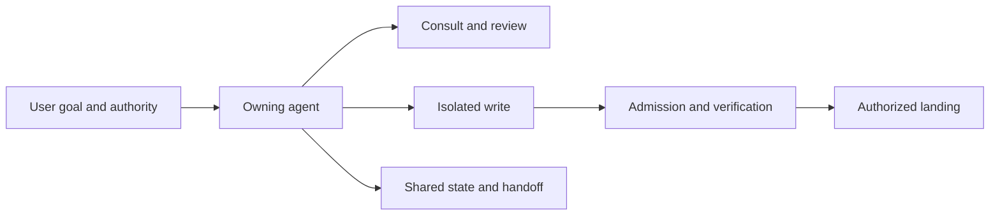

# Components

This catalog is for people using or maintaining the oh-my-setting (OMS) harness.
It maps each command to its purpose and detailed guide; OMS shares rules, state,
peer workflows and bounded patch handling across installed coding-agent CLIs,
with one verification boundary for OMS-managed delegated patches. The
[Codex harness launcher](CODEX-HARNESSES.md) runs Pi and Claude Code through an
invocation-scoped local gateway; the selected harness keeps its tool permissions.
Work rooms can also deliver to an explicitly enrolled
[Claude Desktop Code or terminal inbox](TERMINAL-PANEL.md#claude-desktop-code-and-claude-code-terminal-delivery),
with separate delivery receipts and an explicit opt-in to possible model wakeup.

## In this guide

| What you need | Read next |
|---|---|
| Set up or update OMS | [Install guide](INSTALL.md) · [한국어](INSTALL.ko.md) |
| Use the control panel | [Panel guide](TERMINAL-PANEL.md) |
| Ask for advice or review | [Asking other agents](#asking-other-agents) |
| Delegate implementation | [Delegating writes](#delegating-writes) |
| Run an approved plan | [Plans and bounded autonomy](#plans-and-bounded-autonomy) |
| Verify and publish | [Verification and release](#verification-and-release) |
| Inspect or clean up state | [State and memory](#state-and-memory) · [Cleanup](#cleanup) |

**Command catalog**

- [Panel and collaboration](#panel-and-collaboration)
- [Plans and landing](#plans-and-landing)
- [State and memory](#state-and-memory)
- [ML and HPC](#ml-and-hpc-components)
- [Install, update and doctor](#install-update-and-doctor)
- [Internals](#internals)
- [Architecture and contracts](#how-it-fits-together)

Use `oms list` for the front-door catalog, `oms list --all` for all commands,
and `oms <command> --help` for flags. The
[command-routing reference](../custom-skills/oms-agent-harness/references/command-routing.md)
explains overlapping entrypoints.

## Panel and collaboration

| Component | Purpose | Invoke | Details |
|---|---|---|---|
| `panel` | Open the terminal control panel for live collaboration. | `oms panel` | [Terminal panel](TERMINAL-PANEL.md) |
| `dashboard` | Read a terminal view of OMS collaboration state. | `oms dashboard` | [Panel and collaboration](TERMINAL-PANEL.md#shared-work-rooms-and-the-graph) |
| `inbox` | Prioritize attention from shared state. | `oms inbox` | [State, memory, and handoff](#state-memory-and-handoff) |
| `room` | Share task-scoped messages and room snapshots. | `oms room` | [Work rooms](TERMINAL-PANEL.md#shared-work-rooms-and-the-graph) |
| `thread` | Read and deliver shared conversation turns. | `oms thread` | [Asking other agents](#asking-other-agents) |
| `consult` | Ask one peer or continue a peer thread. | `oms consult` | [Asking other agents](#asking-other-agents) |
| `peer-ask` | Ask a provider council and save each answer. | `oms peer-ask` | [Asking other agents](#asking-other-agents) |
| `peer-review` | Review a diff with an independent provider council. | `oms peer-review` | [Asking other agents](#asking-other-agents) |
| `advise` | Request an adversarial pass at a decision point. | `oms advise` | [Asking other agents](#asking-other-agents) |
| `agent-call` | Run one read-only local peer call. | `oms agent-call` | [Asking other agents](#asking-other-agents) |
| `peer-delegate` | Send a bounded write task to an isolated worktree. | `oms peer-delegate` | [Delegating writes](#delegating-writes) |
| `agent-supervisor` | Queue and supervise attempts without landing them. | `oms agent-supervisor` | [Delegating writes](#delegating-writes) |
| `agent-events` | Record and project agent lifecycle events. | `oms agent-events` | [Delegating writes](#delegating-writes) |
| `agent-plan` | Maintain a shared task graph. | `oms agent-plan` | [Plans and bounded autonomy](#plans-and-bounded-autonomy) |
| `agent-role` | Manage reusable profiles for the three agent CLIs. | `oms agent-role` | [Models and reasoning effort](#models-and-reasoning-effort) |
| `agent-task` | Maintain the active handoff packet. | `oms agent-task` | [State, memory, and handoff](#state-memory-and-handoff) |
| `approval-inbox` | Request and consume fenced durable approvals. | `oms approval-inbox` | [Plans and bounded autonomy](#plans-and-bounded-autonomy) |

## Plans and landing

| Component | Purpose | Invoke | Details |
|---|---|---|---|
| `autopilot` | Drive bounded coding under plan and landing contracts. | `oms autopilot` | [Plans and bounded autonomy](#plans-and-bounded-autonomy) |
| `goal-drive` | Drive an existing approved plan to its acceptance command. | `oms goal-drive` | [Plans and bounded autonomy](#plans-and-bounded-autonomy) |
| `plan-from-spec` | Propose plan tasks from `PROJECT.md` or discovered work evidence. | `oms plan-from-spec` | [Plans and bounded autonomy](#plans-and-bounded-autonomy) |
| `plan-run` | Execute one pre-authorized plan task. | `oms plan-run` | [Plans and bounded autonomy](#plans-and-bounded-autonomy) |
| `patch-admit` | Check delegated patch scope and evidence. | `oms patch-admit` | [Delegating writes](#delegating-writes) |
| `patch-land` | Apply an admitted delegated patch. | `oms patch-land` | [Delegating writes](#delegating-writes) |
| `land` | Gate, push and update a committed worktree. | `oms land` | [Verification and release](#verification-and-release) |
| `sync-shared` | Fetch and fast-forward an idle shared checkout. | `oms sync-shared` | [Verification and release](#verification-and-release) |
| `draft-pr` | Publish a verified clean HEAD as a draft pull request. | `oms draft-pr` | [Verification and release](#verification-and-release) |
| `ci-status` | Read the CI conclusion for a branch HEAD. | `oms ci-status` | [Verification and release](#verification-and-release) |
| `change-guard` | Warn about concurrent agent edits. | `oms change-guard` | [Delegating writes](#delegating-writes) |
| `checkpoint` | Save a reversible snapshot of tracked Git state. | `oms checkpoint` | [Delegating writes](#delegating-writes) |
| `scratch-worktree` | Manage scratch worktrees around active workers. | `oms scratch-worktree` | [Delegating writes](#delegating-writes) |

## State and memory

| Component | Purpose | Invoke | Details |
|---|---|---|---|
| `state` | View active, stale, pending and changed harness state. | `oms state` | [State, memory, and handoff](#state-memory-and-handoff) |
| `state-verify` | Check consistency of repository harness state. | `oms state-verify` | [State, memory, and handoff](#state-memory-and-handoff) |
| `agent-memory` | Maintain shared harness memory. | `oms agent-memory` | [State, memory, and handoff](#state-memory-and-handoff) |
| `journal` | Read and manage the local-first Work Journal. | `oms journal` | [Work Journal](WORK-JOURNAL.md) |
| `report` | Preview and file a privacy-checked upstream bug or feature request. | `oms report` | [State, memory, and handoff](#state-memory-and-handoff) |
| `fail-ledger` | Record and inspect cross-session failures. | `oms fail-ledger` | [State, memory, and handoff](#state-memory-and-handoff) |
| `artifact-index` | Inspect and maintain indexed harness artifacts. | `oms artifact-index` | [Asking other agents](#asking-other-agents) |
| `output-digest` | Run a command and print a bounded, loss-marking digest of its output; the raw output stays in a local file. | `oms output-digest` | [Command output digests](#command-output-digests) |
| `session-handoff` | Build a compact digest from an agent session. | `oms session-handoff` | [State, memory, and handoff](#state-memory-and-handoff) |
| `snapshot` | Record private local context for agents. | `oms snapshot` | [State, memory, and handoff](#state-memory-and-handoff) |
| `gc` | Apply retention to repository-local state. | `oms gc` | [State, memory, and handoff](#state-memory-and-handoff) |

## ML and HPC components

| Component | Purpose | Invoke | Details |
|---|---|---|---|
| `data-manifest` | Fingerprint dataset splits and detect drift or leakage. | `oms data-manifest` | [ML and HPC](#ml-and-hpc) |
| `experiment-board` | Coordinate shared research studies. | `oms experiment-board` | [ML and HPC](#ml-and-hpc) |
| `job-digest` | Summarize training or Slurm logs and jobs. | `oms job-digest` | [ML and HPC](#ml-and-hpc) |
| `run-ledger` | Record a command and its execution metadata. | `oms run-ledger` | [ML and HPC](#ml-and-hpc) |
| `run-reconcile` | Reconcile long-running Slurm jobs with saved run records. | `oms run-reconcile` | [ML and HPC](#ml-and-hpc) |
| `run` | Tie experiment and execution records together. | `oms run` | [ML and HPC](#ml-and-hpc) |
| `tsp-queue` | Queue local jobs through task-spooler. | `oms tsp-queue` | [ML and HPC](#ml-and-hpc) |
| `runtime` | Inspect typed projections and optional execution services. | `oms runtime` | [Runtime guide](OMS-RUNTIME.md) |
| `harness` | Run Codex, Pi or Claude Code harnesses with a Codex login. | `oms harness` | [Codex harnesses](CODEX-HARNESSES.md) |

## Install, update and doctor

| Component | Purpose | Invoke | Details |
|---|---|---|---|
| `install-profile` | Inspect or install tools for selected capabilities. | `oms install-profile` | [Install guide](INSTALL.md) |
| `connect-services` | Connect GitHub/Notion or register another Codex account home. | `oms connect-services --account codex:ID [--home PATH] [--first\|--last] [--repair\|--remove\|--verify]` | [Provider accounts](TERMINAL-PANEL.md#provider-accounts) |
| `status` | Show install, task and update status. | `oms status` | [Install and ownership](#install-and-ownership) |
| `doctor` | Check managed links, tools, skills and manifest sync. | `oms doctor` | [Install and ownership](#install-and-ownership) |
| `project-doctor` | Check project agent-facing files for agreement. | `oms project-doctor` | [Project onboarding](#project-onboarding) |
| `skill-doctor` | Diagnose and rightsize installed skills. | `oms skill-doctor` | [Local skills and optional bundle operations](#local-skills-and-optional-bundle-operations) |
| `skill-forge` | Create, validate and manage project skills. | `oms skill-forge` | [Local skills and optional bundle operations](#local-skills-and-optional-bundle-operations) |
| `model-doctor` | Probe provider binaries and cached capabilities. | `oms model-doctor` | [Models and reasoning effort](#models-and-reasoning-effort) |
| `provider-permissions` | Check or grant provider CLI permissions. | `oms provider-permissions` | [Provider integrations](#provider-integrations) |
| `init` | Initialize a repository harness. | `oms init` | [Project onboarding](#project-onboarding) |
| `apply-project-template` | Apply managed project policy and scaffold files. | `oms apply-project-template` | [Project onboarding](#project-onboarding) |
| `remove-project-template` | Remove managed project policy blocks. | `oms remove-project-template` | [Project onboarding](#project-onboarding) |
| `project-private` | Keep project harness files out of Git commits. | `oms project-private` | [Project onboarding](#project-onboarding) |
| `intent` | Turn a broad goal into a reviewed project specification. | `oms intent` | [Project onboarding](#project-onboarding) |
| `update` | Update an installation transactionally. | `oms update` | [Install and ownership](#install-and-ownership) |
| `auto-update` | Check or apply source updates. | `oms auto-update` | [Install and ownership](#install-and-ownership) |
| `tick` | Run unattended maintenance for registered repositories. | `oms tick` | [Durable operations and optional frontends](#durable-operations-and-optional-frontends) |
| `cleanup` | Remove safe install leftovers. | `oms cleanup` | [Install and ownership](#install-and-ownership) |
| `uninstall` | Remove managed links and restore backups. | `oms uninstall` | [Install and ownership](#install-and-ownership) |

## Internals

| Component | Purpose | Invoke | Details |
|---|---|---|---|
| `models` | List cached provider model capabilities. | `oms models` | [Models and reasoning effort](#models-and-reasoning-effort) |
| `graph` | Query project and execution graphs. | `oms graph` | [Graph engineering](GRAPH-ENGINEERING.md) |

The catalog names the command front doors. Their variants and authority remain
separate; a shared index does not combine permissions.

### Consolidated paths

<details>
<summary>Maintainer reference: shared implementation paths</summary>

Agent guidance groups discovery into state, collaboration, implementation,
verification/landing, continuity, and operations. Public commands remain
compatible; these groups do not grant combined authority.

- Inbox projects shared state; detail-only lifecycle/approval reads remain
  separate because summaries truncate those lists. Reports are non-atomic
  across underlying stores. State and runtime reuse validated task/plan results
  within one query, without a persistent status cache or another CLI input.
- Recent log windows read backwards; MCP display reads at most 64 KiB before
  its existing output cap. Full artifact/thread references stream once so an
  early result is not lost. Peer and MCP share final Output/Exit interpretation.
- Runtime context reuses fresh Project Graph evidence selection, preserving
  explicit inputs and budgets. Missing/stale/unsupported graphs retain local
  discovery; read-only context neither builds graphs nor grants authority.
  Private delegation packs use the same freshness/path checks after their
  bounded build; they never refresh the parent's graph from a worker tree.
- Consult and advice share exact call-receipt validation; absent or ambiguous
  receipts cannot borrow the newest artifact. Advice is a prompt variant using
  the shared model router, not a separate fixed-high-effort routing policy.
  Consult prints the current result without replaying recent thread history;
  the thread retains that history for follow-up calls. Advice injects its
  bundled decision contract once, retaining the contract for custom roles.
- Tick and install auto-update share scheduler detection/selection while
  preserving distinct schedules, ownership markers, and repair transactions.
- Diagnostic, council, autonomy, profile, experiment, and continuity variants
  remain behind the existing front doors. Already shared engines are reused,
  not replaced with another orchestration layer or a combined memory store.

</details>

### Surface boundaries

<details>
<summary>Maintainer reference: compatibility and ownership decisions</summary>

Use `oms list --all` for the current catalog. Keep distinct authority and
provenance boundaries; remove duplicated routing and generated boilerplate.

| Surface | Decision |
|---|---|
| State, threads, memory, journal, graph/context | Keep shared evidence and incremental collaboration; reuse injected resume/digest context before extra journal reads. |
| Plans, delegation, admission, recovery, release | Keep leases, reviewed bytes and explicit authority; model capability cannot replace concurrency or recovery guarantees. |
| Install, update, repair, scheduler | Keep reversible ownership. Tick's backlog and current-day journal sync have different scopes. |
| Councils, runtime experiments, HPC, external frontends | Keep explicit workflows; no new default calls. One peer precedes a council when sufficient. |
| Daily and task-close skill-creation recommendations | Removed: resolved failures and frequent tool use alone do not justify another skill. Explicit forge and existing skill verification reminders remain. |
| Tool-family telemetry | Opt-in with `OMS_USAGE_TRACK=1`; historical usage remains readable and GC-managed. No daily scan of usage/skill bodies to recommend new skills. |
| Skill selection and onboarding | ASCII trigger boundaries prevent `oom` matching `room`; generic continuation/model questions no longer force the harness. Keep specific collaboration/graph/autopilot triggers. Store ordinary build/test facts in the existing contract. |
| Generic keyword skill hints | Off by default; native skill discovery remains. `OMS_SKILL_HINTS=1` restores keyword hints without changing live collaboration or journal delivery. |
| Stop session budgets | Answer-format blocking is removed, including legacy opt-ins. Positive `OMS_SESSION_BUDGET_TURNS` or `OMS_SESSION_BUDGET_HOURS` enables a session cap. Journal finalization remains. |
| External adapters | Removed the old Herdr pane-control command and standalone A2A HTTP bridge/card. The panel has a separate optional local Herdr terminal host for wrapper launch, identity-checked navigation and reported footer values; it grants no landing authority. Native peer calls, live threads and CLI/MCP state reads remain. No extras dispatcher remains. |

The eight skills retain distinct installation, coordination, specification, diagnosis,
security, careful collaboration, Slurm and local-GPU responsibilities. Combining them
would load unrelated procedures or blur safety boundaries. Trace requires competing
hypotheses only when real alternatives remain, not a fixed worksheet. `oms-careful` is
an opt-in careful collaboration mode where the agent confirms understanding and plans
before editing, explains reasoning, data flow and impact, and separates verified facts
from hedged inference with confidence levels.

Trigger it per session with `"careful mode"`, `"careful collaboration"`, `"신중 모드"`, `"신중
협업 모드"`, `$oms-careful`, or `/oms-careful`; enable it per project by adding the line
`Collaboration mode: careful` to the project `AGENTS.md`; and turn it off in the session
by asking to exit careful mode (or remove that line from `AGENTS.md`). Retired daily
hint knobs (`OMS_USAGE_HINT_MIN`, `OMS_USAGE_HINT_DAYS`, `OMS_USAGE_SKILL_ROOTS`) no
longer affect prompts; no stored skills or history are deleted. `OMS_SKILL_FORGE_HINT`
still controls existing skill-contract verification reminders at task close.

</details>

## How it fits together



<details>
<summary>Command-level flow</summary>

```text
user request
  -> provider skill/router
  -> oms <tool>
       -> read: consult / peer-ask / peer-review / advise
       -> write: peer-delegate -> isolated worktree -> patch
                                      -> patch-admit -> patch-land
       -> orchestrate: agent-supervisor -> agent-events -> approval-inbox
       -> operate: runtime backend
       -> observe: inbox / targeted state queries
  -> local state in .oms/
       -> inbox / state / handoff / MCP / Work Journal
```

</details>

The owning agent remains responsible for scope, admission, verification,
commit, push, and release decisions. Peer agreement is evidence, not approval.

## Install and ownership


### Installation rollback

Systemd auto-update setup stages unit files and restores prior files, timer
enablement/activity and any newly enabled linger if activation fails. Failed
restoration retains the backup and reports its location; this cannot undo an
update process that already started.


### Profiles and ownership

The default `core` profile installs the harness, Bash, Git, Python and one
coding-agent provider. Selected required CLIs must be present; optional
capabilities add tools without making them core dependencies. See
[profiles and integrations](INSTALL.md#profiles-and-integrations) for selection
and receipts, and [provider installation and updates](INSTALL.md#provider-installation-and-updates)
for vendor refresh, pins, digest checks, Claude migration and inventory rules.

> **Pi:** Pi refresh runs only through `install-tools.sh --providers`.
> Full-tool installs and profile reapply leave Pi unchanged.

Default-channel agy is vendor-managed after a lock-verified bootstrap; refresh
retires a valid legacy sidecar and doctor warns on a stale one. Explicit locks
retain strict checks for existing OMS-owned digests.

Direct platform payloads and npm wrapper/native packages are verified before use; npm
installation runs offline with a fresh cache. Install, update, repair, and uninstall
share one user-wide lifecycle lock. Lock ownership survives installer `exec` handoff. A
checkout-selected foreground child may borrow the live parent's critical section only
after matching its owner, PID, start token, and canonical path; ownership and release
authority remain parent-only, and the borrow cannot pass to another child. Managed
direct binaries and npm package/shim swaps carry recovery state, and doctor reports
digest drift or an interrupted transaction separately from lock schema validity.

PATH persistence follows Bash's existing login-file priority instead of creating a
higher-priority profile. Optional provider registrations report a warning and remain
visible to `oms doctor --contract`. Setup installs Node when the selected profile
requires it. Native Windows is refused before setup; WSL2 uses the Linux installation
path.

Managed rules and skills use symlinks by default, with verified copies when
copy mode is selected. Existing user files move to timestamped backups and return
on `oms uninstall`. Uninstall stops before unlink or purge if any integration
cannot be removed. It intentionally leaves external CLIs and the user-local
PATH entry installed.


### Updates

The source installer follows `edge` by default. The daily updater applies only
clean fast-forwards and skips dirty or diverged checkouts. Set
`OH_MY_SETTING_AUTO_UPDATE_MODE=check` for notification-only updates, or pin a
ref when reproducibility matters. A missing pinned ref fails closed unless the
operator explicitly chooses `--fallback-to-edge`.

Scheduled apply requires successful push CI for the exact SHA; missing, pending,
failed or unreadable CI defers the update. GitHub CLI must be authenticated.

<details>
<summary>Scheduled updates: transaction, runtime, timer persistence and cron ownership</summary>

Scheduled `auto-update` is the unattended policy and status wrapper, not a
second updater. Receipt-owned schema-1 and schema-2 installs both preflight and
apply through `update.sh`, which remains the canonical rollback-capable install
transaction. Only receipt-less legacy checkouts retain the configured-upstream
compatibility path until a successful update creates an install receipt.


#### CI proof for scheduled updates

Before applying a new commit, both paths require successful `test.yml` push CI
for that exact SHA. Missing, pending, failed, or unreadable CI defers to the next
scheduled run; `gh` must be available and authenticated. Legacy updates merge
the checked SHA, without a second pull that could fetch an unchecked tip.


#### Runtime and rollback

New cron/systemd triggers set `OMS_AUTO_UPDATE_MANAGED=1`: the wrapper selects
the checkout's exact private uv Python before reading receipts or running the
transaction. Runtime setup failures write a failed updater state instead of
leaving an old success visible. New installs provision the runtime before
provider configuration. Internal `scripts/python-runtime.sh` shares
versioned environments and launchers under the user's private OMS data folder;
system Python is used only to bootstrap the pinned uv download/lock parser.
Provisioning is locked, existing broken/unowned environments are preserved,
and rollback selects the old checkout's retained Python version. These runtime
files are outside the checkout and retained on uninstall for safe recovery.


#### Timer persistence

`attention` reports skipped updates as `blocked` and a logout-dependent user
timer as `session-only`; systemd's `Persistent=true` alone does not keep the
user manager alive after logout. Linger is opt-in because it affects every user
service. Custom systemd drop-ins and private user skills remain user-owned.


#### Cron ownership

Cron ownership is one exact begin/end marker pair. Install, removal, status,
and legacy receipt inference share the same `absent | valid | malformed`
classification; a malformed block is reported but never rewritten, so an
orphan marker cannot consume unrelated user cron entries. That malformed
verdict takes precedence over another installed trigger and is identical in
dry-run and apply mode.

</details>

Useful maintenance commands:

```bash
oms status
oms doctor
oms doctor --repo . --json
oms doctor --repo . --remediation-plan
oms update
oms uninstall
```

### Cleanup

`oms cleanup` previews removals; `--apply` performs them only when the preservation
proof succeeds. Every kept item reports its reason.

> **Preserve ignored work before applying.** Eligible ignored trees in a settled,
> dead delegate worktree can be discarded, including hand edits. The preserved
> patch does not include that content.

| Worktree | Removal requires |
|---|---|
| Dead delegate | One finished recorded run, exact preserved patch, regenerable ignored files and settled harness state. |
| Failed or timed-out delegate | The same proof, plus an owner decision or the configured aging period (default 7 days). |
| Scratch | A clean tree at a referenced HEAD and no protected harness records. |

<details>
<summary>Full cleanup rules: ignored trees, symlinks, scan limits and scratch records</summary>

`oms cleanup` dry-runs unless `--apply` is given. It removes a dead delegate worktree
with uncommitted work only when exactly one recorded run names it and that run finished
(a failed or timed-out run only after an owner decision or
`OMS_HARNESS_RESIDUE_AGED_DAYS` days, default 7), its changed files equal the run's
preserved patch applied to HEAD byte for byte, its ignored files are regenerable, its
`.oms` holds only hook telemetry, caches and empty locks, and the owning repo survives;
it repeats that proof just before removal.

#### Eligible ignored trees

Regenerable ignored content includes Python bytecode, `.venv/` or `venv/` with a regular
`pyvenv.cfg` at its root, `.pytest_cache/`, `.mypy_cache/`, `.ruff_cache/`, and
`node_modules/` with a sibling `package.json` tracked in HEAD and present as a regular
file on disk, at any depth. These trees must have real directory roots and parents.

#### Scan and refusal conditions

Cleanup independently scans each recognized tree without following links and keeps it if
it contains Git metadata (including incomplete `.git`, case variants or bare layouts
with linked storage or `HEAD`), non-symlink reparse points or special files, or more
than 200,000 descendant entries.

#### Symlinks and proof

Interior symlinks are leaves, including absolute, outside and dangling targets: removal
unlinks them without following their targets. Its proof binds each entry's type, size
and nanosecond modification time, plus each symlink's target bytes; retargeting a link
between proofs keeps the worktree.

#### Quiescence and discarded content

After the final scan it relies on the dead worktree remaining quiescent until removal.
In a dead, otherwise settled delegate worktree, eligible ignored-tree content is
discarded, including hand edits: names and markers do not establish reproducible bytes.
The delegate's deliverable is its preserved patch; ignored content was never part of it.
`oms cleanup --apply` requires explicit invocation and has no tick or automatic caller;
preserve anything you need before `--apply`. Non-ignored files still need preservation,
and dry-run lines name any regenerable tree classes in settled delegates.

#### Scratch worktrees

A scratch worktree stays kept while it has uncommitted or untracked files, its HEAD is
on no branch, tag or remote ref, or it holds `.oms/plan/tasks.json`,
`.oms/failures.jsonl`, `.oms/landings.jsonl` or `.oms/artifacts/index.jsonl`; a clean
scratch worktree at a referenced HEAD is removable. Worktrees holding other `.oms`
records stay kept, and every kept item prints its reason.

</details>


### Doctor reports

Structured doctor reports adapt the existing checks; they do not create a
second health engine. Findings carry stable IDs, severity, and content-free
remediation metadata. `--remediation-plan` prints commands and their authority
class but never executes them, and it cannot be combined with `--repair`.
Doctor checks installed Git HEAD/ref validity without fetching or rewriting
refs. Damaged references require targeted recovery with preserved originals;
link repair is not Git recovery.


### Workspace and installation status

`oms status --repo PATH` selects a Git workspace and its active task from any
working directory; `--json` emits its branch, alignment, task and auto-update
fields as one object. Without `--repo`, existing workspace selection applies.

`oms status` separates the active OMS workspace revision/changed-entry count
from the canonical installation's actual revision/changed-entry count. Alignment
is `in-sync`, `pending-source-changes`, `different-revision`,
`installed-uncommitted`, or `unknown`; receipt SHA alone does not prove live
checkout identity. This display neither updates an installation nor proves
plugin-cache freshness or verification.

## Project onboarding

Say “Start this project.” or “이 프로젝트 시작해줘.” The
`oms-spec-interview` skill routes by state:

- Empty directory: clarify the goal, write `PROJECT.md`, apply a template, run
  the project doctor.
- Existing repository: inspect first, then ask only about gaps that change the
  implementation.
- Ongoing harness project: report current state and the next actionable step.

A decision that needs its alternatives, interface or risks kept can use the
skill's optional design-note form (Context, Alternatives, Decision, Interface,
Risks, Verification) in a tracked file that `Decisions` names under
`- References:`; `oms plan-from-spec` already reads those documents before it
decomposes. The form is never required, and a note is not approval or
verification evidence.

`general`, `ml`, and `slurm` templates add a managed policy block and a small
verification contract without overwriting user content. `oms project-private`
keeps `AGENTS.md`, `CLAUDE.md`, `GEMINI.md`, and `PROJECT.md` out of commits via
`.git/info/exclude`; tracked files require an explicit untrack action.
Before a first write worker, make its `--verify` work from a clean checkout; see
[native dependencies in verify](../custom-skills/oms-agent-harness/references/delegation-artifacts.md#native-dependencies-in-verify).

```bash
oms init
oms apply-project-template general .
oms project-doctor .
oms project-private --check
```

`oms project-doctor --contract .` is a separate read-only look at what the contract
points at: every `Required check files` entry, `Decisions` `References` path and relative
Markdown link in `PROJECT.md` must exist, and a plan task's `covers` must name a criterion
the spec still carries. A missing target is a `warn:` (a failure only with `--strict`).
Each acceptance criterion is then listed with its current evidence status and the plan
tasks that cover it, as `note:` lines: an unproven criterion is unfinished work, not drift.
Nothing is written and no model is called.

Council and panel workers need no `PROJECT.md`; autopilot needs a confirmed
`PROJECT.md`; goal-drive needs an agent-plan with verify commands and a clean tree. `oms
init` suggests verification from existing repository files (check.sh, pytest, npm, make,
Cargo, then Go), or `<your test command>` when no runner is recognized.

## Local skills and optional bundle operations

Skills load in three layers: general-purpose skills everywhere,
machine-conditional skills only where their command exists (`oms-slurm`,
`oms-gpu-workstation`), and per-repo skills forged into `.oms/skills/`. Global
skills are named `oms-*` so they cannot collide with your own skills in the
shared skill roots. Newly forged project skills are also `oms-*`; stored legacy
names remain readable and are not renamed automatically.

Use `oms skill-forge add|validate|link` for ordinary local guidance. Neither
external bundle management nor evaluation is required for a local edit.
`oms skill-forge status` gives kind-specific recovery guidance for skills that
differ from same-name OMS templates; local replacement warns that local edits
will be lost, while imported updates remain explicit.
`oms skill-forge` remains the single project-skill authority. Local authored
skills live under `.oms/skills`; explicitly imported bundles first pass a bounded,
no-follow preview and then live as content-addressed immutable revisions under
`.oms/skill-store`. Import, update, and rollback require explicit apply plus
digest CAS. They reject links, hardlinks, nonregular entries, sensitive file
names/content, embedded URL credentials, oversized trees, and an unprefixed
skill name. Import never executes a bundle script.

```bash
oms skill-forge preview --source PATH_OR_GIT --json
oms skill-forge import --source PATH_OR_GIT --expected-bundle-sha256 SHA --apply
oms skill-forge update --source PATH_OR_GIT --expected-current-sha256 OLD --expected-bundle-sha256 NEW --apply
oms skill-forge rollback oms-NAME --to SHA --expected-current-sha256 CURRENT --apply
```

Skill evaluation is an explicit black-box experiment. A suite declares near-
miss trigger cases and baseline/treatment task commands; host commands run only
with `--allow-host-commands`. The result contains aggregate counts and command
digests, never prompts or outputs. `--record` appends content-free metrics that
`oms runtime benchmark` projects. Write useful guidance directly from reviewed
source evidence, then use `skill-forge add|link` for local skills or the
preview/import flow for bundles. Automatic draft generation is not required.

## Asking other agents

| Need | Front door | Result |
|---|---|---|
| One independent read or continued peer thread | `oms consult [--to PROVIDER]` | Threaded answer |
| Council or debate | `oms peer-ask` | Per-seat artifacts and family count |
| Diff review | `oms peer-review --gate` | Verdicts plus mechanical backstop |
| High-risk decision | `oms advise` | Adversarial recommendation |

`oms consult --repo-context` attaches sanitized git status to that question;
`--diff` also attaches the sanitized, budgeted diff. Follow-up questions retain
the thread and attach fresh repository context only when requested.


### Prompt and debate budgets

Blocking review gates default to 192 KiB; set `OMS_PROMPT_DIFF_BYTES` to raise the
complete-diff budget, increasing prompt usage and provider cost.

Debate rounds after the initial independent answers share a 64 KiB prompt budget across
all seats (`OMS_DEBATE_ROUND_BYTES`). Each fresh call receives section-balanced excerpts
of current claims/findings, evidence, changes and remaining disagreements, including its
own position. Structured excerpts use at most 4 KiB each; freeform and undersized
section budgets use a bounded head-and-tail excerpt, retaining the leading conclusion
and final objections. Original artifacts remain linked, and omitted content is marked
rather than presented as a complete summary.

All prompts are prepared before any seat is started; a frame too large to retain
evidence fails without partial calls. Within a round, identical artifact/quota pairs
reuse the sanitized excerpt; different quotas and later rounds are processed separately.
This reduces local processing, not the number of model calls or the prompt's token
count. Round-byte reporting excludes provider-native context, reads, retries and
synthesis, and must not be reported as measured token savings. An agy print-timeout
diagnostic is incomplete output even with exit status zero; it cannot count as an
answered seat, enter a later round, or pass a review gate.

Excerpts recognize plain and Markdown section headings without treating fenced or
indented code and `>`-quoted examples as new answers; short sections donate unused space
to longer ones. Early stopping requires every called seat to answer and its entire
change section to explicitly declare no change. A dropped seat's last good answer
remains available, labeled as stale in the synthesis.


### Live council threads

Councils with `--thread ID` publish every completed turn without waiting for slower
seats. Opening answers and rebuttal rounds remain parallel, with one prior-round
evidence/notes snapshot and all-seat budget preflight per round. Coordinator
notes/decisions use `thread context --notes-only` (2 KiB, eight turns); answers and
provider failure notes are not duplicated there. Notes arriving during a round apply
only if another configured round runs. MCP `kind=ask` returns a ready thread and accepts
`debate_rounds=0..3` (default zero); its suggested operation wait is zero while
exchanging messages.

Threads stay open for authorized focused follow-up through `consult`; neither notes nor
reads start new calls. CLI export-only does not create/publish turns. Closing a council
rejects new CLI/MCP council starts and its next configured round before provider
dispatch. Ordinary history reads remain available; already-running calls are not
interrupted. `thread context --require-open` is the shared preflight, not a lock across
an entire provider call. There is one parallel council, not a separate sequential
scheduler, persistent provider session, token stream, or mid-generation interruption.


### Blind review lenses

`oms panel --council --lenses correctness,security,compatibility` assigns one
blind seat per unique `[a-z0-9-]+` name of 1..32 characters, cycling over the
selected workload's exact council routes. It requires 2..12 seats, two provider families and
`--rounds 0` (the default with lenses). Fresh run threads and distinct seat
identities keep repeated targets apart through prompts, artifacts, repairs,
thread turns and local synthesis. Zero rebuttals retain the full deliberation
output contract. Failed and byte-budget-omitted seats remain labelled; the
12-primary-call budget and existing transport apply. Ordinary councils retain
their existing behavior without this panel-only flag. `--rounds` requires
`--council`, including an explicit `--rounds 1`.


### Provider output and evidence

Claude read calls retain public assistant text from `stream-json --verbose` alongside
the terminal result, so a closing remark cannot erase earlier evidence.
User/tool/thinking/subagent events are not answers; absent terminal results are marked
truncated. Existing JSON envelopes and write/interactive transports remain supported,
with unchanged permissions. The transport follows the [official streaming
contract](https://code.claude.com/docs/en/headless#stream-responses); fixture validation
is not a live-provider guarantee or measured cost saving.

Initial and subsequent debate prompts share evidence/verification framing, while
honoring explicitly requested answer formats. Claims use stable IDs and
provider-reported confirmed/refuted/unverified labels; agreement never promotes them to
owner-verified evidence. Retractions must accompany subsequent claims. Each run keeps a
bounded, sanitized initial request and answer copies, mirrored into isolated read
worktrees. Tracked base/state identity is shared and a tracked source change stops later
rounds. Base plus supplied diff is the shared view; untracked or omitted bytes remain
explicit uncertainty, not an identical full checkout promise.

The copies are removed after the run; original artifacts stay. Usage details retain
input/output and cache-read/write counts with unknowns as null. Codex cache reads are
included in its input count; Claude reports caches separately. Historical `tokens used`
semantics remain unchanged. Details are cached in the existing artifact index, not a new
store or a billable-cost claim.


### Outbound context and export

Read calls scan outbound context for credentials and machine-sensitive data.
`--export-only` writes a prompt without invoking another CLI; import the answer
through `oms artifact-index import`.


### Artifact storage and recovery

The artifact index is a repo-bound, no-follow, copy-on-write JSONL store.
Normal views and mutations reject structural corruption. Agent recovery is
two-step: `oms artifact-index salvage` plans without writes, while
`salvage --apply` preserves the exact raw bytes in a content-addressed 0600
quarantine before one CAS repair and receipt. Legacy schema repair remains the
separate `migrate` operation. A row over 1 MiB or recovery snapshot over 256
MiB is refused without mutation. A write that would exceed the 16 MiB healthy
ceiling first applies lineage-aware retention and refuses only when its required
new rows still cannot fit; salvage uses the same output ceiling. Its receipt
references the raw quarantine, so ordinary artifact retention preserves it
until that receipt is pruned.

### Command output digests

`oms output-digest -- COMMAND` runs the command, keeps its whole output
(stdout and stderr, in order) in `.oms/artifacts/output-digest/` and prints a
bounded digest instead of the log: the exit code, line and byte counts, the raw
file's path and sha256, the failure lines a recogniser matched (pytest,
unittest, smoke `FAIL:`, tracebacks, compiler and lint errors, common runtime
failures), a head and a tail, and how many lines and bytes it left out. Its
exit code is the command's. Output that fits `--max-bytes` (default 4000) is
shown whole. When cutting, failure lines are spent first, then the tail, then
the head; escape codes are stripped from the view, a line past 300 characters
is cut with the cut counted, and a capture that ends mid-line says so. A
failing log no recogniser matches is shown as a raw head and tail and labelled
as such, not as a diagnosis. `--file PATH [--exit-code N]` digests an existing
capture without running or storing anything; `--json` prints schema 1.

Nothing is rewritten and no model is called: the raw file is the record, the
digest a derived view for reading. A verifier's input and receipt stay the raw
output, and the byte counts are measured bytes; the JSON's token figure is a
labelled bytes/4 heuristic, not a tokenizer and not a quota or billing saving.
The tool is opt-in: no hook rewrites a command to use it.

Raw captures are mode 600 and the newest 50 are kept. If the lines to be
shown look like they carry a secret, or the scan cannot run, they are withheld
and only the counts, the exit code and the raw path are printed. `--no-store`
keeps no file, and a harness child never keeps one. In run mode the tool's own
failure is exit 125 and a bad request exit 2, before anything runs.

### Provider discovery and adapters

Provider count is not independence. Two routes backed by the same model family
remain one opinion for diversity reporting.

Provider discovery separates an executable transport from its model family.
`glm` is therefore never guessed as a provider: a GLM route names its carrier
and exact model, for example `opencode:model=zai/glm-4.7`. Likewise,
`deepseek` names the official DeepSeek Harness transport, while a DeepSeek model
behind Aider is expressed as `aider:model=deepseek/deepseek-chat` (or the exact
model name configured by that carrier).

`oms models --providers auto` is a no-exec physical inventory; its `usable`
field is unknown until `--refresh`. Refresh and `model-doctor --providers auto`
run bounded local version/help probes without inference, login, install, update,
or configuration changes. A visible but broken shim remains in diagnostics as
`broken`, while automatic routing admits only a probe-proven usable transport.
Optional agents do not become default council seats merely because they appear
on PATH: a custom adapter is excluded from every automatic pool (advisor
auto-pick, consult auto-pick and failover) and runs only when named with `--to`
or under an explicit `consult --all` fan-out.

Provider-native user, organization, and previously trusted project
configuration remains part of the trusted host boundary. OMS pins the
documented noninteractive mode, tool/permission surface, and outer worktree
fences, but those flags are not a substitute for reviewing native hooks,
plugins, MCP servers, credentials, or managed policy loaded by the provider.

Custom transports must be executable as `oms-agent-adapter-ID` on PATH or in
the configured adapter directory. Their protocol is a prompt-file based
`run --access read|write --workdir PATH` call. Read calls use a disposable
worktree. Write is refused unless `ID` appears in
`OMS_PROVIDER_WRITE_ADAPTERS`, then still returns through the normal isolated
delegation and patch gate. The adapter remains a trusted host executable, not
an OS sandbox, and carries no landing, commit, push, or publication authority.

The [terminal panel](TERMINAL-PANEL.md#additional-clis-and-adapters) reuses this
registry for its read-only CLI inventory and explicit `--dispatch --to` routes.
Installing an adapter does not require panel-specific provider code and does
not opt it into preset routing or native session messaging.

### Provider-child authority

A provider subprocess is a harness child, not a new owner. Child-marked
processes may inspect saved review verdicts, but every peer-call and delegation
front door refuses a recursive start. The child reports that another opinion or
worker is needed and the parent decides whether to spend or fan out.
Global or explicit-file memory source/derived-state changes, global role
creation, journal configuration/sync, model-capability refresh, and host queue
enqueue/cancel are parent-owned as well. Pure inspection and project-local
counterparts remain available where applicable.

## Models and reasoning effort

Routing is deliberately small:

- No `--model`: judging calls use the provider default; write workers use the
  second seeded price rank among routable models. An explicitly declared
  `--workload routine` selects the lowest seeded routable rank. Unseeded
  generations use the provider default; `OMS_ROLE_ROUTING=0` disables presets.
- `--model NAME`: use that exact model with no implicit switch.
- DeepSeek Harness and Vibe currently expose no documented per-invocation model
  selector on their OMS headless surfaces. An explicit `--model` for either is
  refused instead of being silently ignored; configure the native profile or
  omit the flag.
- `--fallback-model NAME`: on a recognized capacity error, retry once with
  that model. A write attempt that changed its worktree is never retried.
- An unpinned provider-default route may use bounded catalog recovery for a
  model safeguard or unavailable-name error.
- Recognized policy declines are terminal. Authentication, permission, context,
  and verification failures are not model-capacity fallbacks.

`--reasoning-effort` accepts `auto`, `low`, `medium`, `high`, `xhigh`, `max`, or
`ultra`, then validates the value against the selected provider/model capability
snapshot. `oms models` reads the cache; `oms models --refresh` and `oms model-doctor`
perform explicit probes. `oms models` reports catalog age separately from snapshot age.
The hourly tick checks installed provider catalogs at most once daily and refreshes
listings older than seven days; a failed listing keeps the previous catalog and is
retried no earlier than the next day. Hosts without the trigger heal on read: `oms
models` (the read behind `oms panel --providers` and dispatch routing) finding an
installed provider's catalog older than seven days starts `oms tick refresh-catalogs`
detached, behind the same daily stamp and lock, so the two never both run; the call
reports the cached data plus a one-line note (`catalog_refresh: started` in `--json`)
and a harness child never starts one.

Cached catalog reads separate tab-delimited model IDs from display labels and discard
listing banners, so labels cannot leak into automatic recovery routes.

Artifacts record requested and selected models, reasoning effort, fallback use,
and reason.

The [model-routing contract](../custom-skills/oms-agent-harness/references/model-routing.md)
separates parent judgment from bounded execution and defines decision-point
reviews. Generic role prompts do not select a model or grant delegation authority. Native
subagents remain outside the shell router.

### Collaboration visibility

The [terminal control panel](TERMINAL-PANEL.md) is the human entrypoint: bare
`oms` on a TTY or `oms panel`. It opens Codex/Claude native sessions, resumes
explicit session IDs, and connects either owner to the same consult/delegate/
review paths. Optional installed tmux keeps native conversations beside shared
status; the portable inline menu works without it. Provider workers do not gain
owner or recursive delegation authority. The panel adds an explicit role policy:
Sol/Opus mains, Haiku/Luna light research, Sonnet/Terra routine implementation or
explanation, and Astra/Fable advisors and reviewers. The native main judges the workload and dispatches
through existing front doors. Separate advisor/worker sections show recorded
model, task, authority and execution location, bound to the native main's
lifecycle attempt. Generic provider defaults stay separate from this policy.

Use compact status during ordinary work and drill down when coordination or a
blocker needs explanation. `oms dashboard` composes existing state, lifecycle,
artifact and inbox projections into a read-only terminal view. `--watch`
refreshes the view and `--json` returns a bounded schema-1 projection. There is
no second state store or model call to render it. The retired `ops-cockpit`
remains retired. See [the dashboard guide](DASHBOARD.md) for coverage and controls.

An illustrative layout, not a live run:

```text
Goal / requested scope
Parent: planning | execution | integration | verification
Task       Owner / selected model   Route reason        Observed state
lookup     local tool               known path          evidence returned
implement  worker / recorded model  routine assignment  ready for review
Acceptance: required check / exact tree / pass, fail, missing or stale
Attention: blocker / review finding / next decision
```

Display an owner, model or route reason only when recorded; otherwise mark it
unknown. Identify snapshot time and evidence freshness. Distinguish agent
completion from integrated verification, and review not requested from a
passing review. Tokens, costs and durations need a measured source and scope;
absent values are unknown, not zero. Do not expose raw prompts or transcripts.
Session-native HUD data and OMS-managed attempt records have different
coverage; a view must say which it observes rather than implying that every
native agent is tracked. Viewing state grants no execution or publication
authority.

## Delegating writes

Choose `oms consult` (or the lower-level `agent-call`) for a read and
`oms peer-delegate` for a patch. The `agent-run` wrapper and keyword mode
classifier were removed. Task-aware calls/delegates record outcomes directly;
existing artifact and task history is preserved.

A write delegation:

1. Creates a detached worktree from the current `HEAD` under the private
   `${XDG_CACHE_HOME:-$HOME/.cache}/oh-my-setting/worktrees` root (override
   with `OMS_DELEGATE_WORKTREE_ROOT`).
2. Injects the brief, optional role, and bounded context.
3. Runs the provider and the declared verification command.
4. Returns an artifact and binary-safe patch; it does not commit or push.
5. Optionally uses bounded repair rounds with the prior failure attached.

Attached review/repair findings use bounded, sanitized reference quotes: local
paths are masked and sensitive lines redacted without rewriting the original
evidence. Long reviews keep their opening findings; unterminated final lines
remain readable. The operator brief still passes the strict outbound guard.

Explicit `--verify` and plan-task checks win. Otherwise writes default only to
an implemented `scripts/check.sh fast`; ML project detection does not select a
heavier suite. A check script without `fast` requires a chosen verification
command or an explicit `--no-verify`, before graph work or provider startup.
Review and patch admission use the same selector. Admission has no implicit
full-suite fallback or no-verify override; choose an explicit command when
`fast` is absent. An explicit ML preset still selects an available `ml-smoke`.
Read-only reports do not auto-run tests. Missing or blocked providers skip
verification with a non-success result, rather than test unchanged code.

With `--repair 2|3`, compact candidate/diagnostic hashes and exit codes go into
the existing artifact-index `repair_replay` field. Replay compares the requested
budget with stopping consecutive identical failures; single-repair runs skip
this overhead. Selection requires 12 distinct prompts with the same base SHA,
selected model/effort/provider, verifier command and cap. Latest complete baseline
runs form chronological two-thirds development and one-third held-out sets;
both must save calls. Any recorded success lost by early stopping, including
duplicate-prompt reruns, vetoes selection. After four challenger runs, the next
run retains the original cap to replenish uncensored evidence. These thresholds
are OMS heuristics, not paper results or statistical guarantees.

Reads are bounded to 1000 rows/2MiB. Censored failures, sparse/invalid history,
unknown models and fallback routes cannot justify early stopping. A stop remains
a failure. `OMS_REPAIR_REPLAY=0` retains the cap and records outcomes without
reading history; `oms artifact-index telemetry` reports recorded/delegation
counts, selections and stops, not a measured token or wall-clock saving.
Telemetry also reports complete provider usage details by recorded route, with input, cached and output subtotals; incomplete reports are omitted.
`oms artifact-index telemetry --by day|model|provider|task` groups the same routed
operations and prints, per group, calls, provider-reported tokens, complete
input/cached/output reports and provider-reported cost. `-` means no call in the
group reported the value and `N+?` that only some did; a resumed session's
running total is left out of input/cached/output rather than added twice; cost
is never derived from tokens and groups are not summed. `--since`/`--until` take
`YYYY-MM-DD` (the whole UTC day) or an ISO-8601 time and apply before `N`; the
header says how many rows matched and whether `N` cut the oldest off. The index
is pruned, so this covers retained rows only. Rows record no role, so there is
no role grouping. `--json` carries the groups under `usage_by`.
No extra run, timer, model, test omission or automatic delegation is introduced.
Explicit repeated-failure advice bypasses replay: a different agent contributes
to that trajectory and its cost, so single-worker evidence is not comparable.

This is a narrow adaptation of [Dream-RSI §3](https://arxiv.org/html/2609.14858v1#S3),
not a reproduction of its full exploration system: two fixed stopping policies,
no generated policy code, no concurrency optimization. The [upstream repository](https://github.com/zhengkid/Dream-RSI)
listed its full implementation as pending on 2026-09-15. Historical non-regression
does not guarantee future task success or equivalent environments; a changed
base/verifier/model cohort starts without transferable evidence.

The worker does not see the caller's uncommitted changes. `patch-admit` checks
applicability, path scope, sensitive content, syntax, and the stored test contract in
another temporary worktree. Changed shell files also run ShellCheck at warning severity
without following sources, excluding cross-file codes `SC1090`, `SC1091`, `SC2034`, and
`SC2154`, plus the missing-dialect diagnostic `SC2148` because `bash -n` already checks
their syntax. `OMS_SHELLCHECK_BIN` (default `shellcheck`) selects the binary and the
existing per-call verification timeout applies; a missing binary is reported as skipped
and does not block admission.

If a patch changes its verifier, tests, or common verification config, admission also
runs the same command in a second projection with that verification surface restored
from HEAD. Conventional repo-owned check/test/verify/lint helpers are included even when
the top-level command does not name them directly. A failed pre-verification
policy/integrity gate skips project-code execution; an explicit override opts into the
corresponding candidate run. `patch-land` is the single mutation boundary and requires a
clean main tree (including untracked files) plus lease checks.

A policy can require a one-use, exact-action approval; `--request-approval` creates the
request without applying the patch.

Write providers receive task context but not the primary `.oms` pointer, or
attempt/lease capability. The default guard preserves parallel agent state, rejects
destructive rewrites, and binds the selected task/lease objects exactly while other
tasks may move. On a violation the failing run also repairs the operation's own
authority from its hash-verified pre-launch snapshot: scope, verifier, and review
evidence always restore, while claim-cycle fields restore only under the operation's own
lease and are otherwise kept and named. A caller that guarantees no sibling writer may
set `OMS_WORKER_AUTHORITY_EXCLUSIVE=1` for complete authority-state comparison and
rollback.

Plan landing and completion require the reviewed patch bytes, verifier and lease to
match exactly inside the plan lock. The delegated checkout's physical identity and both
Git backpointers are rechecked at every mutation boundary, including cleanup. Landing
terminal rows close a transaction only when their canonical receipt and durable plan,
approval, and lineage outcome also converge.


New native landing captures reserve a generation before writing payload bytes.
`OMS_LANDING_CAPTURE_COUNT` (default 256) and `OMS_LANDING_CAPTURE_BYTES`
(default 134217728, 128 MiB) cap newly managed generations and their reserved
peak payload bytes. Each input is limited to 16 MiB; the reservation charges both
the private admission input and its separate publication copy. Hardlinked
private anchors do not duplicate payload bytes. Admission failures, interrupted
publication and unknown reservations remain charged. A full budget refuses a
new capture before it writes bytes; it does not delete protected evidence to
make room. These limits cover new managed payloads, not legacy files, journal
metadata, externally modified files or total historical storage.

`oms gc` preserves legacy, unknown and referenced history. On supported POSIX hosts it
can reclaim an aged, unreferenced native generation only after checking the private
directory and retained inode anchors, the actual writer's terminal seal,
plan/completion/report/index pins, and quiescence. Plan `review`/`finish` refuse a
managed capture reference unless the plan file's replacement destination is under a
scanned root (`.oms/plan`, `.oms/artifacts`, `.oms/tasks`, `.oms/task`), and a plan file
other than the default `.oms/plan/tasks.json` also holds the default plan lock that
collection takes.

Collection holds the landing, marker, plan, lifecycle and artifact-index writer locks in
that order. A live panel main session does not itself prevent collection; marked
reference writers still prevent it until terminal, and other live attempts remain pins.
It first quarantines a shared pathname inside the private generation directory and
checks its inode again. A replacement is restored without overwriting a new occupant, or
preserved in quarantine; it is never deleted as native data. Interrupted owned
quarantines can resume. Unproven reservations stay charged.

Legacy Windows collection preserves captures until private ACL and quarantine semantics
can be proved; quota and backpressure still apply. Filesystems without native hardlinks
refuse new managed publication. Ordinary durable-file readers retain their single-link
rule; only designated landing readers validate native anchors. The private generation
directory is a cooperating-OMS ownership boundary, not an OS isolation boundary against
hostile code running as the same user.

```bash
oms peer-delegate --to codex --prompt "Implement the bounded change."
oms patch-admit --patch path/to/change.patch  # optional read-only preview
oms patch-land --patch path/to/change.patch   # runs admission, then mutates
```

## Security boundary

The harness provides isolation and post-run detection, not a complete process
sandbox. It detects repository, git metadata, ignored-file, hook, and shared
state changes around a worker. It cannot prove what a process read, see a write
that was undone before exit, or contain writes outside the repository. An
ordinary provider/verifier shell can leave a background process. On POSIX,
`agent-supervisor` owns and closes one process group; a process that deliberately
starts a new session can escape it. The boundary is not an OS sandbox.

`OMS_WORKER_SECRET_GUARD=1` (off by default) narrows what a provider child is
handed. A Claude read seat or write worker gets per-call inline settings that
deny its Read tool the secret paths the prompt bundle already excludes
(`**/.env*`, `**/.npmrc`, `**/*.pem`, `**/id_rsa*`, the SSH and AWS directories
under home, and the rest of `MA_SECRET_READ_DENY` in `scripts/lib/peer-common.sh`); the
person's settings files are not edited. A Claude, Codex or Antigravity child
also starts without the owner's credential-shaped variables: `AWS_*` and names
ending in `_TOKEN`, `_SECRET`, `_SECRET_KEY`, `_API_KEY`, `_APIKEY`,
`_ACCESS_KEY`, `_ACCESS_KEY_ID`, `_PRIVATE_KEY`, `_PASSWORD`, `_PASSWD` or
`_CREDENTIALS`. Kept are the provider's own login variables (`ANTHROPIC_*` and
`CLAUDE_*`; `OPENAI_*`, `CODEX_*` and `AZURE_OPENAI_*`; `GEMINI_*`, `GOOGLE_*`
and `ANTIGRAVITY_*`; `AWS_*` or `GOOGLE_*` for Claude on Bedrock or Vertex),
every `OMS_*` variable, and the names listed in `OMS_WORKER_ENV_ALLOW` (spaces
or commas) for a verifier that needs one. Other providers keep their
environment, because their key can have any name. This is a seatbelt too: a
deny rule stops the Read tool, not `cat`, `grep -r` or a script the worker runs,
and Codex and Antigravity get no read rule from it.

Treat a clean worker result as “no monitored repository surface moved,” not
“the process was harmless.” Stronger guarantees require OS/container isolation.
The default provider permission profile remains practical rather than strict;
outbound scrubbing, isolated worktrees, admission, and verification are the
main controls. Provider and verifier wall clocks use `timeout`/`gtimeout` or a
POSIX Python fallback; without either mechanism the call is refused.

## State, memory, and handoff

Project state lives under ignored `.oms/` paths:

| State | Purpose |
|---|---|
| task and plan | Current goal, acceptance, DAG state, leases |
| memory | Scrubbed shared notes with provenance |
| artifacts | Calls, reviews, patches, verification, lineage |
| failures | Open/resolved failure fingerprints |
| threads | Cross-provider conversation history |
| handoffs | Bounded pre-compaction and session summaries |
| work-journal | Daily local activity and optional Notion mirror |

`oms state` summarizes the repository; `oms inbox` ranks items needing
attention. `oms fail-ledger list`, `oms artifact-index unresolved`, and
`oms thread list` expose the underlying records. Writers are append-oriented;
use migration and GC commands instead of editing JSONL by hand.
`oms agent-memory recall` and `search` also cover the failure ledger. An open
failure carries its recorded next step (`record --next`), and the newest failure
of a resolved fingerprint carries how it was fixed (`resolve --how`), each as one
line of up to 240 characters. The ledger stores those two notes as given, so each
passes the secret scanner in its original form before normalization and indexing;
a flagged note, or any note when the scan cannot run, is left out while the failure itself still recalls. An index
built earlier gains them when the ledger next changes or on `oms agent-memory
rebuild`.
`oms agent-memory redact --id EVENT` is the one declared exception to the
append-only memory logs, for text that should never have been recorded. Without
`--apply` it only names the entry. With it, the entry's text in `shared.md` or
`pins.md` is replaced by a fixed tombstone that keeps the ID, time and author
and states how many bytes were removed; `summary.md`, the SQLite index and its
journals are deleted and rebuilt. Neither the text nor a digest of it is
printed or stored. A redacted entry leaves default search, recall and context
like a retired one and shows as `redacted` under `--include-superseded`. Only
the parent session may redact; failure-ledger rows are not covered, and copies
outside the memory store (provider transcripts, handoffs, backups, the disk
blocks the old file used) are not touched. Run it while no delegated worker is
active: the worker guard reads a rewritten log as a broken append-only contract. `supersede` and `retire` remain the
way to correct a note that is merely wrong.
`oms agent-memory sources [--json]` lists what each provider CLI keeps for the
repository beside OMS memory: the Claude and Codex instruction files, Claude's
project auto-memory and subagent-memory directories, Codex memories and the
Antigravity global rules, each with its size, file count and modification time.
It reads no file, writes nothing, and does not report whether a provider has its
memory turned on; the Claude auto-memory location is derived from the repository
path rather than confirmed by the CLI.
Inbox reports dead-PID delegation markers at P1 with a GC dry run and prior-month
unsealed journal events at P3 with a journal seal dry run. Neither query nor
`--fix-safe` removes those markers or seals the journal.

`oms thread close --stale` previews the stale list; add `--apply` to close
eligible non-room threads after a locked staleness recheck, optionally supplying
`--summary TEXT`. Logs containing room events are excluded even when their IDs
do not start with `room-`. An append failure stops the sweep and reports the
failed ID; already closed IDs are reported as they succeed.

Stop materializes the journal locally. Its detached publisher starts only if
a Notion target is configured or GitHub CI polling is available for this repo.
Existing content hashes, sync locks and CI polling intervals deduplicate work
against scheduled maintenance; hosts without a timer keep the Stop fallback.
Native telemetry registers only session boundaries, which live peer discovery
reads; per-tool and SubagentStop registrations were retired, and metricless
activity from an old registration is still dropped. Explicit failures remain; set
`OMS_TELEMETRY_DEBUG=1` only when empty activity is useful for diagnosis.

`.oms/` and project agent files are clone-local by design. A fresh clone needs
the template/private setup again; continuity is not silently copied between
machines.


### Live threads

Concurrent collaboration uses the same thread log: `thread new --live` opts a
scoped conversation into existing prompt/edit-hook delivery, `append` posts a
question or change, `updates --after CURSOR` reads complete new turns, and `ack`
records explicit consumption (not approval). Each hook session retains a small
delivery cursor, never a second transcript. Worktrees can address the canonical
log explicitly with `--repo`; no cross-machine sync or forced live-model
interruption is implied. MCP reuses `oms_peer_start` message/ack modes and
`oms_peer_result(thread, after)` without increasing its 12-tool core catalog.


#### Bounded operation waits

Operation reads optionally wait up to 50 seconds (`wait_seconds`) for completion
inside the existing server; log activity does not wake that wait. Default reads
remain immediate and expiry never cancels or restarts the peer. The host timeout
must exceed the wait; this serial stdio server cannot handle another request
until it returns.
Start responses include `result_arguments` for that bounded read of the same
operation. Install/update distributes the shared waiting guidance through the
existing global-rule and skill links; it does not add polling hooks or overwrite
user-owned Codex `developer_instructions`. Configured ceilings permit longer
waits but do not enforce agent behavior or prove usage savings.


#### Incremental result reads

Operation results return a content `cursor`; passing it back as `after` omits
unchanged answer/log bodies while retaining status, exit and artifact references.
Omit it to reread the full bounded result. Elapsed time alone does not invalidate
the cursor; changed visible evidence, completion and failure do. This is stateless
conditional delivery, not automatic completion notification or acknowledgement.


#### Worker context and telemetry

Worker prompts omit the model catalog: model choice stays with the authorized
parent through `oms models`, not with non-delegating workers.
Read-call thread views omit an exactly repeated final question already supplied
separately; stored turns and earlier decisions stay intact. Repair briefs retain
the task and required context, but patches over 4 KiB are read from the preserved
staged worktree instead of embedding another copy. Artifact telemetry records
primary `prompt_bytes` separately from reported tokens and wall time; provider
context and retry/repair inputs are not included in this byte metric.
The detailed operating contract is in the harness state-memory reference.

## Plans and bounded autonomy

`oms plan-from-spec` proposes tasks from an active `PROJECT.md`; it refuses a
draft spec and does not alter the plan until the proposal is explicitly
applied. `oms plan-run` claims and executes at most one ready task. `oms
goal-drive` repeats within a cycle cap and acceptance command; the cap counts
task attempts across resumes of one autopilot contract, bounds attempts rather
than provider cost, and an exhausted contract is retired with `oms autopilot
abandon`. It is not an unbounded autonomous loop.

A proposal task may carry `"covers": ["REQ-1"]`: the acceptance criteria its
verify proves, by the ids the runtime projects from the spec (an explicit
`[id:...]`, else the wording-derived id). An id the spec does not carry refuses
the proposal; the list is kept on the plan task (`oms agent-plan show`, `brief`)
and is part of what an exact replay must match. At propose and at apply,
`warning: coverage: no task covers REQ-2: "..."` names each criterion no task
claims (one `note:` when no task declares any). The lines are advisory, on
stderr, and never change an exit code. `covers` on a task is a plan-time
statement, not evidence: admission coverage is still what `patch-admit --covers`
records, and nothing forwards a task's list there yet.


### Discover work and review proposals

`oms plan-from-spec --discover` collects a bounded packet of failures, panel
metrics, undecided review findings, CI history, open plan tasks, and rejected
hypotheses. It fails closed on corrupt or over-budget evidence. The planner
proposes evidence-cited candidates through imagination, gap-critique, and
pruning lenses; speculative candidates remain report-only. When the contract
lists acceptance criteria, a fourth lens, spec gap, asks for each criterion
whose implementing source the planner could not find: such a candidate names
the criterion's id in `criterion` and cites the `src:PATH:LINE` lines it
checked. One that names an id the spec does not carry is recorded as
`unknown_criterion_report_only`, and one without a source citation as
`unresolved_evidence_report_only`; neither becomes a task. The lens reports what
looks unimplemented and never marks a criterion satisfied. A run with no
eligible work creates no proposal and exits successfully. Otherwise it prints
the proposal, evidence packet, and candidate report paths with their SHA-256
digests. With `--collaboration auto`, the council reviews the contract without
the packet. Every `--collaboration auto` council is first asked to judge the
requirements themselves under three headings, Contradictions, Missing
situations and Unverifiable criteria, quoting the contract line and writing
none where nothing applies; its answer stays untrusted evidence for the planner
and nothing parses or gates on those headings. Applying a proposal requires `--expected-proposal-sha256` for the
reviewed proposal bytes. `oms autopilot propose --discover` uses discovery for
the initial tranche only; when no eligible work is found, its receipt remains
at proposing so the attempt can be retried.


### Freeze and commit an approved patch

Before landing,
`goal-drive` freezes the reviewed
patch and appends a commit intent. A restart reconciles an unapplied, applied,
or already committed intent without calling the provider again. Publication
builds the frozen tree in a private index, creates the commit without repository
commit hooks, and compare-and-sets `HEAD` against the recorded parent while
holding Git's index lock. A staged index that differs from the frozen base is
preserved and parks the run instead of being overwritten. Repository hooks are
disabled for every child Git operation in the drive, not only the final ref
update. Frozen patch creation enters the validated physical directory, uses
relative writes, and atomically replaces the final leaf without following a
directory symlink; a changed absolute lookup parks before consumption.


### Plan readiness and task completion

`agent-plan status --json` is the canonical read-time plan decision. Its
additive `contract` object compares the reviewed `project_contract.spec_sha256`
with one bounded, no-follow snapshot of `PROJECT.md`, and its `actionable`
list already includes dependency, claim-expiry, and contract gates. A bound
plan whose project file is missing, draft, invalid, unreadable, or byte-drifted
cannot issue a new `ready`, `next`, or `claim` authority. Exact transitions for
an existing lease remain available so drift cannot strand running work or
prevent cleanup. Legacy plans without a reviewed contract keep their existing
claim behavior. Runtime, state, and inbox consume this decision rather than
reconstructing readiness from stored task states.

For reviewed tasks integrated together by commit, use `oms agent-plan finish --id ID
--landed-commit SHA [--repo PATH]`. `--artifact` and `--patch` are recorded when
supplied or retained from `review`; neither is required when the land receipt supplies
the evidence. This requires an exact-SHA `oms land` receipt with state `passed`, successful
gate/push/CI, and SHA reachable from the receipt's recorded local remote/target ref; it
performs no fetch. A task's current lease must match when one is given, and a task with
allowed paths needs the landed range, from the nearest earlier pushed receipt (else the
first parent) to SHA, to change at least one of them, so a receipt for unrelated work
cannot finish it.

The task retains the commit and receipt file SHA-256 as landing proof and counts as done
in plan status and the panel. `patch-land` remains the default front door for single
patches. It passes `--expected-landing-receipt-sha256` to `oms agent-plan finish`
internally; this is a `finish` argument, not a `patch-land` option.

Receipt discovery stays clone-local (linked worktrees share their canonical
namespace). When an authorized main lands from a separate clone, it can use
`oms land --handoff-receipt-to /path/to/shared-checkout` to import the producer's
exact receipt bytes into that checkout's canonical namespace. The target must
have the receipt's remote name configured to the same URL as the producer's
push destination; equivalent network URL spellings are not inferred. Handoff
fetches only that remote's destination branch and verifies the landed SHA is
reachable; it leaves the target HEAD, index and worktree untouched. It requires
a passed land with successful gate, push and CI; skipped or failed CI transfers
nothing. Any required installation stage must also have finished successfully.

The nearest pushed first-parent predecessor receipt is transferred too, so the landed
range stays the same. Existing target receipts that would change that boundary cause
refusal. Imports publish complete files atomically, with the primary receipt last,
preserve SHA-256 digests and refuse different bytes at an existing filename. Identical
bytes are idempotent. A failed handoff exits nonzero and leaves the producer receipt
intact. To retry only the handoff, use the same commit, destination and gate with
`--no-update --handoff-receipt-to PATH`. This reuses the completed receipt without
changing its bytes or requesting an installation.

The landed SHA must remain reachable from the fetched destination ref; another main may
have pushed a descendant in the meantime. Invocations without `--no-update` run the
normal CI/install steps and retain the ordinary exact-tip safety checks before handing
off the resulting receipt. A changed receipt still cannot overwrite different bytes
already imported at the same filename. After successful handoff, `oms agent-plan finish
--repo /path/to/shared-checkout --id ID --landed-commit SHA` uses the existing
completion checks without an additional import or fetch.

To refresh panel boards after landing from another clone, use `oms sync-shared
--repo /path/to/shared-checkout [--remote origin] [--target main]` instead of
`git merge`. Calls register a shared lock before canonical snapshots and retain
it through final guards and receipts; sync takes the same admission gate
exclusively through fetch and `merge --ff-only`. It returns exit 75 with
`deferred: N calls running (ids...)` while calls remain, and refuses dirty
(including untracked files), detached, ahead or diverged trees; any local branch may follow the target.
New calls wait at most five seconds for an active sync, then refuse safely;
retry them after sync finishes. Dead PID/start identities are reclaimed,
while incomplete or unprovable lock owners continue to block. This refresh
does not push, install or supply landing evidence.

To request this refresh as a separate step of landing, add
`--sync-shared /path/to/shared-checkout` to `oms land`. PATH is required and
independent of `--handoff-receipt-to PATH`; use both to transfer landing evidence
and then refresh that checkout. Sync runs only after land passes and any handoff
succeeds. Deferred (exit 75) or refused sync leaves land passed with exit zero;
the land log and text status show `sync deferred: reason` or
`sync refused: reason`. Retry the same command when the checkout is idle and
clean. Omitting the flag preserves the target HEAD, index and worktree during
handoff.

The refresh outcome is stored in `sync/<request>.json` beside the producer's
landing receipt, with `sync.state` (`running`, `passed`, `deferred` or `refused`),
path, exit code and reason. `oms land status` includes this companion's `sync`
fields in JSON and text output. Keeping this mutable operation separate preserves
the original landing receipt bytes and handed-off digests, including on retries;
the companion is not imported as landing evidence.

The change guard sends its sorted changed-path stream through the canonical
scope engine once. The engine loads and validates the stored allow/deny rules,
compiles each bounded Bash-compatible glob once, and emits one deny-first
verdict per path. The public single-path scope operations remain compatible;
the batch operation is an internal performance boundary for large diffs.


### Retire a stale plan

An active plan that became stale after equivalent work landed elsewhere is removed
through `oms agent-plan retire`, never by inventing task transitions. The default
command is a no-write check that returns the exact plan SHA-256. Apply is parent-only
and requires that SHA, a disposition, and a reason. For `completed-external`, the
command itself runs a fresh acceptance on one clean committed HEAD and binds full
plan/acceptance/output hashes, ref, file generation, and a unique proof token.
`superseded` requires every old-plan task to be `done` or `cancelled` and explicitly
claims no verification.

Both preserve the exact bytes in one disposition-independent content-addressed archive
and append a typed receipt before unlinking the exact live generation. Claimed, running,
review, landing, malformed/unproven markers, or a live task marker veto retirement.
Authority JSONL is strict LF/CRLF-delimited finite JSON with bounded rows, and every
receipt is cross-linked to its archive and, when claimed, its unique acceptance row.
Replaying the same operation completes an interrupted unlink; a different nonempty plan
lineage is untouched, while same/ambiguous lineage fails closed.

Canonical plan mutations also veto that same-lineage residual. After unlink already
completed, `init`/reviewed proposal apply may remove the validated intent before
creating a new plan. `state` and runtime expose the latest receipt as display context;
`state-verify` is the trust surface that rejects malformed/duplicate receipts, proof or
task-state contradictions, residual intents, and active/retired lineage conflicts.

### Collaborative planning

With `--collaboration auto`, initial planning and the bounded remainder proposal trigger
the panel council with one rebuttal round: its seats come from the same policy as
`oms panel --council` (Codex, Claude and Antigravity at the deep tier), and an
unavailable family refuses before any call, naming the family. Every seat must finish
and meet `--deliberation`'s per-seat response contract: alternatives, evidence,
counterargument, verification and explicit deltas/disagreements. JSON-only task lists
or empty sections fail closed. A seat whose answer is otherwise complete but lacks
required headings is asked once, in the same round, to restate its own answer under
every heading; the restatement is used only if it passes, and both answers stay in the
artifacts.

The council receives only contract data; JSON decomposition instructions stay in the
planner call. Structure is checked mechanically; reasoning still needs parent judgment.
Planner reasoning effort applies only to decomposition; the council keeps provider
defaults, disclosed before dispatch alongside its retained log path. That path remains
available for parent inspection after early child failure, even when the child did not
emit its own summary. The bounded synthesis feeds the planner as untrusted evidence
before normal exact parent proposal review.

Without the option, `oms autopilot` selects auto only when the review mode is gate, the
routes satisfy the rule below and all three council families are available (never a
partial council); otherwise it stays off and prints one line saying why.
`--collaboration off` opts out. The durable contract retains the effective mode through
resume and enforces gated opposite-provider review. Codex routes for the planner,
workers and reviewer (not the council seats) are pinned to a GPT-6-or-newer version of
Astra, Sol, Terra or Luna, including reviewed assignments and optional capacity fallbacks.
Claude Code can implement with `--worker claude`, leaving Codex as the reviewer; each
campaign keeps one implementation transport to preserve independent review. The existing
provider-neutral behavior is unchanged when the mode is off. No background daemon or
publication permission is added.

#### Whole-change review scope

A peer review emits a `review-scope` artifact binding its base, HEAD, exact diff
digest and paths; external parent recovery patches are explicitly not covered.
The parent must obtain a separate or combined review of those exact patches
before declaring the whole request complete. Campaign scope remains immutable.

#### Review findings

A gate prompt asks each seat to also list what it found in one fenced `findings`
block, one JSON object per line (`file`, `line`, `severity` of `blocking` or
`advisory`, `summary`, optional `quote`). After the verdicts, the gate reads those
blocks from seats that reached a verdict and checks every citation against the
diff the seats were shown and the file it names: `in-diff` (an added line),
`context` (an unchanged line inside a hunk), `outside-scope` (anywhere else),
`anchor-not-found` (no such file or line, or the quote is not within three
lines of it) and `unclassified` when no diff was attached. Rows go to
`_findings-RUN.jsonl` beside the review-scope artifact with its diff digest; a
malformed line, an absolute path or one that leaves the repository is counted
as rejected. No model is called and the gate verdict stays the seats' `GATE:`
lines and the mechanical verify: an `anchor-not-found` citation is flagged as
not usable as blocking evidence, nothing more.

`oms peer-review findings list [--status open|fixed|verified|dismissed] [--json]`
and `findings show ID` read them back. An ID is derived from the path, the
summary and the quote, so the same finding reported by a later run is the same
row. A finding is `open` until a record says otherwise in
`_finding-events.jsonl`: `findings fix ID` is a claim; `findings verify ID --run
REF` requires a passing gate-verify receipt in the artifact index, named by its
artifact id or file name and recorded after the fix; `findings dismiss ID
--reason TEXT` is the owner's (refused inside a harness worker or reviewer);
`findings reopen ID --reason TEXT` undoes any of them. A fixed or verified
finding that a later run reports again reads `open`. Every status is a record
of what was said, never approval or verification evidence, and a refused
action exits 2.

`oms peer-review --gate --confirm PROVIDER` adds one read-only call after the
seats: the blocking findings that exactly one seat reported (and that PROVIDER
did not report itself; at most twenty) go to PROVIDER, which answers one label
per ID: `confirmed`, `refuted` or `unverified`. Name a provider from a different
model family than the reporting seat. The labels are appended to
`_finding-events.jsonl` as `review-finding-confirmation` rows and shown by
`findings list` and `findings show`; an unanswered or unverified finding is
kept and reads `unconfirmed`. A label is one more reader's opinion on a
citation: the GATE verdict, the exit code and the finding's status do not move,
and a failed confirm call is a warning. It is off unless asked for.

A repository says what its reviews treat as blocking with one item in
PROJECT.md's Verification section: `- Review rules: TEXT`, with indented
continuation lines (at most 2,000 bytes). Every review prompt carries it, read
from the review's base commit (`--base REF`, the candidate base, else `HEAD`)
and never from the working copy, so a change cannot rewrite the rules it is
reviewed by; when the working copy's rules differ, the run says which copy is
in force. The rules add to the seat instructions and override none of them.
`oms peer-review findings suggest-rules` lists dismissal reasons the owner gave
for three or more findings. It is a suggestion only: the owner adds a rule to
PROJECT.md by hand, and nothing writes one.

`oms peer-review --gate --security-audit PROVIDER` turns patch-admit's
`security: ADVISE` into a recorded reading. When the reviewed change touches
the same risk paths (hooks, installers, permissions, settings, workflows,
deletions and the like), PROVIDER gets one read-only call under the
`security-auditor` role with the diff, and the run prints `security: pass`,
`fail` or `incomplete` and appends a `review-security` row to the artifact
index (exit 0, 1 or 2). No risk path means no call (`security: skipped`). An
answer without a final `SECURITY: pass|fail` line, a missing provider or a
withheld prompt is `incomplete`, never a pass. The verdict is advisory: it does
not change the GATE verdict or exit code, and no scanner is run.

### Acceptance freshness and reuse

Acceptance stays fresh by default. An explicit `- Acceptance reuse: same-run`
in PROJECT.md's Verification section asserts snapshot-pure checks and stable
external tools. Only then may the immediate post-drive check reuse the latest
supervised pass from that same run, for at most ten minutes from acceptance start, with matching
command, plan/spec, manifest, repository snapshot, runner and environment.
Missing or stale evidence runs fresh. The review verifier, post-review check
and publication gates remain fresh; reuse neither creates a new pass nor
refreshes the original receipt. Network, time, hardware, filesystem metadata other than modes, and mutable
ignored inputs are ineligible. This reduces four acceptance executions to three in an
unchanged local campaign; it does not claim a model-token or wall-time saving.


### Autopilot and Draft PR publication

`oms autopilot` is an agent-side control plane: the end user states the goal and
authority while the top-level parent performs every transition below. It proposes an
initial plan for parent review, atomically applies only that exact proposal, drives the
approved tasks, and may propose one `r1-` remainder tranche of at most two tasks. The
mechanical acceptance command remains the hard gate. A non-pass acceptance persists its
bounded, normalized output body under `.oms/plan/acceptance/` keyed by the receipt row's
output digest. Custom acceptance commands bind their declared `Required check files` and
reject verifier mutation; Draft PR publication defaults cross-family semantic review to
a blocking gate.

Its base is frozen to a commit before the drive, so a moved branch name cannot make the
whole-change review empty. Each drive ends with one unique canonical result that binds
its internal receipt, status, and reason; the durable terminal row must match it before
the remainder tranche is authorized. `propose` requires the base; its printed
continuation is shell-safe, retains every effective option, and accepts only a regular
non-symlink proposal snapshot of at most 1 MiB. `oms intent adopt` likewise validates
one frozen candidate, then publishes only that snapshot after a locked SHA-256 and
byte-for-byte comparison with the live candidate; an editor save during acceptance
leaves the draft intact and creates no `PROJECT.md`.
The acceptance preflight (`oms plan-from-spec --validate-spec FILE`) also prints
advisory `warning: spec:` lines on stderr, which adopt relays: an `Open decisions`
(or `Decisions` → `Open`) field that still lists a choice, no success criteria at
all, a criterion without `[id:...]` in a list where others have one, and one ID
on two different criteria (which the runtime envelope refuses). They never change
an exit code.

An adopted contract is changed with `oms intent amend --reason "TEXT"`: it copies
`PROJECT.md` to a draft candidate under `.oms/intents/`, bound to the contract's current
SHA-256, and leaves `PROJECT.md` alone. After editing the candidate, `oms intent adopt --id
AMEND-ID --expected-project-sha256 SHA` prints the criteria `ADDED`, `MODIFIED` and
`REMOVED` (by the ids the runtime projects) and the sections that changed, runs the adopt
gates, and replaces `PROJECT.md` only if it still hashes to the bound digest. The previous
bytes are kept at `.oms/intents/archive/<sha256>.md` and one receipt per amendment is
appended to `.oms/intents/amendments.jsonl` (reason, both digests, the criterion ids).
A candidate that changes nothing, a contract that moved since the draft, and a live
autopilot receipt all refuse. A check that already passes is a warning for an amendment,
not a refusal. The existing plan is not touched: adopt prints the `oms agent-plan retire`
and `oms plan-from-spec` commands to supersede or extend it. Evidence for a removed
criterion stops counting because its id is gone; a reworded criterion that keeps its
`[id:...]` keeps its evidence, so re-verify it.

#### Draft PR publication

With `--draft-pr`, `oms draft-pr` rechecks the clean HEAD, tree, remote base, GitHub
identity, write permission, and verifier before a create-only push and Draft PR. Every
introduced Git object, including trees, is scanned for credential-shaped and
machine-private content; defaults cap this at 20,000 objects, 32 MiB per object, 256 MiB
total, and a 180-second scan budget with fixed termination escalation; Git history
traversal also runs under a 512 MiB process-memory ceiling. Hosts without both controls
park before traversal. The bounded history scan shares admission's public-configuration
filter, scans raw bytes in the C locale, and distinguishes filter errors from clean
input.

Temporary payloads are removed before parking. Hidden/sparse index entries and Git
grafts are refused. Its local intent records a pre-push uncertainty phase, and verifier
mutation terminally spends that intent, so a deleted branch is not recreated after an
interrupted or tampered push; it cannot update an existing remote branch, merge, mark
ready, tag, or release. Starting on the base branch creates a deterministic local
`oms/autopilot-<spec-digest>` branch before the first drive cycle, with or without Draft
PR publication; any other checked-out branch parks rather than being silently driven.

Recovery branches use strict `-rN` names, and the complete committed diff from the
reviewed base must stay inside the plan envelope. That selected branch is frozen through
review, and a base-branch restart parks when a matching recovery branch already exists
instead of creating a competing lineage. A failed or ambiguous push spends that intent;
retry from a new branch name rather than risk replaying an effect whose absence cannot
be proven permanently. The two publication recovery cases: an interrupted but unspent
intent replays with `oms draft-pr --repo REPO --intent INTENT publish`; a spent or
terminal intent never replays.

Repeated preparation prints that exact, shell-safe replay command only for an unblocked
regular intent; otherwise it parks without advertising publication. For a spent intent,
rename the work branch once (`git branch -m oms/autopilot-<digest>
oms/autopilot-<digest>-r2`, which the checkout guard accepts); the parent then resumes
review and preparation on the new name. This recovery procedure is agent-facing, not an
end-user handoff.


### Legacy Soul records

Task-specific behavior belongs in the brief, not a separately generated Soul.
Soul executors and their command are removed. Existing records and bound reviews
remain readable evidence but cannot authorize new execution or landing; create
a fresh reviewed task without editing away the old binding. GC preserves legacy
executor markers instead of attempting to resume or retire their contracts.
Default state/envelope queries no longer scan or advertise these retired files.
Normal task leases, scoped admission, one-use approvals and one-shot repair remain.


### Bounded campaigns

#### 1. Preview the manifest

`oms goal-drive --campaign FILE --dry-run` validates a pinned problem campaign and
prints its normalized manifest and planned call totals without writing state. The
manifest binds the problem, HEAD, verifier inputs, groups, routes and bounded budgets.
Routes without a provider-specific cap use the global caps. A `pi` route needs
`public_data: true`, a `cursor` route takes no `effort`, and any `effort` must be one
`oms agent-call` accepts. A route `model` follows the same rules (at most 160
characters, no control characters, not `provider-default`).

Dry-run reserves one consolidator call per wave in its totals and caps planned seats to
fit; the total budget must cover those consolidator calls. Without a `consolidator`
route the headroom remains unspent; seat reservations stop at `total_calls` minus
`max_waves`. An optional `consolidator` uses the same route validation as group routes
and reserves and settles one call from that headroom after an unsolved wave only when
another wave can run with seat budget and a live route.


#### 2. Run candidate calls

Without `--dry-run`, the command requires a clean tracked tree and an owner
(a harness child is refused before any state is written), then initializes or
resumes the ledger and runs waves. Ledger, candidate artifacts and seat artifacts
live under the state checkout (`oms_state_root`, so a scratch worktree shares its
owner's ledger and lifetime budget); the base, problem and verifier inputs resolve
from `--repo`. Each wave runs `k` seats per group, interleaved across groups and
rotated over the group's routes, through `agent-call` with one artifact directory
per seat. A seat is reserved before its call and settled after; reservations
count against the lifetime cap even if interrupted. Replies are parsed into
sha256-named candidate artifacts (fenced blocks tagged with an allowed format);
malformed replies record `candidate_rejected`. Later waves show a seat's group a
digest of its earlier candidates' ids, routes, verdicts and receipt digests.

#### Consolidator claims and failed routes

The consolidator receives those digests, never seat transcripts, and returns a fenced
JSON list of claims with `text`, `candidates` and `receipts`. Only claims whose
candidate IDs and corresponding receipt digests match the ledger are recorded; rejected
claims are counted. At most 32 claims and 16 KiB of claim text and encoded claims are
accepted. The next wave receives at most 16 KiB of accepted claims as unverified notes
with citations; they never change verdicts or promote a winner. A failed consolidator
records `seat_failed` and exploration continues.

A failed route (provider error, timeout, print-timeout stop) records `seat_failed` and
is skipped for the rest of the campaign; a provider's call cap records
`route_exhausted`; `total_calls` records `budget_exhausted`. A seat whose artifact is
missing or unreadable is a failed seat. An outbound-scrubber refusal (exit 3 with the
scrubber's `SKIPPED` marker in the artifact; other exit 3 is a provider error) stops the
campaign (`outbound_refused`, exit 2) instead of failing the route.

#### 3. Evaluate and verify

The evaluator runs locally and spends no provider budget: each patch or lean candidate
is applied in a scratch checkout of the base, refused with `verifier-tamper` if it
touches the problem file or a verifier input, re-checked against every pinned digest,
then verified with the manifest command under the smaller of the two timeouts (process
group killed on timeout). Verdicts are `pass`, `fail`, `timeout`, `error` or
`unverified` (text and counterexample, never promoted). On a pass the controller applies
the exact bytes to a fresh base checkout, checks the pinned digests again and reruns the
verifier.

A failed final check records `final_verify_failed` and exploration continues. A second
pass records `campaign_solved` with both receipts, writes `handoff.json` next to the
ledger and, for a patch, prints an `oms patch-admit` command. It never admits, commits
or lands automatically. Otherwise the run stops on `deadline` (counted from
`started_at`), `budget`, `max_waves`, `stall` (`stall_waves` waves without a pass; v1
has no partial score) or `routes_exhausted` and exits 3; refusals exit 2. Every
controller event carries `ts` (reservation and settlement rows do not); a ledger without
`started_at` counts its deadline from the resuming run.

#### 4. Resume or inspect

Re-running the same
manifest resumes from the ledger: a solved or stopped campaign prints its summary
and spends nothing, an interrupted wave re-runs in full, and settled and
unsettled reservations stay spent. One controller runs a campaign at a time.
The saved manifest supplies the ledger budget. Campaign mode accepts only
`--repo`, `--campaign`, `--dry-run` and `--status`. `--status` is read-only,
does not take the controller lock, and works for a harness child; it prints the
state, waves, call budgets, last event, winner and handoff command if available.
It exits 2 if no ledger exists and cannot be combined with `--dry-run`.


### Lease recovery and garbage collection

Each new autopilot receipt also binds an opaque run owner. Claims and worker markers
inherit it. Re-entry recovers only that owner's exact current `claimed`/`running` leases
under the plan lock: live markers, markerless running work, another owner, and
`review`/`landing` evidence are preserved. Its owner and dead claimant come from one
receipt-lock judgment token, never a later ledger reread. Routine GC CASes the observed
state and lease and vetoes any exact live worker marker under the plan lock, so a retry
or task that advances during cleanup cannot be requeued by stale evidence.

Legacy Windows liveness binds the Git Bash PID to its native WINPID and uses a wait-only
process handle; it never probes by sending signal zero through Python. A missing legacy
native identity is preserved as unknown. GC treats markers as bounded, no-follow
evidence and deletes only an unchanged generation under its marker lock. More than 4,096
marker entries makes the entire scan unproven and preserves every entry; it never turns
a partial enumeration into recovery authority. Legacy receipts and tasks without an
owner stay readable; owner-based re-entry never guesses them, while exact state+lease GC
remains backward compatible.


### Recovery commands

Recovery tools include:

```bash
oms checkpoint create --label "before risky edit"
oms fail-ledger list
oms report bug --from-failure FINGERPRINT --dry-run
oms artifact-index unresolved
oms artifact-index salvage
oms approval-inbox expire [--apply]
oms approval-inbox reconcile --older-than-seconds 300 [--apply]
oms patch-land --recover
oms gc
```


### Preview and publish an upstream report

`oms report bug [--from-failure FINGERPRINT] [--title TEXT]` and `oms report feature
--title TEXT` always preview the full draft. Optional `--message TEXT` or piped stdin
supplies the user's description; files and project content are never collected
automatically. The default metadata is limited to OMS version/commit, OS family,
Bash/Python major.minor and, when selected, the failure fingerprint, bare OMS verb,
exit, `failure_code` and repeat count. Ledger summaries and command arguments are
excluded. Descriptions and user-supplied titles normalize CRLF to LF and pass the peer
outbound scanner and additional path/hostname/IP checks; the generated metadata header
is not scanned as user text.

Ordinary filenames, dotted identifiers, test ids, times and slash commands are accepted.
Sensitive user text is refused, never silently edited. The verb must name an installed
public OMS tool; otherwise it is `unavailable`. Blank failure commands are rejected
before append. Actionable ledger records print `report: oms report bug --from-failure
FP`; retiring/transient failures do not gain that hint. The public failure JSON
additionally exposes `failure_code`.

`--dry-run` previews without network access. Publication requires `--yes` or an
interactive y (EOF means no); a noninteractive call without `--yes` exits
nonzero and prints a prefilled URL. The destination is the OMS checkout's own GitHub origin, or
`OMS_REPORT_REPO=owner/name`. Authenticated `gh` searches open issues by
fingerprint before publishing; a match receives a comment (interactive users
confirm that choice). Otherwise it creates an issue with `bug`/`enhancement`
when that label exists. Without authenticated `gh`, it prints a URL capped at
8,000 characters, explicitly marking any shortened body. No browser opens.
Requires Bash 5.0 and Python 3.11. A failed or interrupted publication is never
automatically retried; inspect GitHub before retrying because the post may exist.

## Graphs

`oms graph` (`scripts/lib/oms_graph/`, standard library only) adds two
inspectable graphs above the plane described in the previous section; the
contract is `docs/GRAPH-ENGINEERING.md`.

The **Project Graph** (`oms graph project
build|check|map|find|api|search|neighbors|trace|blast|affected|context`) is a
deterministic structural graph of the repository — file, module, class/function/method,
test, config, and document nodes with `contains`, `imports`, `calls`, `references`, and
`tests` edges — extracted by stdlib parsers (Python `ast`, bounded shell regexes,
Markdown path references, Jupyter notebook code cells through the same `ast`
pass, outputs never read) without a model, key, or network. Every edge carries
`EXTRACTED`, `INFERRED`, or `AMBIGUOUS` confidence, so inference is never presented as
fact. Deterministic source summaries improve task ranking; `api` projects signatures
without bodies, `search` groups exhaustive literal hits by enclosing symbol, and
overviews report unsupported-extension coverage instead of presenting an empty graph as
complete.

Extraction is content-addressed under `.oms/project-graph/cache/`, `graph.json` carries
no timestamps and is byte-identical for the same working tree, and `check` judges
freshness by working-tree bytes, not by commit. `blast --base` uses the merge base and
handles an unborn `HEAD`; `blast` walks reverse dependencies from the changed files;
`context` produces a bounded task-specific pack (files, tests, blast radius, hubs, a
byte estimate that is never called tokens) and can compile it through `oms runtime
context`. Discovery honors `.gitignore`, skips symlinks, binaries, oversized and
secret-shaped files, and treats every source byte as data.


### Execution Graph

The **Execution Graph** (`oms graph exec validate|render|route|run|resume|decide|status|events|test|commit`)
is an advanced option for explicit branching, concurrent graph tasks or resuming
an existing graph run. Ordinary execution stays with plans/goal-drive/autopilot;
the bundled goal-drive graph is an example, not another default driver.


#### Spec and validation

A GraphSpec (`config/graphs/*.json`)
declares `agent`, `tool`, `gate`, `router`, `subgraph`, and `terminal` nodes,
typed semantic outcomes (`completed failed unverified partial blocked
changes_requested approved skipped`, deliberately separate from the plan
task lifecycle), edges keyed by outcome with `repeat` budgets, `join`
semantics, and proof predicates over facts. The validator rejects unknown
endpoints, unreachable nodes, missing terminals, cycles without a stop
policy, ambiguous routes, and recursive subgraphs. `route` is a pure
evaluation over facts (plan state, admission/landing/acceptance receipts,
git) and recorded outcomes: a claimed `completed` whose proof facts are
absent is `unverified`, and no model participates in routing.

#### Run storage and replay

Runs live in
`.oms/graph/runs/<run-id>/` as a frozen spec, an append-only `events.jsonl`
with idempotency keys, and a derived projection; `resume` rebuilds state
from events and current facts, never from conversation memory.

#### Task identity

Task identity
is frozen before work starts: `plan_task: "next"` is a selector resolved by
one read-only peek, the concrete id is recorded on the `node_started` row
and, under `bind_task`, as a run-scoped binding that `plan_task_from` nodes
execute exactly (`implement` choosing `t1` means `land` lands `t1` after the
plan's `next` has moved on).

#### Dispatch and serialization

Agent nodes execute through
`plan-run --id TASK [--land] [--context-pack FILE]` — the project-graph
context pack an agent node's `context` field builds is orientation for the
worker brief, never authority; the adapter has no path to `agent-plan
land/finish/claim`, landing stays serialized by `patch-land`, and `--jobs N`
runs a scheduler wave concurrently only for disjoint explicit tasks (same
task, unknown or overlapping scope, landing, write tools, and a second
selector serialize).

#### Caching and crash recovery

The read-tool cache is keyed by a workspace fingerprint
as well as HEAD and fails closed. `resume` reconciles a crashed node against
the plan — a live lease waits, an expired one is `unverified`, a dead write
tool is `blocked`.

#### Exact commits

`exec commit --binding NAME` commits exactly the bound
task's landed patch so the next landing finds a clean tree. The retired
`exec shadow` comparison is replaced by
`runtime next` for control-plane actions and `exec route/status` for actual
graph runs; existing comparison history is preserved.

## Durable operations and optional frontends

Lifecycle and approval JSONL access rejects linked leaves/direct parents and
checks named/opened file identity. Trace-tail reads, append and POSIX private
permissions use the same verified handle; torn-tail recovery remains intact.
Host ancestry aliases remain supported. This is not a same-user filesystem sandbox.

| Front door | Actual boundary |
|---|---|
| `agent-events`, `agent-supervisor` | Append-only attempt lifecycle and bounded `trusted-local` execution. Resume creates a child attempt; reconcile closes stale supervisor-owned queues that lost their runtime record. The supervisor never lands, commits, or pushes. |
| `approval-inbox` | Private, version-CAS approval outside `.oms`; a patch grant binds the exact base, bytes, attempt when present, lease, profile, verifier hash/mode, ML mode and admission exceptions, then is consumed once. `expire --apply` closes unused grants; stale reservations reconcile dry-run first to terminal `interrupted` with an unknown outcome. Patch landing defers to `patch-land --recover`. |
| `land` | Gates and pushes one committed SHA, follows CI, and updates eligible installations. `oms land status` reads its receipt and log under `$XDG_STATE_HOME/oh-my-setting/land/<repo-slug>/`. See [verification and release](#verification-and-release) for proof, retries and sibling coordination. |
| `init` | Creates repo-local `.oms` state and its ignore guard, then registers the canonical repo root with `oms tick`. The non-fatal summary says `registered`, `already registered`, or `not registered`; an unavailable tick helper or unwritable registry never prevents local initialization. |
| `tick` | Hourly unattended sweep of registered repos: `oms init` registers a newly initialized repo automatically, while `oms tick register` remains available for an adopted repo. The sweep performs journal sync, attempt reconcile, threads idle over 7d closed, active goal-less task packets closed after 7d, idle all-done plans retired after 14d, mechanically recovered or exactly superseded artifact failures resolved, and failures recurring on only one old commit retired after `OMS_TICK_FAILURE_STALE_DAYS` (14d). `OMS_TICK_RETIRE=0` opts out of task/plan/failure retirement but not artifact resolution; gc remains opt-in with `OMS_TICK_GC=1`. The idle-main wake is opt-in with `OMS_TICK_WAKE=1`: when a repo's one verified panel main (any provider) has no live child call, its activity record shows it idle for at least 30 minutes, the panel's `panel-main-start` lock is free, and plan tasks are ready or an autopilot proposal waits in `proposal-review`, the tick types one ordinary prompt (never `/goal`) naming that reason into the main's pane, so the contract is provider-neutral; it never starts a main or a worker. A main without an idle activity record is never woken, and a user's unsent draft is never submitted: the live pane must prove the input line empty (out of copy mode, exactly one `>`/`❯`/`›` prompt line between the borders around it, that line and the lines below it holding only blanks, box sides and dim or grey placeholder text, and an inverse cursor cell only as the first one right before that placeholder), otherwise the wake is skipped, the skip recorded, and nothing is typed, cleared or entered. Keys typed in the about 0.8 s between that check and Enter can still be submitted with the prompt. Wakes are bounded to one per main per run and 6 per UTC day, recorded in `.oms/tick/last.json` under `wakes` before typing with a per-reason dedupe key, so a retried tick never submits twice; recorded skips count toward neither. Only a missing receipt is empty history: an empty, malformed, unreadable, symlinked, hard-linked or non-regular receipt refuses the wake and is never rewritten or replaced by the sweep, which applies the same check and prints one recovery line instead. `tick run --dry-run` prints the prompt it would send. Each receipt and `swept` line reports `tasks_closed`, `plans_retired`, `artifacts_resolved`, `artifacts_superseded`, and `failures_retired`, plus `wake` (`skipped` when off, else 0 or 1); a stale Codex plugin cache is refreshed. `install` wires a systemd user timer or a cron line this checkout owns. |
| `panel` | Native Sol/Opus main plus OMS activity sidebar; scoped role dispatch and a difficulty-tiered council (routine, deep or frontier) reuse peer front doors. An installed Antigravity seat joins with the newest routable catalog model of its configured family and level (or the single other family at that level when the configured one is gone) when the 12-primary-call budget permits. Owner summaries and app delivery receipts are immutable indexed artifacts. `--results` reads retained evidence; `--finalize` preserves owner acceptance authority; `--retry-delivery` never resends a persisted revision. See [terminal panel](TERMINAL-PANEL.md). |
| `room` | Task-scoped work rooms on the canonical thread log: `new`, `join`/`bind`/`leave` with a declared role and scope, addressed `send`, cursor-based `updates` and `ack`, and `publish` to an explicitly enrolled Codex app or Claude Code session. Declared scope is not a write grant; acknowledgment is not approval. See [shared work rooms](TERMINAL-PANEL.md#shared-work-rooms-and-the-graph). |
| `autopilot`, `draft-pr` | Confirmed spec to reviewed plan, bounded landing, acceptance and semantic review; optional exact create-only GitHub branch plus Draft PR. No merge, release, ready, tag, or branch-update authority. |

`check.sh` and `tick` coordinate through the existing per-file lock namespace.
Checks may run concurrently; a sweep defers while a check or another sweep is
active on that repo. Dead check markers are recoverable, and the timer stays
enabled. This does not exclude maintenance receipts or task state from the
gate's state-leak detection; both entrypoints must have the updated code.

Commands that retain different authority may still share one decision engine.
Scope consumers use one Bash-compatible literal/glob matcher with deny
precedence; different glob declarations are never assumed to be subset-related.
Consultation entrypoints use one provider registry for aliases, availability,
and explicit/configured/automatic preference. State, inbox, runtime, plan, and
resume surfaces consume the same failure-attention, approval effective-state,
task-verification, plan-actionability, and PROJECT-state projections. These
shared reads do not grant mutation authority: durable approval `state` remains
distinct from its read-time `effective_state`, and `goal-drive` remains the
bounded executor for an approved plan while `autopilot` also owns spec review,
plan proposal, and final semantic review.

`trusted-local` inherits host files, credentials, processes, and network.
`isolated` only checks an existing Docker- or Podman-compatible daemon and local
image; `remote` only checks an operator-owned executable adapter. The compatibility
preflight and `oms runtime backend` resolve the same executable, so readiness and
execution cannot silently select different engines. The current supervisor does
not execute those two backends. Authenticated provider-native token/cost limiting is
not available, so a trusted-local job requesting either hard budget is refused
before launch. The private approval store is outside worker-writable `.oms/`
and uses `0700`/`0600`, but another process running as the same OS user can read
it; this is a write-integrity boundary, not account isolation.

VS Code and Orca are optional interfaces. Their session states are
observations, not OMS verification results. Direct commit, merge,
push, or PR actions in an external frontend bypass OMS admission and landing.
OMS is the authority only for flows started and completed through its managed
commands; keep one flow under one authority.


## ML and HPC

The ML template records the scientific contract in PROJECT.md; optional
reference docs require `--full-docs` and never overwrite existing files.
ML/Slurm workflows use local-first experiment controls:

- `oms run new/current/show/timeline` for the run spine.
- `oms run capsule` for reproducibility capture and replay metadata. Its
  environment block records what is present and null otherwise: interpreter,
  python/torch/cuda, GPU names and count, package freeze digest, host and CPU
  count, loaded modules (`LOADEDMODULES`), the active conda environment with
  the digest of its `env export --no-builds` (the export, without its machine
  prefix, is saved beside the capsule unless it looks sensitive), and only the
  variables `CUDA_VISIBLE_DEVICES`, `OMP_NUM_THREADS`, `SLURM_JOB_ID`,
  `SLURM_ARRAY_TASK_ID`, `SLURM_JOB_NODELIST` and `SLURM_JOB_PARTITION`.
  `verify` and `oms run diff` report conda and module differences as
  information; only commit and uncommitted-diff drift fail `verify`.
  `OMS_RUN_CAPSULE_CONDA_TIMEOUT` (1–600 seconds, default 30) bounds the export.
  A `--config` that is JSON (YAML when PyYAML is importable) is stored as
  flattened `key.path` → value pairs beside its digest, and `oms run diff`
  lists the keys that changed, appeared or disappeared (40 lines at most).
  Over 200 keys, 200 characters per key or value, or 16384 bytes, and whenever
  the flattened view looks sensitive, the capsule keeps the digest alone and
  records why in `params_status`.
  `--data NAME` (repeatable) links the run to a manifest made by
  `oms data-manifest create --name NAME`: the capsule records the manifest's
  fingerprint (its content without timestamp and note) and each split's row
  count, never data, and an unknown name stops before the command runs.
  `verify` warns when the manifest's recorded splits have since changed and
  `oms run diff` shows a `data:NAME` line; neither re-reads the split files, so
  `oms data-manifest check --name NAME` remains the drift check. Manifests
  store no check or leakage verdict, so the capsule records none.
- `oms run-ledger top` ranks under a metric contract when one exists. An optional,
  git-tracked `metric-contract.json` beside the ledger declares per metric its
  `direction` (`max` or `min`), `unit`, `split`, `aggregation`, `eval_command` and
  `eval_code` paths. Each finished row then records those fields and a digest that
  also covers the eval code's contents; `top` takes the declared direction and ranks
  only runs recorded under today's contract for that metric, counting the rest on
  stderr with the fields that differ. When none qualifies, or rows carry different
  contracts and none is declared now, it prints "not comparable" and exits 4;
  `--mixed` ranks everything and says so. Rows written before a contract existed
  rank among themselves as before, and `list`, the duplicate warning and the other
  ledger readers ignore the field. A run with a seed (`--seed N`, or the command's
  own `--seed N` / `seed=N`) records `seed` and `group`, by default a digest of the
  command without its seed at that commit and diff (`--group LABEL` names it).
  `top --by-group` ranks groups by mean with n, stdev and a bootstrap 95% interval,
  and lists one-seed groups apart, since one seed supports no claim that it is better.
- `oms run claims` and `oms run figure` for where a report's numbers and
  figures came from. `claims add --metric KEY --value N --run ID [--tolerance T]
  [--where paper/results.tex:42]` records that a stated number is that metric
  of that run's capsule; an unknown run or a metric the capsule did not record
  is refused. `claims check` reports each claim as `match`, `mismatch` (outside
  the absolute tolerance) or `missing`, notes single-seed, failed and dirty
  runs, and marks a claim `stale` when `run capsule verify` no longer matches
  the tree; it exits 1 on a mismatch or missing claim, and on a stale one only
  with `--strict`. `figure record --output FILE --script FILE [--run ID]...
  [--command TEXT]` stores both files' sha256, the input runs and the command
  as text; `figure verify` reports `stale` when either file changed or an
  input capsule is gone and prints the recorded command without running it.
  Records are local append-only rows in `.oms/claims.jsonl` and
  `.oms/figures.jsonl`. Nothing is re-run: a match says the report still
  agrees with what was recorded, not that the result reproduces.
- `oms runtime experiment` for comparable seed-, metric-, and invariant-bound
  studies; `oms runtime experiment launch` pre-registers a single command
  through the same run ledger (replacing `research-runner`).
- `oms data-manifest` for fingerprints, split checks, and leakage evidence.
  `create --policy random|group|scaffold|cold|time` declares how the splits
  were made, and `leakage` then checks that policy's invariant on the columns
  the project precomputed: no `--key-column` value across splits for `group`
  and `scaffold`, no `--entity-column` value (drug, target, ...) across splits
  for `cold`, each column on its own, and for `time` every row of a later
  `--split` later than every row of an earlier one on `--time-column` (numbers
  or ISO-8601 dates; list splits oldest first). An ID repeated inside one split
  is a warning. `--derive-cmd` and `--derive-script` record the command and the
  script digest behind the key columns; `check` warns when that script changed
  or is gone. OMS never runs the chemistry or the clustering, and every
  `leakage` report ends by saying it compared exact matches only: analogs,
  homologs and other near-duplicates need the project's similarity tooling.
- `oms experiment-board` for claims and collision avoidance.
- `oms run-reconcile`, `oms job-digest`, and `oms tsp-queue` for Slurm or local
  GPU work. `oms job-digest <id> --wait --wait-timeout S --max-bytes N` keeps
  the scheduler polling inside one shell call instead of repeated model turns:
  a spent budget exits 124 with observation incomplete and the job untouched, the
  digest is capped to whole lines with the omission stated, and a repeating
  controller error is reported once plus a total. Leaving the queue or empty
  accounting is reported as unknown, never as success. Where GNU `timeout` is
  present, both `squeue` and `sacct` use the remaining observation budget, with
  a one-second kill grace. Expired budgets skip accounting. Without GNU `timeout`
  (BSD/macOS), scheduler calls cannot be preempted; only sleeps are bounded.

Machine, cluster, dataset, and run details stay local unless the user explicitly
chooses a connector or tracked summary.

## Provider integrations

### Claude Code

Skill hints, turn guard, failure memory, edit-time syntax guard
(a file that does not parse after Edit/Write is reported in the same turn as
feedback, never a block), session capture, handoff, and compact main/subagent
HUDs. When supported by the CLI, OMS sets the Opus 5.5 per-model
`modelSettings.<model>.autoCompactWindow` to 300000 and removes equal values;
as with effort, an identical user value is treated as OMS-owned on removal.
Model routing stays explicit in
delegate/run commands; direct edits do not pay for a separate policy hook.


#### Destructive command guard

A PreToolUse hook on Bash refuses a short list of commands that destroy work
or a machine in one step, prints the reason and names the safer spelling:

- `rm -rf` of `/`, the home directory, `.`, `..`, the checkout's top level or
  its `.git`;
- `git reset --hard`, `git clean -fd`/`-x`, a bare `git push --force`/`-f`
  (`--force-with-lease` passes), `git stash drop`/`clear`, and
  `git checkout -- .`/`git restore .` at the top level;
- `mkfs*`, `dd of=/dev/...`, and `curl`/`wget` piped into a shell.

It is a seatbelt against accidents, not a sandbox. It reads the command text
only and fails open: a payload it cannot parse, a command spelled through a
variable, `eval`, a subshell or a script file all pass, and what a script does
once it runs (`oms` included) is never judged. An OMS worker in its own
worktree skips the git rules and keeps the others.

Coverage is Claude Code only. The Codex plugin registers no pre-tool hook and
the Antigravity plugin carries only certified lifecycle hooks (prompt and
Stop), so their behaviour is unchanged.

The switch belongs to the person, not the command: `OMS_COMMAND_GUARD=0` in the
environment the session was started from turns the guard off, while the same
text typed inside a command does nothing because the provider starts the hook.
A person who means a refused command can also run it in their own shell.

A guard that cannot run at all (its script or runtime is missing, it crashes or
passes its timeout) lets the call through by default, because that is what
Claude Code does with a failed hook. `OMS_GUARD_FAIL_CLOSED=1
scripts/install-claude-hooks.sh` registers the guard row with Claude Code's
`"onFailure": "block"` instead, so such a failure stops the Bash call. The
field is written only after the installed `claude` proves it validates it
(`claude doctor` is handed a deliberately invalid value, offline); otherwise
the install says so and changes nothing. A later install or update without the
variable keeps the choice, `OMS_GUARD_FAIL_CLOSED=0` removes it, and `oms
doctor` notes a guard that is still registered fail-open. It is opt-in because
a checkout that was moved or deleted would then block every Bash call in
Claude Code until the row is removed from `settings.json`. The guard's own
parse failures still allow the command either way.

Codex and Antigravity remain uncovered. No Codex or Antigravity CLI was
available to confirm a pre-tool hook contract, `codex execpolicy` rules or
Antigravity `command(...)` deny rules, so nothing is generated for them.


#### Hook ownership and audits

Reinstalling converges each OMS hook's
command, timeout and matcher and drops duplicates. A hook is OMS-owned only
when its exact `bash <root>/scripts/<script>` command points at this or a
verified earlier OMS checkout, so wrappers and same-named user scripts stay
untouched and uninstall keeps user siblings in place. `oms doctor` and
`oms doctor --surfaces` audit the same Claude Code registration contract
read-only. Its shared event evidence does not establish provider-specific
execution or usage frequency. Prompt hints and session-budget checks emit
events conditionally; silence alone is not evidence that their hooks are
unused. Lifecycle telemetry retains the recent-evidence window.

`oms doctor --security` is a separate read-only report of how far the provider
CLIs are opened up. It parses each user-level settings file as data and prints
one row per finding: Claude Code `permissions.defaultMode: bypassPermissions`,
`skipDangerousModePermissionPrompt`, a blanket `Bash(*)` allow rule and whether
`sandbox.enabled` is on; Codex `sandbox_mode = "danger-full-access"`,
`approval_policy = "never"` and sandbox `network_access`, for the top level and
each profile; Antigravity `mcp(*)` / `unsandboxed(*)` rules and
`enableTerminalSandbox`; and which sandbox tools (`bwrap`, `socat`,
`sandbox-exec`, `srt`, `docker`, `podman`) are on `PATH`. It runs no provider
command and executes nothing a file names. Rows are `ok`, `warn`, `info` or
`unknown`; a file that cannot be read is `unknown`, never `ok`, and no row
changes the exit status. A fingerprint of the findings is kept under
`$XDG_STATE_HOME/oh-my-setting/doctor-security.json` (mode 600) so the next run
can say which section changed; no provider file is touched. Project-level
settings, managed policy and command-line flags are not read, so the report
describes the user-level starting point, not the effective posture of a given
session.


#### Optional hints and budgets

Keyword skill hints remain opt-in (`OMS_SKILL_HINTS=1`). The Stop hook
completes journal/relay work; its budget check runs only with an explicit
`OMS_SESSION_BUDGET_TURNS` or `OMS_SESSION_BUDGET_HOURS` limit.
`OMS_SKILL_ROUTER_OFF=1` skips the routing helper, including context/peer/relay
hints and turn-start tracking. The prompt hook still runs its journal/daily-state
work and state hints first; `OMS_STATE_HINTS=0` disables the hints.
Prompt and tool state uses an explicit `OMS_STATE_REPO`, otherwise the
payload cwd, falling back to the process cwd only when the payload omits it.
Nested paths resolve to the repository root; handoff transcript selection
and relative edited paths retain the original session cwd.

### Codex

Local plugin hooks, including the edit-time syntax guard, plus a
managed native status line when the user has not set one. Python 3.11+
supplies the stdlib TOML parser for installation and checks.
Removal retracts only exact managed marker blocks, so a legacy host can
uninstall without a managed runtime or third-party parser.


#### Managed Codex defaults

The same installer manages usage-efficiency keys it can evidence:
`background_terminal_max_timeout = 900000` (a longer ceiling for an empty
background-terminal poll, not a wait duration) and, only where the user
already enabled `[features.multi_agent_v2]` as a table, `min_wait_timeout_ms`
and `default_wait_timeout_ms`. A user value, a boolean-form feature flag, or
a lower user `max_wait_timeout_ms` is preserved; OMS never enables a feature,
and model, reasoning, service tier, compaction, sandbox and approval keys are
untouched. Codex rejects a config whose wait keys break `min <= default <=
max`, so only when it writes those floors the installer lets the real `codex
features list` load the result and removes its keys if that fails; an
ordinary install pays no extra provider probe, since Codex ignores a root
key it does not know. `oms doctor` reports the state; a project
config, profile or `-c` flag can still outrank the written value.


#### Legacy hook migration

Install/update retires exact legacy OMS user-hook bridge entries only after
verifying an enabled native plugin, current cache and stable hook support.
It backs up the original bytes and preserves custom hooks; inconclusive
replacement evidence or malformed/linked config leaves the file untouched.

### Antigravity

Shared rules, skills, MCP, and provider calls. Hooks are enabled
only after the installed binary passes a live surface probe; otherwise it is
intentionally MCP-only. Install and provider refresh grant `read_file(*)`,
sandboxed `command(*)`, delegate worktree writes, and exceptions for installed
toolchains by default; all-MCP access remains approval-gated. Set
`OH_MY_SETTING_PEER_PERMISSIONS=0` to skip grants. Delegate exceptions accept
only an exact command token and normalized absolute worktree parent. A sidecar
lets uninstall remove only recorded rules. An interrupted grant can leave an
unrecorded rule, which uninstall preserves.
HUD/session-capture parity is not claimed.

### Optional CLI transports

Cursor, Grok Build, Gemini CLI, Qwen Code, OpenCode,
DeepSeek Harness (`dsh`), Mistral Vibe, Pi, GitHub Copilot CLI, Factory Droid,
and Aider join the same artifact, model-route, and provider-child contracts
when detected. OMS does not install, authenticate, or reconfigure them.
Provider-native read/edit modes and tool allowlists are pinned per invocation;
Vibe trust is invocation-only, Pi project resources are ignored, and DeepSeek
invocation telemetry is disabled. DeepSeek's filesystem preset does
not confine network reads or every host process; Aider, OpenCode, and custom
adapters additionally rely on the OMS worktree and post-run authority guard
rather than an OS sandbox.

### MCP

Shared state reads plus background peer actions that can incur provider
cost and write `.oms` artifacts. Stdio records and prompts are byte-bounded;
oversized input is rejected before provider argv or prompt files are built.


#### Tool discovery profiles

By default `tools/list` exposes 12 core tools: inbox, repo state, journal,
handoff list/read, peer start/result/operations, and graph render/query/trace/
affected. Set `OMS_MCP_TOOL_PROFILE=full` in the MCP server's environment
and restart its connection to discover all 26 tools; `core` is the default.
The profile is fixed at process startup, so cached discovery is stable.
Unlisted registered tools remain callable for existing clients: this setting
reduces discovery overhead, not permissions. Schemas, annotations, UI resources,
and protocol/Tasks negotiation are identical in both profiles.


#### Peer operation results

Runs are addressable from disk rather than from the conversation that started
them: `oms_peer_operations` lists them newest first, a run whose process died
without an exit reads as `stalled` instead of polling as running forever, and
a finished result names the thread to continue from.

### MCP Apps

`oms_project_graph_render` is the presentation-only graph tool. It
links the versioned `ui://oms/project-graph/v1.html` resource, while map,
query, trace, blast, API, search, and affected remain reusable data tools.
Node selection creates an editable instruction draft and never sends it
without an explicit user action.

### MCP protocol revisions

The server is dual-era. `initialize` still
negotiates for legacy clients; a `2026-07-28` client needs no handshake —
`server/discover` answers statelessly and the revision named in each
request's `_meta` selects the result shape, with `-32022` for a revision the
server does not implement. Requests naming no revision keep their bytes.

### MCP Tasks

Disabled unless `OMS_MCP_TASKS_EXTENSION=1`. With protocol
`2026-07-28` and per-request `io.modelcontextprotocol/tasks` capability, a
same-repository `oms_peer_start` reuses its durable operation ID as a Task;
`tasks/get|update|cancel` add no list or second store. Older clients keep the
prior CallToolResult shape.

### Work transport

Provider work uses the existing CLI transport. The optional OMS app-server
read adapter is retired; stale `OMS_CODEX_TRANSPORT=app-server` configuration
fails explicitly instead of silently changing execution policy. Codex model
discovery may still use its native app-server; that is not a work transport.

### Integration removal

Integration removal failures propagate to `oms uninstall`; successful-looking
messages are emitted only after the corresponding CLI confirms removal.

## Verification and release


### Project verification defaults

Installed global guidance and general/ML project templates favor one primary
test layer, reused fixtures, affected tests and small routine CI. New project
contracts include `CI scope/runtime`; expensive GPU/data/platform checks need
relevant-change, release, scheduled or explicit triggers under that contract.
The ML check scaffold uses `uv run --no-sync` after project Setup, so routine
checks do not implicitly resolve/install dependencies. Existing project check
scripts and workflows are not overwritten. The explicit `--python-ci` onboarding
option requires `pyproject.toml`, `uv.lock`, and a project-owned CPU `tests/`
suite. It adds one PR/manual CPU job, one locked sync, and the same
`bash scripts/check.sh fast --jobs 2 tests` entrypoint used locally. Other CI
or a custom checker requires project-specific integration; reapplying the
scaffold preserves existing files. No CI is added by default.

The checker keeps plain `fast` serial and fail-fast. Explicit `--jobs N`
(1–4) bounds concurrent compile/lint/selected-pytest stages, collects every
stage failure, and terminates their process groups on cancellation. It does
not shard pytest, add nested workers, or collect tests without selectors.
Only independent CPU checks belong in this mode; record actual scope/runtime
in the project's `PROJECT.md`. These defaults guide agents, not an enforcement
service or proof of measured CI savings.


### Local development checks

`bash scripts/check.sh` is the repository gate: shell lint, Python 3.11 grammar, skill
validation, focused suites, and sharded smoke tests. The entry point requires Bash 5.0 or
newer; the Bash 3.2 parse check has been retired. Development uses affected tests and
static checks, not this full gate per edit. Before landing a
bundle, run `bash scripts/check.sh invariants` for the fast repository-wide
allowlist/review-state, skill and provider registry, documentation reference and
changed-source syntax checks; this lane is intentionally limited to these invariants and
does not replace affected checks or the full landing gate.

For committed ranges, `--affected --changed-from BASE --changed-to HEAD` checks ordinary
README/docs changes directly, otherwise selects existing tests from positive graph
evidence. Skill/template Markdown uses the direct skill validator (including project
skill templates and their local references); `roles/*.md` relies on the repo invariants'
role-injection check; neither runs runtime prompt/GC/lifecycle suites;
install/permission/state, executable templates, selector changes, dirty trees, or
uncertain graphs retain full coverage. `source-distribution-smoke.sh --docs-only` checks
documentation references without its CI orchestration, installation or CLI-help probes.

`--quick` is partial feedback, not a substitute for affected or release checks.


### CI selection and execution

CI prepares ShellCheck lazily; parallel narrow checks share one verified
download. Selected smoke runs validate names before dispatch, partition each
case once, and cap workers to the selected count. Event/ref
[concurrency groups](https://docs.github.com/en/actions/how-tos/write-workflows/choose-when-workflows-run/control-workflow-concurrency)
keep scheduled/manual runs separate from pushes; newer pushes supersede older
pushes. Native platform checks reuse the lifecycle matrix's macOS runner.
[`!cancelled()`](https://docs.github.com/en/actions/reference/workflows-and-actions/expressions#status-check-functions)
lets later checks report failures after an earlier failure without continuing
a cancelled run.

CI selects once and runs affected tests plus changed-file lint in that same job for PRs
and main pushes. Full selections fan out to the existing Linux lint, four focused lanes,
four smoke shards and copy lifecycle runner. The selector also emits
`native=true|false`: install/lifecycle, shell portability, Python compatibility, shared
runtime/configuration and workflow changes require macOS lifecycle with Homebrew Bash 5
and BSD userland fixtures, plus real Python 3.11 compatibility. Weekly/manual runs and
unavailable-base fallbacks require all native jobs. The install matrix omits native hosts only on an explicit
`native=false` plan; the stable `gate` rejects missing, failed or cancelled required
results and accepts only planned skips.

Require it in branch protection before enabling a local quick push hook; having a
workflow alone does not protect the branch. `oms ci-status protection [branch]` checks
that on request: it reads the branch's protection and active rulesets (GET only; the
default is the repository's default branch) and reports whether `gate` is a required
check as `proven` (exit 0), `absent` (1) or `unknown` (2), with the required approving
reviews, stale-approval dismissal and force-push setting from the same answers. A
source it cannot read — no `gh`, no permission, a timeout — makes the answer `unknown`,
never `absent` and never a pass, even when the other source requires `gate`. A review
count of zero is no requirement. Nothing else runs it, and it changes nothing.

`oms ci-status triage [--sha COMMIT] [branch]` explains a red run without touching it.
For the branch's HEAD (or the named commit) it lists the failing jobs and their failed
steps, the checks the log names as `FAILED`, the last 25 lines of each failing job's
failed-step log, and whether the same job is also red on the base: the default branch,
or for the default branch its previous commit. A job that is green there is a regression
candidate; one that is also red was not broken by this branch; a base that could not be
read leaves the comparison `unknown`. Each excerpt passes the sensitive-content scan
before it is printed and is withheld when it looks sensitive or the scan cannot run.
The action issues only read requests through `gh`, records nothing and never re-runs,
retries, pushes or dispatches. It exits 0 when nothing is red, 1 after a triage and 2
when the run could not be read; `OMS_CI_TRIAGE_TIMEOUT` (1 to 300 seconds, default 60)
bounds the log download. The closing brief is an observation of CI, not verification
evidence.

`oms ci-status record` names what failed on a completed red run: the row in
`.oms/ci.jsonl` gains `failed_jobs` and `failed_checks` (names only, at most twenty
each, never log text) when `gh` can list the failed log; the session-boundary tick
skips that lookup, and the next explicit record completes its row. `oms ci-status
flaky [branch]` then reads the ledger alone and lists the commits recorded red and
later green without a new commit, with those names counted. It is an observation: a
rerun also passes when a runner recovers, and nothing is skipped, quarantined or
re-run on its strength.

Deployment via `oms land` verifies the exact
committed tree with CI-parity affected checks against `REMOTE/TARGET` (a full selection
runs lint and the quick lane locally and the full lanes in CI; explicit `--gate` wins),
pushes its SHA, waits for CI success, then updates only to that SHA when a full local
gate or the run's jobs prove the full selection. Failed or skipped CI cannot
refresh the installation. An affected-only run or one whose scope cannot be read
does not supply full proof; an existing full local gate can supply that proof.

A moving update target is rejected by the updater. Local CI-parity hides registry
provider CLIs and adds operator-tools when tier-routing inputs change; it does not parse
changed shell files with Bash 3.2. The receipt's `update.authority` records the full proof
used for installation.

The [installation verification policy](INSTALL.md#verification-policy) records the
explicit differences between land, scheduled updates, and fresh/manual edge installs.
Scheduled updates continue to accept successful affected-only CI and report the
actual scope in their existing state message. Both automated paths share
`ci-query.py` for exact-SHA conclusions and scope; that helper can read public OMS
CI without `gh` or user authentication. This does not grant affected-only CI the
full-proof authority required by land.


### Landing coordination and retries

The gate runs in an independent clone of the verified SHA, keeping live-session
state and untracked files out. Dirty or diverged source trees and a HEAD that
moves during the gate are refused. After its gate, `oms land` owns the
`git push --no-verify` step; this does not authorize bypassing hooks manually.
It reports sibling worktrees with live autopilot receipts (`proposing`,
`proposal-review`, `driving`) at intake and waits before pushing up to `--sibling-wait` seconds
(default 1800). Expiry blocks landing without moving shared refs;
`--ignore-siblings` records an explicit override.

Retrying the same commit, destination and gate resumes CI/install from its
successful push receipt; successful stages are reused. An installation receipt
is reused only while the installed checkout is clean and still at the same SHA.
A repository-wide lock prevents concurrent landing gates; background launches
acknowledge lock acquisition before reporting success. CI query errors are recorded immediately,
and each query is bounded by the remaining polling deadline (at most 30 seconds).


### Timing and state-leak evidence

The existing check output and GitHub job summary show selection reasons and the
five slowest measured stages/tests per lane. Test timings reuse the smoke
runner's opt-in measurements; there is no extra run, job or timing database.
Mode-only/list output remains machine-readable and nested fixtures cannot
append to the real job summary. Summaries do not alter required coverage.

The gate fingerprints `.oms` file contents, entry modes, symlinks, and
directories so a test cannot quietly mutate the live checkout. Live `hooks/` and
`work-journal/` activity is excluded because it belongs to the active session.

Use an outside advisor for irreversible architecture choices, repeated
failures, or a release go/no-go. Routine bounded completion relies on the
declared mechanical gate.

## Known limits

- Native Windows is unsupported, including Git Bash/MSYS2/Cygwin and PowerShell.
  WSL2 requires the repository and home on the Linux filesystem.
- Full non-Linux behavior is strongest on the install lifecycle; most public
  tools run their comprehensive suites on Linux plus portability fixtures.
- Locked upstream artifacts and the `edge` source ref remain supply-chain
  choices; review the lock and pin the source ref for higher assurance.
- Policy handling classifies provider text. Unfamiliar or localized refusal
  wording can be reported as an ordinary provider failure.
- Version publication, merge, and release remain explicit owner actions.
  `goal-drive` only creates local commits. `draft-pr publish` is the narrow
  exception for a verified create-only branch and Draft PR; it never updates
  an existing branch or advances the PR.
- Recovery-branch admission is a continuity guard, not an ownership proof:
  autopilot accepts only the deterministic branch or a strict
  `oms/autopilot-<spec-digest>-rN` branch descended from the reviewed base,
  with a clean in-envelope diff and the configured final gates, but no durable
  receipt attests which process created that local branch. Inspect any
  unexpected matching branch before checkout or resume; use
  `--review-mode gate` when provenance is uncertain.
- Frozen-patch path validation rejects static symlinks and detects the
  exercised directory-swap windows, but it is not a portable `dirfd`/`openat`
  transaction. A hostile same-UID process may still win a check-to-write race
  around `.oms/plan/commit-patches`; do not run `goal-drive` with untrusted
  same-account writers, and use OS isolation when that threat is in scope.
- Draft publication pushes with `--no-verify --no-signed`, so repository-local
  pre-push hooks and worker-writable signing configuration never execute under
  the publisher's credentials. It refuses repository-local executable
  transport, filter/diff/fsmonitor, proxy, credential, include, and URL-rewrite
  keys plus unsafe command-scope Git configuration before any remote operation, scans all new
  history objects, disables implicit tag/submodule
  pushes, and binds the `gh` viewer. Residue: a trusted global Git credential
  helper can still identify a different account; GitHub identity checks cover
  `gh`, not every possible transport credential source.
- GitHub creates pull requests from branch names, not caller-supplied expected
  object IDs. The publisher checks both refs immediately before and after the
  request and parks on drift, but another authorized GitHub writer can still
  move a ref in that request window; restrict writers or protect those branches
  when that residual race is unacceptable.

Claude's `oms-korean` output style declares `keep-coding-instructions: true`:
its final-reply language guidance retains Claude's native engineering
instructions. The repository `CLAUDE.md` imports `AGENTS.md`, avoiding a
second copy of policy. Global rules remain in `rules/global-AGENTS.md`;
provider system instructions and user-owned settings are not replaced.

### Decisions API

`oms decide --input TEXT --choice NAME --option VALUE=DESCRIPTION --option VALUE=DESCRIPTION --instructions TEXT`
asks one choice question; `--predicate NAME --instructions TEXT` asks a predicate.
For choice, predicate or score questions together, pass `--questions-file PATH`
with a JSON array of question objects. Use `--input-file PATH` (or `-` for
stdin) for text or a JSON message array. `--json` emits the answers array;
otherwise each answer is a line. A refusal exits 3. `--dry-run` prints the
request without sending it; `--timeout S` sets the request timeout.

`oms decide --set-key` reads the dedicated key without echo on a terminal, or from
stdin, and atomically stores it in
`${XDG_CONFIG_HOME:-$HOME/.config}/oh-my-setting/openai-decisions.key` with mode 0600 in
a user-owned, non-symlink directory, tightening its mode to 0700 when needed. Reads and
status leave the directory mode unchanged. Non-regular, symlinked, non-owned or non-0600
key files are refused. Keys must be a single token containing only ASCII letters,
digits, dot, underscore or hyphen. `--key-status` shows its presence and mode without
reading it; an unsafe mode or owner is reported with exit 1 and a suggested fix.

The `OMS_OPENAI_DECISIONS_KEY` environment variable takes precedence over the file; the
subscription authentication key is not used. Input is sent to OpenAI; only use data
appropriate for that service. `OMS_OPENAI_BASE_URL` may override the API base only with
the production `https://api.openai.com/v1` or HTTP/HTTPS loopback (`127.0.0.1`, `::1`,
or `localhost`); environment proxies are ignored. Input and question files, including
stdin, are limited to 4 MiB each; keys are limited to 4 KiB and serialized requests to 8
MiB.

A machine-local ledger in `$XDG_STATE_HOME/oh-my-setting` (default
`~/.local/state/oh-my-setting`) reserves estimated input cost before a call and
records reported uncached input usage afterwards. The daily cap estimates input cost only; its default is
$1.00, configurable with `OMS_DECIDE_DAILY_USD`; exceeding it exits 4. The
daily cap is a cooperative estimate: the state directory and
`OMS_DECIDE_DAILY_USD` are caller-controlled. The pre-call estimate uses request bytes plus an allowance, so it is not a hard
billing guarantee. Interrupted or failed requests retain their reservation.
