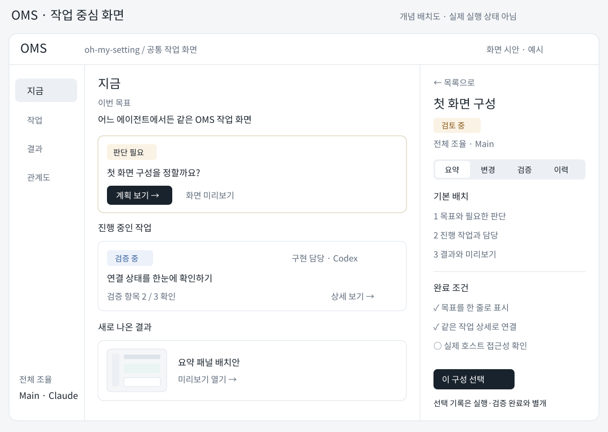
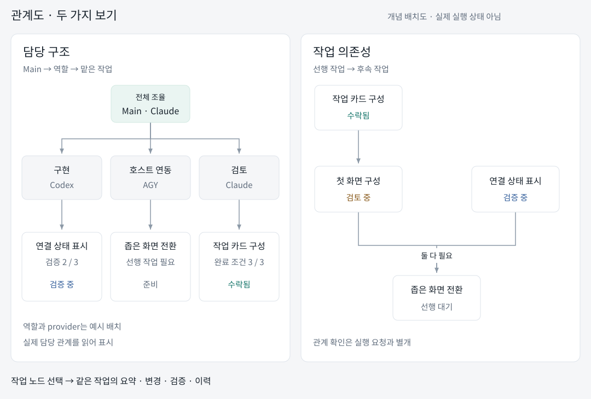

# OMS 공통 작업 화면: 합의한 UI/UX

합의일: **2026-11-24 (KST)**. 상태: **사용자가 선택한 GUI 방향 / 문서·시안 단계**.
기본 화면은 작업과 결과를 중심으로 구성하고, 관계도는 별도 메뉴에서 보여 준다.
이 문서의 병합은 실제 plugin 설치, MCP 연결, native host 렌더링 또는 실행 제어의 완료를 뜻하지 않는다.

[호스트별 control-surface 로드맵 PR #440](https://github.com/eightmm/oh-my-setting/pull/440)의
공통 runtime·capability 방향을 화면 구성으로 구체화한다. 기존
[패널 상호작용 계약](TEAM-ORCHESTRATION-PANEL.md), [Feature scope](FEATURE-SCOPE.md),
[통합 작업 큐](ORCHESTRATOR-WORK-QUEUE.md)의 역할·권한·owner 경계를 유지한다.
[11월 9일 UX/NF 문서](CONTROL-PLANE-UX-AND-FEATURES.md)는 비교 가설과 세부 acceptance의 이력이다.
이번 합의는 아래 GUI 정보 구조를 선택하며, 과거의 모든 후보 기능이나 TUI 배치 변경을 채택하지 않는다.
Terminal의 Work/Overview/Focus와 기존 pane·입력 동작은 [terminal panel 계약](TERMINAL-PANEL.md)을 따른다.

## 1. 결정한 화면 구조

기본 진입은 **지금**이다. 사용자는 현재 목표, 필요한 판단, 진행 작업, 새 결과를 먼저 확인한다.
대화는 기존 Main/native host에서 이어가고, OMS 화면은 같은 작업의 탐색·검토·조작을 담당한다.
화면을 열거나 확장해도 두 번째 Main이나 별도 실행을 만들지 않는다.

| 메뉴 | 처음 보여 줄 내용 | 상세로 이어지는 경로 |
|---|---|---|
| **지금** | 목표 한 줄, 실제로 필요한 사람의 판단, Main 처리 중인 일, 진행 작업, 최근 결과 | 해당 작업의 공통 상세 |
| **작업** | 예정·진행·검토·완료의 짧은 작업 목록과 담당·막힌 이유 | 계획, 완료 조건, 변경, 검증, 이력 |
| **결과** | 화면·문서·변경·검증 산출물의 썸네일이나 짧은 요약 | 미리보기, diff, 원본 근거, PR |
| **관계도** | 담당 구조 또는 작업 의존성 | 같은 작업 상세 또는 해당 역할의 작업 목록 |

기존 Agents 정보는 담당 구조와 작업의 담당 상세, Plan은 작업의 계획·의존성,
Logs는 상세 이력·원문 로그, Review는 결과·변경·검증에 연결한다.
네 메뉴는 이 기능들을 묶는 탐색 구조이며 기존 capability나 reader를 폐기하는 목록이 아니다.

상단에는 허용된 repository/Room과 목표, 현재 Main, 관측 시각을 표시한다.
모델·계정·실행 세대 등 상세 식별자는 필요한 범위에서 펼친다.
사람의 판단이 필요하지 않으면 그 영역을 접는다. Main 권한 안의 일상 복구를 사용자 승인으로 올리지 않는다.

카드는 기본적으로 **작업 이름 / 상태와 이유 / 담당 역할 / 다음 행동**을 짧게 표시한다.
실행 시도와 긴 보고는 작업 아래에서 펼친다. 동일 원인의 여러 attempt를 여러 알림으로 반복하지 않는다.
Provider는 담당의 속성이다. 실제 배정 구조에 따라 Main 직접 작업, direct worker, 선택적 Lead/Team을 표시한다.
Codex·Claude·AGY 세 팀을 항상 생성하거나 provider 이름으로 parent 관계를 추론하지 않는다.

## 2. 화면 시안과 검토 방법

아래 그림과 [상호작용 시안](prototypes/oms-workspace.html)은 **합성된 예시 데이터**다.
실제 OMS 실행 상태, 실제 검증 결과 또는 host에서 촬영한 화면으로 사용하지 않는다.
HTML 파일은 브라우저에서 열어 메뉴·작업 선택·관계 보기·의견 초안의 동선을 검토하는 자료다.
GitHub의 파일 보기에서는 코드로 표시될 수 있다.

첫 화면에서 확인할 질문은 세 가지다: **무엇이 진행 중인가, 내가 판단할 일은 무엇인가, 결과는 어디 있는가**.
관계도는 별도 메뉴에서 연다. 제품의 기본 진입 화면은 관계도 검토 시안의 초기 선택과 무관하게 지금으로 유지한다.

시안에서의 구성 선택과 의견 작성은 예시 상태만 바꾼다. 실제 작업 시작·메시지 전송·PR 변경과 연결하지 않는다.
시안에 없는 동작은 아래 구현 acceptance와 후속 Issue에서 확인하며, 버튼이 보인다는 이유로 지원을 선언하지 않는다.

## 3. 하나의 작업 상세

작업 카드, 결과 카드, 관계도의 작업 노드는 **같은 task identity와 선택된 revision**으로 상세를 연다.
탭 전환이나 provider 필터가 다른 작업을 조용히 선택하지 않는다.

| 상세 그룹 | 내용 |
|---|---|
| **요약** | 목적, 현재 단계와 이유, 담당, 계획과 완료 조건, 다음 주체 |
| **변경** | 화면 미리보기, 변경 파일과 diff, 문서 등 해당 candidate의 산출물 |
| **검증** | 완료 조건별 근거, verifier/review 결과, 미실행·누락·오래된 증거 |
| **이력** | 제한된 event/receipt, 실행 시도, 사용자 요청과 처리 결과 |

새 웹 상세는 기존 Results/Events/Diff reader와 연결하며 별도 review 원장을 만들지 않는다.
새 candidate가 생기면 이전 candidate의 검증을 자동 승계하지 않는다.
원본 보고와 로그는 상세에서 열 수 있게 남기고, 기본 화면에는 최근 변화의 짧은 요약만 둔다.

역할 노드에 상호작용을 붙일 때는 해당 역할과 맡은 작업 목록을 보여 준다.
Main이나 역할 노드의 클릭을 임의의 작업 하나 또는 새로운 에이전트 실행에 연결하지 않는다.
그 목록에서 작업을 선택하면 공통 상세로 이동한다.

## 4. 결과에 맞는 시각 표현

| 결과 종류 | 기본 표현 | 펼쳐서 확인할 근거 |
|---|---|---|
| UI 변경 | 실제 산출물의 화면 썸네일 | 같은 대상·조건의 변경 전후 비교 |
| 코드 변경 | 변경 파일과 핵심 diff | 전체 diff, candidate/base 참조 |
| 계획 | 단계 카드와 완료 조건 | 채택된 계획, 의존 작업, 변경 이력 |
| 검증 | 통과·실패·미실행을 구분한 항목 | 실행 대상 revision과 결과 참조 |
| 문서·기타 산출물 | 종류·제목·짧은 미리보기 | 원본 파일과 생성 근거 |

이미지나 비교 자료가 없으면 **미리보기 없음**을 표시한다. 빈 자리를 합성 이미지나 가짜 결과로 채우지 않는다.
미리보기는 허용된 artifact reference를 읽으며 파일 내용을 실행하지 않는다.
비교 대상의 base·실험 조건이 다르면 차이를 먼저 표시하고 동일 조건의 비교처럼 보여 주지 않는다.
GitHub Project의 전체 backlog 관리는 기존 Project에 연결하고, OMS에는 현재 실행에 필요한 범위를 보여 준다.

## 5. 관계도는 두 가지 의미로 분리

### 담당 구조

- 현재 Room/목표의 유일한 Main, 실제 역할·Lead/worker와 맡은 작업을 연결한다.
- 선은 **조율·배정 관계**를 뜻한다. Provider가 같다는 이유로 노드를 합치지 않는다.
- 관측된 관계와 OMS가 관리하는 관계를 구분한다. 관측된 세션만으로 제어 권한을 표시하지 않는다.
- native child가 관측되지 않으면 **하위 작업 상태 미확인**으로 표시하고 `0명`으로 채우지 않는다.

### 작업 의존성

- 선은 **선행 작업 → 후속 작업**을 뜻한다. 담당 구조나 메시지 전달 관계와 한 그래프에 섞지 않는다.
- 대기 원인은 기존 runtime의 근거와 함께 표시한다. 그래프 선만으로 실제 blocker나 실패 원인을 단정하지 않는다.
- 노드 선택·펼치기·재배치는 읽기 동작이다. 선행 작업 완료나 카드 이동이 새 실행을 자동 시작하지 않는다.
- cycle, 누락된 dependency, 부분 관측은 각각 표시하고 잘못된 연결을 임의 보정하지 않는다.

작업이 많을 때는 선택한 작업의 직접 선행·후속 또는 담당 관계부터 보여 준다.
더 넓은 범위를 펼칠 때 숨겨진 항목 수와 관측 한계를 유지한다.
좁은 화면에서는 같은 관계를 역할별 행 또는 선행/현재/후속 목록으로 재배치하며 글자를 축소하지 않는다.
관계도와 작업 목록을 오가도 선택한 작업과 미전송 의견이 유지된다.

## 6. 화면 크기와 입력

**작은 패널**은 지금 화면과 선택한 작업 요약에 집중한다.
**확장 화면**은 작업 목록과 상세를 나란히 보여 주고 결과 비교나 관계도를 펼친다.
**모바일·좁은 폭**에서는 목록과 상세를 한 번에 하나씩 보여 주고 명시적인 돌아가기 동작을 제공한다.
각 host가 실제 제공하는 컨테이너와 표시 모드에 적응하며 모든 host에 고정 우측 패널을 요구하지 않는다.

- 새 event, 정렬, refresh가 선택한 task, 입력 focus, scroll 또는 미전송 의견을 빼앗지 않는다.
- 상세를 닫으면 원래 목록과 선택 위치로 돌아간다. 화면 닫기는 backend 작업 중단을 뜻하지 않는다.
- 아이콘에는 짧은 문구를 함께 두고 상태는 색상만으로 전달하지 않는다.
- 주요 동작은 키보드와 터치로 접근 가능하며 hover가 필수인 정보나 버튼을 만들지 않는다.
- 긴 한국어·파일명과 확대된 글자를 줄이거나 잘라서 행동 이유를 감추지 않는다.
- 호스트의 기존 대화·단축키·입력 draft를 유지한다. 별도 채팅 composer를 기본 화면에 복제하지 않는다.

## 7. 버튼과 상태의 의미

카드에는 주 행동 하나를 두고 보조 행동은 필요한 것만 표시한다.
읽기 단계의 기본 버튼은 **계획 보기, 변경 비교, 검증 결과, 원본에서 열기**다.
실제 제어는 지원·권한·대상이 확인된 뒤 **이 작업 시작, 계속 진행, 수정 요청, 중단 요청**처럼 구체적으로 표시한다.
중단만 가능한 backend에 일시정지/재개를 약속하지 않는다.

| 구분 | 화면에서 유지할 의미 |
|---|---|
| 관측 상태 | fresh / stale / partial / unknown과 출처·마지막 관측 시각 |
| 실행 상태 | 실행 중, 선행 대기, 입력 필요, 연결 끊김, 실패의 이유를 분리 |
| 완료 근거 | process exited, verified, accepted, published를 각각의 근거로 표시 |
| 요청 처리 | 요청됨, 전달됨, 처리 확인됨을 구분; 중단 요청을 중단 완료로 표시하지 않음 |
| 진행 정도 | 분모가 확인된 완료 조건·검증 항목 수; 추정 시간 백분율이나 가짜 ETA는 사용하지 않음 |

지원 여부와 거절 이유는 기존 capability/writer 결과를 소비한다. UI가 자체 허가 정책을 만들지 않는다.
실행 직전 target·scope·revision·generation 등 기존 계약을 재검사하며, 오래된 카드가 실행 권한이 되지 않는다.
응답이 불명확하면 기존 operation/receipt를 먼저 조회한다. 자동 재전송이나 다른 provider 실행으로 보완하지 않는다.
조회·필터·관계 보기·화면 확장·읽음 처리는 dispatch, approval, 수락, 메시지 전송을 만들지 않는다.

## 8. 기존 구현 작업에 연결

상위 추적은 [Epic #431](https://github.com/eightmm/oh-my-setting/issues/431)이다.
이 문서는 별도의 scheduler, 상태 DB, Project 동기화 엔진이나 새 runtime API를 만들도록 요구하지 않는다.
기존 Rust owner와 read projection, Plan/Room/result 및 typed action 경로를 재사용한다.
구현자가 실제 호출 경로를 확인할 출발점은 [패널 계약](TEAM-ORCHESTRATION-PANEL.md),
[runtime 계약](OMS-RUNTIME.md), [작업 검토](WORK-INSPECTION.md)다.

| 기존 Issue | 이번 UI 결정의 적용 범위 |
|---|---|
| [#432](https://github.com/eightmm/oh-my-setting/issues/432) | host/Main/session identity, capability와 관측 한계 |
| [#433](https://github.com/eightmm/oh-my-setting/issues/433) | 지금·작업·공통 상세의 읽기 projection, 동일 scope/revision |
| [#437](https://github.com/eightmm/oh-my-setting/issues/437) | 실제 변경 버튼의 기존 typed action·권한·receipt 연결 |
| [#438](https://github.com/eightmm/oh-my-setting/issues/438) | host별 패널·확장·fallback, 설치 구성과 실제 지원 확인 |
| [#442](https://github.com/eightmm/oh-my-setting/issues/442) | artifact/diff/검증 결과 미리보기와 검토 동선 |
| [#443](https://github.com/eightmm/oh-my-setting/issues/443) | 선택·미전송 의견·대화 reference와 lifecycle 보존 |

첫 구현은 **지금 → 공통 작업 상세 → 결과 미리보기**의 읽기 동선을 완성한다.
같은 projection으로 담당 구조와 작업 의존성 보기를 붙이고, 기능이 확인된 host부터 적용한다.
실제 실행·수정·중단 버튼은 해당 typed action 작업의 검증 후 연결한다.
읽기 전용 단계에는 실행 버튼을 활성화하지 않고 사용할 수 없는 이유를 표시한다.
모델 사용 우선순위, 전역 도구 잠금, 별도 모델 호출 기능은 이번 UI 합의의 범위가 아니다.

## 9. 구현 완료를 판단할 시나리오

다음 항목은 **후속 구현의 수락 조건**이며 이 문서나 예시 시안만으로 통과했다고 표시하지 않는다.
기존 canonical fixture와 가장 가까운 projection/navigation/result 테스트를 확장한다.
전용 테스트 엔진, 유료 provider 실행, 별도 CI matrix를 이 문서를 위해 추가하지 않는다.

- [ ] 지금 화면에서 현재 목표, 필요한 사람의 판단, 진행 작업과 결과를 찾는다. 판단이 없을 때 빈 승인 카드를 만들지 않는다.
- [ ] 같은 작업을 작업 → 결과 → 관계도 → 상세로 열었을 때 identity, candidate와 근거 참조가 일치한다.
- [ ] 요약·변경·검증·이력을 오가고 목록으로 돌아와도 선택, scroll과 미전송 의견이 유지된다.
- [ ] 관계도에서 담당 관계와 선행 관계를 각각 설명할 수 있다. 부분 관측·미확인 child·누락 dependency를 사실로 보완하지 않는다.
- [ ] 카드 선택·관계도 전환·새로고침·화면 닫기로 launch, Room join, 메시지 전송, 승인 또는 결과 수락이 발생하지 않는다.
- [ ] stale/partial/unknown과 연결 끊김을 구분하고, 오래된 action 또는 응답 불명의 요청을 기존 writer/receipt 경로로 처리한다.
- [ ] worker 종료, 검증 통과, 결과 수락, PR 게시의 근거가 다르면 상태도 다르게 보인다. 미실행과 결과 0을 구분한다.
- [ ] 썸네일·diff·검증 근거가 없을 때 누락 상태를 보여 준다. 다른 revision의 증거를 현재 결과에 붙이지 않는다.
- [ ] 320·768·1024 CSS px의 대표 폭에서 핵심 문구와 버튼이 겹치지 않는다. 좁은 폭에서는 목록/상세와 관계를 재배치한다.
- [ ] 키보드·터치·확대 글자·긴 한국어 label로 탐색하고 focus 복귀를 확인한다. 지원 host/version과 관측 결과를 따로 기록한다.

문서 검토, 시안의 로컬 동작 확인, adapter fixture, 실제 host 실행은 서로 다른 검증 단계다.
후속 PR은 사용한 fixture/revision, 지원 host/version, 미확인 동작과 남은 제한을 기록한다.
