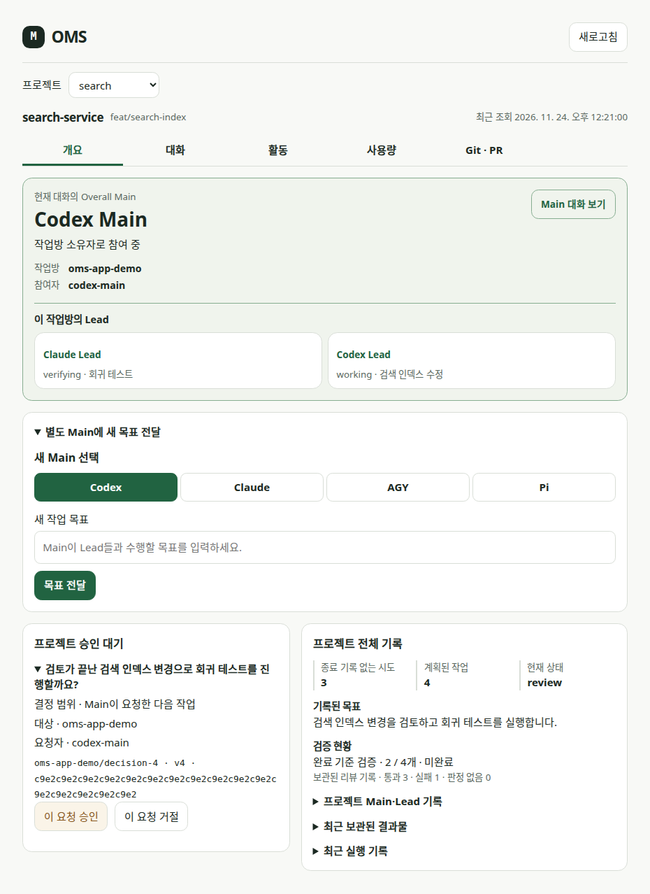

# Collaboration dashboard

This guide is for operators who need a quick read of recorded OMS collaboration.
It covers the terminal dashboard, its JSON contract and the status available in project chats.

`oms dashboard` is a read-only terminal view of what OMS knows about a
repository's collaboration: goal and scope, task/plan and attempt states, which
provider and model ran each recorded operation, acceptance evidence, and the
next decision from the inbox.

```bash
oms dashboard --repo PATH                       # one snapshot
oms dashboard --repo PATH --json                # schema-1 projection
oms dashboard --repo PATH --watch               # refresh every 5 s until Ctrl-C
oms dashboard --repo PATH --watch --interval 10 --count 3
```

`--interval` takes whole seconds (minimum 2, default 5). `--count` stops after
N refreshes. On a terminal each refresh clears the screen after the new view is
rendered. When stdout is a pipe or file, snapshots are appended and separated
by a `----` line. Nothing is erased. `--json` emits one snapshot and cannot be
combined with `--watch`. Width follows `COLUMNS`, then `tput cols` on a
terminal, otherwise 120 columns.
Terminal watch mode also follows `LINES` or `tput lines` (default 24), keeping
summary headings, model routes, failures and the next decision visible while
omitting older details. The footer says how many lines are hidden; a single
snapshot or JSON retains the bounded detailed view.

Exit status: `0` when every source was collected, `1` when the view is degraded,
`2` for usage errors, and `130` on Ctrl-C.

## What it reads

Each refresh runs three existing read-only queries:

| Source | Query | Used for |
| --- | --- | --- |
| state | `oms state --json` | goal, scope, task, plan, attempt counts, delegations, acceptance criteria, inbox attention |
| artifacts | `oms artifact-index --json list 8` | recent operations, provider/model attribution, review rows |
| attempts | `oms agent-events list --limit 8 --json` | recent attempts with reported usage |

The attention section comes from the same `project_inbox` projection as
`oms inbox`, applied to the state snapshot. The dashboard does not write `.oms`
or call a model. It does not refresh CI, touch the network, or keep a store of
its own. The lifecycle stream is read twice per refresh: once inside
`oms state` and once for per-attempt usage, which the compact state omits.

## Reading the view

- **Coverage.** Only OMS-managed records are shown. A native provider subagent
  that never wrote OMS state does not appear. The dashboard does not infer a
  supervising agent or a plan/execution/integration stage.
- **Unknown is not zero.** A missing owner, model, token count, or cost shows
  as `unknown` in text and `null` in JSON. Attempt usage counts only when the
  provider reported it.
- **Model attribution.** `model=` is the selected route model recorded at
  dispatch. `served=` is the model the provider reported running, or
  `unreported`. `route=` is the recorded route class (`explicit`,
  `role-default`, `provider-default`, `fast`, `balanced`, `deep`). A fallback
  shows its recorded reason, and any reason outside the known set shows as
  `other`.
- **Completion is not acceptance.** A `done` attempt only means that the
  worker stopped. Acceptance is the evidence status of each criterion:
  `verified`, `failed`, `missing`, `stale`, `inconclusive`, or
  `skipped_with_reason`. Failed and stale criteria are listed first.
- **Reviews.** `review gate:` counts recorded `review-outcome` rows
  (exit 0 = pass; missing exit = unknown). These are historical counts over
  the listed window, not proof of a review for the current tree. If none were recorded, it says
  `none recorded in window (not a pass)`. Seat answers (`kind=review`) are
  counted separately, because a seat answering is not a verdict.
- **Degraded collection.** A source that fails or returns an unsupported
  contract adds a `COLLECTION FAILED <source>: ...` line, and its section
  reads `UNAVAILABLE`. Only the collector exit code is displayed: stderr may
  quote private record contents. A source larger than 4 MiB is unavailable
  rather than silently truncated into a healthy-looking snapshot.

Every label is treated as untrusted. Control characters, including terminal
escapes, BEL, and C1 codes, are replaced with `?`, and so are format characters
such as bidi overrides and zero-width characters. Labels are truncated, each
list shows at most 8 rows plus an omitted count, and each line fits the
terminal width. The view never includes artifact task goals, approval
summaries, patch or artifact paths, prompts, or transcripts. Panel-managed
attempts can include a bounded descriptive task title and relative execution
location; [the terminal panel](TERMINAL-PANEL.md) records explicit role and main
relationships. Generic attempt parent IDs are not assumed to mean supervision.

## Sample

Illustrative output from the operator test fixture:

```text
OMS dashboard  repo=demo  main@b6c3a2aa8c39  snapshot=2026-10-04T00:51:30Z
coverage: OMS-managed records only; native provider subagents are not observed
goal: operator fixture (plan)
scope: unbounded (none recorded)
task: none active
plan: 2 task(s)  ready=1 review=1  actionable=ready_task
attempts (OMS lifecycle): 1 total, 0 active  cancelled=1
  att_one cancelled codex/agent-supervisor task=task_one tokens=12 cost_microusd=7 2026-08-01T00:00:03Z
delegation: live codex started=2026-08-01T00:00:00Z live
operations (artifact index, newest first):
  codex delegate model=unknown route=unrecorded exit=0 success served=unreported tokens=unknown at=2026-08-01T00:00:10Z
  claude review model=unknown route=unrecorded exit=1 unresolved served=unreported tokens=unknown at=2026-08-01T00:00:07Z
  codex call model=gpt-test route=explicit fallback=other exit=0 success served=gpt-served tokens=120 at=2026-08-01T00:00:05Z
review gate: none recorded in window (not a pass)  seat answers=1
acceptance: 0/2 verified  missing=2  (worker completion is not acceptance)
  missing plan-task-ready_task [plan-task] Plan task ready_task is admitted.
  missing plan-task-review_task [plan-task] Plan task review_task is admitted.
attention: 2 item(s)
  P1 unresolved-artifacts: 1 unresolved artifact outcome(s)
     next: oms artifact-index --repo . unresolved; oms artifact-index --repo . resolve-recovered --dry-run
  P3 runtime-evidence-missing: 2 acceptance criterion/criteria lack current evidence
     next: oms runtime evidence show
next decision: initialize_project (repo_write): oms init
```

## JSON schema 1

`--json` prints one object. Its fields are additive, and removing or retyping
one requires a schema bump.

| Field | Type | Meaning |
| --- | --- | --- |
| `schema`, `kind` | `1`, `"oms-dashboard"` | contract identity |
| `generated_at` | UTC timestamp | snapshot time |
| `repo` | `{name, branch, head}` | directory name, branch, 12-character HEAD, or `null` |
| `coverage` | string | the OMS-managed-records-only statement |
| `collection` | `{ok, sources: {state, artifacts, attempts}}` | each source is `"ok"` or a sanitized error |
| `goal` | `{text, source}` or `null` | recorded objective (`task`, `plan`, or `project`) |
| `scope` | `{allowed[], forbidden[], source}` or `null` | `source` is `unbounded` when nothing is recorded |
| `task` | object or `null` | `present, healthy, task_id, status, verification, stale, next` |
| `plan` | object or `null` | `present, healthy, task_count, by_state, actionable[], stale_claims, stale_reviews, contract_blocker` |
| `attempts` | object | `available, total, active, by_state, recent[], active_recent[], note`, plus `error` when unavailable |
| `attempts.recent[]` | object | `attempt_id, state, provider, tool, task_id, reason_code, updated_at, tokens, cost_microusd` |
| `attempts.*[]` panel metadata | object, when explicitly recorded | Additive `parent_attempt_id` and `panel {role, owner, purpose, workload, model, effort, location, access, label}`. Locations are `repository` or a relative `worktree:` token; models are requested selections. |
| `attempts.active_recent[]` | object | Up to eight current attempts, newest update first: `attempt_id, state, provider, tool, task_id, reason_code, updated_at`. Independent of the recent outcome window. |
| `delegations` | array or `null` | Up to five markers, live first: `id, provider, role, task_id, requested_model, reasoning_effort, live, started_at, location`. Location is a relative worker worktree token. Requested model is marker configuration, not proof of the served model. |
| `operations` | object | `available, recent[], omitted`, plus `error` when unavailable |
| `operations.recent[]` | object | `event_id, ts, kind, provider, task_id, attempt_id, exit, status, verify_exit, route_class, requested_model, selected_model, served_model, model_attribution, fallback_used, fallback_reason, tokens, provider_usage, cost_usd`; `provider_usage` is `null` or `{input_tokens, output_tokens, cache_read_tokens, cache_write_tokens, cache_in_input}`, counts only |
| `reviews` | object or `null` | `outcomes, passed, failed, unknown, seat_answers` over the listed window |
| `acceptance` | object or `null` | `available, total, counts, complete, criteria[] {id, status, source, text}, omitted, note` |
| `attention` | object or `null` | `actionable, items[] {priority, code, summary, command}, omitted, next[] {id, authority, command}` |

When the state source is unavailable, every section derived from state is
`null`. A `null` means "not known", never "none".

## OMS in Codex and ChatGPT Work

In a Codex project with OMS installed, ask **“@oh-my-setting 이 프로젝트 패널 상태 보여줘. Main과 Lead가 어떤 작업을 하고 있어?”**.
The `oh-my-setting` plugin supplies Codex hooks, including optional skill
hints. The project host’s separately configured OMS MCP server (Core or Full)
supplies the read-only `oms_panel_snapshot` tool. The assistant passes the
current project checkout in `repo` and reports the snapshot in the conversation.
For a bundled MCP connection, select the standalone **OMS** marketplace entry
below.

Both connections use the repository projection from
`oms dashboard --json --panel-snapshot`. It identifies the repository, branch
and collection time, the recorded Main and bound Room when available, active
and recent attempts, current task state, recent operation outcomes, review and
acceptance counts, and inbox attention. Only attribute a row to a Main or Lead
when records link them. Provider-native workers without a record have unknown
status. Ask again in the same chat to refresh.

For **this conversation’s Main**, Codex supplies the current thread ID on each
MCP tool call. OMS checks whether that thread is enrolled as the Codex owner
of an open Room in the selected repository. A matching Room identifies the
Main for this chat. Opening or refreshing the panel only reads existing
membership. Choosing a provider and submitting a goal explicitly starts a
separate managed Main. Project-wide attempt and acceptance counts retain
their repository scope. If OMS cannot establish a single match, the panel
leaves this conversation’s Main unconfirmed.

### How the panel reaches the runtime

| Surface | Data and control path |
| --- | --- |
| Codex project chat | The assistant calls the OMS MCP tool. Rust collects project state, attempts and artifact outcomes and returns a bounded snapshot for the reply. |
| ChatGPT Work content tab | The host renders the plugin’s HTML and forwards its tool requests over MCP. Refresh reads the same Rust dashboard. Start and approval use separate project-scoped tools. |
| Terminal panel | The Rust TUI calls native OMS panel services directly and can attach to managed tmux sessions. It draws the Board from project and provider records. |

When a user submits a goal through **@OMS**, the selected Main coordinates the
work on the project host. An authorized provider Lead can delegate to its
native workers. Their recorded attempts, task updates, results and evidence
supply later status queries. An approval in the Work tab answers the selected
Room question. [Terminal panel](TERMINAL-PANEL.md) ·
[Main and Lead responsibilities](TEAM-ORCHESTRATION-MAIN-POLICY.md).

### Select a Main and give it a goal

In the desktop app, mention **@OMS** in a project chat. For example, ask
“Use Claude as Main for the docs project and have its leads review the API
examples.” In the same conversation, ask “What are the leads working on?” or
“What needs my approval?”. When OMS has multiple connected projects, select
the intended project by its alias. Main and Lead execution, state and provider
authentication live on that project's OMS host.

In ChatGPT Work, open **OMS** from the conversation's content-tab picker for
the Main selector, goal editor, project progress and pending decisions. In
Codex, use the same plugin tools directly in the conversation. Acknowledging a
goal means the Main received a launch request. Work in progress and outcomes
come from runtime records. Approve or deny a specific pending question after
reviewing it. A stale review requires a fresh decision. The approval is an
answer to that question for its Main to consume.

If the start response is lost, ask OMS to check that request in the same
chat. `oms_start_status` looks up the original project and request UUID.
`not_found` allows a retry with that UUID. `reserved` identifies the Room
while launch remains unconfirmed. `recorded` returns the matching attempt
and its state.

The panel below uses seeded project data.



### If the tab fails before the OMS heading appears

A tab listed in the picker can still lack an MCP connection in the open
conversation. With the legacy **OMS Panel** preview, a running Codex executor
listed the installed plugin and could read its HTML globally, while the open
chat returned `unknown MCP server 'oms-panel'` for both the resource and
`oms_open_panel`. Reloading the executor’s MCP configuration left that chat
in the same state.

To recover the **same conversation**, the executor operator re-registered
the already-enabled, identical local package using `plugin/install` on the
running app-server with its registered `marketplacePath` and `pluginName`.
The existing thread could immediately read the HTML, call `oms_open_panel`
and retrieve its project snapshot. The source, cached package, marketplace and
user configuration kept their original contents. Reopen the tab to retry the
view. A new chat in the same project after registration also worked in an
isolated app-server test.

To diagnose a specific thread, compare its named `mcpServerStatus/list` and
`mcpServer/resource/read` results with the host-wide results. Use the server
name and environment advertised by that plugin. Repeat the opener and HTML
read on the same connection while a status query is running. Earlier servers
queued both behind a slow project snapshot. The panel server now serves
those requests independently. Its widget also acknowledges host `ping` and
`ui/resource-teardown` requests, including when the host and widget happen
to use the same request ID.

If clicking **Retry** produces only a desktop inventory request, the executor
has no opener or resource-read result for that click. The desktop renderer’s
diagnostic log is needed to locate that failure. A rendered panel showing
degraded data has reached OMS and describes collection on the project host.

### Register a marketplace once

Choose one transport for the app's **execution host**. Both expose the same
`@OMS` tools. The existing `oh-my-setting` entry supplies separate lifecycle
hooks.

| Where the app can execute plugin tools | Marketplace path in this repository | Entry |
|---|---|---|
| On a supported OMS host, including a Codex project running on that host | Repository root | `oms@oh-my-setting-local` |
| On a PC using OpenSSH to reach the OMS project host, including Windows Work | `plugins/oms-ssh` | `oms@oms-ssh` |

For a managed workspace, an admin can open **Admin → Plugins → Add → Import
marketplace** and use `https://github.com/eightmm/oh-my-setting` as the Source.
Leave **Path** empty for the root catalog or enter `plugins/oms-ssh` for the SSH
catalog. Select a branch or commit when testing a PR. Once the catalog is
available on the execution host, select **OMS** in the app's Plugins directory.
Its setup conversation checks the connection and offers the available projects.
For a direct connection, it can register the active checkout with the owner's
permission. Start a new project chat or continue the installation chat. [Workspace import](https://learn.chatgpt.com/docs/enterprise/plugin-management)
and [personal and repo marketplaces](https://developers.openai.com/plugins/build/plugins).

### Connect the project host

The project host needs an OMS build containing the desktop tools, tmux, and
an available provider for the selected Main and leads. Use the same OS account
that owns the projects and provider sessions.

- **Direct execution.** The plugin starts `oms mcp-server` from PATH. A
  project-scoped executor can supply the project checkout as its working
  directory. Codex 0.172.0 starts bundled servers in their plugin cache. For
  that case, register the alias map below once on the project host. The
  direct server can also receive `OMS_PANEL_PROJECTS` or one pinned checkout
  in `OMS_PANEL_REPO`. A shell-capable project conversation can invoke the
  same typed operations from its active checkout when the direct
  server lacks a project binding. The panel itself uses its MCP connection.
- **Windows or another remote desktop.** The SSH package uses the desktop's
  OpenSSH client. Configure the SSH alias `oms-runtime` once for the existing
  OMS account and host, with its verified host key and a key or agent that
  already authenticates noninteractively. An existing OpenSSH entry with
  an explicit `HostName` can include `oms-runtime` as a second name on its
  `Host` line. The plugin opens a binary-clean stdio connection to that alias
  and runs the server's `~/.local/bin/oms`. The desktop holds no OMS runtime
  or project checkout. [SSH package](../plugins/oms-ssh/oms/mcp.json).

To register projects, put the project map at
`~/.config/oh-my-setting/desktop-projects.json` **on the OMS host**, readable and
writable by its owning account only, for example with file mode `0600`.
The direct package also honors an
absolute `XDG_CONFIG_HOME` for the config directory. Use absolute
physical paths to Git checkouts or adopted OMS projects that this desktop
connection may manage. For example, this map offers two choices in the same
plugin.

```json
{
  "docs": "/srv/projects/docs",
  "engine": "/srv/projects/engine"
}
```

Keep access to that map and SSH account restricted to the intended operators.
Refresh OMS after changing the map to see the current choices. Each call on a
mapped connection identifies a project by alias. The plugin accepts the
project paths from the host configuration. SSH uses strict host key
verification and disables forwarding and interactive authentication.
[Plugin thread entrypoints](https://developers.openai.com/plugins/build/extensions).

### Git and GitHub in the desktop panel

The dashboard reads the selected checkout's branch, full HEAD, tracked and
untracked changes, upstream, and local ahead/behind counts in one Git status
call. Counts compare against the locally stored upstream ref. Detached HEAD,
unborn branches and missing upstreams retain the values Git can establish.

The GitHub action invokes `oms_panel_git_status` (CLI equivalent
`oms github panel-status --repo PATH --json`). It reads open pull requests
from the checkout's github.com origin using the runtime host's GitHub CLI.
For the selected branch it shows whether the local HEAD matches the PR.
It also recognizes PRs whose origin branch **and** head match a registered
linked worktree. A fork with a coincident branch name does not qualify.
The title, check counts and up to six named checks belong to the observed PR head. Failed and pending checks appear first. Zero checks means none
were reported. The response marks truncated or partial results, unsupported
origins, and unavailable GitHub access. Opening or refreshing the dashboard
uses local Git alone. This action does not fetch refs or change the checkout.

In the panel, **Usage** shows the provider and attempt counters that OMS
actually recorded. **Chat** reads messages shared with the enrolled Main and
the selected participant. Inspect its linked result or evidence when available.
The TUI views read the native Board, plan, teams, routing policy, metrics,
results, and workspaces on demand. Sessions, Attention, Past, Council and
Activity require this conversation's enrolled Main. Council shows the number
of recorded answers and their model names when a validated linked thread
exists. Activity shows recent Room message metadata addressed to the Main.
Capacity shows the recorded resource policy and its occupancy when configured.
