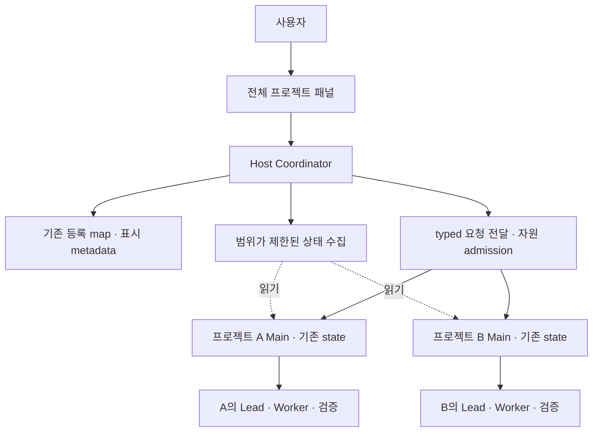

# 한 컴퓨터의 여러 OMS 프로젝트: 통합 패널 구현 인계

> **설계·구현 인계 문서. 문서 병합은 runtime 구현·설치·배포 완료가 아니다.**
> 작성: 2026-11-27 KST. 소스 기준: main
> [`0e9b93cabdaa6b7c8d4abbb18a424a701a285574`](https://github.com/eightmm/oh-my-setting/commit/0e9b93cabdaa6b7c8d4abbb18a424a701a285574).
> 추적: [#668](https://github.com/eightmm/oh-my-setting/issues/668), 상위
> [#431](https://github.com/eightmm/oh-my-setting/issues/431), 재사용 계약
> [#619](https://github.com/eightmm/oh-my-setting/issues/619). 아래 새 DTO·tool·action 이름은 제안이다.

## 1. 목표와 첫 완료 범위

한 컴퓨터에 등록한 여러 프로젝트를 모아 보고, 각 프로젝트의 Main이 자기 목표와 구현을
책임지게 한다. 통합 패널은 프로젝트 중요도, 필요한 판단, 실행 현황과 자원 대기를 연결한다.
외부 프로그램 연동 확장은 현재 보류한다. Jira·Linear·Slack, 공개 Gateway, 여러 컴퓨터의
Runner와 새 daemon은 첫 화면의 선행 조건이 아니다. 기존 연동 코드를 제거하는 뜻도 아니다.

첫 milestone은 **등록된 프로젝트 3개를 읽고, 한 프로젝트가 응답하지 않아도 나머지를 표시하며,
선택한 프로젝트의 기존 v38 상세로 정확히 들어갔다 돌아오는 것**이다. 이 단계에서 등급은
표시·정렬에만 사용한다. 프로젝트를 읽는 행위로 Main 실행, tick, 유료 provider 호출을 시작하지 않는다.

v1의 운영 단위는 논리 프로젝트마다 활성 목표 1개와 대표 Main 1개다. 다른 Room·과거 목표·
기존 세션은 보존한다. 대표 Main이 모호하면 선택 필요 또는 미확인을 표시하고 다른 Main을 종료하지 않는다.
Main의 책임은 지속되지만 모델 세션은 잠들거나 종료될 수 있다. 등록·상주 관측·자동 재개는 별도 기능이며,
provider마다 resume·관측·취소를 실증하기 전에는 동등한 지원이라고 표시하지 않는다.

## 2. 현재 구현과 기존 PR의 재사용

아래 상태는 위 기준 SHA와 2026-11-27 조사 시점의 기록이다. 착수 직전 main과 open PR을 다시 읽는다.
[기존 인계서](RESIDENT-PROJECT-IMPLEMENTATION.md)와 #619 본문의 과거 open 표는 당시 기록으로 보존한다.

| 기존 항목 | 확인한 상태와 의미 | 이번 작업에서의 처리 |
|---|---|---|
| [#666](https://github.com/eightmm/oh-my-setting/pull/666) | host 전용 프로젝트 등록·해제·목록 CLI 병합 | 새 register 명령을 만들지 않고 같은 map을 소비 |
| [#600](https://github.com/eightmm/oh-my-setting/pull/600), [#613](https://github.com/eightmm/oh-my-setting/pull/613), [#616](https://github.com/eightmm/oh-my-setting/pull/616) | 모두 병합됨; 상세 UX·명시적 발췌 공유·관리형 Plan context 연결 | 기존 v38 상세와 binding·receipt 경계를 재사용 |
| [#608](https://github.com/eightmm/oh-my-setting/pull/608), [#627](https://github.com/eightmm/oh-my-setting/pull/627) | 병합된 설계 문서 | runtime 완성 근거가 아니라 PIPE·상주 설계의 출처 |
| [#659](https://github.com/eightmm/oh-my-setting/pull/659) | 기존 Linear intake 구현 병합 | 보존하되 외부 adapter 확대는 현재 범위에서 보류 |
| [#661](https://github.com/eightmm/oh-my-setting/pull/661) | 로컬 Claude quota fallback 표시 구현 | display-only/never-routing 경계 유지; 실행 배정 권한으로 사용하지 않음 |
| [#665](https://github.com/eightmm/oh-my-setting/pull/665) | 병합됨; state와 services의 group proof | 기존 group-proof 구현을 재사용하고 중복 구현하지 않음 |
| [#667](https://github.com/eightmm/oh-my-setting/pull/667) | 조사 시점 open; panel Claude wake/chat | 대표 Main 재개·대화 작업과 겹치면 기존 owner와 먼저 조율 |

기존 공개 진입점은 `oms panel --register-project [PATH] [--alias NAME]`,
`oms panel --unregister-project NAME`, `oms panel --projects [--json]`이다.
map은 alias→절대 checkout 경로의 JSON이며 최대 128개·16 KiB다. 등록은 실행 허가가 아니다.
CLI의 `StrictProjectMap`은 중복 alias key를 거부하지만 MCP `configured_projects`는 현재
`serde_json`의 `BTreeMap` 역직렬화를 사용하므로 중복 key가 덮어써질 수 있다. 첫 slice에서 이 차이를 좁힌다.

### 현재 source와 fixture 소유권

| 책임 | 재사용할 정확한 source | 기존 검증 위치 / 경계 |
|---|---|---|
| host catalog 쓰기·읽기 | [desktop_projects.rs](../crates/oms-command-panel/src/desktop_projects.rs), [panel CLI](../crates/oms-command-panel/src/cli.rs) | [panel_parity.rs](../crates/oms-command-panel/tests/panel_parity.rs)의 `desktop_projects_registry_and_reader_parity` |
| MCP catalog·caller binding | [panel.rs](../crates/oms-mcp-server/src/panel.rs)의 `configured_projects`, `panel_repo`, `panel_call` | [native.rs](../crates/oms-mcp-server/tests/native.rs)의 `cross_host_project_reads`, `mcp_app_binding_boundaries` |
| physical project key | [reviewed_context.rs](../crates/oms-command-plan/src/reviewed_context.rs)의 `project_key` | 기존 MCP·Plan의 physical binding fixture; 논리 ID와 분리 |
| 실행 root와 state root | [services.rs](../crates/oms-runtime/src/services.rs)의 `RuntimeRoots` | [runtime_contract.rs](../crates/oms-runtime/tests/runtime_contract.rs); 둘의 동일성 추정 금지 |
| project snapshot·관측 | [state_projection.rs](../crates/oms-command-state/src/state_projection.rs), [MCP panel](../crates/oms-mcp-server/src/panel.rs)의 `panel_snapshot_projection` | projection 내부 fixture와 MCP native; 병합된 #665의 state/services group proof 재사용 |
| Main·Room의 실제 소유권 | [panel control](../crates/oms-panel-core/src/control.rs), [native panel](../crates/oms-command-panel/src/native_panel.rs) | [panel-core parity](../crates/oms-panel-core/tests/parity.rs), [panel parity](../crates/oms-command-panel/tests/panel_parity.rs) |
| v38 상세·late response 처리 | [conversation-panel.html](../crates/oms-mcp-server/src/conversation-panel.html) | [conversation-panel.test.mjs](../crates/oms-mcp-server/tests/conversation-panel.test.mjs); #667과 겹침 확인 |
| 프로젝트 내부 배정·병렬 실행 | [parallel.rs](../crates/oms-command-autonomy/src/parallel.rs), [Plan engine](../crates/oms-command-plan/src/engine.rs) | [parallel_run.rs](../crates/oms-command-autonomy/tests/parallel_run.rs); host-wide admission은 별도 후속 |
| 기존 자원 정책·reservation·정산 | [services_resources.rs](../crates/oms/src/services_resources.rs), [telemetry resource store](../crates/oms-command-telemetry/src/store/resources.rs) | services 내부 `native_resource_cli_pins_host_policy_and_shared_state_without_main`; 현재 scope는 `repository-host-local-observed` |
| 요청·취소·결과 | [MCP peer](../crates/oms-mcp-server/src/peer.rs), [lead_turns.rs](../crates/oms-mcp-server/src/lead_turns.rs), [supervisor lifecycle](../crates/oms-supervisor/src/lifecycle.rs) | 기존 MCP native·panel parity와 해당 owner의 receipt; 새 전역 task DB 없음 |

## 3. 구조와 책임



Host Coordinator는 논리적 책임 이름이다. 처음부터 새 crate·daemon·프로세스를 요구하지 않는다.
기존 MCP/CLI의 서비스 경계 안에서 등록 조회, 관측 projection, 명령 routing을 분리해 구현할 수 있다.
공통 reader를 추출할 때는 현재 crate 의존성 방향을 확인한다. 두 caller가 같은 crate를 이미
의존한다고 가정하거나 parser 하나를 위해 UI·실행 의존성을 서로 끌어오지 않는다.

| 계층 | 소유하는 결정 | 위임하지 않는 책임 |
|---|---|---|
| 사용자 | 목표·범위·중요도·운영 정책 | 새 권한과 범위의 결정 |
| Host Coordinator | 등록·표시 metadata·관측·정확한 요청 routing·host 자원 배정 | 프로젝트 task 계획·수락을 대신하지 않음 |
| 프로젝트 Main | 자기 목표·계획·Lead/Worker 배정·검증·수락 | 기존 Room·Plan·lease·approval·publication owner 유지 |
| Lead·Worker | 맡은 범위의 수행·근거 반환 | 전역 UI에서 우회 지시를 받거나 권한을 확대하지 않음 |

전역 요약 assistant는 나중에 구조화한 변경·질문을 읽고 제안할 수 있다. 두 번째 Overall Main,
모든 대화의 상시 수집기, 별도 작업 원장이 되지 않는다. 실제 변경은 같은 typed owner 경로를 거친다.

## 4. identity와 호환성

### 프로젝트 이름과 실행 대상을 분리한다

| 식별자 | 의미 | 바뀔 때의 처리 |
|---|---|---|
| logical `projectId` | 사용자가 관리하는 프로젝트의 지속적인 표시 identity | 표시 metadata에서 명시적으로 할당; 이름 변경만으로 재발급하지 않음 |
| alias | 기존 host map의 선택 이름 | 다른 경로로 재사용되면 예전 명령·선택을 무효화 |
| `projectKey` | 현재 소스가 path/dev/inode에서 만드는 physical checkout identity | 이동·교체·재등록 시 다시 관측; 논리 ID로 대체하지 않음 |
| binding generation | 논리 프로젝트와 catalog entry의 연결 세대 | 명시적 rebind 후 증가; 이전 요청을 새 대상으로 전달하지 않음 |
| execution/state root | 실제 작업 위치와 OMS state 위치 | worktree와 parent 관계는 기존 resolver의 증거를 소비 |
| Room·owner generation | 해당 실행을 통제하는 현재 Main | takeover·restart 후 기존 owner의 fence로 재검증 |

첫 aggregate read는 alias+physical key로 시작할 수 있다. logical ID migration을 선행 조건으로
만들지 않는다. 명시적인 metadata mutation 전에는 `projectId`를 `null`/미할당으로 둔다.
나중에 metadata를 붙일 때 현재 binding을 검증하고 할당하며, 이전 관측을 새 ID의
실행 이력으로 자동 승격하지 않는다. 같은 Git remote나 비슷한 이름은 프로젝트 병합 근거가 아니다.
여러 worktree를 한 프로젝트로 묶으려면 명시적 binding과 state-root 관계가 필요하다.

catalog의 경로 owner는 계속 기존 map이다. 표시 overlay는 catalog entry와 physical key를 참조하며
독립 path registry를 저장하지 않는다. 기본 map 위치, `OMS_PANEL_PROJECTS_FILE`,
`OMS_PANEL_PROJECTS`, `OMS_PANEL_REPO`, cwd fallback의 기존 의미를 보존한다.
inline map은 기존 읽기 방식으로 소비하고 등록 writer로 덮어쓰지 않는다. pinned panel을 catalog
조회로 우회하거나 delegated worker에게 다른 프로젝트 목록을 노출하지 않는다.
공통화 대상은 검증 가능한 parsing/읽기 부분이다. CLI·MCP의 host/delegated/pinned/inline 정책은
caller별로 남겨 conformance로 확인한다. 명시적 빈 map 거부와 symlink·파일 권한 경계도 보존한다.

### 표시 metadata 예시 — 제안

아래 JSON의 `<...>`는 server가 확인한 값의 자리이며 실행 가능한 요청이 아니다.
overlay 저장 위치·version·writer는 HP-03에서 확정한다. 읽기만으로 파일을 만들거나 `.oms`를 수정하지 않는다.

```json
{
  "schema": 1,
  "kind": "oms-host-project-metadata",
  "revision": 3,
  "projects": [{
    "projectId": "project-example-01",
    "label": "EFF-Dock",
    "importance": "A",
    "operatingModePreference": "assist",
    "lifecyclePreference": "active",
    "binding": {
      "alias": "eff-dock",
      "projectKey": "<independently observed physical key>",
      "generation": 2
    }
  }]
}
```

metadata의 선호값은 실행 허가나 적용 완료가 아니다. 현재 effective mode와 hold 상태는 기존
권한·owner receipt에서 별도로 읽는다. alias가 사라지면 orphan metadata로 보존하되 실행 대상에서
제외한다. 재등장한 다른 physical key에 자동 연결하지 않으며, 사용자 의도에 따른 rebind가 필요하다.

## 5. 등급·운영 정책·상태를 별도 축으로 유지한다

| 축 | 제안 값 / 예시 | 의미 |
|---|---|---|
| 중요도 | S 핵심, A 높음, B 일반, C 낮음, 미설정 | 사용자 설정; 처음에는 표시·정렬만 변경 |
| 운영 정책 | observe, assist, autonomous | autonomous도 이미 허용한 목표·backlog 안의 실행만 가능 |
| lifecycle | active, paused, archived | paused의 적용 여부는 admission hold receipt로 확인; archived는 기록 삭제가 아님 |
| 실행 단계 | idle, planning, executing, validating, waiting_user, waiting_capacity, draining | 현재 수행 상태와 대기 이유 |
| attention | 심각도·원인·대상·해결 여부 | 등급과 별개로 필요한 판단을 우선 표시 |
| freshness | fresh, stale, unknown | 관측 시각의 신뢰 범위; 실제 실행 성공·실패와 별개 |
| 수집 완전성 | complete, partial, unavailable | 최신 응답도 일부 source를 읽지 못했을 수 있음 |

observe는 읽기 전용, assist는 현재 허용된 목표를 끝낸 뒤 대기, autonomous는 이미 허용되고
실행 조건을 충족한 backlog를 이어 수행하는 정책이다. assist가 매 단계마다 승인을 받는다는 뜻은 아니다.
등급 변경이 자동수행·비용·merge·publish 권한을 늘리지 않는다. 낮은 등급의 심각한 장애는 높은
등급의 일상 알림보다 먼저 보인다. 등급 미설정·관측 불가를 B·0·정상으로 채우지 않는다.
UI의 운영 정책 선택은 지원 여부와 적용 결과를 함께 보여준다. 지원하지 않는 재개 기능은
설정값만 저장한 뒤 실행 가능이라고 표시하지 않는다. 일시 집중은 만료 시각을 가진 별도 override다.

예시: `EFF-Dock · A · assist · validating · 판단 0건 · 4초 전 확인`.
`Main 설정됨`, `세션 연결됨`, `현재 수행 중`은 다른 정보다. Worker 종료는 결과 수락이 아니다.
진행률 대신 목표 revision과 `완료 조건 5개 중 3개 검증됨`을 우선 표시하고,
분모·검증 근거를 모르면 단일 퍼센트를 만들지 않는다.

## 6. 여러 프로젝트의 읽기 계약

새 읽기 tool의 후보 이름은 `oms_host_portfolio_snapshot`이다. **아직 구현된 API가 아니다.**
별도 tool에서 명시적으로 등록 프로젝트 범위를 요청한다. `oms_panel_snapshot`의 `project` 생략을
전체 프로젝트 조회로 재해석하지 않는다. 기존 single-project tools와 read-only profile을 보존한다.
pinned/cwd 문맥에는 기존 단일 프로젝트 상세를 제공하고, catalog 전체 읽기를 묵시적으로 열지 않는다.

첫 구현은 cursor 기반 paging과 제한된 동시 수집을 사용한다. 초기 제안 상한은 페이지당 프로젝트 20개,
동시 수집 4개, 프로젝트별 2초, 요청 전체 5초이며 fixture와 실제 측정 후 조정한다.
전체 budget이 먼저 끝나 시작하지 못한 행은 `not_collected`와 `budget_exhausted`를 명시하고
counts/attention을 `null`로 돌려준다. 행을 숨기거나 idle·실행 0개로 바꾸지 않는다.
timeout은 관측용 child만 종료·회수하며 프로젝트 Main/Worker를 죽이지 않는다. 종료할 수 없는
동기 호출을 timeout처럼 포장하지 않는다. 페이지 및 응답 byte 상한과 omitted 수를 명시한다.

- catalog 자체가 유효하지 않으면 오류로 종료한다. 일부 프로젝트의 timeout·권한 오류는 해당 행만 실패시킨다.
- cursor는 catalog revision·caller scope·정렬 조건에 묶는다. map 변경 시 재시작을 요구하며 누락·중복을 숨기지 않는다.
- source별 `observedAt`과 수집 `collectedAt`을 구분한다. source timestamp가 없으면 `null`이다.
- unavailable 행과 실패 source의 counts는 `null`/unknown이다. 확인되지 않은 0·빈 판단함을 만들지 않는다.
- `atomic: false`를 명시한다. 여러 프로젝트 및 여러 owner의 원자적 snapshot을 약속하지 않는다.
- cache는 caller scope·physical key·binding generation으로 분리한다. 최초에는 메모리 cache면 충분하다.
- stale cache는 마지막 확인 시각과 함께 보여준다. rebind·권한 철회 시 private 내용과 변경 동작을 제거한다.
- global freshness/revision은 표시용이다. action owner의 version/CAS·lease를 대체하지 않는다.
- 조회는 기존 public projection만 읽는다. 원시 대화·private transcript를 권한 없이 aggregate하지 않는다.
- `tick`, `run`, Main wake, provider/auth probe, 외부 tracker 갱신은 aggregate read에 포함하지 않는다.

### aggregate DTO 예시 — 제안

```json
{
  "schema": 1,
  "kind": "oms-host-portfolio",
  "atomic": false,
  "catalogRevision": "<catalog revision>",
  "collectedAt": "2026-11-27T09:00:00Z",
  "collection": {"status": "partial", "requested": 3, "available": 2},
  "nextCursor": null,
  "projects": [{
    "projectId": null,
    "alias": "eff-dock",
    "projectKey": "<observed physical key>",
    "bindingGeneration": null,
    "importance": null,
    "repositoryMain": {"availability": "unknown", "room": null, "owner": null},
    "observation": {"freshness": "fresh", "completeness": "partial", "observedAt": "2026-11-27T08:59:59Z", "collectedAt": "2026-11-27T09:00:00Z"},
    "sources": {"state": "ok", "usage": "unavailable"},
    "counts": {"running": 2, "attentionItemsVisible": 1, "needsUser": null, "cost": null},
    "attention": [{"code": "runtime-evidence-missing", "summary": "검증 근거 확인 필요", "count": 1, "priority": "P3", "scope": "repository", "target": null, "actionAvailable": false}],
    "attentionOmitted": null
  }, {
    "projectId": null, "alias": "ba-pred", "projectKey": "<another observed physical key>",
    "observation": {"freshness": "fresh", "completeness": "complete", "observedAt": "2026-11-27T08:59:58Z", "collectedAt": "2026-11-27T09:00:00Z"},
    "counts": {"running": 0, "attentionItemsVisible": 0, "needsUser": null, "cost": null}, "attention": []
  }, {
    "projectId": null, "alias": "oms", "projectKey": "<independently observed physical key>",
    "observation": {"freshness": "unknown", "completeness": "unavailable", "collectedAt": "2026-11-27T09:00:00Z"},
    "error": "collection_timeout", "counts": null, "attention": null
  }]
}
```

두 번째와 세 번째 행은 공통 선택 필드를 생략한 shape 예시다. 실제 응답은 요청한 각 프로젝트의
정상·실패 행을 모두 포함하거나 paging/omitted로 설명하고 source별 누락을 표시해야 한다.
현재 public attention은 `code/summary/count/priority/scope`의 운영 알림이며 최대 8개다.
이 source에서 Room·question id/version을 추정하지 않는다. 정확한 대상은 기존 caller-authorized
owner reader가 제공할 때만 포함한다. 그 외에는 `target: null`·비활성 동작으로 상세의 재조회를 안내한다.
표시 알림 수·알려진 omitted 수는 전체 사용자 결정 수가 아니다. `needsUser`는 근거 없으면 `null`이다.
repository `main`과 대화에 결속된 `conversationMain`을 합치지 않는다. 현재 대화의 Main을 다른
프로젝트에 투영하지 않고, 대표 Main이 유일하다는 근거가 없으면 `unknown`을 유지한다.
호출자의 conversation identity를 새로 만들거나 host metadata의 actor 문자열을 권한으로 신뢰하지 않는다.

## 7. 전체 화면과 기존 상세의 연결

| 화면 | 기본 내용 | 이동과 동작 |
|---|---|---|
| 전체 프로젝트 | 등급·목표·현재 Main·실행 단계·판단 수·다음 행동·마지막 확인 | 행 선택 → 해당 binding을 재확인한 기존 v38 상세 |
| 통합 판단함 | 장애·질문·검증 실패·권한 필요·자원 대기 원인 | 정확한 project/Room/object/version의 기존 owner 화면으로 이동 |
| 자원 | 확인된 실행 수·프로젝트별 슬롯·대기 이유·관측 범위 | 초기에는 읽기; 실제 admission 구현 전 제한 적용 버튼 없음 |
| 프로젝트 상세 | 현재 v38의 Main·Lead·목표·결과·Inspect·대화 흐름 | 전체 목록의 검색·정렬·선택·스크롤을 보존하고 돌아오기 |

과거 시안의 여러 탭 화면을 복원하지 않는다. v38의 단일 프로젝트 흐름을 상세로 재사용하고
그 위에 전역 탐색을 추가한다. 작은 화면은 목록과 상세를 한 번에 하나씩 보여주며 뒤로 가기를
명시한다. 키보드 focus를 복원하고 색만으로 등급·오류를 구분하지 않으며 긴 CJK 이름을 시험한다.
캐릭터나 작은 아이콘은 상태를 보조한다. 관측 근거 없이 “생각 중”·“완료”를 연출하지 않는다.

프로젝트 전환 때 요청 generation을 갱신하고 이전 late response를 버린다. 폼·질문·결과 선택은
작성 당시 projectKey·Room에 고정한다. 제출 직전 physical binding, caller, Room/owner를 재검증한다.
새 프로젝트로 이동했다고 기존 초안의 전송 대상이 바뀌면 안 된다. rebind와 권한 철회에는
private 선택·대화를 지우고, 잠깐의 읽기 오류에는 허용된 public snapshot만 stale로 유지한다.

통합 판단함은 public 운영 알림과 실제로 답할 수 있는 결정을 구분한다. 운영 알림은 원래 필드를
유지하고 프로젝트 상세로 이동한다. owner가 대상과 권한을 확인한 결정만 project binding+Room+
원래 id/version으로 식별하고 원문 owner의 허용 동작을 제공한다. 없는 Room 참조는 만들지 않는다.
심각도·응답 필요성을 등급보다 먼저 정렬한다. 읽음·숨김은 해결이 아니며, 해결 상태는
원래 owner에서 다시 읽는다. 과거 결과의 성공 수를 현재 tree의 검증 완료로 표시하지 않는다.
비용·token·GPU 관측이 없으면 미확인이다. dashboard가 볼 수 있는 OMS 실행 범위를 함께 표시한다.

## 8. typed 제어와 요청 결과

제어는 HP-05 이후 기존 writer의 capability가 확인된 동작부터 연결한다. 아래 envelope는 제안이며
새 저장소나 범용 명령 endpoint를 구현하라는 뜻이 아니다. owner마다 필요한 fence만 정확하게 사용한다.

```json
{
  "schema": 1,
  "requestId": "<stable request id>",
  "action": "pause_admission",
  "target": {
    "projectId": "project-example-01",
    "alias": "eff-dock",
    "projectKey": "<observed physical key>",
    "bindingGeneration": 2,
    "room": "room-example",
    "owner": "main-example",
    "ownerGeneration": "<current owner generation>"
  },
  "expected": {"objectId": "<owner object>", "objectVersion": "<owner version>"},
  "payload": {"mode": "drain"}
}
```

server는 실제 caller를 검증하고 현재 등록·권한·owner를 다시 확인한다. envelope의 projectId나
클라이언트가 쓴 actor는 권한이 아니다. 실제 caller scope 안에서 requestId를 action+정확한 target/
binding/owner+expected fence+payload의 canonical digest에 결속하고 기존 owner receipt를 재사용한다.
같은 requestId라도 이 중 하나가 다르면 거부하며 새 receipt 저장소를 만들지 않는다.
같은 요청의 재시도로 원래 만료를 연장하지 않는다.
접수, 전달, 적용, 실제 process 종료는 각각 증거가 있는 상태만 표시한다.

기본 “전체 일시정지”는 **신규 dispatch hold와 drain**이다. 이미 수행 중인 작업의 실제 취소·
프로세스 종료는 별도 동작이다. 동시 요청도 각 프로젝트 child receipt를 남기며 일부 실패를
전부 성공·전부 rollback으로 표시하지 않는다. 실행 중 hold 설정만으로 이미 실행한 효과를 취소하지 않는다.
응답 유실은 같은 owner의 receipt를 재조회한다. `unknown`을 새 Main 시작·새 requestId 재전송으로
해결하지 않는다. 지원하는 durable receipt가 없는 동작은 그 한계를 표시하고 자동 재실행하지 않는다.

## 9. host-wide admission은 실제 실행 경로에서 적용한다

등급의 스케줄링 효과는 HP-06에서만 활성화한다. UI의 숫자 제한이나 각 프로젝트의 독립 counter는
한 컴퓨터 전체 한도를 보장하지 못한다. 같은 host/account를 공유하는 실제 dispatch 직전에
공통 reservation을 얻고, 프로젝트의 기존 task claim·권한·자원 계약도 통과하게 한다.
새 reservation은 실행 task DB가 아니며 기존 attempt/owner/receipt를 참조한다.
현재 `services_resources.rs`와 telemetry resource store가 소유하는 정책·점유·정산의 scope는
`repository-host-local-observed`다. 이 owner와 fixture를 먼저 재사용하고 cross-project 조정의
최소 보완만 설계한다. `parallel.rs`만으로 새 host budget을 만들거나 기존 한도를 전역 보장으로 확대하지 않는다.

초기 정책은 프로젝트별 상한+전역 상한+가중 공정 배정+대기 시간 보정이면 충분하다.
S/A/B/C의 상대 가중치 예시는 8/4/2/1이며 적용값은 사용자가 확인할 수 있게 한다.
등급 변경은 다음 배정부터 적용하고 실행 중 작업을 강제 선점하지 않는다. 대기 이유를
전역 한도·프로젝트 한도·공유 provider/account 한도·프로젝트 내부 선행 조건으로 구분한다.
살아 있는 입력 대기 세션과 실제 실행 attempt를 구분하고 Main의 실제 모델 호출도 관측 범위에 포함한다.
같은 account의 quota를 프로젝트별로 복제해 합산하지 않는다. #661의 로컬 Claude quota fallback은
display-only/never-routing이며, 관측치만으로 provider routing·admission·자동수행 권한을 결정하지 않는다.

MCP·CLI·기존 controller 등 적용 대상 dispatch caller를 열거하고 우회 경로가 남으면
`enforced` 대신 `partial`을 표시한다. count만 보고 성공적인 quota enforcement를 주장하지 않는다.
예약 후 crash·dispatch 직전 crash·실행 시작 뒤 응답 유실·owner 재시작을 기존 증거로 reconcile한다.
timeout만으로 실행 슬롯을 재사용하지 않는다. PID 단독 대신 boot/process/owner identity와
기존 종료 증거를 사용하고, 불명확한 점유는 격리·재관측한다. 사용량이 없으면 hard token 예산을 약속하지 않는다.

## 10. 작은 구현 패킷과 착수 순서

HP ID는 [#668](https://github.com/eightmm/oh-my-setting/issues/668)의 구현 참조다. 별도 실행 큐가 아니다.
기존 #433/#434/#441/#442/#443 owner와 #619의 PIPE-01/04/07을 재사용한다.
[#444](https://github.com/eightmm/oh-my-setting/issues/444)의 multi-host는 보류하며 첫 완료의 선행이 아니다.

### HP-01 — catalog 읽기 규칙 대조와 중복 key 차이 해소

- owner: #434/#441, PIPE-01. 선행: #666 source와 open PR/claim 재확인.
- source: 위 표의 `desktop_projects.rs`와 MCP `panel.rs`; caller별 정책은 보존한다.
- 첫 변경: 양쪽 기존 fixture에 중복 alias 사례를 추가하고 MCP의 덮어쓰기 차이를 좁힌다.
- 공통 parser/loader 추출은 의존성과 동일성이 확인된 범위에만 한다. 새 등록 API·경로 원장은 만들지 않는다.
- 완료: 정상 map, duplicate, 128/129 entries, 16 KiB 경계, inline/pinned/delegated/명시적 빈 map이 계약대로 동작한다.
- 검증: 기존 panel parity와 native의 catalog/binding fixture 확장; registration writer의 원자적 갱신·거부 의미 보존.

### HP-02 — 3개 프로젝트의 제한된 aggregate read

- owner: #433/#434, PIPE-01/07. 선행: HP-01; stable logical ID·metadata migration은 선행이 아니다.
- source: MCP `panel.rs`의 독립 aggregate 진입점과 기존 snapshot projection을 소비한다.
- 병합된 #665의 state/services group proof를 재사용한다. 필요한 projection 계약 변경은 owner와 claim한 뒤 별도 slice로 한다.
- 완료: 정상 2개+timeout 1개, paging·byte 상한·partial·atomic=false·source timestamp·호출자별 cache 격리가 보인다.
- 검증: 기존 native fixture에 3-project 집계, malformed catalog, rebind, read side-effect 부재를 추가한다.
- 첫 coding milestone: HP-01 다음 이 패킷까지. provider 호출·tick·외부 통신 없이 끝나야 한다.

### HP-03 — 표시 metadata와 중요도

- owner: #441/#443, PIPE-01. 선행: HP-01/02의 binding 계약.
- source: 기존 catalog writer/reader 경계 위의 작은 metadata owner; 저장 형식은 코드 PR에서 확정한다.
- 완료: 논리 ID·등급·표시명·운영 선호를 현재 binding에 명시적으로 연결하고 경로는 복제하지 않는다.
- 등급 변경은 정렬만 바꾼다. rebind·alias reuse·orphan·concurrent edit를 처리하고 기존 inline/pinned 사용을 보존한다.
- 검증: 기존 panel parity/native에서 표시 metadata가 실행 권한·Main 실행·scope를 바꾸지 않음을 확인한다.

### HP-04 — 전역 목록·판단함과 v38 상세 이동

- owner: #433/#441/#442/#443, PIPE-07. 선행: HP-02; 등급 편집 표시는 HP-03 후 연결한다.
- source: 기존 `conversation-panel.html`; aggregate UI와 현재 상세 사이 전환만 추가한다.
- 완료: 목록·통합 판단함·읽기 자원 화면에서 정확한 상세로 이동하고 검색·스크롤·focus를 복원한다.
- 검증: 기존 Node panel fixture에 late response, dialog 중 프로젝트 전환, rebind, 권한 철회, 빈/partial 상태를 추가한다.
- UI 닫힘·숨김에는 불필요한 polling을 멈춘다. 좁은 화면·키보드·긴 CJK 표시의 live 확인은 별도 기록한다.

### HP-05 — owner에 결속된 작은 제어 slice

- owner: 기존 #437/#442와 PIPE-04/07; 선행: HP-02/04와 해당 동작 owner의 실제 capability.
- source: 기존 panel control·MCP peer/lead turn·원래 receipt 경로. 첫 동작 하나를 선정하고 PR에 범위를 적는다.
- 완료: 현재 binding/Room/owner 확인 → 접수 receipt → 실제 효과 재조회까지 이어진다. global pause는 hold/drain 의미다.
- 검증: 기존 native/panel parity에서 stale version, rebind, 중복 요청, 같은 key의 다른 action/대상/fence/payload, 응답 유실을 시험한다.
- batch는 child별 결과를 표시한다. 재개·취소 parity를 가정하지 않으며 #667 wake/chat scope를 선점하지 않는다.

### HP-06 — host 전체 admission과 공정 배정

- owner: 기존 Plan/autonomy·supervisor owner, PIPE-04 재사용. 선행: HP-03과 HP-05의 owner/receipt 계약.
- source: 기존 [services_resources.rs](../crates/oms/src/services_resources.rs)와 [resource store](../crates/oms-command-telemetry/src/store/resources.rs)의 `repository-host-local-observed` 정책·정산을 먼저 읽고 재사용한다.
- `parallel.rs`·Plan engine의 실제 dispatch caller까지 추적해 최소 cross-project 조정 지점을 claim한다. 같은 account quota를 중복 합산하지 않는다.
- 완료: 독립 프로젝트 controller 두 개가 동시에 실행해도 전역 상한을 넘지 않고 등급·대기 시간 정책이 적용된다.
- 검증: 기존 resource policy/settlement fixture, `parallel_run.rs`와 해당 dispatch fixture에 동시 경쟁, crash, 응답 유실, 점유 복구를 추가한다.
- UI 한도만 구현한 상태는 완료가 아니다. 미적용 caller·확인할 수 없는 account quota를 명시한다.

### HP-07 — 선택형 상주 관측·전역 요약

- owner: 기존 관측·lifecycle·memory owner. 선행: HP-02/04; 제어 제안 실행은 HP-05, 한도 적용은 HP-06 이후.
- source: [기존 scheduler](../crates/oms-command-lifecycle/src/scheduler.rs), [tick](../crates/oms-command-lifecycle/src/tick.rs)의 경계를 검토하되 관측에서 maintenance/run을 호출하지 않는다.
- 완료: UI가 닫혀도 필요한 public 상태를 관측하는 선택 기능과, 허용된 요약의 출처·시각을 제공한다.
- assistant는 구조화한 변경·질문을 on-demand로 읽는다. 원시 대화의 상시 replay·두 번째 Main을 만들지 않는다.
- 검증: sleep/restart·stale cache·권한 철회·닫힌 UI·관측 실패를 시험하고 idle 비용과 호출 수를 측정한다.
- 상주 서비스·모델 호출은 첫 읽기 UI 출시와 별도 채택한다. 외부 연동·multi-host·상용 배포는 이 패킷에 포함하지 않는다.

## 11. 수용 시나리오와 증거 수준

| 시나리오 | 수용 기준 |
|---|---|
| 3개 정상 프로젝트 | 각 행에 같은 시점이라고 과장하지 않은 상태·근거 시각과 정확한 상세 대상 |
| catalog 오류 / 개별 read 오류 | catalog 오류는 명확히 실패; 개별 오류는 다른 행을 살린 partial |
| stale·절전·collector 재시작 | 마지막 상태와 관측 문제 표시; timeout으로 작업 실패·재실행을 단정하지 않음 |
| alias rebind·다른 clone·worktree | 예전 폼·private cache·late response가 새 physical target에 적용되지 않음 |
| Main 교체·여러 Room | 대표 Main 미확인을 허용하고 과거 Room과 현재 대화 Main을 혼동하지 않음 |
| 읽기·등급 변경 | Main wake·tick·run·provider 호출·scope 확대가 없음 |
| 명령 재시도·응답 유실 | 같은 owner receipt 조회; 중복 효과와 임의 restart 없음 |
| 전체 hold 중 일부 실패 | child별 accepted/applied/unknown/failed와 실행 중 작업의 drain 상태 표시 |
| 동시 admission·owner crash | 적용 범위에서 전역 상한 보존; 불명확한 실행을 남겨둔 채 슬롯 재사용하지 않음 |
| UI 닫힘·재열기·좁은 화면 | polling 정책 준수, public 상태 복구, 선택·focus·키보드 접근성과 정보 손실 확인 |

증거는 **source 존재 / fixture 통과 / 실제 host의 live 확인**으로 나누어 기록한다.
문서 PR, merged PR, CI 성공만으로 설치된 OMS나 provider/account별 동작을 완료로 표시하지 않는다.
각 구현 PR은 변경한 경로의 기존 fixture를 확장하고 affected gate를 따른다. 이 문서 때문에
새 broad CI job·모든 host matrix·중복 테스트 대장을 만들지 않는다.

## 12. 구현 에이전트에 전달할 시작 지시

```text
목표: #668의 첫 milestone인 host catalog parity와 3-project aggregate read를 구현한다.
1. 최신 main, #668/#619와 open PR/claim을 확인한다. 병합된 #665를 재사용하고 open #667의 활성 scope를 선점하지 않는다.
2. 기존 owner에게 변경 파일·계약·fixture 범위를 claim한 뒤 HP-01부터 시작한다.
3. #666의 등록 map과 CLI를 재사용한다. 새 register 명령·독립 path registry·task DB를 만들지 않는다.
4. 중복 alias와 caller별 정책을 기존 fixture로 대조하고 필요한 parser 차이만 수정한다.
5. HP-02의 explicit aggregate tool을 작은 후속 PR로 연결한다. omitted project 의미는 유지한다.
6. 정상/오류/stale/rebind/read side-effect를 확인한다. logical ID migration과 daemon은 선행이 아니다.
7. UI 변경은 Claude의 현재 v38 작업과 claim을 맞추고 기존 상세·private binding 경계를 보존한다.
8. 각 PR에 source/fixture/live 증거, 미지원 경로, 재개 지점을 남긴다. 구현·설치·배포를 구분한다.
9. metadata+UI, typed control, 실제 admission, 선택형 관측은 HP-03~07의 의존성 순서로 진행한다.
10. 코드·검증·PR 진행은 #668과 기존 작업 큐에 연결한다. 외부 연동 확대는 현재 보류한다.
```

이 인계의 첫 결과는 독립 프로젝트를 정확히 관측하는 작동 가능한 화면이다. 실제 자율 수행은
각 프로젝트 Main과 기존 runtime이 책임지고, 전역 제어는 확인된 owner 계약부터 단계적으로 연결한다.
