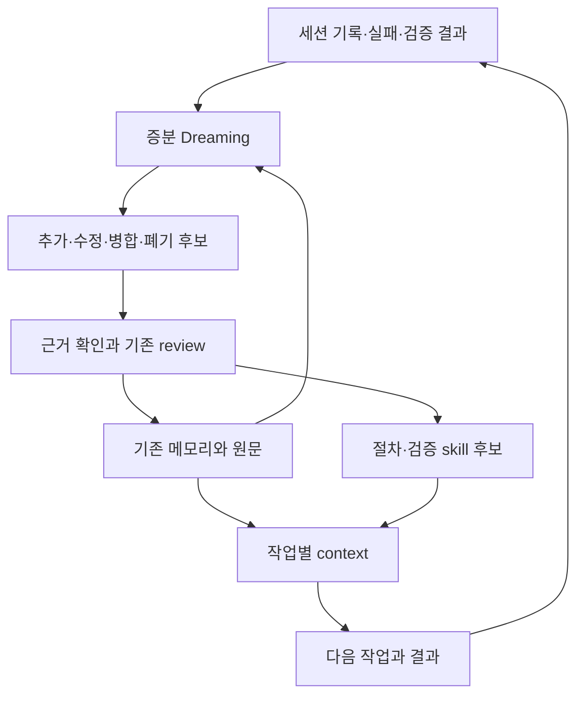

# Memory consolidation: 증분 Dreaming과 검증된 경험 재사용

**상태: 일부 정확성 수정 구현, 나머지는 DESIGN ONLY.** DR-01의 후보 보존은 현재
`journal distill`에 연결됐다. 기존 SQLite의 active decision/blocker 행에서 후보를
다시 계산하고, 기존 `distill.json`의 완료 fingerprint로 중복을 막는다. 한 pass에서 최대
5개를 시도하며 마지막 시도 후보 다음부터 이어 확인한다. 계속 거절되는 후보가 있어도
뒤의 후보를 처리하고, 실패한 후보는 목록을 한 바퀴 돈 뒤 다시 시도한다. 늦게 들어온
사건과 날짜를 나눠 기록한 blocker도 대상이다. Legacy cursor는 관측 정보로 유지하며
기존 memory 내용과 먼저 중복 검사한다.
한 pass의 annotation 입력은 16,384개, 완료 receipt는 4,096개, receipt 파일은 512 KiB로
제한한다. 한도를 초과하면 명시적으로 실패하며 원본·cursor를 소비하거나 일부 완료로
표시하지 않는다. 이 제한의 확대·압축은 별도 측정 후 결정한다. 원문 전체 대신 indexed
annotation을 다시 읽는 정확성 수정이며 I/O 절감이나 semantic 품질 개선을 주장하지 않는다.
후보에 source event ID와 검증되지 않은 기록이라는 설명을 붙이지만 기존 memory review
eligibility는 유지한다. 아래 DR-01의 batch 파생 갱신과 DR-02~06은 계속 구현 명세다.
이 문서 병합 자체로 모델 호출,
자동화, memory 승격, 새 CLI/schema/default가 활성화되지 않는다. 아래 필드 이름은
설계상의 의미이며 공개 API가 아니다. 실제 착수 상태는
[통합 작업 큐](ORCHESTRATOR-WORK-QUEUE.md)가 소유한다.

조사일: 2026-11-19 KST. OMS 소스 기준:
[`9a37a6ab8e39e3d4f8e11b77961d6c547b2d630b`](https://github.com/eightmm/oh-my-setting/commit/9a37a6ab8e39e3d4f8e11b77961d6c547b2d630b).
관측은 코드·공식 자료에서 확인한 사실, 해석은 그에 대한 판단, 제안은 후속 구현 계약이다.
코드의 정적 관찰을 재현된 결함이나 측정된 성능 개선으로 표현하지 않는다.

## 1. 목적과 첫 범위

목표는 여러 세션의 경험을 출처·적용 조건·검증 결과가 있는 지식으로 바꾸고, 다음
Claude/Codex/Antigravity 작업에서 재사용하는 것이다. 기존
`journal distill -> agent-memory review -> provider_context` 경로를 확장한다.

첫 구현 범위는 DR-01의 입력 보존과 DR-02의 선택형 semantic producer다. 실패·수정·검증
연결에 필요한 출처를 함께 보존하고 DR-03으로 절차 재사용을 연결한다. DR-04는 낡은 기억의
재검토, DR-05는 필요한 경우의 지식 지도, DR-06은 기존 context/성과 관측 작업에 흡수한다.
독립적인 새 scheduler, DB, memory 권한 체계나 Team runtime을 추가할 필요는 없다.

사용자가 확인할 결과는 다음과 같다.

- 이전 세션의 실패와 이후 수정·검증이 하나의 경험으로 연결된다.
- 표현이 다른 같은 문제를 찾고, 모순과 적용 조건을 드러낸다.
- 기존 기억의 추가뿐 아니라 수정·병합·대체·폐기 후보를 만든다.
- 관련 작업에 필요한 경험을 전달하고, 실제 사용과 후속 결과를 연결한다.
- 모델·도구가 발전하면 이전의 우회책이 여전히 필요한지 확인한다.

## 2. 현재 구현과 추가 가치

| 현재 관측 | 코드 근거 | 추가할 부분 |
|---|---|---|
| 파일 원본, SQLite FTS5, scope/path-aware recall, provenance와 citation 검사가 있다. | [memory README](../crates/oms-command-memory/README.md) | 여러 사건의 의미 관계와 실패·복구·결과 연결 |
| 자동 생성 후보는 review acceptance가 있어야 context에 들어간다. 수동 기록은 별도 규칙이다. | [review.rs](../crates/oms-command-memory/src/review.rs), [#250](https://github.com/eightmm/oh-my-setting/pull/250) | 기존 eligibility를 유지하면서 사실 근거와 검증 범위를 별도로 표현 |
| distill은 decision 추출과 동일한 normalized blocker의 서로 다른 날짜 집계다. | [journal store](../crates/oms-command-journal/src/store.rs), `distill`, `distill_candidates` | 다른 표현의 반복 문제, 해결 결과, 모순을 해석하는 producer |
| compact는 eligible 항목의 첫 줄 240자와 최신 40줄을 사용한다. append 후 compact와 DB sync가 반복된다. | [memory store](../crates/oms-command-memory/src/store.rs), `summary_body`, `compact`, `after_write` | 의미를 고려한 선택과 여러 변경의 일괄 파생 갱신 |
| supersede/retire/redact, hygiene, promote/graduate와 source lock/atomic publication이 있다. | 같은 memory README/store | 새 명령군 대신 기존 상태 전이와 쓰기 경계에 변경 후보 연결 |
| journal capture, resume/handoff, task-context recall, skill-forge가 있다. | [state-memory](../custom-skills/oms-agent-harness/references/state-memory.md) | 교훈에서 검증된 절차로의 연결과 결과 피드백 |
| 제한된 opt-in feedback repair consumer가 구현되어 있다. | [#238](https://github.com/eightmm/oh-my-setting/pull/238), [#239](https://github.com/eightmm/oh-my-setting/pull/239) | repair engine을 재구현하지 않고 그 결과를 경험의 근거로 사용 |

정적 관찰상 먼저 재현할 항목:

1. `distill_candidates`는 `fresh.truncate(5)`를 수행하고 `distill`은 최신 이벤트까지
   marker를 전진시킨다. 초과 후보가 다음 pass에 남는지 canonical fixture로 확인한다.
2. blocker 반복은 증분 조회 범위 안에서 서로 다른 날짜를 요구한다. 일별 실행에서도
   이전 날짜의 관측과 연결되는지 확인한다.
3. 여러 후보의 append마다 파생 compact/sync가 반복된다. 실제 write 횟수·bytes·지연을
   측정한 뒤 batch 범위와 갱신 방식을 결정한다. Rust 전환만으로 I/O 절감을 추정하지 않는다.

위 항목의 실행 재현과 성능 측정은 이 명세 PR의 결과가 아니다.
조사 시점 [#258](https://github.com/eightmm/oh-my-setting/pull/258)은 draft,
[#276](https://github.com/eightmm/oh-my-setting/pull/276)은 open이다. 최신 model/effort
선택과 upstream tracking을 main의 완료 기능으로 취급하지 않는다.

## 3. 공통 계약

### 상태와 책임

Journal은 사건 기록, memory는 재사용 지식, task/Plan은 진행과 acceptance를 소유한다.
Wiki·panel·요약은 기존 원본에서 재생성할 수 있는 뷰다. 저장 위치와 lifecycle은
[Feature scope](FEATURE-SCOPE.md) 및 현재 typed store를 따른다.

Dreaming은 기존 worker/provider 경로로 실행하는 분석 작업이다. 기존 queue/tick의
활성화 정책 안에서 task 종료·사용자 수정·관련 source 변경 같은 이벤트를 모아 처리한다.
기본 모델 호출 주기나 nightly schedule을 이 문서로 추가하지 않는다. 대기 중 반복적인
LLM polling 대신 새 근거가 있을 때 일을 만든다. 실제 사용 가능한 model×effort catalog와
사용자의 선택을 유지하며, 모델 tier·버전·도구 lock을 새로 만들지 않는다.

### 후보에 필요한 의미

| 정보 | 계약 |
|---|---|
| 입력 identity | 원본 event/session/task ID, source digest와 관측 범위. 서로 복사한 기록을 독립 근거로 세지 않는다. |
| 주장과 scope | 사실·사용자 결정·환경 가정·절차·원인 추정을 구분하고 project/provider/path 등 적용 범위를 기록한다. |
| 제안 동작 | 추가·수정·병합·대체·폐기·절차 후보 중 하나. 기존 memory revision과 연결한다. |
| 근거와 검증 | 원문 포인터, 실제 조치, verifier/result receipt, 검증한 code/environment identity와 남은 불확실성. |
| 유효성 | 마지막 확인과 재검토 조건. 과거 관측 버전은 증거이며 사용 가능한 최신 모델을 제한하는 정책이 아니다. |
| lineage | 어떤 후보·원문·이전 기억에서 파생됐는지 보존한다. 거절된 후보도 변경 없는 입력에서 계속 제안하지 않는다. |

기존 review acceptance는 context 사용 eligibility다. 이는 사실 검증, task 완료,
명령 실행이나 외부 게시 권한과 별개의 상태다. 승격에는 기존 review 계약을 사용하고
매 후보에 새로운 사용자 승인 단계를 추가하지 않는다. 자동 처리 범위는 실제 기존 정책을
따르며, 구현 PR에서 그 consumer를 명시한다.

원문·도구 출력의 명령형 문장은 데이터로 취급한다. 분석 결과가 정책을 바꾸거나
사용자의 명시적 결정을 추정으로 덮어쓰지 않는다. 허용된 source와 scope 안에서만 읽고
기존 scrub/redaction·출처 검사를 거친다. Redact된 원문은 파생 후보·index·view에서도
다시 노출되지 않아야 한다. 실제 transcript를 테스트 fixture나 연구 문서에 복사하지 않는다.

### 처리 흐름

## 4. DR-01 — 입력 보존과 일괄 파생 갱신

**Owner:** journal/memory. 기존 marker, locks, atomic writes, receipt와 가까운 fixture를 재사용한다.

1. 입력을 발견한 위치와 그 입력의 분석·후보 저장 완료를 구분한다. 시간순 marker보다
   늦게 도착한 과거 시각 이벤트도 기존 event identity로 처리 여부를 판단할 수 있어야 한다.
   현재 store에 필요한 identity가 부족하면 최소 additive metadata와 legacy 읽기를 같은 PR에 제안한다.
2. 모델·시간·출력 예산이 끝나면 미처리 입력과 초과 후보를 durable 상태로 남긴다.
   marker 전진은 처리 결과 또는 명시적인 보류 상태의 저장 뒤에 한다. 다음 pass는 marker 뒤의
   새 입력과 함께 기존 pending을 다시 선택해야 하며, marker 전진으로 pending을 가리지 않는다.
3. 반복 판정은 이번 입력 구간과 독립된 과거 관측을 연결한다. 원문 전체를 매번 재분석하는
   대신 관련 identity·기간을 사용하고 조회에서 빠진 범위를 보고한다.
4. 분석 중 source write lock을 잡고 있지 않는다. 반영 시 기존 source revision을 재확인하고
   다른 writer의 변경을 보존한다. 충돌은 재계산 대상으로 남기며 마지막 writer로 덮어쓰지 않는다.
5. Batch 시작 시 입력-set digest·분석 정책·기준 memory revision을 stable identity와 함께
   durable 기록으로 고정한다. Retry는 같은 identity를 사용하고, 앞선 append로 바뀐 현재 revision을
   새 batch로 오인하지 않는다. Candidate별 idempotency key는 해당 source append와 같은 durable
   publication 경계에 남겨 receipt 저장 전 crash도 재조정한다. 중복 후보·memory append가 없어야 한다.
6. 여러 write의 기존 durability를 유지하면서 compact/index 갱신을 모은다. 파생 갱신 실패는
   원본 손실과 구분하고 기존 rebuild/recovery 경로로 복구한다. fsync/lock을 생략해 속도를 얻지 않는다.

**완료 조건:** 현재 cap을 넘는 후보, 두 날짜에 나뉜 반복, 늦게 들어온 이벤트,
후보 저장 전후 중단, 같은 batch 재시도, 동시 append, index 갱신 실패를 가까운 fixture에서 확인한다.
기존 데이터의 읽기와 review eligibility도 유지한다. I/O 개선 수치는 같은 fixture/workload에서
직접 잰 write 횟수·bytes·지연으로만 보고한다. DR-02나 유료 모델 평가 완료는 이 정확성 수정의 선행이 아니다.

## 5. DR-02 — 선택형 semantic distill producer

**의존성:** DR-01의 입력 보존. **Owner:** 기존 journal/memory 호출 경로와 peer worker 연결.

1. 기존 deterministic distill을 보존하고 명시적으로 선택한 semantic 분석 경로를 추가한다.
   최초 범위는 새 사건과 그에 관련된 원문·기억만 읽는다. 입력에 포함된 scope와 omission을 남긴다.
2. 분석은 공통 후보 계약으로 추가·수정·병합·대체·폐기·절차 제안을 반환한다.
   서로 다른 표현을 묶되 원인 추정과 확인된 결과를 나누고, 모순은 서로의 근거와 함께 보존한다.
3. 출처 ID·digest·대상 revision·scope·기존 review eligibility는 Rust consumer가 검증한다.
   모델이 새 source나 검증 receipt를 지어내거나 현재 허용 범위를 넓히면 해당 제안은 적용하지 않는다.
4. 제안 수집과 실제 반영을 분리한다. 거절·defer·failed 분석도 재시도 가능한 이유와 identity를 남긴다.
   승격 실패를 이유로 같은 provider 요청을 무조건 다시 실행하지 않는다.
5. 기존 account/model/effort 선택과 물리 호출 usage receipt를 사용한다. 병렬 transcript 분석은
   필요한 workload에서만 기존 위임으로 구성하며 lead/분석자/정리자 3단계를 고정 요구하지 않는다.

**완료 조건:** synthetic transcript와 fake provider의 정해진 응답으로 표현 차이, 모순,
없는 출처, 변한 source, 잘못된 scope, 출력 일부 누락, 사용자 결정 덮어쓰기, 거절 재제안을 검증한다.
기존 자동 후보가 review 없이 context에 들어가지 않는 회귀를 유지한다. Fixture 통과는 producer와
consumer 계약 증거이며 semantic 모델 품질 개선의 증거는 아니다.

## 6. DR-03 — 복구 경험에서 절차와 검증 방법 추출

**의존성:** DR-02 후보/출처. **재사용:** fail-ledger, task 결과, verification receipt,
[#239](https://github.com/eightmm/oh-my-setting/pull/239)의 제한된 repair consumer, skill-forge.

경험은 `문제 관측 -> 시도한 조치 -> 확인된 결과 -> 적용 조건`으로 연결한다.
수정 뒤 테스트 통과는 그 검사 범위의 결과이며 유일한 root cause의 증명이 아니다.
실패·미결·효과 없는 조치도 근거에 남기고, 결과가 연결되지 않은 성공 서술을 verified로 승격하지 않는다.

출력은 지식 메모리, 재사용 절차 후보, 관련 변경에 적용할 검증 방법으로 구분한다.
Skill 후보는 기존 skill-forge/lifecycle 경로에서 다루며 배포되는 이름은 `oms-*`를 따른다.
추출한 명령을 자동 실행하거나 AGENTS/CI/권한 정책을 자동 수정하지 않는다. 검증 방법은 어떤
task/diff 조건에서 필요한지, 무엇을 실행·관측하며 무엇까지 입증하는지 설명해야 한다.

**완료 조건:** 관련 없는 verification receipt, 다른 commit/environment의 통과, 수정 후에도
실패한 경우, 하나의 원문에서 복제된 다수 기록을 구분한다. 실제 검증 결과에 연결된 절차만
그 검증 범위를 표시한다. 대상 변경과 무관한 절차를 모든 작업에 주입하지 않는다.
검증 선택·기존 gate 유지 책임은 [VW 작업](ORCHESTRATOR-VERIFICATION-WORK-PACKETS.md)에 남긴다.

## 7. DR-04 — 적용 조건과 노후화 관리

**의존성:** DR-02 lineage. **재사용:** citation/stale 검사, hygiene, supersede/retire.

- source·관련 코드·도구 capability 변경은 영향을 받는 기억의 재검토 후보를 만든다.
  모든 memory를 provider 업데이트마다 전수 모델 호출로 재검증하지 않는다.
- 사용자 명시 결정, 현재 관측, 원인 가설, 임시 우회책을 구분한다. 사용자 결정을 모델 갱신만으로
  폐기하지 않으며, 명시적 후속 결정과 연결한다. 오래됐다는 이유만으로 내용이 틀렸다고 판정하지 않는다.
- 새 모델에서 우회책·skill·추가 reviewer의 필요성을 비교할 때 해당 구성요소 하나를 바꾼
  작은 대조를 사용한다. 유효한 전체 model×effort 선택은 계속 허용한다.
- 폐기·대체 뒤에도 역사적 lineage를 보존한다. 현재 context에서는 기존 active/eligible 판정을
  적용하며 raw memory와 파생 summary/wiki의 상태가 다르게 남지 않도록 한다.

**완료 조건:** 무관한 source 변경은 재검토를 만들지 않고, 관련 변경은 stale 원인을 설명한다.
사용자 결정과 모델의 임시 가정을 다르게 처리한다. supersede/retire/redact 뒤 파생 뷰와 context에
이전 active 내용이 남지 않는지 canonical memory fixture로 확인한다.

## 8. DR-05 — 작업별 context와 조건부 지식 지도

기존 task-context recall과 provider_context를 기본으로 사용한다. 추가 context는 이번 목표,
명시 결정, 관련 경험, 원문 포인터를 짧게 전달한다. 선택한 source와 생략 범위는 기존 manifest에
연결하며 전체 메모리를 매 호출에 넣는 기본 정책으로 바꾸지 않는다.

여러 결정·파일 관계를 반복해서 묻는 실제 실패 사례가 있으면 linked wiki/index를 검토한다.
페이지는 원문 identity와 lineage를 갖는 재생성 가능한 뷰다. 페이지별 작성 후 한 owner가
반영하거나 기존 revision 검사로 충돌을 해결한다. 공유 페이지의 concurrent overwrite를 허용하지 않는다.

**착수 조건:** 기존 검색/메모리만으로 해결되지 않는 반복 질의가 있고 비용을 비교할 수 있음.
**완료 조건:** 원문 검색과 함께 평가하고, stale·상충·redact 처리와 삭제 후 재생성을 확인한다.
새 embedding/vector/graph 서비스는 이 작업의 선행이 아니다. Graph의 정확성·coverage는
[GR-03/04/05/07](GRAPH-RETRIEVAL-WORK-PACKETS.md)의 owner와 연결한다.

## 9. DR-06 — 기존 context/성과 관측에 경험 연결 흡수

별도 benchmark·usage·panel 저장소를 만들지 않는다. 다음을
[RF-05/06](RESEARCH-FOLLOWUPS.md)과 기존 task/result·usage receipt에 연결한다.

- 실제 호출에 전달한 memory ID/revision, 선택 근거와 source coverage.
- 그 작업의 검증 결과, 사용자 correction, 실패/미결, 후속 memory 변경.
- provider가 보고한 input/cache/output/usage와 정리·검증·재시도의 별도 operation 관계.
- 실제 request의 context 구성과 지연. Byte 감소를 reported token이나 청구 절감으로 환산하지 않는다.

Panel/inbox는 사용된 기억, 근거, 수정·폐기 이유, 실행한 검사, 남은 불확실성을 기존 Reader로
투영한다. Source 없는 값은 unknown으로 남긴다. Recall 횟수와 성공의 상관관계를 인과 효과로
표현하지 않는다. Native 사용량/child 전체가 관측되지 않으면 그 coverage도 함께 표시한다.

**완료 조건:** RF-05의 호출 identity·source 귀속과 RF-06의 비교 계약을 재사용한다.
기록 중복, unknown/zero, late receipt correction, memory revision 교체를 정확히 표시한다.
이 항목은 기존 owner에 흡수하며 DR-01의 작은 정확성 수정을 막는 전체 평가 선행 조건으로 쓰지 않는다.

## 10. Native 연결과 기존 작업의 책임

Overall Main이 사용자 목표와 제공자 간 통합을 소유하고, provider native runtime은 내부 대화·도구·
하위 작업을 수행한다. OMS는 task, provider session, 산출물, 실제 검증, 남은 일을 연결한다.
프로세스/pane 수명과 작업 수명을 구분하고 기존 resume 기능을 활용한다. 이는 provider 내부
hidden state를 다른 provider로 완전히 이식할 수 있다는 뜻이 아니다.

진행 중 지시는 기존 input queue·native assignment에 연결하고 적용·거절·보류 근거를 남긴다.
실제 취소/steering 지원 여부와 반영 경계는 capability로 확인한다. Claude Mods나 dynamic
workflows는 선택적 native 접점이며 Codex/AGY에 같은 기능이 있다고 가정하지 않는다.
Provider 전용 얇은 adapter가 필요하면 공통 상태·정책은 Rust core에 둔다.
Headless 환경의 UI 제한과 관측 가능한 이벤트 범위를 문서화한다.

| 이번 주제 | 기존 owner / 작업 | 이번 명세와의 연결 |
|---|---|---|
| 후보 승격 | #250, memory review | DR-02 consumer가 기존 eligibility 사용 |
| 복구 | #238/#239, REL-02 | DR-03은 관측·조치·검증을 읽음. 새로운 repair loop 없음 |
| memory 유효성 | memory hygiene/citation, GR-05 | DR-04는 memory 상태를 소유. Graph freshness store와 혼합하지 않음 |
| task context | RF-05, GR-03/04/07 | DR-05/06은 기존 compiler와 coverage 사용 |
| 성과·비용 | RF-06, #240, 필요 시 #241 | 같은 benchmark/physical receipt/admission 사용 |
| native 관측 | REL-01, 조건부 PERF-01, RF-03/04 | 저장 transcript 관측과 live event 진단 구분 |
| durable task·steering·취소 | LC-01~04, native assignment, 기존 input queue | 기존 lifecycle/ownership을 먼저 연결. 별도 Team 구현 없음 |
| 통합 결과 acceptance | reviewed proposal/composite acceptance | 생성한 note나 provider terminal이 task acceptance를 대신하지 않음 |
| catalog 최신성 | CC-01/02/03, #258/#276 | 실제 가용 model×effort와 사용자 선택을 사용 |
| I/O | DR-01 memory owner; PERF-02/03 참고 | usage persistence와 memory publication은 서로 다른 owner |
| 검증 비용 | VW-01~05, 필요 시 CC-08 | 새 review 지식은 gate 선택의 자동 축소 권한이 아님 |

상세 native 연결 상태는 [completion audit](ORCHESTRATOR-COMPLETION-AUDIT.md), lifecycle은
[LC 명세](ORCHESTRATOR-LIFECYCLE-IMPLEMENTATION.md), 관측은
[REL 명세](ORCHESTRATOR-RELIABILITY-WORK-PACKETS.md)를 따른다.

## 11. 효과와 비용 평가

### 비교 구성

| Arm | 구성 |
|---|---|
| A | 원문 검색 |
| B | DR-01 정확성 수정 위의 기존 deterministic distill/memory와 검색 |
| C | B와 같은 입력 보존·검색·recall 정책 + semantic distill |

Semantic 비교의 B/C는 같은 DR-01 기반을 사용하고 distill 정책만 treatment로 바꾼다.
DR-01 자체의 입력 보존/I/O 효과는 별도 전후 측정으로 기록해 semantic 개선과 혼동하지 않는다.
과거 구간에서 메모리를 만들고 이후 구간의 작업에서 평가한다. 평가 작업의 답·수정 결과·사용자
feedback이 사전 메모리에 유입되지 않게 cutoff와 corpus identity를 남긴다. 실험 안에서는
task/base/model/effort/tools/verifier를 맞추고, 순서·cache 조건·반복 수·중단 조건은 RF-06을 따른다.
실패·취소·미결·fallback·served-model 불명도 결과에 남긴다. 실험 통제는 운영 모델 lock이 아니다.

지표는 작업 품질/완료, 같은 실패의 재발, 사용자 수정·검토 시간, 첫 유용한 행동까지 시간,
잘못되거나 무관한 memory 주입, 전체 token/보고된 비용, read/write bytes·횟수·지연이다.
전체 비용에는 Dreaming, 실제 작업, 검증, retry/repair, 저장·인덱싱을 포함한다.
파생 요약의 크기나 note 수만으로 성공을 판단하지 않는다.

기본 회귀는 synthetic data와 fake provider로 수행한다. 기존 canonical fixture를 확장하고
중복 시험을 줄인다. Offline replay는 저장·전달·귀속 정확성을 검증하며 모델 품질·실제 latency
개선을 증명하지 않는다. 유료 paired 실행은 실제 평가 권한과 기존 비용 정책 안에서 별도로 수행한다.
새 CI job/matrix/schedule이나 매 작업의 전면 재실행을 이 명세로 추가하지 않는다.

## 12. 구현 에이전트 전달문

> 최신 main, 통합 작업 큐, 실제 caller와 병합된 코드부터 확인하세요. 첫 작업은 DR-01의 cap/
> marker와 일별 recurrence를 기존 fixture에서 재현하고 입력 보존·재시도 정합성을 고치는 것입니다.
> DR-02는 그 계약 위에 기존 peer/model 선택을 쓰는 선택형 semantic producer로 연결하세요.
> DR-03에 필요한 failure/action/verification 출처를 처음부터 보존하세요. 모델의 성공 서술은
> verification receipt가 아닙니다. 기존 review, source lock, atomic publication, memory eligibility와
> 사용자 결정을 유지하세요. 같은 journal/memory 파일의 writer는 한 명으로 두고 공통 계약을 먼저
> 반영하세요. DR-03과 DR-04는 그 이후 독립 자료/fixture 준비를 병렬화할 수 있습니다.
> Wiki는 DR-05의 실제 질의 조건이 있을 때, 관측은 DR-06을 RF-05/06 owner에 연결해 진행하세요.
> Native 제어·취소·task acceptance는 LC/native assignment 경로를 재사용하세요.
> 각 코드 PR에 실제 변경, 재사용 경로, 실행한 검증, 미측정·미지원 범위를 적고 작은 단위로 올리세요.
> 이 명세를 구현 완료, 자동 실행 설정, 새 유료 평가 캠페인이나 배포 권한으로 해석하지 마세요.

## 13. 조사 근거와 적용 한계

자료 확인일은 2026-11-19다. 인터뷰는 공개 전문/자막, 전문을 얻지 못한 영상은 공식 소개·
주최 요약까지 확인했다. 고객 수치는 자체 보고이며 OMS에서 재현한 수치가 아니다.
관련 설명을 아래처럼 짧게 남기고 구현 판단은 앞의 계약으로 구체화한다.

| 1차 자료 | 확인한 내용과 OMS 해석 |
|---|---|
| Anthropic, [The components of agent memory](https://www.anthropic.com/research/components-of-agent-memory), 2026-11-06 | 약 35만 문서/420M tokens, 25개 질문에서 search 53%, wiki+search 54→61%; dreaming 2M→128M tokens, 질문당 약 20k tokens 절약. 정리 비용과 질의 절감의 합산이 필요하며 일반적 개선율로 외삽하지 않는다. |
| Anthropic, [Managed Agents: dreaming, outcomes, multiagent](https://claude.com/resources/articles/new-in-claude-managed-agents), 2026-05-19 | 세션 간 패턴 정리, 별도 context의 rubric 평가, Harvey의 도구 경험·Netflix의 반복 로그·Every의 문체 평가 사례. OMS에는 경험과 결과 기준을 연결하는 패턴을 적용한다. |
| Anthropic, [Dreaming with a dynamic workflow](https://platform.claude.com/cookbook/managed-agents-cma-dreaming-with-a-dynamic-workflow) | 완료 세션의 분석과 정리를 조합한 구현 예제. OMS에서는 기존 worker와 durable 입력에 맞춘다. |
| Anthropic, [Dreams guide](https://platform.claude.com/docs/en/managed-agents/dreams), [create API](https://platform.claude.com/docs/en/api/http/beta/dreams/create) | Managed Agents 제품의 research preview와 별도로 패턴을 구현할 수 있다. API 기본 create_new와 선택적 update_existing을 구분한다. OMS의 기존 원본·review 계약을 제품 예제의 in-place 쓰기로 대체하지 않는다. |
| Anthropic, [Context engineering tools](https://platform.claude.com/cookbook/tool-use-context-engineering-context-engineering-tools), [Claude Code memory](https://code.claude.com/docs/en/memory) | 세션 compaction, tool-result 정리, 장기 memory를 구분한다. 짧은 index와 필요한 상세 조회를 참고한다. |
| Anthropic, [Harness design for long-running apps](https://www.anthropic.com/research/harness-design-long-running-apps), 2026-03-24 | 모델 발전에 따라 기존 scaffolding을 제거·변경한 사례. DR-04의 규칙 재검토 근거다. |
| Anthropic, [Building always-on agents](https://claude.com/resources/articles/building-always-on-agents), 2026-11-13 | 대기 중 event/timer를 통해 깨어나는 구조. 기존 queue/tick에 증분 작업을 연결한다. |
| Anthropic, [Verification](https://claude.dev/blog/how-the-claude-code-team-thinks-about-verification/), 2026-11-16; [Verification skills](https://claude.com/resources/articles/building-verification-loops-in-claude-code-with-skills), 2026-07-22 | 과거 실패를 관련 변경의 검사로 연결하고 검토 증거를 누적한다. OMS의 기존 verifier/skill 경로에 연결한다. |
| Anthropic, [Dynamic workflows](https://claude.dev/blog/a-harness-for-every-task-dynamic-workflows-in-claude-code/), 2026-06-02; [Mods](https://claude.com/resources/articles/claude-code-mods), 2026-10-01; [Mods docs](https://code.claude.com/docs/en/plugins/mods/overview) | native 구성과 event/UI 접점. 지원 surface/capability는 실제 adapter에서 확인하며 모든 provider의 공통 기능으로 일반화하지 않는다. |
| Anthropic, [Claude Docs chaos loop](https://claude.dev/blog/chaos-loop-claude-docs-launch/), 2026-11-17 | 실제 telemetry와 실패 재현을 연결한 대규모 운영 사례. OMS에는 작은 저장/재개 재현과 I/O 측정 원칙을 적용한다. |
| Ramp, [OCA](https://builders.ramp.com/post/how-we-built-oca-our-ai-on-call-assistant), 2026-09-09; [Office Hours 영상](https://www.youtube.com/watch?v=i4odXOmgMLw) | OCA 글은 Claude Code/Codex 선택, 모델 갱신 시 hook 재평가, 필요한 시점의 지시를 설명한다. Memory는 helpful rating의 뚜렷한 차이 없이 조사 속도 개선을 관측했다. 영상은 공식 설명 범위로만 사용했다. |
| Ramp, [Laminar](https://builders.ramp.com/post/building-laminar), 2026-10-20; [Developer Experience](https://builders.ramp.com/post/building-laminar/developer-experience) | 여러 제품의 loop를 직접 소유하고 작업/환경 수명, 진행 중 입력, context/cache 관측을 다룬다. OCA 내부 전환 시점은 글만으로 확정하지 않는다. OMS에는 현재 native 활용 범위에 필요한 연결부터 적용한다. |
| Thariq Shihipar, [Latent Space 전문](https://latent.space/p/thariq/), 2026-09-28; [영상](https://www.youtube.com/watch?v=IZAlq-V19U8) | 28:10 지시 파일과 반복 실패, 32:49 Mods, 36:35 routing/cache, 44:40 하네스 노후화. 사용자·프로젝트 결정과 임시 모델 우회책을 구분한다. |
| Felix Rieseberg, [MAD 전문](https://www.mattturck.com/podcast/anthropics-felix-rieseberg-claude-cowork-mythos-and-the-saas-extinction), 2026-04-10; [영상](https://www.youtube.com/watch?v=9MEJ4syOVrQ) | 19:06 harness의 텍스트 memory와 project/global 구분. OMS 파일 원본과 파생 검색 구조를 활용한다. |
| Felix Rieseberg·swyx, [Latent Space 전문](https://latent.space/p/felix-anthropic/), 2026-03-17; [영상](https://www.youtube.com/watch?v=ZpZ7lFoWaT8) | 27:44 실제 작업에서 skill을 추출하고 재사용 단위로 나눈 사례. DR-03의 절차 후보에 참고한다. |
| Boris Cherny, [CHM 주최 요약](https://computerhistory.org/blog/in-conversation-with-boris-cherny-creator-of-claude-code/), 2026-09-29; [영상](https://www.youtube.com/watch?v=djDt8J2_YVs) | 행사일은 09-23. 모델 행동을 실험하고 도구를 추가·제거하는 관점. 전문 대신 주최 측 요약을 확인했다. |
| [Sleep-time Compute](https://arxiv.org/abs/2504.13171), 2025-04-17 | 질의 이전 연산 투자라는 관련 연구. OMS에서는 재사용 가능성이 있는 경험에 정리 비용을 쓴다. |

이 PR의 검증은 문서와 코드 참조의 정합성이다. 모델 품질, production I/O, 실제 청구,
native control 전체, live provider 간 동등성은 후속 구현과 지정된 실험에서 확인한다.
