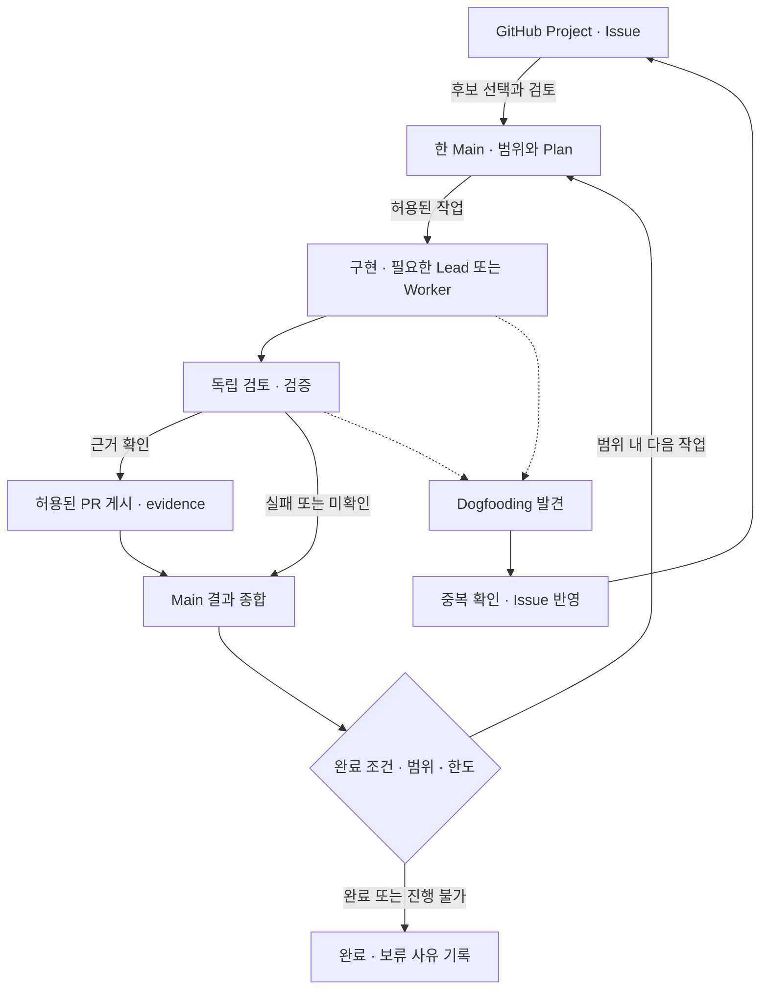

# OMS 자체 개발: 우선 사용과 Dogfooding 채택 판단

검토일: **2026-11-24 (KST)**. 상태: **필요성 검토 결과의 문서 등록**.
소스 기준: [`ad03a1a3`](https://github.com/eightmm/oh-my-setting/commit/ad03a1a32221ff483eb0539274ae6b9a4e4c0364).
OMS를 활용해 OMS를 발전시키는 개발 방향과, 실제로 추가할 필요가 있는 일을 정리한다.
이 문서는 실행 지시, 플러그인 활성화 정책 또는 기능 완료 보고가 아니다.

## 1. 판단 요약

**OMS가 소유하는 작업 상태·협업·복구·검증 경로를 우선 활용하고, 실제 사용에서 드러나는 연결 공백을 고친다.**
기존 기능의 선택과 연결을 개선하는 방향을 권고한다. 새로운 OMS-first Skill, 범용 router,
별도 자기 개선 엔진을 먼저 만드는 근거는 현재 검토에서 확인하지 못했다.
[Feature scope](FEATURE-SCOPE.md)가 제품 범위를, [통합 작업 큐](ORCHESTRATOR-WORK-QUEUE.md)가
기존 작업의 착수 조건을 계속 소유한다. 아래 평가는 별도의 필수 구현 목록이나 새 우선순위 체계가 아니다.

| 검토 항목 | 필요성 판단 | 권고하는 처리 |
|---|---|---|
| OMS 관리 업무의 우선 사용 | 높음 | 기존 Harness의 의도별 선택을 활용; 실제 누락 사례가 있으면 해당 Skill·caller 보강 |
| 플러그인 진입 시 기존 작업 복귀 | 높음 | host별 설치·SessionStart·복구 연결을 확인하고 기존 adapter에서 수정 |
| 모든 도구 호출에 OMS 강제 | 낮음 | 제외; 일반 검색·편집·테스트의 native 도구 사용 유지 |
| 상태 변경의 코드 수준 정합성 | 높음 | 기존 typed contract·lease·검증의 구체적 결함을 해당 owner에서 개선 |
| Project 기반 다음 작업 후보 조회 | 높음 | 기존 [#447](https://github.com/eightmm/oh-my-setting/issues/447)에서 진행 |
| Project 자동 동기화 | 조건부 | 반복적인 수동 작업·충돌 근거가 생기면 [#439](https://github.com/eightmm/oh-my-setting/issues/439) 검토 |
| OMS를 활용한 OMS 개발 | 높음 | 기존 개발 흐름을 실제로 사용하는 운영 원칙으로 채택 권고 |
| 별도 자기 개선 엔진 | 현재 근거 부족 | 기존 Plan·Autopilot·Memory 경로를 먼저 활용하고 신규 엔진은 보류 |
| 작업·결과 중심 GUI와 관계도 | 높음 | [#454](https://github.com/eightmm/oh-my-setting/pull/454)의 설계를 기존 UI 작업에 연결 |
| host별 Plugin 연결 | 높음 | 기존 [#438](https://github.com/eightmm/oh-my-setting/issues/438)에서 기능별 확인 |
| 상시 실행 daemon·새 scheduler | 조건부 | 기존 실행 경로가 해결하지 못하는 지속 실행 수요가 확인될 때 재평가 |
| 호출·조회·검증 비용 개선 | 실제 관측 필요 | 기존 기록으로 반복 비용과 의미 보존을 확인한 뒤 가장 작은 변경 선택 |

## 2. 이미 있는 기반과 확인 범위

| 확인한 근거 | 현재 읽을 수 있는 사실 | 이번에 확인하지 않은 것 |
|---|---|---|
| [Harness Skill](../custom-skills/oms-agent-harness/SKILL.md) | 상태·협업·문맥·복구·검증의 진입점을 구분하며, 알려진 로컬 범위에는 직접 검색을 허용 | 실제 세션의 Skill 선택률·성과 |
| [Skill hint caller](../crates/oms-command-hooks/src/routing.rs) | `OMS_SKILL_HINTS`가 `1`일 때 활성 Skill·필요 실행 파일·trigger를 검사해 최대 두 개의 추천을 출력 | 추천이 실제로 읽혔거나 실행됐다는 증거 |
| [Plugin hook manifest](../plugins/oh-my-setting/hooks.json) | `UserPromptSubmit`, `SessionStart` 등 callback 선언이 존재 | 현재 설치·host·계정에서 callback이 호출된다는 증거 |
| [Claude marketplace](../.claude-plugin/marketplace.json) | 별도 `oms` 설치가 필요한 skills-only 구성; hooks·MCP·panel을 포함하지 않는다고 명시 | 다른 plugin bundle이나 host의 동일한 설치 동작 |
| [Autonomy 계약](../custom-skills/oms-agent-harness/references/autonomy-loop.md) | 제한된 목표, 검토한 proposal, 기존 실행·복구·검증과 종료 조건을 정의 | 모든 provider 조합에서의 live 실행·복구 성공 |
| [GitHub workflow](wiki/GitHub-Workflow.md) | Issue → OMS Plan → 검증된 PR → merge evidence의 기존 책임 구분 | Projects v2 후보 조회·자동 동기화의 구현 완료 |

추천 출력은 도구 사용을 강제하는 router가 아니다. Manifest 발견, 설치, hook 호출, 상태 복귀,
실제 실행 성공은 각각 확인해야 한다. 이번 검토는 위 소스·계약과 관련 작업의 연결을 대상으로 하며,
전체 runtime 감사나 도구 선택률·속도·비용 측정을 수행한 결과로 확대하지 않는다.

## 3. 우선 사용의 적용 범위

**우선 사용은 OMS의 기존 책임을 필요한 작업에서 먼저 활용한다는 의미다.**
다음 표는 기존 Harness를 적용할 판단 기준이며 새 전역 정책이나 도구 잠금을 추가하지 않는다.

| 작업 상황 | 선택 기준 |
|---|---|
| 기존 작업의 진행·소유권·검증 근거가 필요함 | 해당 OMS 상태와 evidence를 읽고 같은 작업을 이어감 |
| 변경 영향이나 관계가 불명확함 | 현재 graph/context pack을 활용하고 부족한 근거를 직접 조사 |
| 범위가 알려진 파일 검색·편집·테스트 | 적합한 native 도구를 직접 사용하되 기존 역할·작업 범위를 유지 |
| 분업·독립 검토·지속적인 문맥 보존이 필요함 | 기존 위임·Room·Plan 경로에서 필요한 역할만 선택 |
| 반복 실행이 승인된 명확한 다단계 목표 | 현재 capability와 한도가 맞는 기존 Autopilot 계약 적용 |

팀 Main은 [계층 계약](../custom-skills/oms-agent-harness/references/coordination-layers.md)에 따라
계획·배정·검토·종합을 담당한다. Native 도구를 사용할 수 있다는 사실이 팀 Main의 직접 편집이나
worker의 권한 확대를 허용하지 않는다. 팀 없는 단독 작업과 별도 Lead·Team의 필요성도 같은 계약으로 판단한다.
모든 provider, Council, Graph 조회 또는 새 Plan을 매 요청마다 호출하는 절차는 만들지 않는다.

OMS가 필요한 상황에서 선택되지 않았다면 **미설치 / hook 미도달 / 추천 누락 / 미지원 기능 /
실행 결함 / native 경로가 더 적절함**을 먼저 구분한다. 이 관측 없이 강제 수준을 높이지 않는다.
OMS 자체가 고장 났을 때도 기존 권한 안의 소스 진단·수정과 독립 검증은 진행할 수 있다.
관리 중인 작업의 claim·lease·guard를 우회하거나 `.oms`를 손으로 고쳐 성공으로 만드는 복구는 사용하지 않는다.

## 4. 자체 개발 Goal과 실행 단위

### 재사용할 상위 Goal

> OMS의 계획·협업·문맥·복구·검증 기능을 실제 OMS 개발에 활용하여,
> 채택된 요구사항을 구현하고 그 결과를 검증한다. GitHub Project의 우선순위,
> Issue의 완료 조건, 기존 OMS Plan과 runtime의 실행 근거, PR의 변경·검토 결과를 연결한다.
> 사용 중 발견한 기능 공백과 불필요한 절차는 재현 근거와 함께 기존 작업에 반영한다.
> 각 실행은 선택한 Issue 또는 작업 묶음의 범위·완료 조건·자원 한도 안에서 수행하고,
> 결과와 남은 제한을 종합하여 다음 실행 여부를 판단한다.

상위 Goal은 발전 방향이다. 모든 열린 Issue와 새로 발견한 아이디어를 한 번의 무기한
Autopilot 실행에 넣는 완료 조건으로 사용하지 않는다. 실제 실행을 시작할 때는 다음을 정한다.

- **작업:** 선택한 canonical Issue, 이미 진행 중인 PR·claim과의 중복, 실제 선행 조건.
- **범위와 완료:** 변경할 동작·경로, 수락 조건, 정확한 대상에 실행할 verifier와 검토 근거.
- **실행 조건:** 현재 host/provider capability, 사용할 역할, 시간·비용·cycle·복구 한도.
- **종료와 인계:** 완료·실패·미확인·한도 도달 시 남길 결과, 후속 후보와 필요한 새 판단.

Main은 기존 실행 소유권을 확인하고, 해당 작업의 campaign이 있으면 그 campaign을 이어간다.
같은 작업에 경쟁하는 별도 driver를 만들지 않는다. 재계획은 기존 proposal 검토·적용 경로와 정해진 한도 안에서 수행한다.
새 발견이 현재 범위를 넓히면 후속 후보로 남기며 기존 한도를 초기화하지 않는다.
구현 작성자와 독립 검토자의 실제 참여 이력을 확인한다. Provider 이름이 다르다는 사실만으로 독립성을 판단하지 않는다.
PR 게시·검토 준비·병합·배포는 각각 현재 허용된 범위를 따르고, PR 하나의 게시를 전체 Goal 완료로 계산하지 않는다.

## 5. 개발과 Dogfooding의 반복 흐름

아래는 **권고하는 운영 흐름**이다. 새 자동 실행 엔진이나 모든 단계의 구현 완료를 나타내지 않는다.

Codex·Claude·AGY·Pi는 해당 host와 작업에서 확인된 역할·capability에 맞춰 선택한다.
Provider별 팀을 모두 만드는 구조가 아니며 Main은 하나다. Pi의 현재 inference 경로와
provider별 차이는 [Feature scope](FEATURE-SCOPE.md)의 지원 경계를 따른다.
Project는 후보와 우선순위를 제공하고, 카드 이동은 실행 claim이나 새로운 실행 권한을 만들지 않는다.
필요성 검토·문서 등록만 요청된 경우에는 해당 판단과 등록에서 끝난다.

## 6. 기존 작업에 연결

| 책임 | 기존 경로와 후속 판단 |
|---|---|
| 요구사항·우선순위 | [OMS Development](https://github.com/users/eightmm/projects/3), [Epic #431](https://github.com/eightmm/oh-my-setting/issues/431); 기존 [작업 큐](ORCHESTRATOR-WORK-QUEUE.md)와 긴급 결함을 함께 확인 |
| 작업 후보 조회 | [#447](https://github.com/eightmm/oh-my-setting/issues/447); Project 미사용·접근 불가 시 명시적으로 선택된 Issue 흐름 유지 |
| 선택형 field 동기화 | [#439](https://github.com/eightmm/oh-my-setting/issues/439); 읽기 mapping과 반복 수동 작업의 필요를 확인한 뒤 검토 |
| Skill 선택·세션 진입 | 기존 Harness·hook·설치 owner; host별 연결은 [#438](https://github.com/eightmm/oh-my-setting/issues/438)에서 확인 |
| 읽기 GUI·산출물 | [#433](https://github.com/eightmm/oh-my-setting/issues/433), [#442](https://github.com/eightmm/oh-my-setting/issues/442), [UI/UX PR #454](https://github.com/eightmm/oh-my-setting/pull/454) |
| 대화·선택·draft 복구 | [#443](https://github.com/eightmm/oh-my-setting/issues/443)와 기존 session/continuity owner |
| 실제 제어와 상태 정합성 | [#437](https://github.com/eightmm/oh-my-setting/issues/437)와 기존 runtime writer·검증 경로 |
| 실행·복구·지식 재사용 | 기존 Plan·Autopilot·Room·Memory와 [Feature scope](FEATURE-SCOPE.md); 신규 엔진 없이 구체적 결함을 해당 owner에 연결 |

[로드맵 PR #440](https://github.com/eightmm/oh-my-setting/pull/440)과 UI/UX PR #454는 별도 설계 근거다.
이 문서의 등록은 그 PR의 병합이나 연결된 기능의 완료를 뜻하지 않는다. 새로운 중복 Epic·작업 큐를
만들거나, 보류 항목을 기존 구현 Issue의 필수 선행으로 올리지 않는다.

## 7. 개선 여부를 판단할 증거

Dogfooding의 성공은 OMS 명령 호출 수가 아니라 **실제 작업이 일관되게 완료되고 다시 이어지는지**로 평가한다.
기존 Issue·Plan·receipt·실패 기록·검증 결과·PR에서 다음 질문에 답할 수 있으면 된다.

| 질문 | 확인할 근거 |
|---|---|
| 필요한 OMS 경로가 선택됐는가? | 작업 목적, 사용한 기능 또는 native 경로 선택 이유, 누락이 있다면 재현 조건 |
| 분업 결과를 Main이 종합했는가? | 같은 task/attempt와 candidate에 연결된 결과, 검토, 다음 판단 |
| 중단 후 같은 작업을 이어갔는가? | 기존 실행·소유권·receipt와 재진입 결과; 중복 제출 여부 |
| 완료를 입증할 수 있는가? | Issue 수락 조건, 해당 revision의 검증, 미실행 항목, PR 및 필요한 병합 근거 |
| 발견이 실제 개선으로 이어졌는가? | 기존 Issue 매핑 또는 근거 있는 새 Issue, 수정 후 같은 재현 조건의 결과 |
| 절차나 비용을 줄였는가? | 비교 가능한 작업·환경의 기존 관측; 측정하지 않은 속도·절감률은 미확인으로 기록 |

추가 계측은 위 질문에 기존 기록으로 답할 수 없을 때 필요한 범위만 검토한다.
별도 telemetry 서비스, 유료 benchmark, 정기 CI·새 matrix를 Dogfooding의 기본 조건으로 만들지 않는다.
한 작업의 성공은 그 작업과 확인한 host/version의 증거이며, 전체 기능·모든 provider의 검증을 대신하지 않는다.

**후속 착수 기준:** 재현되는 기능 공백, 기존 경로로 해결되지 않는 요구, 확인 가능한 완료 조건이 있어야 한다.
그 근거가 있으면 해당 기존 Skill·adapter·runtime 작업을 좁혀 개선하고, 없으면 현재 기능을 활용하며 관측을 남긴다.
