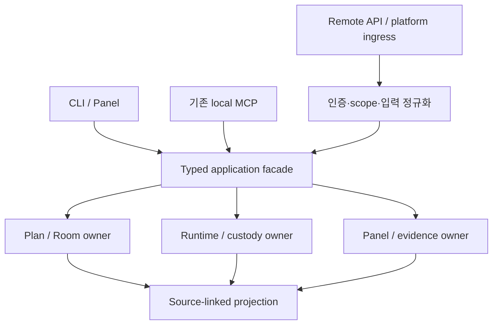
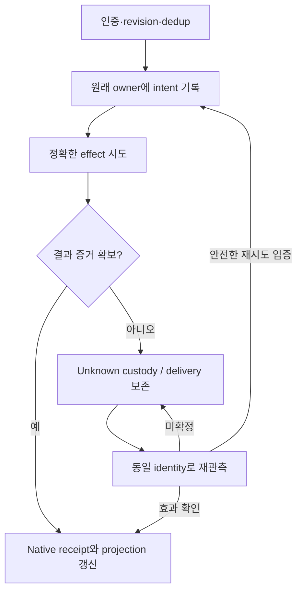

# OMS Core와 Platform API 경계 제안

> **설계 문서 · 구현 완료를 뜻하지 않음.** 2026-11-26 공개 source
> `7d0e40c48886bc009eee50091c7a12d132cc37e8`을 기준으로 기존 owner를 재사용하는
> application facade, 원격 계약, platform adapter와 단계별 수용 조건을 제안한다.

## 1. 목적과 채택 상태

OMS의 제품 중심은 승인된 작업을 실행하고, 변경·검증·수용·발행의 근거를 연결하는 것이다.
사용자는 CLI, Panel, MCP 또는 외부 업무 플랫폼에서 그 작업을 관찰하고 제한된 행동을 요청한다.
플랫폼마다 별도 실행 엔진을 만드는 대신, 같은 domain owner에 도달하는 좁은 typed facade를 둔다.
업무 플랫폼의 이슈·대화·화면은 작업의 입력과 표현이고, 실행 권한과 완료 판정은 기존 OMS owner가 맡는다.

[Feature Scope](FEATURE-SCOPE.md)가 제품 범위,
[Orchestrator Work Queue](ORCHESTRATOR-WORK-QUEUE.md)가 채택과 순서,
[Control Surface Roadmap](CONTROL-SURFACE-ROADMAP.md)이 기존 issue 연결의 기준이다.
[Control Session Contract](CONTROL-SESSION-CONTRACT.md)의 capability·identity 계약을 재사용하고 재정의하지 않는다.
이 문서의 OMS-01~16은 앞선 제안을 추적하는 **문서 내 식별자**이며 독립 실행 큐가 아니다.
[Callable Consolidation Audit](CALLABLE-CONSOLIDATION-AUDIT.md)의 재사용 원칙을 따르되,
그 문서의 과거 도구 수·미완료 목록을 현재 구현 상태로 인용하지 않는다.

| 구분 | 기준 revision의 사실 / 이번 제안 |
| --- | --- |
| 현재 | Rust runtime, Plan, Room, Panel service, MCP server와 실행·검증·수용 producer가 존재한다. [S1–S5] |
| 현재 | Panel에는 프로젝트 선택·Main 실행·승인 UI가 있고, MCP Apps 경로와 제한된 Projects 읽기도 존재한다. [S5] |
| 제안 | 기존 capability별 경계를 typed facade로 정리하고, 별도 version의 remote contract로 일부를 노출한다. |
| 조건부 | REST transport, persistent host, 외부 adapter, remote broker, multi-tenant 운영은 실제 workflow와 검증 후 채택한다. |
| 이번 변경 | 문서와 문서 링크만 추가한다. endpoint, crate, daemon, SDK, 새 저장소를 구현하거나 활성화하지 않는다. |

공개 [#431](https://github.com/eightmm/oh-my-setting/issues/431)과
[#437](https://github.com/eightmm/oh-my-setting/issues/437)은 2026-11-26 확인 시 열려 있다.
[#446](https://github.com/eightmm/oh-my-setting/pull/446)의 기존 UI/MCP 연결은 병합되었지만,
[#600](https://github.com/eightmm/oh-my-setting/pull/600)과
[#607](https://github.com/eightmm/oh-my-setting/pull/607)은 이 확인 시점에 열린 미병합 PR이다.
그 제안의 Goal UI나 handoff 보강을 기준 revision에 이미 있는 기능으로 전제하지 않는다.

## 2. 현재 owner와 Core의 의미

여기서 Core는 새 workflow engine의 이름이 아니라 **기존 domain service의 application 경계**다.
저장 형태가 서로 달라도 각 전이의 writer와 증거 owner가 하나면 된다.
모든 데이터를 한 database로 옮기거나 facade에 두 번째 task·approval ledger를 만들 이유는 없다.

| 영역 | 현재 재사용할 owner / source | facade가 하는 일 | facade가 하지 않는 일 |
| --- | --- | --- | --- |
| Plan·task·claim | `oms-command-plan`, domain contract [S3] | 기존 ID·revision·contract를 바인딩한 요청 전달 | claim·완료 상태를 별도로 발행 |
| Room·Main·lineage | 기존 Room producer, `CollabServices` [S1] | 현재 actor·Main·Room 관계를 다시 확인 | 외부 issue 담당자를 Main으로 간주 |
| Runtime·resource custody | `oms-runtime`, `RuntimeServices` [S2] | canonical observation과 원래 mutation port 사용 | PID 부재나 timeout으로 자원 반환 |
| Dispatch·review·acceptance | `oms-panel-core::{services,dispatch,results,review}` [S4] | 기존 candidate·patch·review receipt 참조 | 새 workflow 또는 대체 acceptance 기록 |
| Process supervision | `oms-supervisor`와 owning reactor [S6] | bounded 실행과 취소 결과를 원래 owner에서 수집 | 임의 HTTP handler가 별도 process reactor 생성 |
| CLI·MCP·Panel 연결 | `CollabServices`, 기존 MCP executor/profile [S1, S5] | 동일 의미의 validation과 service port 공유 | 모든 CLI verb를 MCP로 옮기거나 wire 계약 변경 |
| Context·history·memory | 기존 compiler와 journal/memory 경계 [S7] | 허용된 입력·근거를 참조 | 외부 문서를 정책이나 새 작업 큐로 승격 |

기존 `Services`, `PeerExecutor`, `NativeCommand`, `ExecutionRequest`는 재사용 지점이다. [S4]
모든 호출을 즉시 in-process로 바꿀 필요는 없다. 현재 supervised fixed-argv 경로와 provider별
native session 경로의 차이를 보존하고, 의미가 같은 검증만 공유한다. [S1, S5, S7]
실행 전략은 작업과 권한에 맞게 고른다. 단일 실행에도 같은 경계를 적용하며,
모든 요청에 planner→worker→reviewer 형태의 multi-agent chain을 강제하지 않는다.

## 3. 제안 구조: surface, application, producer



이 그림의 facade는 논리적 경계다. 독립 `oms-core` crate를 먼저 만들자는 결정이 아니다.
기존 root service port와 좁은 module로 시작하고, 실제 dependency 문제가 확인될 때만 분리한다.
Transport는 parsing·authentication·framing을, facade는 action별 precondition과 owner 선택을,
producer는 자기 상태의 lock·CAS·receipt·side effect를 소유한다.
다중 producer 작업은 원래 receipt를 연결하는 명시적 순서와 복구 규칙으로 표현한다.
HTTP transaction 하나가 모든 producer와 외부 플랫폼을 원자적으로 바꾼다고 가정하지 않는다.
Transport outbox를 채택해도 기존 filesystem producer와 cloud 저장소 사이의 atomic commit을 전제하지 않는다.

읽기 결과에는 `observed_at`, source identity/revision, freshness와 `unknown/degraded`를 남긴다.
projection cache가 없어도 원본 증거의 의미는 바뀌지 않아야 한다.
화면의 낙관적 표시나 플랫폼의 Done 상태는 mutation receipt가 아니다.

## 4. Typed facade와 최소 계약

아래 이름은 **제안된 application operation**이며 현재 Rust symbol이나 endpoint 목록이 아니다.
먼저 capability matrix로 actor·resource·provider별 실제 지원을 선언하고, 미지원 호출은 명시적으로 거절한다.

| 제안 operation | 입력과 precondition | 결과와 기존 owner |
| --- | --- | --- |
| `observe_workspace` | 허용된 `WorkspaceId`, read scope | Runtime/Panel source와 freshness가 붙은 projection |
| `observe_run` | `RunRef`, 현재 source/output 읽기 권한 | 원래 task·attempt·operation·evidence를 참조하는 view |
| `request_cancel` | exact target/generation, expected revision, idempotency | 기존 cancellation owner의 receipt 또는 pending/unknown |
| `decide_approval` | exact pending decision, bound action/identity/state, expiry | 원래 approval owner의 결정·소비 receipt |
| `submit_work` | 등록 workspace, typed goal/task reference, constraints | 이후 검토할 기존 Plan/intake 연결; 초기 remote MVP의 필수 항목 아님 |
| `read_evidence` | evidence reference, pagination/size bound, 재인가 | 허용된 immutable evidence와 digest; 임의 파일 path 없음 |

| 계약 | 필수 의미 |
| --- | --- |
| `AuthenticatedContext` | 서버가 검증한 identity, installation/connection, policy scope, 필요 시 tenant binding |
| `WorkspaceRef` | 등록 ID, 서버가 찾은 physical repository와 repository/host generation |
| `TargetRef` | owner namespace, native ID, attempt/generation, expected revision; 서로 다른 ID를 합치지 않음 |
| `ActionRequest` | action, target, typed payload, constraints, idempotency key, request digest |
| `CommandReceipt` | 요청 수락 여부, canonical owner, native receipt reference, known/pending/unknown 결과 |
| `RunView` | 여러 native record를 묶는 read projection; domain의 experiment run이나 Plan 상태를 재정의하지 않음 |
| `EvidenceRef` | producer identity, immutable digest, resource scope, retention/read policy |
| `EventEnvelope` | schema version, source event ID/revision, cursor, causation/correlation, event time과 observed time |

`permissions_requested`, provider/model preference, budget과 deadline은 요청의 **제약**이다.
유효 권한은 서버 정책·actor 권한·workspace 정책·runner capability의 교집합이며 요청으로 넓어지지 않는다.
등록된 provider도 해당 action과 session mode의 증거가 있어야 지원으로 광고한다.
soft budget은 admission·경고·정산의 기준이다. 지연 usage나 unknown liability가 있는 상태에서
외부 provider 청구액이 절대 한도를 넘지 않는다는 보장을 하지 않는다.

## 5. REST, MCP, events, webhook의 역할

| 경계 | 역할과 version 전략 |
| --- | --- |
| REST / OpenAPI | 외부 UI·service의 typed resource/action 계약. 채택한 capability만 노출하는 별도 remote version |
| 기존 local MCP | 기존 tools·schemas·profiles·session version·호환성을 유지. 공통 service 재사용은 wire rename과 별개 |
| Remote MCP | 필요가 입증되면 인증·scope가 검증된 facade adapter로 추가. local discovery를 원격 권한으로 간주하지 않음 |
| Event stream | 원본 상태 변경의 관측. replay cursor·dedup·gap·retention·재인가 계약을 명시 |
| Inbound webhook | 외부 사건을 인증하고 bounded 수신한 뒤, typed intake/dispatch intent로 전달 |
| Outbound webhook | 허용된 변경을 플랫폼에 투영. 재시도·중복 제거·권한 철회·unknown delivery를 별도 관리 |

기존 MCP는 이미 schema와 compatibility가 있다. [S5]
새 remote 계약은 별도 version을 갖고, local 특수 parser 동작이나 private helper ABI를 외부 API로 복제하지 않는다.
REST DTO는 엄격한 JSON·문자열·숫자 규칙을 정의하고 기존 MCP wire/string/number 호환성과 분리한다.
OpenAPI와 JSON Schema를 채택한다면 각 public contract에서 validation·문서·fixture를 생성하며,
처음부터 모든 언어의 SDK를 만들지 않는다. 한 adapter의 실제 필요로 최소 client를 검증한다.

### 가상 API 예: scoped cancellation 요청

다음은 **미구현 설계 예시**다. 실제 URL이나 현재 사용 가능한 명령이 아니다.
[#437](https://github.com/eightmm/oh-my-setting/issues/437)의 첫 후보인 기존 scoped cancellation과 맞춘다.
인증 토큰은 transport가 검증하며, JSON에서 principal·tenant·shell·physical repository path를 받지 않는다.

```http
POST /api/v1/workspaces/ws_registered/runs/run_projection/actions/cancel
Authorization: Bearer <verified-credential>
Idempotency-Key: 5de81567-b14f-4a49-903f-a4b54b4b230b
Content-Type: application/json

{
  "contract_version": "oms.remote.v1",
  "target": {
    "owner": "registered-cancellation-owner",
    "operation_id": "op_existing",
    "generation": "generation_existing",
    "expected_revision": "revision_42"
  },
  "reason": "사용자가 해당 실행의 중단을 요청함",
  "constraints": { "deadline_seconds": 30 }
}
```

```http
HTTP/1.1 202 Accepted
Location: /api/v1/workspaces/ws_registered/commands/cmd_example
Content-Type: application/json

{
  "contract_version": "oms.remote.v1",
  "command_id": "cmd_example",
  "request_status": "accepted_for_evaluation",
  "execution_status": "pending_owner_confirmation",
  "effect_status": "unknown",
  "run_id": "run_projection",
  "native_receipt": null
}
```

`202`는 bounded intake가 요청을 보관하고 평가 대상으로 삼았다는 뜻이다.
취소·cleanup·Plan 완료·권한 승인 성공을 뜻하지 않는다. owner가 다시 권한과 revision을 확인한다.
권한 없음, stale revision, 같은 key의 다른 payload, 미지원 action은 명확한 오류로 구분한다.
오류 응답도 허용되지 않은 resource의 존재나 원본 output을 누출하지 않아야 한다.

## 6. Identity, 권한, approval 경계

1. Transport는 검증된 credential과 설치 연결을 서버 registry에 바인딩한다.
2. Workspace ID는 서버에 등록된 실제 repository로 해석하고 physical root·host generation을 확인한다.
3. Source issue/document의 접근권과 OMS action 권한을 각각 확인한다. 외부 membership은 실행 권한이 아니다.
4. Runner는 local policy, 현재 Main/Room/claim, target generation, scope와 capability를 다시 확인한다.
5. Approval이 필요한 action은 기존 owner가 pending contract를 만들고, 정확한 결정만 실행에 연결한다.
6. Output·artifact·event의 조회 및 platform write 시에도 현재 source와 destination 권한을 다시 확인한다.

서명이 유효한 webhook도 payload의 actor를 곧바로 위임된 사용자로 인증하지 않는다.
그 actor는 출처 정보이며, 실행 주체와 위임 권한은 검증된 설치·정책·명시적 delegation에서 얻는다.
외부 텍스트의 명령형 문장, 첨부물, webhook payload, agent output은 작업 데이터다.
정책·credential·tenant·등록 root·승인 상태를 바꾸는 입력으로 해석하지 않는다.
외부 API에서 임의 shell·argv·path를 실행 권한으로 받지 않고, typed action을 검증된 native port에 매핑한다.

Approval은 approver identity, acting subject, installation, resource, action, plan/patch digest,
expected state/revision과 expiry에 묶는다. Action에 없는 patch는 해당 없음으로 명시한다.
승인 이후 대상·계획·patch·권한이 달라지면 재검증하고 필요한 경우 새 승인을 요구한다.
기존 approval owner가 producer guard 아래에서 소비를 원자적으로 처리해야 한다.
그러나 승인 소비와 외부 side effect 사이의 장애는 가능하다. 소비했다는 이유로 성공을 기록하거나
새 token으로 같은 effect를 반복하지 않고, 원래 intent와 receipt로 reconciliation한다.

인증이 유효했던 과거 receipt는 현재의 조회·재시도 권한을 보장하지 않는다.
철회된 설치·token, source ACL 변경, 다른 플랫폼의 더 넓은 공개 범위는 새 read/write를 차단한다.
로그·오류·projection에도 동일한 정보 경계를 적용하고 원본 evidence를 보존하면서 허용된 부분만 노출한다.

## 7. Run projection과 완료 증거

하나의 `status: done`으로 서로 다른 사실을 합치지 않는다.
외부 `RunView`는 아래 축을 원래 producer의 ID·revision·receipt와 함께 보여준다.
축별 terminal/unknown을 조합한 표시는 가능하지만 그 표시가 원래 lifecycle을 덮어쓰지는 않는다.

| 관측 축 | 충분한 근거 / 의미 | 대신 사용할 수 없는 신호 |
| --- | --- | --- |
| 요청 수신 | 검증된 intake/dispatch receipt | runner가 시작되었다는 추측 |
| 실행 시작·중단 | exact owned invocation/process generation의 native receipt | HTTP 종료, heartbeat 만료, PID 검색 실패 |
| Cleanup | owning reactor/producer가 확인한 정확한 child·custody settlement | leader process exit, kill 요청 전송 |
| Verification | exact patch/tree·verifier·결과를 바인딩한 증거 | worker의 성공 문장, 외부 이슈 Done |
| Acceptance | 기존 Plan/Panel owner의 review·acceptance receipt | verifier pass 또는 process stopped 단독 |
| Publication | exact commit·destination·publication receipt | 로컬 commit 생성, acceptance 단독 |
| Platform sync | 외부 resource version/response 또는 확인된 effect | OMS acceptance, 전송 timeout |

현재 Panel acceptance는 원래 candidate·review·tree·landing 증거를 검사하며,
Runtime은 cleanup과 candidate custody를 별도로 다룬다. [S2, S4]
새 API는 이 구분을 보존한다. 원본 evidence와 digest를 참조하고 번역된 요약을 유일한 증거로 만들지 않는다.
Cancellation은 구체적 action이다. Queue 철회, owned execution 중단, candidate disposition,
Plan cancellation, platform session 종료를 하나의 암묵적 연쇄로 실행하지 않는다.
중단 후 남은 patch·logs·비용·자원은 그대로 추적하며 완료나 비용 환불로 처리하지 않는다.

## 8. CAS, idempotency와 unknown effect

Mutation은 target revision/generation에 대해 producer CAS를 수행한다.
읽은 snapshot과 다른 상태라면 conflict를 반환하고 재관측하게 한다.
Facade는 기존 lock·fsync·CAS·immutable receipt를 우회하거나 transport cache로 대체하지 않는다.
Idempotency scope는 인증된 connection/actor, workspace, action과 key를 포함한다.
정규화한 payload digest도 묶어 같은 key·다른 요청을 거절하며, exact retry만 기존 결과를 돌려준다.
보존 기간이 끝난 key는 자동으로 새 side effect를 허용하는 근거가 될 수 없다.



Webhook delivery ID의 중복 제거와 OMS action idempotency는 다른 층이다.
전자는 같은 외부 사건의 재수신을, 후자는 동일한 의도에서 중복 effect를 막는다.
접수 후 crash, effect 후 응답 유실, receipt 갱신 전 crash를 각각 복구 사례로 다룬다.
외부 side effect를 정확히 확인할 수 없으면 `unknown`을 유지하고 사람이 판단할 수 있는 근거를 제공한다.
재시도는 원래 owner와 effect별 계약이 안전성을 입증할 때만 허용한다.
전송 재시도만으로 end-to-end exactly-once 실행을 주장하지 않는다.

Events는 producer별 sequence/cursor와 source revision을 유지한다.
재연결의 duplicate·gap·retention 만료를 명시하며 gap에서는 권한 있는 snapshot으로 재동기화한다.
순서가 다른 source event들을 하나의 전역 실행 순서로 꾸미지 않는다.
Event 수신이나 replay는 command 재실행 권한이 아니다.

## 9. Platform adapter: 입력과 출력

Adapter는 플랫폼 인증·입출력 형식·reference mapping을 담당한다.
목표 분해, execution scheduling, approval 판단과 acceptance는 기존 OMS owner를 따른다.
공통 connector 계약에는 connection identity, capability, scope, event identity,
source/destination reference, delivery state, 재인가와 reconciliation port만 먼저 둔다.

| 대상 | Inbound | Outbound | 반드시 보존할 경계 |
| --- | --- | --- | --- |
| Forge-native observation | 허용된 플랫폼 context와 읽기 요청 | source-linked 상태·증거 표시 | 우선 검토할 관측 모드; 원격 실행을 필수로 하지 않음 |
| Optional Forge Remote | 검증된 FIT와 installation context를 typed 요청으로 변환 | 허용된 Atlassian resource에 결과 반영 | remote identity/scope 검증, 배포·residency·Runs on Atlassian 조건 별도 검토 [P1] |
| Linear Agent | app identity와 delegated Agent Session/activity를 reference로 바인딩 | 진행·질문·결과 activity | agent delegation을 사람 assignee나 OMS Main 권한과 동일시하지 않음 [P2] |
| GitHub App | installation-scoped webhook, issue/PR/check context | 허용된 check·comment·PR reference | delivery ID 중복 제거와 action CAS를 분리; 자동 merge 권한 없음 [P3] |
| A2A gateway | 검증된 외부 agent의 bounded request | 허용된 progress/evidence | 다른 agent의 주장이나 capability 광고가 로컬 실행 권한이 아님 |

Platform reference는 `connection + external resource type + external ID + version`으로 식별한다.
Jira Epic, Linear project/issue, GitHub Project/issue, OMS Goal/Plan/Room/Run은 의미가 다르다.
연결 관계와 provenance를 저장하되 일대일 동등성, status 복제, 양방향 자동 수정은 가정하지 않는다.
같은 사건이 webhook→OMS→platform으로 돌아올 때 causation과 effect identity로 loop를 막는다.
기존 Projects intake는 후보와 metadata를 제공하며 task execution/approval authority가 아니다.

Ingress는 크기·시간·queue bound 안에서 검증·접수하고 긴 작업은 비동기로 처리한다.
Outbound는 플랫폼별 scope·rate limit·redelivery·삭제·철회를 처리한다.
delivery timeout은 실패 확정이 아니므로 외부 resource를 재조회해 확인한 후 재전송 여부를 정한다.
동기화 실패가 verified/accepted 상태를 거짓으로 되돌리거나 새 실행을 만들지 않아야 한다.
이 문서는 공개 자료만 사용하며 특정 비공개 Forge 구현이나 배포 구성을 전제하지 않는다.

## 10. Cloud broker와 runner의 권한

Cloud control plane은 허용된 요청, dispatch intent, 연결 registry, source-linked run view를 관리할 수 있다.
Runner는 등록 physical workspace, 로컬 credential, process supervision, 실제 쓰기와 native evidence를 소유한다.
Cloud의 run row는 projection/intent이며 Plan·Room·approval·execution custody의 두 번째 원장이 아니다.
Queue 전달 성공은 runner admission이 아니다. Runner의 현행 policy와 native owner 검증이 항상 필요하다.

Broker lease는 운송과 조정의 힌트이며 실행 소유권을 대신하지 않는다.
Lease/heartbeat 만료나 네트워크 단절만으로 동일 workspace에 대체 write runner를 보내지 않는다.
이전 실행의 custody가 unknown이면 새 write admission을 보류한다.
세대/fencing을 지원한다면 실제 write owner까지 검증돼야 하며 broker token만으로 fencing을 주장하지 않는다.
재개·takeover는 이전 execution/cleanup 증거와 현행 owner의 전이 규칙을 충족할 때만 가능하다.

기존 SSH·Slurm 등 특정 adapter가 있다는 사실은 generic remote backend의 완성을 뜻하지 않는다. [S2, S8]
지속 host가 필요해도 기존 MCP process와 host integration의 수명 요구부터 확인한다.
채택할 public entry는 `oms <verb>`이고 helper는 private libexec에 둔다.
별도 공개 `omsd` binary, 기본 daemon, 필수 cloud service나 새 broker database를 도입하지 않는다.
새 durable 저장이 정말 필요하면 기존 receipt 저장의 확장으로 충분한지 먼저 판단한다.
기존 non-`Send`/`Sync` Reactor와 Linux whole-tree custody의 전용·배타적 child/`SIGCHLD` owner를
보존하며, multi-threaded HTTP hosting과 그 process ownership을 분리한다. [S6]
Execution supervision과 OS/container sandbox의 보장도 구별해 capability와 운영 문서에 표시한다. [S6]

## 11. OMS-01~16: 기존 제안의 단계별 배치

우선순위는 이 문서 내부의 상대적 제안이다. 실제 채택과 병렬화는 canonical work queue와 기존 issue owner가 결정한다.
`P0`는 계약·재사용, `P1`은 좁은 pilot, `조건부`는 앞선 증거와 명시적 수요가 필요한 확장이다.

| ID / 원래 제안 | 재사용·의존성과 우선순위 | 수용 기준 / 범위 제한 |
| --- | --- | --- |
| OMS-01 Domain/API 계약 | P0; #432 계약과 Plan/Runtime/Panel types 재사용 | owner·identity·revision·evidence·unknown을 명시; 새 ledger 없음 |
| OMS-02 Core 진입점 통합 | P0; OMS-01, `CollabServices`/`RuntimeServices` | 한 capability의 동일 precondition·receipt 경로 입증; crate 분리 필수 아님 |
| OMS-03 CLI/MCP/Panel 공통 연결 | P0; OMS-02, 기존 profile/host tests | 같은 의미의 호출 결과 비교; 기존 wire/CLI와 native session 의미 보존 |
| OMS-04 Daemon/local IPC | 조건부; OMS-02, 지속 수명·운영 수요 | 기존 host로 해결되지 않는 필요 입증; `oms <verb>`/private helper, 재접속·shutdown 계약 |
| OMS-05 REST/OpenAPI | P1; OMS-01/02/07, #434/#435/#437 | 좁은 read와 scoped action; version/schema/error/CAS, 가상 예시를 실제 계약으로 검증 |
| OMS-06 Run/Event projection | P0 read, P1 stream; 원래 runtime/evidence, #433/#436 | 원본 receipt 연결; gap/replay/unknown·각 완료 축 보존 |
| OMS-07 권한·approval·실행 계약 | P0 설계, P1 action; #434/#437과 기존 writers | source/output 재인가, bound approval, stale/replay/unknown 효과 fixture |
| OMS-08 Connector SDK | 조건부; OMS-05/06/07과 첫 adapter | 공통 intake/output 계약과 하나의 reference adapter; 모든 언어 SDK 불필요 |
| OMS-09 Forge Remote adapter | 조건부; 최소 OMS-05/06/07 계약, 운영·배포 요구; SDK 선택 | native observation과 비교해 remote 필요 확인; FIT/scope·effect 복구 검증 |
| OMS-10 Linear Agent adapter | 조건부; 최소 OMS-05/06/07 계약, 실제 위임 workflow; SDK 선택 | app/session identity·delegation·activity·철회 검증; assignee 의미 보존 |
| OMS-11 GitHub App adapter | 조건부; 기존 GitHub/Projects intake, 최소 OMS-05/06/07 계약; SDK 선택 | installation scope·webhook replay·권한 철회·status mapping 검증 |
| OMS-12 Runner/Job Broker | 조건부; OMS-07, 필요 시 OMS-04, 기존 resource owners | 단절·crash·만료에도 unknown custody 유지; 중복 write와 무단 takeover 거절 |
| OMS-13 Web Dashboard | P1 기존 UI 확장; #433/#438/#442/#443 | 공통 projection/evidence와 scoped decisions; 새 dashboard 엔진 없음 |
| OMS-14 Multi-tenant control plane | 조건부; OMS-07/12, 실제 다조직 수요 | identity·ACL·artifact·usage·retention 격리와 철회 검증; client tenant 불신 |
| OMS-15 A2A Gateway | 조건부; OMS-05~08, 구체적 외부 agent 협업 | delegated scope·deadline·cancel/evidence 상호운용; 새 policy 권한 없음 |
| OMS-16 Registry/Marketplace | 조건부; 검증된 adapter와 배포 수요 | version/capability·설치·철회·호환성 검증; marketplace는 초기 prerequisite 아님 |

## 12. 이행 순서와 검증 기준

| 단계 | 연결할 기존 작업 | 종료 조건과 다음 단계 의존성 |
| --- | --- | --- |
| M0: 계약/owner 정리 | #432와 기존 domain/service 경계, OMS-01/02/07 | action별 owner·현재 capability·미지원·identity·evidence 표 완성; 별도 저장소 없이 설명 가능 |
| M1: read projection pilot | #433/#434/#435/#436, OMS-03/06/13 | 기존 UI/MCP에서 동일 source revision·ACL·unknown 표시; 재접속 gap과 output 재인가 검증 |
| M2: 첫 scoped mutation | #437의 cancellation 후보; #434/#436/#433과 #435 read-only pilot 검토 선행 | 기존 cancellation transaction의 scope·CAS·replay·stale identity·unknown custody 입증; 일반 submit은 별도 검토 |
| M3: 단일 platform adapter | 최소 OMS-05/06/07 후 실제 사용처에서 OMS-09/10/11 중 하나 선택; OMS-08은 후속 선택 | 인증부터 output sync까지 한 흐름; webhook duplicate·응답 유실·철회·상태 불일치 검증 |
| M4: 운영 확장 | 수요에 따라 OMS-04/08/12/14/15/16 | 기존 lifecycle 해결 후에만 채택; remote custody·tenant 격리·운영 책임의 근거 확보 |

Launch·steer·approval·publication은 각각 후속 action으로 따로 심사한다.
미지원 owner/action은 typed refusal을 반환하며 shell fallback이나 다른 owner의 권한으로 우회하지 않는다.
구현 PR의 검증은 바뀐 경계에 맞춘다. 계약 변경에는 schema/compatibility와 producer fixture,
remote action에는 authorization·CAS·중복·unknown effect의 fault case,
adapter에는 검증된 platform identity와 실제 연결의 별도 smoke evidence가 필요하다.
Source 연결, fixture 통과, 설치 환경 live 검증은 서로 다른 증거로 보고한다.
문서만 병합했다고 remote support나 platform 인증·배포를 검증했다고 표시하지 않는다.
가역적인 rollout은 read-only/feature gate와 기존 경로 유지로 시작한다.
중단 시 새 admission을 막되 이미 생긴 intent·receipt·unknown custody와 evidence는 보존한다.

## 13. 공개 근거

Source 링크는 모두 기준 commit에 고정한다. 기존 문서의 상대 링크는 후속 유지보수용이다.
플랫폼 문서는 2026-11-26 확인한 public reference이며 실제 구현 시 변경 여부를 재확인한다.

- **S1 — Root application wiring:** [CollabServices](https://github.com/eightmm/oh-my-setting/blob/7d0e40c48886bc009eee50091c7a12d132cc37e8/crates/oms/src/services_collab.rs), [RuntimeServices](https://github.com/eightmm/oh-my-setting/blob/7d0e40c48886bc009eee50091c7a12d132cc37e8/crates/oms/src/services_runtime.rs).
- **S2 — Runtime와 custody:** [runtime README](https://github.com/eightmm/oh-my-setting/blob/7d0e40c48886bc009eee50091c7a12d132cc37e8/crates/oms-runtime/README.md), [runtime source](https://github.com/eightmm/oh-my-setting/blob/7d0e40c48886bc009eee50091c7a12d132cc37e8/crates/oms-runtime/src/lib.rs).
- **S3 — Plan contract owner:** [contracts](https://github.com/eightmm/oh-my-setting/blob/7d0e40c48886bc009eee50091c7a12d132cc37e8/crates/oms-command-plan/src/contracts.rs), [Plan README](https://github.com/eightmm/oh-my-setting/blob/7d0e40c48886bc009eee50091c7a12d132cc37e8/crates/oms-command-plan/README.md).
- **S4 — Panel ports와 acceptance:** [service types](https://github.com/eightmm/oh-my-setting/blob/7d0e40c48886bc009eee50091c7a12d132cc37e8/crates/oms-panel-core/src/services.rs), [Panel core README](https://github.com/eightmm/oh-my-setting/blob/7d0e40c48886bc009eee50091c7a12d132cc37e8/crates/oms-panel-core/README.md).
- **S5 — 기존 MCP와 host profile:** [MCP README](https://github.com/eightmm/oh-my-setting/blob/7d0e40c48886bc009eee50091c7a12d132cc37e8/crates/oms-mcp-server/README.md), [tool schemas](https://github.com/eightmm/oh-my-setting/blob/7d0e40c48886bc009eee50091c7a12d132cc37e8/crates/oms-mcp-server/src/tools.json).
- **S6 — Process supervision:** [supervisor README](https://github.com/eightmm/oh-my-setting/blob/7d0e40c48886bc009eee50091c7a12d132cc37e8/crates/oms-supervisor/README.md).
- **S7 — 재사용과 분리 근거:** [Callable Consolidation Audit](https://github.com/eightmm/oh-my-setting/blob/7d0e40c48886bc009eee50091c7a12d132cc37e8/docs/CALLABLE-CONSOLIDATION-AUDIT.md).
- **S8 — 제품 범위와 미지원 경계:** [Feature Scope](https://github.com/eightmm/oh-my-setting/blob/7d0e40c48886bc009eee50091c7a12d132cc37e8/docs/FEATURE-SCOPE.md), [Control Surface Roadmap](https://github.com/eightmm/oh-my-setting/blob/7d0e40c48886bc009eee50091c7a12d132cc37e8/docs/CONTROL-SURFACE-ROADMAP.md).
- **P1 — Atlassian:** [Forge Remote](https://developer.atlassian.com/platform/forge/remote/). Remote 연결은 FIT 검증과 identity/scope 경계가 필요하며 Runs on Atlassian 적격성에 영향을 줄 수 있다. 관측 모드와 remote 채택 판단은 이 문서의 제안이다.
- **P2 — Linear:** [Agents](https://linear.app/developers/agents). OAuth `actor=app`, agent delegation, Agent Session/Activity를 기반으로 한다. OMS contract와의 mapping은 이 문서의 제안이다.
- **P3 — GitHub:** [Webhook best practices](https://docs.github.com/en/webhooks/using-webhooks/best-practices-for-using-webhooks). Bounded 비동기 intake를 설계하고 redelivery에서 유지되는 delivery ID를 고려한다. OMS action idempotency와 권한 판단은 별도의 제안이다.
