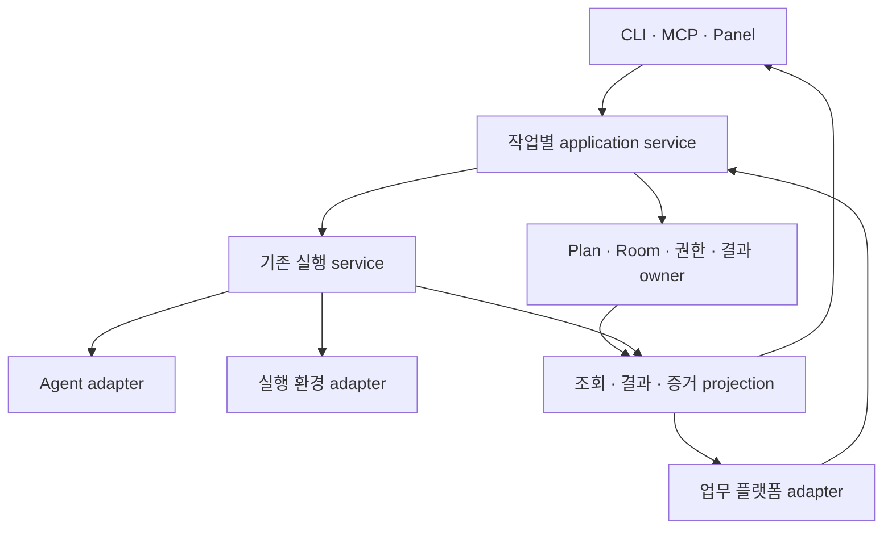

# OMS Core와 Platform API 경계

> **구현 설계 · runtime 구현 완료를 뜻하지 않음.** 2026-11-26 (KST),
> 공개 main `57d026a5071b9a3949925833cf29f6428544fd1a`의 관련 source와 현재 PR을
> 재대조했다. 첫 목표는 선택한 이슈를 기존 Main·Plan·실행·검증·결과 전달로 연결하는 것이다.
> 실제 구현 순서·변경 위치·수용 기준은 [전체 파이프라인 구현 계획](PLATFORM-PIPELINE-IMPLEMENTATION.md)을 따른다.

## 1. 목적과 이번 수정

OMS는 사용자가 선택한 agent와 실행 환경에서 허용된 작업을 수행하고,
작업 범위·실행·검증·수용·외부 전달의 근거를 연결한다. 플랫폼의 이슈와 대화는 입력과
표현이며, 상태 변경과 완료 판단은 기존 OMS domain owner가 맡는다.
여기서 Core는 그 owner들을 작업별로 연결하는 application 경계다.

이전 제안의 공통 계약과 owner 보존 원칙을 유지하되, 다음 순서를 수정한다.

| 이전 문서에서 보완할 점 | 이번 설계 |
| --- | --- |
| Core·모든 surface 통합을 먼저 완료 | 실제 작업 하나에 필요한 좁은 application service부터 연결 |
| 취소 API를 첫 제품 기능으로 사용 | 취소는 제어·복구 검증 항목; 첫 제품 기능은 이슈에서 검증된 결과까지 |
| REST 이후 모든 A2A를 후순위로 배치 | 첫 소비자가 Jira이면 필요한 최소 A2A JSON-RPC를 해당 adapter에서 구현 |
| 공통 approval·revision·cancel로 표현 | 질문 응답, 권한 grant, 표시 revision, 변경 사전조건, 취소 효과를 구분 |
| 조회 pilot에 전역 replay까지 요구 | bounded snapshot과 재조회부터 시작; durable stream은 실제 수요에 따라 추가 |

[Feature Scope](FEATURE-SCOPE.md)가 제품 범위,
[Orchestrator Work Queue](ORCHESTRATOR-WORK-QUEUE.md)가 채택과 순서,
[Control Surface Roadmap](CONTROL-SURFACE-ROADMAP.md)와
[epic #431](https://github.com/eightmm/oh-my-setting/issues/431)이 기존 작업 연결을 소유한다.
[Control Session Contract](CONTROL-SESSION-CONTRACT.md)를 재사용하며 별도 runtime queue를 만들지 않는다.
OMS-01~16은 역사적인 제안 식별자이고 PIPE-00~11은 구현 계획의 전달 단위다.
구현 진행은 [delivery tracker #619](https://github.com/eightmm/oh-my-setting/issues/619)에
연결하며, 기존 epic #431과 각 issue owner의 범위·채택 권한을 유지한다.

### 현재 구현과 구현 예정의 경계

| 근거 | 2026-11-26 확인 상태 | 재사용 범위와 한계 |
| --- | --- | --- |
| [#607](https://github.com/eightmm/oh-my-setting/pull/607), [#609](https://github.com/eightmm/oh-my-setting/pull/609) | 병합 | repo/Room handoff와 canonical Plan readiness; 전체 작업 완주 증거는 아님 |
| [#610](https://github.com/eightmm/oh-my-setting/pull/610), [#611](https://github.com/eightmm/oh-my-setting/pull/611) | 병합 | Council 실행·선택 유지와 목표에 맞는 memory recall; 새 API 구현과 구분 |
| [#614](https://github.com/eightmm/oh-my-setting/pull/614), [#618](https://github.com/eightmm/oh-my-setting/pull/618) | 병합 | native child 관측과 graph 조회 개선; 모든 provider·remote backend 완성으로 확대하지 않음 |
| [#600](https://github.com/eightmm/oh-my-setting/pull/600) | 미병합 | 목표·결과·후속 대화·복구 UI의 구현 PR; main의 완료 기능으로 표시하지 않음 |
| [#613](https://github.com/eightmm/oh-my-setting/pull/613), [#616](https://github.com/eightmm/oh-my-setting/pull/616) | 미병합, #600 기반 | 선택한 결과 공유와 managed Plan context 연결; 공유·준비 자체는 실행이 아님 |
| [#612](https://github.com/eightmm/oh-my-setting/pull/612) | 미병합 | 설치된 MCP profile 선택 보존; profile 이름이 동작 권한을 부여하지 않음 |
| 이번 문서 변경 | 설계·handoff | endpoint, daemon, 실행·배포·실사용 검증을 완료하지 않음 |

착수할 agent는 이 표보다 최신 main·PR 상태를 우선한다. Source 연결, PR의 검증 보고,
이번 문서 검증, 실제 설치·provider·플랫폼 실증은 서로 다른 증거다.

## 2. 첫 사용자 흐름과 완료 정의

첫 범위는 한 프로젝트·등록된 호스트 하나·검증 가능한 실행 경로 하나다.
현재의 GitHub intake와 Plan 경로로 내부 흐름을 먼저 입증하고, 선택한 외부 플랫폼에 연결한다.

1. 사용자가 이슈 또는 기존 작업을 선택한다. 입력의 출처·revision과 읽기 권한을 확인한다.
2. 같은 프로젝트의 현재 Main에 연결하거나, 사용자가 선택한 별도 목표로 새 Main을 시작한다.
3. 재사용 가능한 기존 Plan 작업이 있으면 정확히 연결한다. 새 요구는 기존 프로젝트 계약을
   바탕으로 제안하고, 검토한 proposal digest와 기존 채택 조건으로 Plan에 반영한다. [S3]
4. Main은 기존 권한·scope 안에서 지원되는 worker/Lead 경로에 배정한다.
   상담, context 공유, 실행 배정, 실제 실행 시작을 별도 사실로 기록한다.
5. 실행 결과의 정확한 candidate/tree와 verifier evidence를 연결하고 기존 owner가 수용한다.
6. 사전에 허용된 범위의 draft PR 또는 산출물을 만들고 원래 작업 문맥에 결과를 전달한다.
   외부 전달 실패는 실행 전체 재시작 대신 해당 전달 단계에서 복구한다.

작업마다 `result_contract`에 산출물 종류, 검증, 수용 주체와 전달 목적지를 정한다.
보고서·patch·draft PR·병합된 변경은 서로 다른 완료 조건이다. PR 생성만으로 이슈를 닫지 않는다.
이미 허용된 범위의 작업은 반복 질문 없이 이어가며, scope나 권한이 달라진 결정만 다시 판단한다.
기존 owner의 검사와 명시적 동의 조건을 제거하거나 추정된 동의로 채우지는 않는다.

팀 Main은 범위·배정·검증·통합 판단을 맡고 실제 repository 편집은 worker에 맡긴다.
단순한 작업에 모든 provider의 Council이나 다단계 Lead를 강제하지 않는다.
여러 provider의 native session을 하나의 세션처럼 재개하거나 같은 transcript로 합치지 않는다.

## 3. Core와 세 종류의 adapter

이것은 논리적 책임 경계이며 crate·database·프로세스 배치 결정이 아니다.
Core service는 입력 바인딩, action별 권한·사전조건, 기존 owner 호출 순서,
receipt 연결과 복구를 조정한다. 각 owner는 기존 guard·claim·CAS·receipt·side effect를 소유한다.
다중 owner와 외부 플랫폼의 변경을 하나의 원자적 transaction이라고 주장하지 않는다.

| 경계 | 맡을 일 | 기존 재사용점 |
| --- | --- | --- |
| 업무 플랫폼 adapter | 설치·사용자·이슈·대화 문맥, 입출력 변환, 결과 전달 | 기존 GitHub intake/landing; Jira·Linear 계약은 별도 adapter |
| Agent adapter | native session·호출 방식·지원 기능·결과 관측 | 기존 Codex·Claude·AGY 등의 확인된 경로 |
| 실행 환경 adapter | execution root·process·자원·custody·cleanup | runtime, supervisor와 검증된 backend |
| Application service | 작업의 입력부터 결과까지 기존 owner 연결 | `CollabServices`, `RuntimeServices`, 기존 Plan/Panel service ports [S1] |
| Query projection | 기존 증거를 허용된 범위에서 모아 제공 | runtime, panel-core와 bounded reader [S2, S4] |

`NativeCommand`, `ExecutionRequest`와 supervised fixed-argv 호출은 내부 실행 경계다. [S1, S4]
이를 원격에서 임의 argv·env·path를 받는 계약으로 공개하지 않는다.
모든 CLI verb를 이전하거나 모든 호출을 in-process로 바꾸는 일이 첫 기능의 선행 조건은 아니다.
두 번째 caller가 동일한 동작을 필요로 할 때 공통 service의 의미와 호환성을 검증한다.

## 4. 공개 계약의 식별자와 사전조건

아래 이름은 **설계상의 타입·동작 예시**다. 현재 Rust symbol·공개 endpoint를 뜻하지 않는다.
외부에 노출할 동작마다 입력 대상, 실제 owner, 권한, 사전조건, 효과, 복구 기준을 먼저 명시한다.

| 계약 | 필수 의미 |
| --- | --- |
| `AuthenticatedContext` | 서버가 검증한 설치·계정·사용자/서비스 주체와 위임 scope; 요청 body의 actor로 대체하지 않음 |
| `WorkspaceId` | 서버에 등록된 논리 프로젝트 식별자 |
| `RunnerBinding` | 등록된 실행 주체와 registration generation, 허용된 execution/state root 연결 |
| `TargetRef` | action별 tagged native reference; Plan task·Peer operation·attempt·실험 run을 합치지 않음 |
| `ActionPreconditions` | 해당 owner가 실제 검사하는 task/plan digest, 상태·lease·generation 또는 동등한 불투명한 증명 |
| `CommandReceipt` | 요청·전달의 단계, 실제 owner receipt, 관측된 효과; 실행 task의 대체 원장 아님 |
| `RunView` | 확인된 native reference들을 모은 read projection; 미확인 연결은 누락/unknown |
| `EvidenceRef` | producer, immutable digest, 접근 범위, 읽기·보존 정책 |
| `ResultContract` | 요구 산출물, verifier, 수용과 전달의 완료 조건 |

### Workspace와 generation

현재 `RuntimeRoots`는 `execution_repo`와 `state_repo`를 구분한다.
현재 panel project alias는 묶인 physical root 밖의 native/state root로 해석되는 경우 거절한다. [S2, S5]
기존 alias의 의미를 느슨하게 바꾸기보다, 새 경로가 필요하면 명시적인 root-pair binding을 검토한다.

Runner 등록 교체를 나타내는 generation, host boot/process generation,
현재 Main/Room/lease의 owner generation을 같은 숫자로 합치지 않는다.
첫 pilot은 equal roots인 한 호스트로 제한할 수 있다. 제약과 미지원 조합을 capability에 표시한다.
사용자 입력의 physical path·tenant·runner 이름만으로 등록 범위가 넓어지지 않는다.

### 표시 revision과 변경 사전조건

현재 work-item revision은 Plan 계보·task hash·결과 revision·verification을 합친 표시 값이다. [S4]
`view_revision`/ETag는 조회 최신성이고, 실제 변경은 해당 owner의 사전조건으로 검사한다.
모든 owner에 전역 CAS 번호를 추가할 필요는 없다.
Action precondition token을 사용해도 그 token 자체는 실행 권한 grant가 아니다.

Peer operation의 `attempt_id`는 선택 값이다. [S8]
같은 provider, 현재 화면 선택, 근처 시간의 task를 근거 없이 결합하지 않는다.
외부 issue, 사용자별 context, 외부 task, OMS Plan task, execution attempt, native session은
명시적인 mapping과 provenance로 연결하며 일대일 동등성을 전제하지 않는다.

## 5. 질문·권한·취소의 실제 효과

### 질문에 답하기와 권한 결정

현재 `oms_decide_approval`은 Room의 `desktop-decide`로 이어져,
Main의 정확한 질문에 대한 answer를 원래 inbox에 기록한다.
Room source는 일회성 privileged grant 계약과 이 답변을 구분한다.
권한 owner에는 별도의 `decide / begin-consume / finish-consume` 전이가 있다. [S7]

| 동작 | 대상과 반환 의미 |
| --- | --- |
| `answer_scope_question` | exact Room/question/version/digest; 답변 기록이며 범용 실행권 token이 아님 |
| 검토한 계획 채택 | exact proposal·project contract·Plan 사전조건; 실제 채택된 task reference |
| `decide_action_grant` | 해당 action에 실제 grant가 필요할 때 기존 권한 owner의 bound decision |
| 결과 수용 | exact candidate/tree·review·verifier evidence; 기존 acceptance receipt |
| 외부 발행 | 허용된 destination과 exact artifact/commit; 실제 publication/delivery receipt |

Grant 소비는 실제 action owner 내부에 둔다. 외부 client가 범용 consume 호출로 권한을 먼저
소비하고 나중에 임의 동작을 고르는 경로를 만들지 않는다.
Grant는 결정 주체·실행 주체·설치·resource·action·대상 digest/사전조건·expiry에 묶는다.
Patch가 없는 action에 가짜 patch 필드를 요구하지 않고, owner별 실제 대상 증명을 사용한다.
기존 위임이 충분한 routine action에 새 승인 단계를 추가하지 않는다.
권한이 달라졌거나 대상이 바뀐 경우에는 원래 owner의 재검증·동의 조건을 적용한다.

### 취소의 대상별 의미

| 대상 | 현재 계약 / 필요한 adapter 보강 | 성공으로 표시할 수 있는 사실 |
| --- | --- | --- |
| 비활성 Plan task | 기존 `cancel`은 reviewed Plan/task digest, state·lease, decision artifact, live veto를 검사 [S3] | 허용된 ready/blocked task의 철회; 실행 중 process 종료가 아님 |
| MCP Peer operation | 기존 `tasks/cancel`은 지원되는 working operation에 취소 요청을 기록 [S8] | 중단 요청 접수; 실제 종료·cleanup은 후속 owner 증거 |
| Native session/process | 해당 경로의 명시적 중단 capability와 현재 소유권이 필요 | 지원되지 않거나 미확정이면 그 상태를 보존 |
| 외부 agent task | 플랫폼 상태 mapping과 underlying OMS 동작의 분리 필요 | 외부 취소 응답으로 내부 Plan·process·patch를 일괄 종료하지 않음 |

현재 peer 취소 요청에 새 remote idempotency·identity·expiry 계약이 이미 있다고 가정하지 않는다.
필요한 보강은 원래 producer에서 구현한다. 반복 요청이 첫 요청 receipt를 안정적으로 재사용하게
할 수 있으며, 단조적인 중단 요청에 불필요한 전역 revision을 강제하지 않는다.
중단 요청, 실제 중단, cleanup, 남은 candidate의 처리와 비용 정산은 각각 관측한다.

[#437](https://github.com/eightmm/oh-my-setting/issues/437)의 scoped cancellation은
원격 제어 계약을 검증할 수 있는 후보다. 로컬 작업 완주 기능의 필수 첫 제품으로 고정하지 않는다.

## 6. 접수·전달·복구 계약

원격 비동기 접수는 구현할 저장·조회·복구 owner가 있어야 한다.
공개 API에서 `202`와 command 조회 위치를 약속하기 전에 다음 중 하나를 선택한다.

- 기존 native owner가 요청을 영속적으로 기록한 뒤 그 receipt를 반환한다.
- 분리된 비동기 접수가 필요하면 bounded command receipt 저장의 소유자·조회·보존·복구를 구현한다.
  이 저장은 전달 상태를 다루며 Plan task·실행 custody·권한 원장을 복제하지 않는다.

| 전달 상태 예시 | 의미 | 후속 처리 |
| --- | --- | --- |
| `not_dispatched` | 접수 기록은 있지만 실행 owner에게 아직 전달하지 않음 | 기존 intent와 현재 권한·expiry로 전달 적격성 재검사 |
| `dispatched` | owner 호출/전달을 시도한 기록이 있고 결과 확인 중 | 원래 owner와 native reference로 추적 |
| `confirmed` | 해당 동작의 효과가 owner 증거로 확인됨 | 의미가 맞는 receipt와 projection 반환 |
| `outcome_unknown` | 효과가 발생했을 수 있으나 확정할 근거가 부족함 | 재관측·reconciliation; 새 ID로 무조건 재실행하지 않음 |

이는 구현할 전달 계약이며 현재 공통 state machine이 존재한다는 뜻이 아니다.
접수·실행·검증·외부 전달은 별도 축이고, `not_dispatched`를 unknown effect로 표시하지 않는다.
Owner의 명시적 거절과 실제로 끝난 실패도 결과 불명과 구분한다.

Idempotency는 검증된 안정적인 installation/주체, workspace, action, key와 정규화 payload digest에 묶는다.
재접속마다 바뀌는 세션 ID에만 묶지 않는다. 같은 key의 다른 payload는 거절하고,
새로운 사용자 의도의 정상적인 재실행은 별도 명령으로 표현한다. 이슈 하나를 영구 중복 금지하지 않는다.
첫 접수에서 absolute expiry를 고정하고 재시도로 유효 기간을 연장하지 않는다.
보존 기한이 지난 receipt를 지웠다는 이유만으로 같은 effect를 새로 실행하지 않는다.

접수 전후, dispatch 전후, effect 후 응답 유실, receipt 저장 전 crash를 구분해 시험한다.
외부 effect와 filesystem receipt를 하나의 원자적 commit으로 가정하지 않는다.
승인 소비 후 effect가 불명인 경우에도 원래 intent로 복구하며 새 grant로 중복 실행하지 않는다.
Webhook delivery 중복 제거는 action idempotency와 별개다. 재전송만으로 exactly-once를 주장하지 않는다.

## 7. 조회·결과·검증의 축

첫 읽기 API는 bounded snapshot, source reference/revision, `observed_at`,
freshness·partial·unknown, 페이지 경계를 제공한다. Source가 바뀌면 재조회한다.
실제 상태 변경은 조회 cache나 화면 optimistic state를 근거로 실행하지 않는다.

| 축 | 완료를 뒷받침하는 증거 |
| --- | --- |
| 접수 | exact intent의 durable receipt |
| 실행 | 해당 invocation/attempt의 시작·종료와 오류 관측 |
| Cleanup | 실제 소유자가 확인한 process/child·자원 정리 |
| Verification | exact candidate/tree·verifier·검사 결과 |
| Acceptance | 기존 owner의 검토·수용 receipt |
| Publication | exact commit/artifact와 목적지에 대한 발행 receipt |
| Platform delivery | 외부 resource 식별자·version 또는 확인된 전달 effect |

현재 MCP peer 응답은 프로토콜 `completed`와 `result.isError`를 함께 사용할 수 있다. [S8]
따라서 프로토콜 완료를 제품 성공이나 Jira 이슈 해결로 치환하지 않는다.
현재 landing `post-evidence`는 병합된 PR의 fresh evidence를 전제로 한다. [S9]
이를 범용 진행 상황 게시 API처럼 재사용하지 말고, 필요한 전달 동작의 의미를 먼저 확정한다.

실시간 stream이 필요해지면 source별 sequence, 중복, gap, retention, 재인가를 정의한다.
Attempt-local sequence나 메모리 내 UI event log를 durable 전역 replay cursor로 광고하지 않는다.
Snapshot-first는 [#436](https://github.com/eightmm/oh-my-setting/issues/436)의
아직 필요한 session/event lifecycle 계약을 완료했다는 뜻이 아니다.

## 8. Transport와 플랫폼 연결

| 경계 | 선택 기준과 보존할 계약 |
| --- | --- |
| 기존 local MCP | tools·profiles·wire 호환성 유지; 공통 service 재사용과 도구 이름 변경은 별도 |
| REST / OpenAPI | 실제 UI/service 소비자가 필요할 때 선택; 모든 adapter의 선행 조건이 아님 |
| Jira A2A JSON-RPC | Jira native connector를 선택하면 그 최소 계약을 첫 adapter 범위에 포함 [P1] |
| Remote MCP | 실제 수요와 검증된 read/action 권한이 있을 때 추가 |
| Webhook | 서명·설치·중복·크기·시간을 검증하고 typed intent에 연결 |
| Stream | polling/snapshot으로 충족되지 않는 지연·복구 요구가 확인될 때 추가 |

Local discovery나 `oms_panel_capabilities`의 CLI catalog는 원격 동작 권한 목록이 아니다. [S5]
지원 여부는 action·actor·workspace·provider 경로의 현재 계약으로 표시한다.
설치됨, 계정 미확인, 연결됨, 지금 실행 가능을 구분하고 관측하지 않은 값은 unknown으로 둔다.
조회 refresh마다 무거운 live 인증 probe를 자동 실행하지 않는다.

### Jira의 최소 계약

공식 `rovo:agentConnector`는 A2A 1.0 JSON-RPC를 요구하며,
원격 에이전트 가이드는 필요한 subset과 선택적인 streaming을 설명한다. [P1]
선택한 버전의 SendMessage/GetTask/CancelTask 계약과 지원 오류를 확인하고,
external task 상태를 실제 OMS 입력 대기·진행·결과·취소 상태에 명시적으로 mapping한다.
범용 A2A federation·registry·다른 agent의 임의 위임까지 구현할 필요는 없다.
Polling 경로와 GetTask를 유지하고, streaming을 추가해도 그 조회 계약을 생략하지 않는다.
CancelTask는 취소 요청 기록만으로 `CANCELED`를 반환하지 않는다. 현재 protocol이 정의한
terminal·not-cancelable 결과와 pending/unknown을 구분하고 native receipt로 확인한다.
Timeout이나 unknown을 곧바로 취소 불가능으로 단정하지 않는다. 선택한 경로가 이 계약을
충족하지 못하면 해당 adapter action을 활성화하지 않고 conformance fixture와 복구를 먼저 갖춘다.

Installation과 사용자별 context, external task, issue reference를 각각 바인딩한다.
같은 이슈의 서로 다른 사용자 context를 합치지 않고 terminal external task를 재활성화하지 않는다.
Follow-up은 해당 플랫폼 계약에 맞는 다음 task로 연결한다.
사용자 context의 데이터 접근권과 OMS 실행 권한은 각각 확인한다.

공식 guide는 통상적인 SaaS web application을 전제로 한다. [P1]
사설 호스트 실행이 필요하면 공개 ingress와 검증된 outbound runner 연결의 최소 배포 경계를 정한다.
단일 설치·사용자·호스트 pilot으로 시작할 수 있다. 초기부터 다중 조직 SaaS와 broker 전체를 요구하지 않는다.
로컬에서 이슈를 읽고 결과를 보내는 경로는 이 inbound 배포 작업과 독립적으로 검증할 수 있다.

### 다른 플랫폼과 정보 경계

Linear는 app identity·delegation·Agent Session/Activity를 보존하고,
agent delegate를 사람 assignee나 OMS Main과 동일시하지 않는다. [P2]
GitHub는 기존 issue/Plan/PR 연결을 먼저 재사용하고 App이 필요한 경우 installation scope와
webhook identity를 추가한다. [P3] 플랫폼별 상태 이름을 내부 owner 상태에 그대로 복제하지 않는다.

서명된 외부 payload의 actor는 출처 정보이며 곧바로 OMS 권한이 아니다.
외부 텍스트·첨부·agent output은 작업 데이터다. Source와 destination의 접근권을
읽기·dispatch·결과 전달 시 다시 확인하고, 외부 공개 범위가 더 넓으면 허용된 정보만 보낸다.
철회된 설치, 변경된 ACL, 다른 workspace 재등록은 과거 receipt의 접근권으로 우회하지 않는다.
이 문서는 공개 자료만 사용하며 비공개 adapter 코드·계정·배포를 전제하지 않는다.

## 9. 실행·배포 경계

기존 runtime·supervisor·SSH·Slurm 지원 조각은 generic remote backend의 완성 증거가 아니다.
실행 감독과 OS/container 격리, native 대화와 managed worker의 보장을 구분한다. [S6]
현재 실제로 검증할 수 있는 경로만 capability로 노출한다.

Public entry는 `oms <verb>`로 유지한다. 새 공개 `omsd`, 기본 daemon, 필수 cloud service,
두 번째 task/approval database를 초기 조건으로 추가하지 않는다.
필요한 process 수명과 배포를 기존 host에서 충족할 수 있는지 먼저 확인한다.

Broker를 채택하면 전달 상태만 소유하고 runner가 local policy·binding·custody를 검사한다.
Heartbeat/lease 만료나 네트워크 단절만으로 같은 workspace에 대체 writer를 보내지 않는다.
이전 실행이 unknown이면 재관측하고, 실제 write owner까지 확인된 generation/fencing만 신뢰한다.
HTTP worker의 동시성 때문에 기존 reactor의 child/process 소유권을 바꾸지 않는다.
Budget은 관측 수준과 enforcement를 명시하며 지연 usage에서 절대 청구 상한을 약속하지 않는다.

## 10. 기존 UI와 전체 파이프라인

기존 `지금 / 작업 / 결과 / 관계도`를 유지한다.
새 dashboard engine 대신 같은 작업의 목표·다음 행동·검증·전달을 이어 보이게 한다.

| 화면 요구 | 연결할 기존 작업 |
| --- | --- |
| 현재 목표·다음 책임 주체·막힌 이유 | #600, #609와 canonical readiness |
| 현재 Main에 작업 추가 / 새 Main 시작 | exact project·Room·Main 연결과 기존 Plan intake |
| 상담 / 실제 배정 / 결과 공유 구분 | #600·#613·#616의 실제 계약 재사용 |
| 산출물·diff·검증·수용·전달 상태 | 기존 results/landing와 #442 |
| reload 후 원래 요청 재발견 | 기존 start-status·receipt; 새 ID로 중복 실행하지 않음 |
| 일시 오류의 마지막 공개 snapshot | same physical project/generation·현행 접근권 확인, stale 표시와 변경 차단 |
| 설정·연결·지원 여부 | #441·#612; 설치/인증/실행 가능 상태 분리 |

Private selection과 다른 사용자 context는 stale 공개 snapshot에 포함하지 않는다.
접근 철회나 binding 교체에서는 재인가 전 이전 내용을 계속 보여주지 않는다.
이전 답변의 공유나 follow-up draft 작성은 Main 전달·Plan 실행 receipt가 아니다.

## 11. OMS-01~16과 구현 패킷의 연결

상세 내용과 dependency는 [PIPE-00~11 구현 계획](PLATFORM-PIPELINE-IMPLEMENTATION.md)에 있다.
아래 번호는 16개 필수 선행 프로젝트를 뜻하지 않는다.

| 역사적 제안 | 현재 처리 / 연결 패킷 |
| --- | --- |
| OMS-01 Domain/API 계약 | PIPE-00·01·08: action별 의미·identity·실제 wire 계약 |
| OMS-02 Core 진입점 | PIPE-02~06·08: 한 사용자 흐름의 application service부터 추출 |
| OMS-03 CLI/MCP/Panel | PIPE-07·08: 필요한 caller만 연결하고 기존 호환성 보존 |
| OMS-04 Daemon/local IPC | PIPE-11 조건부; 기존 host 수명으로 부족한 실제 수요 |
| OMS-05 REST/OpenAPI | PIPE-08의 소비자 선택; Jira A2A의 필수 선행 아님 |
| OMS-06 Run/Event | PIPE-05·07 snapshot; durable stream은 PIPE-11 조건부 |
| OMS-07 권한·실행 | PIPE-00·01·03·04: 질문/grant·사전조건·실제 효과 구분 |
| OMS-08 Connector SDK | PIPE-11 조건부; 반복되는 두 번째 소비자의 요구 확인 |
| OMS-09 Forge Remote | PIPE-09: Jira를 선택하면 최소 A2A·identity·배포·결과 mapping |
| OMS-10 Linear Agent | PIPE-11 선택 확장; 기존 사람 assignee·delegation 의미 보존 |
| OMS-11 GitHub App | PIPE-06에서 기존 GitHub 경로 우선; App 도입은 PIPE-11 조건부 |
| OMS-12 Runner/Job Broker | PIPE-09의 최소 private-host 연결, 일반 broker는 PIPE-11 조건부 |
| OMS-13 Web Dashboard | PIPE-07: 기존 네 화면과 작업·결과 동선 재사용 |
| OMS-14 Multi-tenant | PIPE-11 조건부; 실제 다조직 운영 요구와 격리 검증 |
| OMS-15 A2A Gateway | Jira subset은 PIPE-09; 일반 federation은 PIPE-11 조건부 |
| OMS-16 Registry/Marketplace | PIPE-11 조건부; 설치·호환성·철회 요구가 생긴 경우 |

## 12. 착수와 검증 기준

기존 권한 안에서 수행하는 로컬 pipeline은 필요한 owner 계약부터 구현할 수 있다.
새 remote control 노출은 [#434](https://github.com/eightmm/oh-my-setting/issues/434)·
[#436](https://github.com/eightmm/oh-my-setting/issues/436)·
[#433](https://github.com/eightmm/oh-my-setting/issues/433)와 검토된
[#435](https://github.com/eightmm/oh-my-setting/issues/435) read-only pilot을 전제로 하는
[#437](https://github.com/eightmm/oh-my-setting/issues/437)의 gate를 보존한다.
선택한 플랫폼의 동등한 read/auth 증거로 바꿀 경우 해당 owner의 검토와 근거를 먼저 기록한다.
이 문서만으로 remote launch·approval·publication을 활성화하지 않는다.

구현 PR은 필요한 source와 canonical fixture를 확장하며, 다음 실패 경계를 검증한다:
정확한 요청 재시도, stale task/plan, root/owner 교체, dispatch 전후 crash,
실행 실패와 verifier 실패, 중단 요청 후 살아 있는 실행, 외부 게시 응답 유실, 접근 철회.
Source 검토·fixture·실제 설치와 provider·플랫폼 smoke를 따로 보고한다.
Local 완주와 외부 Jira 완주는 각각 별도의 PIPE-10 종료 gate다.

Rollout은 지원하는 한 경로부터 시작한다. 중단 시 새 admission은 막고
기존 intent·receipt·evidence와 unknown custody는 보존한다.
성능은 이슈에서 유효 결과까지의 시간, 수동 handoff 횟수, 검토·복구 시간,
수용된 결과당 비용과 설정 단계를 측정한다. 측정 전에 broker/cache/stream을 일괄 도입하지 않는다.

## 13. 공개 근거

아래 source는 관련 정의·caller를 확인한 공개 main commit에 고정한다.
이는 전체 repository 재감사나 live 실행 성공을 뜻하지 않는다.
플랫폼 reference는 2026-11-26 확인 기준이며 구현 시 선택할 protocol version을 다시 확인한다.

- **S1 — Application wiring:** [CollabServices](https://github.com/eightmm/oh-my-setting/blob/57d026a5071b9a3949925833cf29f6428544fd1a/crates/oms/src/services_collab.rs), [RuntimeServices](https://github.com/eightmm/oh-my-setting/blob/57d026a5071b9a3949925833cf29f6428544fd1a/crates/oms/src/services_runtime.rs).
- **S2 — Root와 runtime:** [RuntimeRoots](https://github.com/eightmm/oh-my-setting/blob/57d026a5071b9a3949925833cf29f6428544fd1a/crates/oms-runtime/src/services.rs), [runtime README](https://github.com/eightmm/oh-my-setting/blob/57d026a5071b9a3949925833cf29f6428544fd1a/crates/oms-runtime/README.md).
- **S3 — Plan·intake·실행:** [Plan engine](https://github.com/eightmm/oh-my-setting/blob/57d026a5071b9a3949925833cf29f6428544fd1a/crates/oms-command-plan/src/engine.rs), [proposal/apply](https://github.com/eightmm/oh-my-setting/blob/57d026a5071b9a3949925833cf29f6428544fd1a/crates/oms-command-autonomy/src/planning.rs), [runner](https://github.com/eightmm/oh-my-setting/blob/57d026a5071b9a3949925833cf29f6428544fd1a/crates/oms-command-autonomy/src/runner.rs).
- **S4 — Service·조회·결과:** [service ports](https://github.com/eightmm/oh-my-setting/blob/57d026a5071b9a3949925833cf29f6428544fd1a/crates/oms-panel-core/src/services.rs), [work-item projection](https://github.com/eightmm/oh-my-setting/blob/57d026a5071b9a3949925833cf29f6428544fd1a/crates/oms-command-panel/src/desktop_board.rs), [results](https://github.com/eightmm/oh-my-setting/blob/57d026a5071b9a3949925833cf29f6428544fd1a/crates/oms-panel-core/src/results.rs).
- **S5 — MCP·alias·capability:** [panel tools/callers](https://github.com/eightmm/oh-my-setting/blob/57d026a5071b9a3949925833cf29f6428544fd1a/crates/oms-mcp-server/src/panel.rs), [conversation panel](https://github.com/eightmm/oh-my-setting/blob/57d026a5071b9a3949925833cf29f6428544fd1a/crates/oms-mcp-server/src/conversation-panel.html).
- **S6 — Supervision:** [supervisor README](https://github.com/eightmm/oh-my-setting/blob/57d026a5071b9a3949925833cf29f6428544fd1a/crates/oms-supervisor/README.md), [peer process](https://github.com/eightmm/oh-my-setting/blob/57d026a5071b9a3949925833cf29f6428544fd1a/crates/oms-command-peer/src/process.rs).
- **S7 — 서로 다른 결정:** [Room desktop decision](https://github.com/eightmm/oh-my-setting/blob/57d026a5071b9a3949925833cf29f6428544fd1a/crates/oms-command-room/src/desktop.rs), [privileged approval](https://github.com/eightmm/oh-my-setting/blob/57d026a5071b9a3949925833cf29f6428544fd1a/crates/oms-command-operations/src/approvals.rs).
- **S8 — Peer 관측·취소:** [MCP peer](https://github.com/eightmm/oh-my-setting/blob/57d026a5071b9a3949925833cf29f6428544fd1a/crates/oms-mcp-server/src/peer.rs), [optional attempt reference](https://github.com/eightmm/oh-my-setting/blob/57d026a5071b9a3949925833cf29f6428544fd1a/crates/oms-command-operations/src/peer_operations.rs).
- **S9 — GitHub 결과 전달:** [landing owner](https://github.com/eightmm/oh-my-setting/blob/57d026a5071b9a3949925833cf29f6428544fd1a/crates/oms-command-landing/src/github.rs), [GitHub workflow](https://github.com/eightmm/oh-my-setting/blob/57d026a5071b9a3949925833cf29f6428544fd1a/docs/wiki/GitHub-Workflow.md).
- **P1 — Jira:** [Rovo Agent Connector](https://developer.atlassian.com/platform/forge/manifest-reference/modules/rovo-agent-connector/), [Remote agents in Jira](https://developer.atlassian.com/platform/forge/remote-agents-in-jira/), [Forge Remote](https://developer.atlassian.com/platform/forge/remote/). OMS mapping과 private-host 배포 선택은 이 문서의 설계다.
- **P2 — Linear:** [Agents](https://linear.app/developers/agents). OMS의 작업·권한 mapping은 이 문서의 설계다.
- **P3 — GitHub:** [Webhook best practices](https://docs.github.com/en/webhooks/using-webhooks/best-practices-for-using-webhooks). OMS action idempotency는 별도 owner 계약이다.
