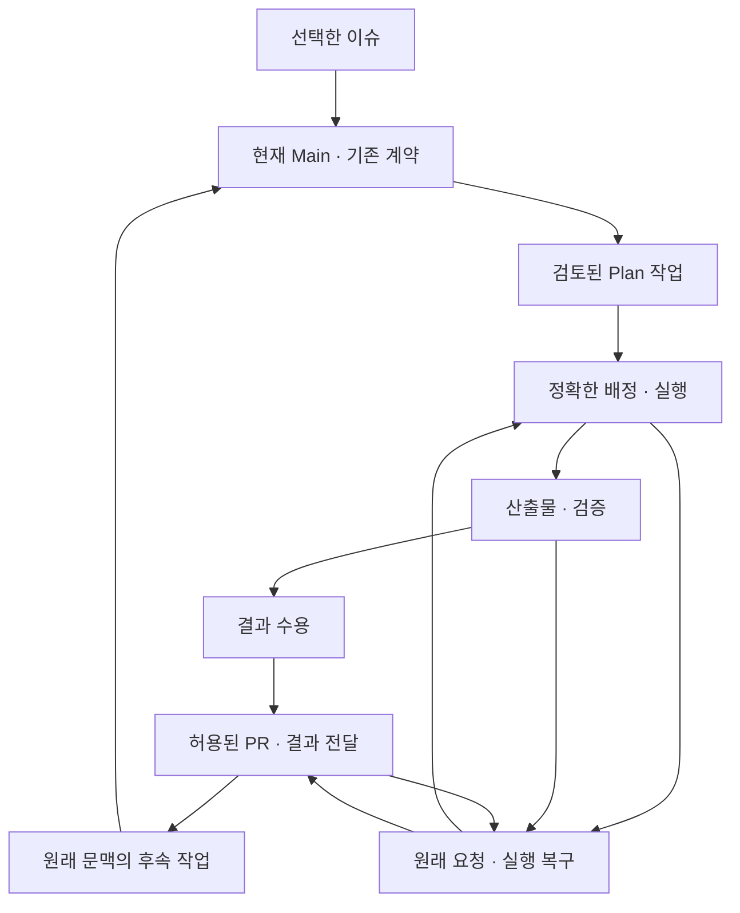
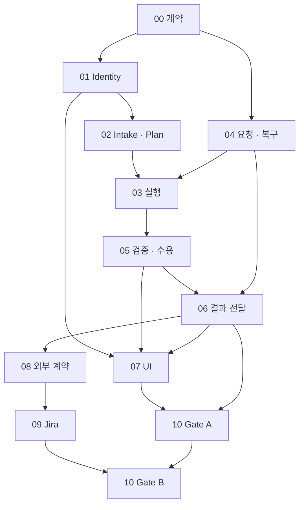

# OMS 작업 접수부터 결과 전달까지: 구현 인계서

> **구현할 내용과 수용 기준을 등록한 문서다. 기능 구현·실행·배포 완료 보고가 아니다.**
> 작성일: 2026-11-26 KST. 공개 소스 기준:
> [`57d026a5071b9a3949925833cf29f6428544fd1a`](https://github.com/eightmm/oh-my-setting/commit/57d026a5071b9a3949925833cf29f6428544fd1a).
> PR 상태는 같은 날 확인한 기록이며, 구현 에이전트는 착수 시 다시 확인한다.

## 1. 목표, 소유권과 첫 완료 범위

**선택한 이슈 하나를 현재 Main에 연결하고, 기존 Plan과 실행 경로로 처리하여,
검증 근거가 있는 결과와 허용된 draft PR 또는 결과 링크를 원래 작업 문맥으로 돌려준다.**
중간 오류·응답 유실·화면 재접속 뒤에도 같은 요청과 실행을 다시 찾을 수 있어야 한다.

[Feature scope](FEATURE-SCOPE.md)가 제품 범위,
[Orchestrator work queue](ORCHESTRATOR-WORK-QUEUE.md)가 채택과 실제 착수,
[epic #431](https://github.com/eightmm/oh-my-setting/issues/431)이 기존 UI·제어 작업의 추적을 소유한다.
이 문서는 [Platform API architecture](PLATFORM-API-ARCHITECTURE.md)를 구현 가능한 변경 단위로 나눈
delivery view다. `PIPE-00`~`PIPE-11`은 이 문서의 추적 번호이며 새 runtime 작업 큐가 아니다.
기존 Issue의 완료 조건을 새 체크리스트로 덮어쓰거나, 문서 병합만으로 Issue를 닫지 않는다.
단계별 구현 PR·검증·재개 지점은 [추적 Issue #619](https://github.com/eightmm/oh-my-setting/issues/619)에 연결한다.
문서가 main에 없으면 [#608](https://github.com/eightmm/oh-my-setting/pull/608)의 현재 head SHA를 확인하고
그 커밋의 문서를 읽는다. 문서 기준 commit과 실제 구현 기반 main은 별도로 기록한다.

첫 완주 범위는 등록 프로젝트 1개, 실행 호스트 1개, 사용자 문맥 1개,
검증 가능한 에이전트 실행 경로 1개, 명시한 결과 형태 1개다.
기존 GitHub intake·Plan·landing 경로로 로컬 완주를 확인하고,
첫 외부 사용처가 Jira이면 최소 A2A 어댑터를 연결한다.
모든 provider·host·플랫폼의 기능 동등성이 첫 성공의 선행 조건은 아니다.

이번 문서 등록의 범위는 설계·구현 지침이다. 실제 구현 에이전트는 자신에게 위임된
구현·게시 범위에서 진행하며, 문서의 예시가 계정 설정·유료 호출·배포·병합 권한을 부여하지 않는다.
이미 허용된 범위의 반복 작업에는 승인을 다시 요구하지 않는다.

### 현재 구현과 재사용할 PR

| 근거 | 확인 상태 | 재사용 범위와 남은 구분 |
| --- | --- | --- |
| [#607](https://github.com/eightmm/oh-my-setting/pull/607) | 병합 | 작업 인계의 repository·Room 문맥. 새 통합 실행의 증거는 아님 |
| [#609](https://github.com/eightmm/oh-my-setting/pull/609) | 병합 | GitHub 후보가 정식 Plan readiness를 소비. 현재 실행 가능 이유의 UI 연결은 계속 확인 |
| [#610](https://github.com/eightmm/oh-my-setting/pull/610) | 병합 | Council 병렬 실행과 선택한 구성·회차 유지. 모든 작업에 Council을 강제하지 않음 |
| [#611](https://github.com/eightmm/oh-my-setting/pull/611) | 병합 | Memory 검토 알림과 목표 기반 선택적 recall. 후보 메모리 자동 수용은 아님 |
| [#614](https://github.com/eightmm/oh-my-setting/pull/614) | 병합 | Claude native child 관측·wake. 관리형 실행·cleanup 동등성의 근거로 확대하지 않음 |
| [#618](https://github.com/eightmm/oh-my-setting/pull/618) | 병합 | Context dependency의 graph index 재사용. 전체 파이프라인 성능 측정은 별도 |
| [#600](https://github.com/eightmm/oh-my-setting/pull/600) | Open, head `4a0b3279` | 목표·증거·readiness·후속 대화·복구 UI. 문맥 갱신은 Main 메시지 전달 receipt가 아님 |
| [#612](https://github.com/eightmm/oh-my-setting/pull/612) | Open, head `cf8b3a34` | 관리형 MCP Core/Full 선택 유지. discovery profile은 원격 실행 권한이 아님 |
| [#613](https://github.com/eightmm/oh-my-setting/pull/613) | Open, head `2b479f9a` | 선택한 결과 발췌의 명시적 공유·Inspect. 공유는 작업 배정·실행·승인 아님; #600 위에 쌓임 |
| [#616](https://github.com/eightmm/oh-my-setting/pull/616) | Open, head `df9babbb` | Lead 발췌를 기존 Claude/AGY 관리형 Plan 경로의 고정 context pack으로 연결. 준비만으로 실행하지 않으며 native Lead 동등성을 구현하지 않음; #600 위에 쌓임 |
| [#608](https://github.com/eightmm/oh-my-setting/pull/608) | 설계 PR | Core·API 경계와 이 인계서. 실제 endpoint·adapter·새 runtime 구현은 없음 |

Open PR은 최신 main에 있는 기능으로 세지 않는다. 후속 PR은 필요한 선행 PR의 실제
merge/tree 상태를 확인한 뒤 기반을 선택하고, 아직 열려 있으면 dependency 또는 stacked base를
명시한다. 같은 파일을 별도 구현으로 다시 쓰지 않는다. PR 본문의 테스트 보고는 해당 revision의
기록이며, 현재 조합과 실제 설치 환경을 검증한 것으로 전용하지 않는다.

## 2. 완주 흐름과 상태의 연결



복구 화살표는 새 실행을 무조건 시작한다는 뜻이 아니다. 기존 요청·소유자·효과를 확인하고,
아직 하지 않은 단계만 이어간다. 원래 효과가 불명확하면 확인 상태를 보존한다.

| 단계 | 입력 → 출력의 최소 참조 | 사실을 소유하는 곳 |
| --- | --- | --- |
| 이슈 선택 | 외부 연결·종류·ID·revision/digest → 검토한 입력 참조 | 기존 intake와 외부 플랫폼 |
| Main 연결 | 등록 프로젝트·Room·현재 Main 근거 → 작업 의도 | Room/Main owner; 대화 UI가 소유권 생성 안 함 |
| 계획 채택 | 기존 프로젝트 계약·검토한 제안 digest → 정식 Plan 작업 | Plan/intent owner |
| 배정·실행 | 정확한 작업·lease·실행 조건 → 배정·operation·attempt 참조 | 기존 native assignment 또는 managed Plan 실행 owner |
| 검증·수용 | 산출물·candidate/tree digest·verifier → 검증·수용 receipt | 결과·review·acceptance owner |
| 전달 | 수용된 결과와 허용된 목적지 → PR/댓글/활동 참조·전달 receipt | 기존 landing 또는 선택 플랫폼의 전달 owner |

위 객체 이름과 이후의 공통 필드는 **구현할 계약의 제안**이다. 현행 Rust symbol이나
현재 지원하는 API 이름으로 간주하지 않는다. source에서 같은 의미의 타입을 찾으면 재사용한다.

### 동작 계약에서 합치지 않을 의미

| 구분 | 구현할 규칙 |
| --- | --- |
| 질문 응답 / 권한 부여 | `oms_decide_approval`의 현재 desktop 응답 의미와 특권 실행 grant를 분리. grant 소비는 실제 동작 owner 내부에 남김 |
| 계획 채택 / 결과 수용 | 검토한 작업을 시작 대상으로 삼는 결정과 정확한 결과를 수용하는 결정을 별도 참조로 기록 |
| 작업 / 실행 / 화면 | Plan task, Peer operation, lifecycle attempt, experiment run, 외부 conversation/task는 각각의 native ID를 유지. `RunView`는 조회용 연결 |
| 조회 revision / 변경 조건 | 화면 hash·ETag는 최신성 표시. 실제 writer는 자기 Plan/task/lease/generation 등의 조건을 guard 안에서 재검사 |
| 취소 요청 / 종료 / cleanup | 대기 Plan 철회, 실행 중단 요청, 종료 관측, 자원 정리는 별도 효과. 지원하지 않는 중단은 명시적으로 표시 |
| 완료 / 성공 / 수용 / 게시 | 프로토콜 terminal, 실행 성공, 검증 통과, 결과 수용, PR 생성, 병합, 전달 성공을 한 `done`으로 축약하지 않음 |
| 설치 / 인증 / capability | 설치 관측, 계정 확인, 해당 동작 지원, 현재 admission을 구분. 모르는 값은 `unknown`; 미지원은 `unsupported` |

## 3. 구현 패킷

각 패킷은 먼저 기존 Issue와 PR을 확인하고 **남은 차이만** 구현한다. 한 패킷을 반드시 한 PR로
만들 필요는 없지만, producer·consumer를 따로 내면 중간 revision도 호환 가능해야 한다.
아래 테스트 경로는 재사용 지점이다. 이름을 확인하지 않은 새 테스트나 전체 suite 통과를 주장하지 않는다.

### PIPE-00 — 현재 기준과 동작별 계약 고정

- **목적 / owner:** 전체 공통 의미를 고정한다. #431과 기존 #432 계약·#437 동작 경계에 연결한다.
- **선행:** 최신 main, 관련 Open PR, `AGENTS.md`, `PROJECT.md` 존재 여부를 다시 확인한다.
- **입출력:** 선택한 첫 use case와 기존 호출 경로 → 동작/대상/소유자/사전조건/효과/복구 표.
- **구현:** 첫 동작의 실제 producer를 지정한다. `registered-cancellation-owner` 같은 미정 owner,
  표시용 Run ID, 임의 shell·argv를 공개 계약의 실행 대상으로 남기지 않는다.
- **구현:** platform adapter, provider adapter, 실행 환경 adapter의 책임을 분리한다.
  공통 조정은 기존 서비스 안에서 시작하며, 모든 CLI/MCP의 동시 이전이나 새 crate를 요구하지 않는다.
- **재사용:** [root composition](../crates/oms/src/services_collab.rs),
  [runtime composition](../crates/oms/src/services_runtime.rs),
  [내부 실행 port](../crates/oms-panel-core/src/services.rs), [세션 계약](CONTROL-SESSION-CONTRACT.md).
- **완료 기준:** 요청부터 실제 writer와 receipt까지 한 경로를 설명할 수 있고,
  기존 wire/CLI 호환성과 첫 소비자의 범위가 명시된다. 이슈 상태를 execution authority로 쓰지 않는다.
- **검증 / PR:** 계약·오류·기존 응답 호환 fixture를 가장 가까운 owner에 추가한다.
  [panel parity](../crates/oms-panel-core/tests/parity.rs), [MCP native](../crates/oms-mcp-server/tests/native.rs)를 재사용한다.
  문서만 바꾸면 구현 완료로 체크하지 않는다.

### PIPE-01 — 프로젝트·사용자·실행 호스트와 동작 가능 여부

- **목적 / owner:** #434 identity, #441 Connections, #436 native capability를 연결한다. PIPE-00 이후 착수한다.
- **입출력:** 검증한 호출자와 등록 프로젝트 → 확인된 Room/Main/runner binding과 동작별 capability.
- **구현:** 논리 Workspace ID와 runner registration을 분리한다. 등록은 서버가 소유하며
  `execution_repo`/`state_repo`, registration generation, boot/process/owner generation을 각각 해석한다.
  첫 파일럿은 동일 root·단일 host로 제한해도 되지만 제한을 명시한다.
- **구현:** 외부 설치·사용자·문맥을 서버 검증 결과에서 내부 주체로 연결한다.
  payload의 actor·tenant·root를 권한으로 신뢰하지 않고 source 조회와 OMS 동작 권한을 각각 확인한다.
- **범위:** 선택한 첫 use case에 필요한 binding만 구현한다. 범용 registry·모든 host의 이관을 선행시키지 않는다.
- **구현:** `oms_panel_capabilities`의 명령 카탈로그를 현재 action admission으로 오해하지 않는다.
  설치됨/인증 미확인/동작 미지원/현재 작업 차단을 구분하고 원래 owner의 이유를 표시한다.
- **재사용:** [RuntimeRoots](../crates/oms-runtime/src/services.rs),
  [Main capability](../crates/oms-command-panel/src/native_panel.rs),
  [MCP project binding](../crates/oms-mcp-server/src/panel.rs), [Connections projection](../crates/oms-command-panel/src/desktop_board.rs).
- **완료 기준:** 다른 clone·Room·등록 세대·사용자 문맥을 같은 프로젝트로 잘못 연결하지 않는다.
  read에서 임의 로그인이나 비싼 probe를 실행하지 않고 관측 불가능한 값은 미확인으로 남긴다.
- **검증 / PR:** alias 재등록, 다른 state root, stale Main/Room, 권한 철회, missing capability를
  [MCP native](../crates/oms-mcp-server/tests/native.rs)와 native panel/desktop board의 기존 fixture에 추가한다.

### PIPE-02 — 선택한 이슈를 현재 Main과 기존 Plan에 연결

- **목적 / owner:** #447 intake, #443 문맥, #434 identity와 기존 autonomy/Plan을 연결한다. PIPE-01에 의존한다.
- **입출력:** 검토한 이슈 revision/digest + 현재 프로젝트 계약 → 재사용하거나 새로 채택한 정확한 Plan task 참조.
- **구현:** `현재 Main에 작업 추가`와 `새 목표의 Main 시작`을 구분한다.
  기존 프로젝트 계약이 유효하면 재사용하고, 이슈가 추가하는 요구·수용 기준을 작업 제안에 넣는다.
- **구현:** 기존 준비된 작업에 이슈가 연결돼 있으면 명시적으로 재사용한다.
  이슈 ID만으로 모든 후속 요청을 하나의 실행에 합치거나, 정당한 재작업을 중복으로 지우지 않는다.
- **구현:** preview → 검토한 제안 digest → 기존 채택 owner를 연결한다.
  이슈 본문·체크박스·공유 발췌는 참조 데이터이며 권한이나 활성 계약을 자동 변경하지 않는다.
- **재사용:** [source intake](INTENT-SOURCE-INTAKE.md), [intent](../crates/oms-command-autonomy/src/intent.rs),
  [planning](../crates/oms-command-autonomy/src/planning.rs), [Plan engine](../crates/oms-command-plan/src/engine.rs),
  [GitHub readiness](../crates/oms-command-landing/src/github_board.rs), #607/#609.
- **완료 기준:** 사용자가 같은 작업에서 이슈·현재 Main·채택된 Plan 참조와 수용 기준을 확인한다.
  현재 승인 범위 안에서는 Main이 계속 진행하고, 범위가 바뀌는 결정만 질문한다.
- **검증 / PR:** source drift, stale proposal, 다른 Room, 기존 task 재사용, 반복 접수와 별개 새 의도를
  [autonomy contract](../crates/oms-command-autonomy/tests/autonomy_contract.rs),
  [Plan CLI](../crates/oms-command-plan/tests/cli.rs), MCP fixture로 검증한다.

### PIPE-03 — Main의 배정과 실제 실행 연결

- **목적 / owner:** 기존 native assignment/managed Plan 실행과 #436을 연결한다. PIPE-02·PIPE-04에 의존한다.
- **입출력:** 정식 Plan task + 기존 위임 범위 + 선택 route → 실제 배정/lease/operation/attempt 참조.
- **구현:** 첫 경로 하나를 선정해 실행 가능 상태를 다시 확인하고 owner의 claim/dispatch를 호출한다.
  Codex native assignment와 Claude/AGY managed Plan 경로를 같은 세션 제어 기능으로 광고하지 않는다.
- **구현:** #616의 검토한 Lead context pack을 재사용하되, 준비 receipt와 실제 실행 receipt를 구분한다.
  원래 brief·범위·모델 배정·verifier·lease를 발췌 텍스트가 바꾸지 못하게 한다.
- **구현:** Main은 계획·배정·독립 검토·통합을 조정한다. 단순 작업은 bounded worker/기존 Lead로 처리하고,
  작업상 필요한 경우에만 Council·추가 reviewer를 사용한다. #610의 provider/회차 선택을 보존한다.
- **재사용:** [runner](../crates/oms-command-autonomy/src/runner.rs),
  [native assignment](../crates/oms-command-panel/src/native_assignment.rs),
  [orchestrator](../crates/oms-command-panel/src/orchestrator.rs),
  [peer execution](../crates/oms-command-peer/src/peer.rs), #610/#616.
- **완료 기준:** Lead pane 열기·읽기 전용 상담·공유 문맥·실제 task assignment가 구분된다.
  모호한 native 전송 뒤 다른 worker에 같은 쓰기를 자동 재배정하지 않는다.
- **검증 / PR:** stale task digest/lease, 잘못된 context pack, provider capability 차이,
  dispatch 전후 변경을 autonomy contract·[peer contract](../crates/oms-command-peer/tests/peer_contract.rs)·panel fixture에 추가한다.

### PIPE-04 — 요청 영속성, 재시도, 취소와 복구

- **목적 / owner:** #437과 기존 operation·Plan·supervisor 소유권을 사용한다. PIPE-00 이후 PIPE-01과 병행 가능하다.
- **입출력:** 인증된 동작 의도와 native target → 원래 요청 키·owner receipt·현재 효과 상태.
- **구현:** 첫 동작은 native owner가 기록한 접수 receipt를 돌려주는 방식부터 선택한다.
  별도 비동기 접수가 필요하면 저장·전달·상태 조회의 소유자와 crash recovery를 구현한다.
  존재하지 않는 `/commands/...` URL이나 `202`만으로 durable queue를 약속하지 않는다.
  이 패킷 역시 첫 동작의 필요한 보장부터 추가하며, 전체 명령을 새 저장 체계로 옮기는 과제가 아니다.
- **구현:** `not_dispatched`, `dispatched`, `confirmed`, `outcome_unknown` 등 전달 상태를 명시한다.
  저장 직전/직후, dispatch 직전/직후, effect 이후 응답 유실을 각각 복구한다.
  한 process 메모리의 key cache를 영속적 중복 방지로 취급하지 않는다.
- **구현:** 멱등성 조회 키는 stable installation/workspace/principal/action과 요청 key로 구성하고,
  저장된 요청 digest와 payload를 대조한다. 같은 key의 다른 payload는 거절한다.
  최초 접수의 절대 만료를 재시도로 연장하지 않는다.
  delayed dispatch 시 현행 권한·작업 조건을 재검사한다.
- **구현:** 현재 owner가 허용하는 ready/blocked Plan 철회, Peer 취소 요청,
  native session 중단을 각각 실제 지원 owner로 연결한다.
  취소 요청 접수와 프로세스 종료·child cleanup 확인을 분리한다. 모든 취소에 전역 CAS를 새로 만들지 않는다.
- **재사용:** [Peer cancellation](../crates/oms-mcp-server/src/peer.rs),
  [Plan cancellation](../crates/oms-command-plan/src/engine.rs),
  [operation records](../crates/oms-command-operations/src/peer_operations.rs),
  [supervisor](../crates/oms-supervisor/README.md), 기존 `oms_start_status`.
- **완료 기준:** 재시도·재접속이 기존 작업을 재발견한다. timeout·heartbeat 만료·PID 미발견만으로
  성공/실패/cleanup 또는 대체 writer의 실행 허가를 만들지 않는다.
- **검증 / PR:** 응답 유실, 재시작, 중복·충돌 key, 만료 재시도, 중단 후 살아 있는 child,
  unknown 효과를 MCP native·Plan CLI·peer contract·[native entry](../crates/oms/tests/native_entry_contract.rs)에 추가한다.

### PIPE-05 — 결과, 검증과 수용을 정확한 산출물에 연결

- **목적 / owner:** #442의 결과 동선과 기존 acceptance를 완성한다. PIPE-03에 의존한다.
- **입출력:** 실제 execution과 산출물 참조 → 검증된 candidate/tree와 검증·수용 receipt.
- **구현:** 결과 형태와 완료 기준을 작업 시작 때 고정한다. 보고서, patch, draft PR,
  merged change를 같은 결과로 간주하지 않는다. 첫 파일럿은 한 형태를 구현한다.
- **구현:** task/operation/attempt/evidence의 확인된 연결만 projection에 넣는다.
  Peer `completed` + `isError`를 성공으로 매핑하지 않고, 선택적인 attempt 연결은 비워 둘 수 있다.
- **구현:** verifier·review 결과를 exact candidate/tree와 연결하고 현재 수용 owner로 전달한다.
  다른 변경을 합친 tree는 그 tree에 필요한 검증을 다시 적용한다. worker의 자기 보고로 수용하지 않는다.
- **구현:** 요청·실행·cleanup·verification·acceptance·delivery 축과 source/freshness/unknown을 노출한다.
  output은 기존 권한과 크기·페이지 경계를 유지하며 임의 파일 경로를 공개 DTO로 받지 않는다.
- **재사용:** [results](../crates/oms-panel-core/src/results.rs), [review](../crates/oms-panel-core/src/review.rs),
  [panel commands](../crates/oms-command-panel/src/commands.rs), [Plan completion](../crates/oms-command-plan/src/engine.rs), #600.
- **완료 기준:** 사용자가 결과에서 무엇을 검증했고 무엇이 아직 미확인인지 알 수 있다.
  권한 철회·다른 candidate·변경된 산출물은 기존 결과를 수용하는 근거로 쓰지 않는다.
- **검증 / PR:** 실패 exit, 실패 verifier, stale candidate, 다른 task attribution,
  artifact 변경·pagination mismatch를 results unit·panel parity·Plan CLI·MCP fixture에 추가한다.

### PIPE-06 — PR 생성과 원래 문맥으로의 결과 전달

- **목적 / owner:** 기존 landing과 #439/#442의 전달 경계를 연결한다. PIPE-04·PIPE-05에 의존한다.
- **입출력:** 정확한 결과와 기존 게시 권한 + 목적지 → PR/댓글/활동의 외부 참조와 전달 상태.
- **구현:** 허용된 draft PR 생성은 기존 landing 경로를 사용한다. PR 생성·ready·병합·issue close는
  서로 다른 효과이며 요청된 범위를 따른다. 결과를 수용했다고 자동 병합하지 않는다.
- **구현:** 기존 `post-evidence`는 병합 증거 게시 경로다. 이를 임의 진행 상황 게시로 전용하지 않는다.
  필요한 플랫폼의 진행/질문/결과 전달은 좁은 delivery owner로 추가하고, 원래 결과를 참조한다.
- **구현:** effect identity와 전달 receipt를 기록한다. remote 응답 유실은 원래 외부 객체를 확인한 뒤
  재전송 여부를 결정한다. source/destination의 현재 접근권과 공개 범위를 다시 확인한다.
- **구현:** delivery 실패가 실행 재시작이나 검증 결과 변경을 일으키지 않게 한다.
  webhook 반향은 causation/effect identity로 구분하며 결과를 다시 새 작업으로 만들지 않는다.
- **재사용:** [landing GitHub](../crates/oms-command-landing/src/github.rs),
  [GitHub workflow](wiki/GitHub-Workflow.md), [landing contract](../crates/oms-command-landing/tests/landing_contract.rs).
- **완료 기준:** 원래 이슈·대화에서 결과 링크와 검증 범위를 확인하고, 미전달 결과만 재전달할 수 있다.
  PR 생성 성공을 이슈 해결 완료로 표시하지 않는다.
- **검증 / PR:** POST 응답 유실, 기존 marker 불일치, 계정/설치 철회, 목적지 삭제,
  동일 사건 반향, 전달 실패 후 재개를 기존 landing fixture 또는 새 adapter의 실제 경계 fixture로 확인한다.

### PIPE-07 — 기존 화면의 작업 흐름과 재접속 UX

- **목적 / owner:** #433/#441/#442/#443 및 #600/#613을 확장한다. PIPE-01 뒤 읽기 UI부터 병행한다.
- **입출력:** canonical snapshot + 확인된 요청/작업/결과 참조 → 같은 범위의 화면·선택·지원 동작.
- **구현:** `지금`은 목표·현재 담당·필요한 다음 행동, `작업`은 상태·admission·차단 이유,
  `결과`는 artifact·검증·수용·전달, `관계도`는 근거 있는 Main/Lead/작업/실행 연결을 보여준다.
- **구현:** Main 계속하기, Lead 상담, 실제 배정, 새 목표를 구분한다.
  #613의 발췌 공유를 Main 메시지 전송이나 실행 버튼으로 표시하지 않는다.
- **구현:** 질문 답변·계획 채택·결과 수용·특정 동작 허용의 버튼 문구와 대상 근거를 구분한다.
  이미 위임된 범위의 통상 동작을 매번 확인하게 만들지 않는다.
- **구현:** 새로고침·프로젝트 재선택 후 원래 접수 기록을 재발견하는 `확인 중인 요청` 경로를 제공한다.
  일시 오류에서는 동일 프로젝트/등록 세대의 허용된 public snapshot만 시각과 함께 유지하고 변경을 막는다.
  권한 철회·재등록·다른 프로젝트에서는 접근할 수 없는 내용과 private 선택을 제거한다.
- **구현:** #600의 읽기 위치·paging·polling pause·선택적 Lead 연결을 재사용한다.
  snapshot-first로 시작하며 지속 session replay가 필요한 #436의 미완료 조건을 통과했다고 표시하지 않는다.
- **재사용:** [conversation panel](../crates/oms-mcp-server/src/conversation-panel.html),
  [desktop board](../crates/oms-command-panel/src/desktop_board.rs), [MCP panel](../crates/oms-mcp-server/src/panel.rs).
- **완료 기준:** PIPE-05/06 결과를 같은 작업에서 확인한다. stale read·unknown과 권한 거절의 이유를 구분한다.
- **검증 / PR:** [Node panel fixture](../crates/oms-mcp-server/tests/conversation-panel.test.mjs),
  [TUI parity](../crates/oms-command-panel/tests/panel_parity.rs)에 late response·재접속·선택 변경·CJK 폭을 추가하고,
  실제 지원 host에서 읽기·키보드·스크롤·긴 결과를 따로 확인한다.

### PIPE-08 — 실제 use case의 공통 호출 경계와 외부 wire 계약

- **목적 / owner:** #434/#437과 기존 서비스 구성을 사용한다. PIPE-00/01/04 계약을 먼저 확정하고
  PIPE-02~06의 실제 경로를 소비한다. 광범위한 리팩터링을 첫 작업의 선행으로 만들지 않는다.
- **입출력:** 인증된 typed 요청 → 기존 owner의 receipt 또는 source-linked snapshot.
- **구현:** 한 use case의 검증·조정을 기존 application service로 정리하고 CLI/MCP/선택 transport가 재사용한다.
  supervised native 호출을 모두 in-process로 바꿀 필요는 없다. 내부 `ExecutionRequest`의 임의 argv/env/path는 공개하지 않는다.
- **구현:** 기존 MCP 이름·profile·엄격한 reader와의 호환성을 유지한다. 새 원격 schema는 별도 version으로 정의하고
  validation·오류·paging·응답 크기·request digest를 fixture로 고정한다. 입력 schema가 권한을 만들지 않는다.
- **구현:** 지원 동작별로 exact target과 precondition을 정의한다. 질문 응답과 action grant,
  Plan 철회와 실제 실행 stop을 서로 다른 operation으로 노출하고 grant 소비는 내부 owner에 남긴다.
- **구현:** 실제 소비자가 REST를 필요로 하면 좁은 OpenAPI 계약을 추가한다.
  Jira가 첫 소비자면 A2A JSON-RPC 어댑터에서 같은 서비스로 연결하며 REST 구현을 선행시키지 않는다.
- **재사용:** root services, panel-core service ports, [MCP schema](../crates/oms-mcp-server/src/tools.json),
  [MCP profiles](../crates/oms-mcp-server/src/lib.rs), [grant owner](../crates/oms-command-operations/src/approvals.rs).
- **완료 기준:** 두 호출 표면이 같은 의미의 요청에 동일 owner와 효과를 사용하고, 알려지지 않은 동작은 명확히 거절한다.
- **검증 / PR:** action allowlist, unknown fields/versions, wrong target, source/output ACL,
  stale precondition, payload/key 충돌과 기존 profile 호환성을 동일 owner fixture와 transport fixture로 연결한다.

### PIPE-09 — Jira의 최소 원격 에이전트 연결

- **목적 / owner:** 첫 외부 사용처가 Jira이면 PIPE-08·PIPE-06 위에 얇은 platform adapter를 구현한다.
  기존 control-surface tracker에 연결하며, 새 Plan·Room·approval owner를 만들지 않는다.
- **입출력:** 검증된 Forge 설치·사용자·외부 문맥의 요청 → OMS 작업 참조, 진행/질문/결과와 A2A task 상태.
- **구현:** 착수 시 [Rovo Agent Connector](https://developer.atlassian.com/platform/forge/manifest-reference/modules/rovo-agent-connector/)와
  [remote agents guide](https://developer.atlassian.com/platform/forge/remote-agents-in-jira/)의 현재 계약을 확인한다.
  A2A 1.0의 JSON-RPC 2.0 `SendMessage`, `GetTask`, `CancelTask`와 task mapping을 먼저 구현한다.
  과거 `message/send`·`tasks/get` 표기를 그대로 가져오지 않는다. polling으로 시작할 수 있고,
  streaming은 선택 사항이며 추가해도 `GetTask`를 유지한다. JSON-RPC 응답에 가상의 REST `202` 계약을 덧씌우지 않는다.
- **구현:** installation + external user + context + task를 명시적으로 OMS 참조에 연결한다.
  같은 이슈의 다른 사용자 문맥을 합치지 않고, external task terminal을 issue Done으로 복제하지 않는다.
  종료된 외부 task의 후속 대화는 공식 수명 규칙에 맞춰 새 task와 기존 작업의 관계를 기록한다.
- **구현:** FIT 등 공식 인증과 사용자 문맥의 데이터 접근을 검증한다.
  다른 플랫폼·사용자에서 얻은 비공개 메모리/결과를 공유할 수 있다고 가정하지 않는다.
- **구현:** 외부 context당 active task 규칙을 지키고, `CancelTask`는 실제 owner가 중단을 확인하기 전
  `TASK_STATE_CANCELED`로 응답하지 않는다. 취소할 수 없는 확정 조건은 공식 `TaskNotCancelableError` 계약을 따른다.
  timeout·결과 미확인은 취소 불가능이나 성공으로 바꾸지 않고 원래 receipt로 대조한다.
  선택 route가 필요한 취소 계약을 충족하지 못하면 지원으로 광고하거나 다른 실행 경로로 우회하지 않는다.
- **구현:** Jira가 호출할 공개 접점과 사설 runner 사이에 필요한 최소 연결을 선택한다.
  로컬 outbound GitHub workflow와 외부 ingress를 분리하고, 단일 허용 설치/사용자/host로 파일럿한다.
  durable 수신이 필요하면 PIPE-04의 owner를 사용하고 네트워크 단절로 다른 writer를 시작하지 않는다.
- **완료 기준:** Jira에서 요청한 한 작업이 OMS의 실제 결과·검증 참조로 돌아온다.
  질문 대기·실패·취소·unknown delivery가 정확히 보이며 native agent UI와 충돌하지 않는다.
- **검증 / PR:** 서명/설치/사용자 불일치, 중복 호출, 권한 철회, private context 혼합,
  요청 timeout 뒤 조회, cancel 도중 완료 경쟁, 결과 전달 응답 유실을 공식 계약 기반 fixture로 확인한다.
  실제 Jira 설치의 smoke 증거는 fixture와 별도로 PIPE-10에 기록한다.

### PIPE-10 — 종단 검증, 운영, 설치와 성능 측정

- **목적 / owner:** #438/#445와 각 packet owner의 근거를 통합한다. 새 독립 telemetry 프로젝트를 선행시키지 않는다.
- **입출력:** 확인한 source/PR 조합 + 선택한 host/provider/platform → 범위가 명시된 실행·검증·복구 증거.
- **Gate A:** PIPE-02~07의 로컬 완주를 실제 지원 host/provider 하나에서 수행한다.
  이슈→현재 Main→Plan→실행→검증→허용된 결과 전달과 중간 재접속을 같은 작업으로 입증한다.
- **Gate B:** PIPE-08/09의 원격 계약을 검증하고 선택한 Jira 설치에서 한 작업을 완주한다.
  미설정 계정·네트워크·비용 권한 때문에 live 검증을 못 하면 정확한 blocker와 준비된 재개 절차를 기록한다.
- **구현:** source 연결, fixture 통과, hosted CI, 설치 host의 live 결과를 각각 기록한다.
  provider/host/version/선택 route/commit 또는 tree/receipt/검증 범위가 없는 성공 표시를 만들지 않는다.
- **host별 확인:** 선택 경로에 따라 [#503 계정 로그인](https://github.com/eightmm/oh-my-setting/issues/503),
  [#505 활성 Codex MCP 갱신](https://github.com/eightmm/oh-my-setting/issues/505),
  [#599 Claude remote session의 도구 proxy](https://github.com/eightmm/oh-my-setting/issues/599)를 확인한다.
  해당하지 않는 host 문제를 모든 파일럿의 선행으로 만들지 않고, 실제 연결 blocker를 fixture 통과로 덮지 않는다.
- **구현:** read-only 또는 제한된 기능 활성화로 rollout하고, 중단 시 새 admission을 막되
  진행 중 intent·receipt·unknown custody·증거를 지우지 않는다. 기존 update/repair/uninstall 소유권을 보존한다.
- **측정:** 첫 유효 결과까지 시간, 수동 문맥 인계 횟수, 검토 시간, 복구 시간,
  수용된 결과당 token/compute 비용, 설정 단계, snapshot 지연과 읽기량을 측정한다.
  미관측 비용은 미확인으로 두며 임의 성공률·성능 목표를 달성했다고 적지 않는다.
- **재사용 / 검증:** [root verifier](../verify), [affected gate](../scripts/check.sh),
  [hosted CI](../.github/workflows/test.yml), [install lifecycle](../tests/install-lifecycle-smoke.sh),
  [native lifecycle](../crates/oms-command-lifecycle/tests/native_lifecycle.rs).
  변경 위험에 맞춘 fixture를 사용하고 필수 gate를 유지한다. 변경 없는 비싼 전체 검증을 반복하지 않는다.

### PIPE-11 — 실제 수요가 확인된 후의 확장

- **상태:** 조건부 후속 목록. PIPE-00~10의 첫 파일럿 완료 조건이 아니다.
- 두 번째 소비자가 동일 의미를 요구할 때 최소 client/SDK와 공통 schema 생성 범위를 정한다.
- 실제 Linear 위임 흐름이 필요하면 [공식 Agents 계약](https://linear.app/developers/agents)의
  app/session/activity와 사람 assignee·agent delegate 차이를 보존한다. GitHub App은 기존 intake·landing 위에서 검토한다.
- 필요한 지연·복구 요구를 snapshot으로 충족하지 못하면 event stream의 durable cursor·gap·retention·재인가를 구현한다.
  기존 attempt-local sequence나 메모리 diff를 전역 재생 로그로 광고하지 않는다.
- 사설 host의 연결·자원 요구가 확인되면 broker/runner 전달을 확장한다.
  기존 SSH·Slurm helper의 존재만으로 범용 원격 실행·격리·takeover 지원을 표시하지 않는다.
- 여러 조직을 실제로 서비스할 때 tenant별 identity·ACL·artifact·usage·retention·철회를 검증한다.
- 장기 host 수명 때문에 필요할 때만 IPC/private helper를 추가한다. 공개 PATH entry는 `oms`를 유지한다.
- 일반 A2A federation, registry, marketplace는 실제 discovery·설치·업데이트 수요와 검증된 adapter 뒤에 채택한다.
- 각 확장은 원인·최소 범위·기존 owner·수용 기준을 별도 구현 PR에 기록한다. 새 scheduler나 두 번째 task/approval DB를 기본값으로 만들지 않는다.

## 4. 의존성, 병렬화와 기존 원격 제어 gate



PIPE-08의 계약 협의와 fixture 작성은 PIPE-01/04 이후 병행할 수 있다. 외부 기능 완료는
실제 PIPE-02~06 owner의 결과를 소비한 뒤 판단한다. 별도 새 애플리케이션 계층 전체를 먼저 만들지 않는다.
PIPE-07의 read UX는 일찍 진행하고, 실행·수용·전달 버튼은 해당 owner 계약이 준비된 뒤 연결한다.

병렬 작업은 서로 다른 파일·상태 owner를 맡긴다. `panel.rs`, `conversation-panel.html`,
`services_collab.rs`, Plan engine 등 공통 파일은 담당 통합 worker를 지정하거나 선행 PR 이후 수정한다.
Main은 각 worker의 입력·출력·허용 경로·검증을 고정하고, 통합 tree에서 증거를 다시 확인한다.

**로컬 완주와 원격 제어의 선행 조건은 다르다.** 기존 로컬 owner가 허용하는 작업 흐름은
[#435](https://github.com/eightmm/oh-my-setting/issues/435)의 ChatGPT 원격 읽기 파일럿 완료를 기다릴 필요가 없다.
원격 변경은 [#437](https://github.com/eightmm/oh-my-setting/issues/437)의 #434/#436/#433과 검토된
#435 pilot 조건을 문서 등록만으로 해제하지 않는다. Jira를 택하면 해당 플랫폼의 동등한
읽기·identity·권한·오류 증거가 무엇인지 기존 Issue에 명시하고 검토한 뒤 원격 변경을 연결한다.
이 검토는 이미 위임된 범위 안에서 진행하며, 매 단계마다 사용자에게 같은 허가를 다시 요구하지 않는다.
Snapshot-first는 첫 조회 slice의 선택이다. #436이 요구하는 지속 세션 replay 등의 남은 조건은 별도로 추적한다.

## 5. 공통 수용 증거와 실패 시나리오

| 시나리오 | 필요한 관측 | 통과로 인정하지 않는 것 |
| --- | --- | --- |
| 이슈·계약·계획 연결 | 검토한 source와 proposal digest, 채택된 정확한 task | 이슈 preview 또는 UI 선택만 성공 |
| 실제 배정·실행 | owner의 claim/dispatch·native operation 참조 | pane 열림, 상담 답변, 공유 context |
| 실패와 검증 | 해당 candidate/tree의 verifier와 실패/성공 결과 | 프로세스 종료나 자연어 완료 보고 |
| 질문·결정 | 질문 reply, 계획 채택, grant, 결과 수용 각각의 owner receipt | 하나의 공통 approved flag |
| 같은 요청 재시도 | 같은 key/payload가 원래 receipt로 돌아옴 | 다른 ID로 다시 실행하여 성공 |
| 응답 유실 | dispatch/effect 기록을 대조하고 기존 작업 재발견 | timeout을 미실행으로 추정 |
| 취소 | 요청 접수와 종료·cleanup의 별도 증거 | HTTP 성공이나 cancel 파일 존재만으로 종료 판정 |
| 결과 게시 | 동일 effect의 외부 객체와 전달 receipt | PR 생성 = 병합 = 이슈 해결 |
| 재접속·권한 변경 | 원래 작업 복구 또는 현재 권한에 맞춘 명시적 거절 | stale UI에서 변경 실행, 다른 문맥의 결과 차용 |
| rollout 중단 | 새 admission 중지와 기존 receipt/custody 보존 | 작업 상태를 지워 깨끗한 화면 만들기 |

한 테스트로 여러 파일을 겉으로 통과시키기보다 실제 경계를 통과하는 fixture를 확장한다.
최소 fault case는 접수 전/후 crash, dispatch 전/후 crash, effect 이후 응답 유실,
동일 key의 다른 payload, source/Plan/lease 변경, 철회된 권한, 종료와 취소의 경쟁이다.
모든 장애의 exactly-once 효과를 포괄적으로 주장하지 말고, 동작별 보장과 확인 불가능한 상태를 적는다.

검증 보고에는 `source checked`, `fixture passed`, `hosted CI passed`, `live host verified`,
`blocked`, `not exercised`를 구분하고 정확한 commit/tree와 실행 범위를 붙인다.
실패한 검증을 삭제하거나 조건을 약하게 바꿔 통과시키지 않는다. 환경 차단은 실제 probe와 범위를 남기고
영향 없는 작업은 계속한다. 완료 기준에 필요한 live 증거가 없으면 그 단계는 미완료다.

## 6. 구현 에이전트에게 전달할 시작 지시

아래 지시는 이 문서의 구현을 의뢰할 때 사용할 작업 brief다. 현재 사용자 위임 범위와
저장소 규칙이 우선하며, 이 텍스트를 읽었다는 사실만으로 실행·게시 권한이 생기지 않는다.

```text
OMS의 이슈 접수→현재 Main→Plan→배정/실행→검증/수용→결과 전달→복구 파이프라인을 구현한다.
기준 문서는 docs/PLATFORM-PIPELINE-IMPLEMENTATION.md와 docs/PLATFORM-API-ARCHITECTURE.md다.
기존 epic #431, ORCHESTRATOR-WORK-QUEUE.md, FEATURE-SCOPE.md와 각 연결 Issue를 함께 따른다.
파이프라인의 구현 PR·검증·재개 지점은 추적 Issue #619에 연결한다.

1. AGENTS.md, global rules, 현재 PROJECT.md와 관련 OMS skill을 읽는다.
   최신 main/관련 PR의 head·merge 상태를 확인하고 이 인계서의 상태 표를 그대로 신뢰하지 않는다.
   #608이 미병합이면 현재 PR head commit에서 문서를 읽고 main에 이미 있다고 가정하지 않는다.
   #600/#612/#613/#616의 구현을 재사용하고, #607/#609/#610/#611/#614/#618의 병합 기능을 중복 구현하지 않는다.
2. 첫 파일럿의 프로젝트·host·provider 경로·산출물·게시 범위를 현재 사용자 위임 안에서 고정한다.
   기존 계약을 재사용하고 허용된 범위에서는 계속 진행한다. 범위 밖 권한이 필요할 때만 구체적으로 질문한다.
3. PIPE-00부터 실제 남은 차이를 Plan과 추적 Issue에 기록한다. 완료된 조건은 commit/tree와 증거로 닫는다.
   새 작업 DB·scheduler·필수 daemon·전체 CLI/MCP 이전을 선행시키지 않는다.
4. Main은 계획·배정·검토·통합을 맡고, 팀을 운용할 때 파일 변경은 범위가 정해진 worker에게 위임한다.
   서로 겹치는 파일은 담당자를 정한다. worker는 허용된 범위만 수정하고 결과와 검증을 반환한다.
5. PIPE-01/04를 기반으로 02→03→05→06을 연결하고 07 UI를 병행한다.
   질문/승인, task/run/view, 접수/실행/검증/수용/전달, 취소 요청/종료/cleanup을 분리한다.
   같은 요청을 재발견하며 unknown 효과를 새 실행으로 덮지 않는다.
6. 작은 구현 PR마다 기존 owner와 가장 가까운 fixture를 확장한다. 정확한 변경 tree에서 affected gate를 실행한다.
   완료 보고 전 root ./verify를 실행하고 실패·환경 차단·미실행 범위를 기록한다. 필수 gate를 우회하지 않는다.
7. 로컬 완주 Gate A를 확인한 뒤, 또는 독립 작업으로 준비한 PIPE-08/09를 합쳐 Jira Gate B를 검증한다.
   Jira는 공식 최소 A2A JSON-RPC 계약을 따르고 REST를 선행 조건으로 만들지 않는다.
   원격 제어는 기존 #437 조건 또는 명시적으로 검토한 동등한 pilot 증거를 충족한다.
8. PR에는 기존 Issue, 변경 이유, 실제 동작, exact head/tree, 검증, 복구/rollback, 남은 조건을 적는다.
   이 작업에서 별도로 허용되지 않은 병합·release·설치·외부 배포는 실행하지 않는다.
   모든 단계의 구현·검증·미완료 상태와 다음 재개 지점을 추적 Issue에 갱신한다.
```

## 7. 기존 OMS-01~16 제안과의 대응

| 기존 ID | 이번 구현 위치 | 첫 완주와의 관계 |
| --- | --- | --- |
| OMS-01 Domain/API 계약 | PIPE-00/01/08 | 실제 동작 계약부터 고정 |
| OMS-02 Core 진입점 | PIPE-02~06/08 | 첫 use case에서 필요한 공통 조정만 추출 |
| OMS-03 CLI/MCP/Panel | PIPE-07/08 | 첫 소비 경로 연결; 전면 이전은 선행 아님 |
| OMS-04 daemon/IPC | PIPE-11 | 지속 host 수요가 생길 때 |
| OMS-05 REST/OpenAPI | PIPE-08 | 실제 REST 소비자가 필요할 때; Jira 선행 아님 |
| OMS-06 Run/events | PIPE-05/07, 필요 시 11 | source-linked snapshot 먼저; 별도 replay 요구 보존 |
| OMS-07 권한/approval | PIPE-00/01/04/08 | 질문·grant·사전조건과 실제 effect 분리 |
| OMS-08 SDK | PIPE-11 | 반복 소비가 확인된 뒤 |
| OMS-09 Forge Remote | PIPE-09/10 | Jira 선택 시 최소 A2A·인증·실제 결과 전달 |
| OMS-10 Linear | PIPE-11 | 두 번째 실제 사용처 수요에 따라 |
| OMS-11 GitHub App | PIPE-02/06, 확장은 11 | 기존 GitHub 경로 재사용; 별도 App 필수 아님 |
| OMS-12 runner/broker | PIPE-01/04/09, 확장은 11 | 필요한 최소 연결과 custody 유지 |
| OMS-13 dashboard | PIPE-07 | 기존 네 화면과 Open PR 확장 |
| OMS-14 multi-tenant | PIPE-11 | 다조직 운영 필요 시 |
| OMS-15 A2A | PIPE-09와 11 | Jira 최소 계약은 초기; 일반 federation은 조건부 |
| OMS-16 registry/marketplace | PIPE-11 | 검증된 adapter의 설치·발견 수요 이후 |

## 8. 근거를 사용하는 범위

상대 source 링크는 위 기준 commit의 재사용 지점이며, 구현 시 현행 정의·caller·fixture를 다시 읽는다.
PR 링크는 게시·병합 상태와 명시한 변경 범위의 근거다. 기능 전체의 완성도나 실제 공급자 실행의
증거가 아니다. 플랫폼 공식 문서는 protocol 선택의 근거이고, OMS가 그 기능을 이미 제공한다는 뜻이 아니다.
이 공개 인계서에는 비공개 저장소의 코드·배포 설정·계정·개인 실행 경로를 넣지 않는다.
