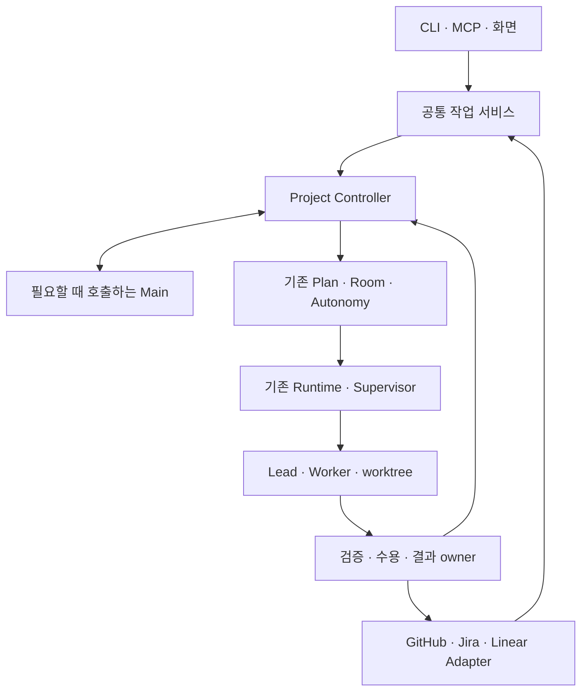

# 단일 프로젝트 상주 운영: 구현 계약과 작업 분할

> **설계·구현 인계 문서. 이 문서의 병합은 runtime 구현·설치·배포 완료가 아니다.**
> 작성: 2026-11-26 KST. 기존 관련 소스 검토는 `9d38b973379842997f0235bde55c849326ef8b5c`,
> 이 문서의 작성 기반 main은 `1ca1939b2a7343b583c627eb83ce69827c27fca7`이다.
> 둘 사이에는 Plan 조회 최적화 #623이 있으며, 최신 main 전체를 재감사한 기록은 아니다.

## 1. 목적과 기존 작업의 관계

프로젝트 하나를 등록한 컴퓨터에서 요청 접수 → Main 판단 → Plan → 실행 → 검증·수용 →
결과 전달을 이어간다. 화면 종료와 프로세스 재시작 뒤에도 원래 요청과 실행을 다시 찾는다.
기존에 위임된 범위의 반복 작업은 계속 수행하고, 새로운 범위나 권한이 필요한 결정만 되돌린다.

제품 범위는 [FEATURE-SCOPE](FEATURE-SCOPE.md), 착수·중복 방지는
[기존 작업 큐](ORCHESTRATOR-WORK-QUEUE.md)와 [#619](https://github.com/eightmm/oh-my-setting/issues/619)가 소유한다.
이 문서는 [#608](https://github.com/eightmm/oh-my-setting/pull/608)의
[API 설계](https://github.com/eightmm/oh-my-setting/blob/fbb762e2209c34c7e32139827c20603ffe7cdf20/docs/PLATFORM-API-ARCHITECTURE.md)와
[PIPE 구현 명세](https://github.com/eightmm/oh-my-setting/blob/fbb762e2209c34c7e32139827c20603ffe7cdf20/docs/PLATFORM-PIPELINE-IMPLEMENTATION.md)에
상주 운영의 구체적인 형식·순서·실패 시험을 보충한다. 새로운 runtime queue나 완료율 원장을 만들지 않는다.

2026-11-26 확인 시 #608은 미병합 문서 PR이고 #600·#612·#613·#616도 미병합이다.
[#619의 기존 claim](https://github.com/eightmm/oh-my-setting/issues/619#issuecomment-7192297692)은
PIPE-00 owner 표, PIPE-04 MCP Peer 취소, #600 → #613 → #616 패널 적층 작업을 맡고 있다.
이 문서는 해당 구현을 재할당하지 않는다. 같은 파일의 작업은 실제 병합 상태와 owner를 먼저 확인한다.
Claim·PR 게시·CI 보고를 구현 완료나 사용자 설치 환경의 실증으로 바꾸어 표시하지 않는다.

첫 범위는 **프로젝트 1개·등록 호스트 1개·사용자 문맥 1개·실증한 실행 경로 1개·활성 목표 1개**다.
독립 Worker는 기존 Plan 규칙으로 병렬화할 수 있지만 integration target의 writer는 기존 owner가 관리한다.
일반 CLI 사용은 유지하고 상주 모드는 선택 기능으로 추가한다. 여러 프로젝트, 공용 broker,
새 실행 DB, 범용 SDK, multi-tenant 운영은 이 첫 완료의 선행 조건이 아니다.

## 2. 현재 소스와 보완할 경계

아래 링크는 재사용할 source 위치다. 구현 에이전트는 착수 SHA에서 정의·caller·fixture를 다시 읽는다.

| 현재 근거 | 이미 있는 역할 | 이번 보완 / 아직 입증되지 않은 것 |
| --- | --- | --- |
| [lifecycle scheduler](../crates/oms-command-lifecycle/src/scheduler.rs), [tick](../crates/oms-command-lifecycle/src/tick.rs) | systemd user oneshot/timer 또는 cron, 저장된 repo registry와 sweep | 이벤트 intake를 처리하는 선택형 host; 설치됐다는 사실은 별도 확인 |
| [panel-core tick](../crates/oms-panel-core/src/tick.rs) | 승인된 autopilot의 headless 재개, launch intent·start/finish 관측 | 새 목표 선택·계획 검토를 수행하는 headless Main driver |
| [autonomy receipt](../crates/oms-command-autonomy/src/receipt.rs) | digest·controller claim 검사; `proposal-review`·`parked`·`done` 재진입 거절 | 기존 거절을 삭제하지 않고 필요한 Parent 판단을 연결 |
| [adaptive](../crates/oms-command-autonomy/src/adaptive.rs), [goal](../crates/oms-command-autonomy/src/goal.rs) | 관측에 묶인 다음 행동·제한된 goal 진행 | 세션이 없는 동안 판단을 호출하고 결과를 검증하는 use case |
| [Plan engine](../crates/oms-command-plan/src/engine.rs), [intent](../crates/oms-command-autonomy/src/intent.rs) | task·lease·계획 채택과 변경 조건의 owner | 외부 요청과 같은 작업의 연결; host가 파일을 직접 쓰지 않음 |
| [CollabServices](../crates/oms/src/services_collab.rs), [service ports](../crates/oms-panel-core/src/services.rs) | 기존 owner와 감독되는 native 실행의 composition | 작은 공통 application service부터 추출; 전체 in-process 이전은 필수 아님 |
| [MCP command](../crates/oms-mcp-server/src/command.rs), [panel](../crates/oms-mcp-server/src/panel.rs) | CommandExecutor, 호스트가 설정한 프로젝트 alias, 화면·작업 조회 | 외부 호출의 검증된 identity와 등록 binding; CLI catalog는 원격 권한 목록이 아님 |
| [Supervisor](../crates/oms-supervisor/README.md), [runtime](../crates/oms-runtime/README.md) | 실행 감독·정산, CI/SSH/Slurm/실험의 정확한 대기 참조 | lost-owner/host·persistent session 복구의 남은 producer 보강 |
| [results](../crates/oms-panel-core/src/results.rs), [landing](../crates/oms-command-landing/src/github.rs) | exact candidate 수용과 GitHub 결과 근거 | 일반 진행·질문·결과 전달; 현재 `post-evidence`는 merged PR 근거 용도 |

새 `ProjectController`는 아래의 논리적 application 역할 이름이다. 현행 symbol이나 별도 crate를 뜻하지 않는다.
Plan·Room·lease·approval·acceptance·publication의 소유권과 기존 오류 의미는 원래 producer에 남긴다.



## 3. 프로젝트 등록 형식과 capability

**이후 JSON은 구현 검토용 예시이며 현재 실행 가능한 설정·공개 스키마가 아니다.**
정확한 타입·version·저장 위치는 기존 owner 확인과 fixture를 포함한 각 구현 PR에서 고정한다.
opaque reference는 서버가 해석한다. 예시를 `.oms`에 직접 기록하지 않는다.

```json
{
  "schema": "resident-project/proposal-0",
  "project_id": "project-example",
  "binding_ref": "registered-root-pair-ref",
  "runner_ref": "registered-runner-ref",
  "runner_registration_generation": 1,
  "project_contract_ref": "reviewed-project-contract-ref",
  "operating_policy_ref": "existing-delegated-scope-ref",
  "main_route_ref": "configured-main-route-ref",
  "work_source": {"kind": "github", "connection_ref": "registered-connection-ref"},
  "active_goal_limit": 1,
  "result_contract_ref": "verified-draft-pr-contract-ref"
}
```

- 등록 owner만 physical `execution_repo`/`state_repo`를 해석한다. 첫 pilot은 equal roots로 제한할 수 있다.
- 기존 alias를 넓혀 임의 경로를 허용하지 않는다. 외부 요청의 path·runner 이름은 등록 근거가 아니다.
- Runner 등록 세대, OS boot/process identity, Main/Room owner 세대는 서로 다른 축으로 보존한다.
- `operating_policy_ref`는 이미 있는 위임 근거의 참조다. 설정 파일에 쓰였다는 사실만으로 권한이 생기지 않는다.
- 설치됨·인증 확인됨·동작 지원·현재 admission 가능을 구분한다. 모름은 `unknown`, 미지원은 `unsupported`다.
- v1은 launch·관측·결과·stop/cleanup 중 무엇을 보장하는지 확인한 경로 하나로 검증한다.
  Native session을 managed worker와 동등하게 표시하거나 모든 provider의 resume를 가정하지 않는다.
- 실행·재시도·시간 제한은 기존 집행 owner에 연결한다. 추정 usage로 provider 청구액의 절대 상한을 약속하지 않는다.

## 4. 입력·결정·영수증의 최소 계약

### 작업 요청

```json
{
  "schema": "resident-command/proposal-0",
  "request_id": "request-example",
  "project_id": "project-example",
  "action": "submit_work",
  "source": {
    "kind": "github_issue",
    "connection_ref": "registered-connection-ref",
    "resource_ref": "reviewed-issue-ref",
    "revision_ref": "frozen-source-revision-ref"
  },
  "external_context_ref": "platform-conversation-ref",
  "idempotency_key": "intent-example",
  "result_contract_ref": "verified-draft-pr-contract-ref"
}
```

검증된 installation·actor·위임 scope는 transport 인증에서 얻고 request body의 actor로 대체하지 않는다.
서버는 최초 접수 시 expiry를 고정하고 재시도로 연장하지 않는다. 예시의 input만으로 작업을 실행하지 않는다.
Issue·외부 session·Plan task·operation·attempt의 일대일 관계를 가정하지 않고 명시적인 참조를 연결한다.
외부 source revision이 바뀌면 원래 요구사항과 변경분을 구분하고 현재 실행에 자동 덮어쓰지 않는다.

### Main 결정

```json
{
  "schema": "resident-decision/proposal-0",
  "request_ref": "request-example",
  "observation_ref": "checked-observation-ref",
  "action": "adopt_reviewed_proposal",
  "target": {"kind": "intent_proposal", "ref": "proposal-ref"},
  "preconditions_ref": "owner-checked-preconditions-ref",
  "review_evidence_refs": ["reviewed-proposal-evidence-ref"]
}
```

Main은 등록된 action 중 현재 허용된 결정을 제안한다. 모델이 반환한 action·review 표시는 권한 증거가 아니다.
실제 writer가 guard 안에서 해당 proposal·task·lease·generation과 검토 근거를 재검증한다.
관측 snapshot의 표시 revision은 writer의 변경 사전조건과 구분한다. 서로 다른 owner에 전역 CAS를 만들지 않는다.

| 제안 동작 | 실제 대상·소유권 | 성공으로 표시할 효과 |
| --- | --- | --- |
| `submit_work` | 등록 프로젝트와 reviewed source; 기존 intake/intent | 원래 요청·입력 참조 접수 |
| `adopt_reviewed_proposal` | 정확한 proposal와 project contract; intent/Plan | 채택된 task 참조 |
| `assign_task` | 기존 task·lease·Room·지원 route | 배정 receipt; 실행 시작은 별도 관측 |
| `answer_question` | 정확한 Room question/version | 원래 inbox에 답변 기록 |
| `decide_action_grant` | 기존 approval owner의 bound action | 필요한 권한 결정; 소비는 실제 action owner 내부 |
| `accept_result` | exact candidate/tree·review·verifier | 기존 acceptance receipt |
| `publish_result` | 허용된 목적지·정확한 artifact/commit | publication/delivery receipt |
| `pause_admission` | 프로젝트의 신규 admission 제어 | 새 배정 중지; 실행 중 process 종료는 아님 |
| `request_stop` | 타입별 native 실행 참조·현재 custody | 중단 요청; 종료·cleanup은 확인된 별도 효과 |

실제 transport에 없는 동작은 capability로 노출하지 않는다. 범용 `approve()`나 raw argv 실행 endpoint를 만들지 않는다.
취소는 기존 #619 claim의 MCP Peer producer를 먼저 재사용한다. Plan 철회와 process 취소를 같은 효과로 반환하지 않는다.

### 접수 영수증과 결과 조회

```json
{
  "schema": "resident-receipt/proposal-0",
  "request_ref": "request-example",
  "delivery": "confirmed",
  "native_refs": [{"kind": "plan_task", "ref": "existing-task-ref"}],
  "owner_receipt_ref": "original-owner-receipt-ref",
  "observed_at": "2026-11-26T00:00:00Z",
  "evidence_refs": []
}
```

이 시각은 형식 예시이며 실제 관측이 아니다. `confirmed`는 지정한 action의 효과만 뜻한다.
실행 성공·검증·수용·PR·병합·외부 전달은 각각 원래 owner의 근거로 표시한다.
결과 view는 `producer_ref`, immutable digest, 접근 범위, freshness와 `partial/unknown`을 가진 근거를 연결한다.
조회 projection을 두 번째 작업 상태 원장으로 저장하거나 빈 배열을 검증 완료로 해석하지 않는다.

## 5. 상주 loop와 headless Main의 동작

1. 부팅 시 binding·실행 버전·지원 capability를 확인하고, 기존 owner와 pending effect를 먼저 reconcile한다.
2. 외부 요청·worker 결과·CI 완료·사용자 입력을 원래 요청 참조로 저장하고 중복 이벤트를 합친다.
3. 실행 중 목표와 기존 `next_action`을 관찰한다. 대기·결과 수집·전달 재시도는 모델 없이 처리한다.
4. 계획·재계획·후속 목표 선택이 필요할 때만 Main을 호출한다. 관련 계약·근거만 전달한다.
5. 구조화된 결정을 기존 owner에서 검증하고 적용한 뒤 receipt를 연결한다.
6. 상태가 바뀌거나 다음 관측 시점이 올 때까지 기다린다. 주기마다 LLM을 호출하지 않는다.

| 현재 상태 | 상주 driver가 할 일 | 보존할 경계 |
| --- | --- | --- |
| 입력 없음 / 외부 결과 대기 | bounded 관측과 backoff; 변경 없으면 휴면 | refresh만으로 작업 생성·재제출하지 않음 |
| `proposal-review` | Parent/Main 검토를 요청하고 실제 검토 근거를 existing adopt 경로에 연결 | 재진입 거절을 지우거나 자동 grant로 바꾸지 않음 |
| `parked` | reason과 정확한 decision을 읽고 허용된 inspect/replan/wait/resume/stop 판단 호출 | 원래 decision digest·scope 보존 |
| 실행 중 | 같은 attempt를 관측하고 실제 결과를 수집 | live Main·child가 있는데 두 번째 controller를 시작하지 않음 |
| `done` | 결과 전달과 기존 archive 절차 확인 후 다음 적격 intent 선택 | terminal run을 재활성화하지 않고 새 의도를 별도로 접수 |
| 운영 범위 밖 | 원래 문맥에 필요한 질문과 근거 전달 | 단순 질문 답변을 추가 권한 grant로 해석하지 않음 |

Main의 책임은 프로젝트에 연결하고 모델 세션 수명과 분리한다. 재시작 시 목표·Plan·질문·결과로 context를
재구성하며 다른 provider의 native transcript를 하나의 resume session처럼 합치지 않는다.
대화 Main과 상주 Main은 같은 Room/owner 계약으로 경쟁을 해결한다. 기존 owner 확인 없이 새 root owner를 만들지 않는다.
팀 Main은 계획·배정·검토·종합을 맡고 repository 편집은 Lead/Worker에 위임한다.
단순 작업마다 Council·여러 provider·별도 Lead를 강제하지 않는다.

현재 hourly tick에는 정리·journal·CI·memory·telemetry가 함께 있다. 이벤트 처리에는 필요한 observe/wake/
continuation service만 호출하고, maintenance sweep은 기존 cadence로 유지한다. 처음에는 기존 timer로
로컬 경로를 검증할 수 있다. 낮은 지연의 수신·지속 관측이 필요한 상주 host는 같은 service를 사용한다.
기존 wake 횟수 제한을 삭제하는 것만으로 새로운 이벤트 처리량·비용 정책을 구현했다고 보지 않는다.

## 6. 전달·중복·재시작 복구

접수 기록을 보존할 실제 owner가 준비되기 전에 비동기 접수 성공을 반환하지 않는다.
전달 메타데이터가 필요하면 bounded inbox/outbox·cursor를 기존 작업 참조에 연결하되 실행 상태를 복제하지 않는다.
여러 owner와 외부 플랫폼의 변경은 하나의 filesystem transaction이 아니다.

| 전달 관측 | 다음 처리 |
| --- | --- |
| `not_dispatched` | 원래 intent·권한·expiry가 유효한지 확인한 뒤 첫 전달 |
| `dispatched` | 기존 native 참조와 owner receipt로 실제 효과 관찰 |
| `confirmed` | 확인된 효과를 반환; 이후 단계만 진행 |
| `outcome_unknown` | 원래 효과를 다시 조회; 새 ID로 무조건 실행하지 않음 |

Idempotency 범위는 검증된 installation/주체 + project + action + key + 정규화 payload digest다.
같은 key·다른 payload는 거절한다. 재접속 session ID를 유일한 범위로 쓰지 않는다.
Webhook delivery 중복 제거와 작업 action의 중복 제거는 별개다. 같은 이슈의 새로운 의도는 새로운 요청이다.
receipt retention이 끝났다는 이유만으로 과거 효과를 재실행하지 않는다.

| 중단 지점 | 필요한 복구 근거 / 허용할 재개 |
| --- | --- |
| 접수 후 dispatch 전 | 원래 request와 아직 미전달이라는 증거로 첫 dispatch |
| launch 기록 전후 | durable launch ID, exact argv/input digest, boot·process identity 확인 |
| launch 후 ACK 유실 | 실제 시작/미시작의 producer 증거; 증명 못 하면 unknown 유지 |
| 실행 중 service 재시작 | 기존 실행 재관측·재접속; PID 부재·heartbeat 만료만으로 새 writer 금지 |
| 실행 종료 후 결과 반영 전 | 같은 attempt의 immutable 산출물·종료·cleanup 근거로 등록/정산 재개 |
| 수용 후 외부 전달 실패 | accepted result를 보존하고 전달 단계만 재개 |
| PR·댓글 생성 후 응답 유실 | 기존 외부 resource/marker를 조회한 뒤 새 효과 여부 결정 |
| stop 이후 늦은 결과 | 결과 근거는 수집하되 새 작업·wake는 중지 상태를 존중 |

현재 launch/start/finish 기록은 부분 복구 기반이다. durable identity lookup이나 lost-owner/host 복구가
지원되지 않는 경로는 그 상태를 보존한다. 단순 서비스 재시작을 exactly-once·cleanup 완료로 광고하지 않는다.
자동 복구가 불가능하면 원래 작업과 필요한 다음 행동을 UI에 표시하고, 기존 unknown 실행의 write 범위·자원 소유권과 독립성이 확인된 작업만 계속하고, 확인되지 않은 범위의 새 admission은 보류한다.

## 7. 플랫폼 Adapter와 배포 경계

| 데이터 | 원본 |
| --- | --- |
| 요구사항·우선순위·사람 담당자 | 프로젝트가 선택한 GitHub Projects / Jira / Linear |
| Plan·lease·attempt·검증·수용 | 기존 OMS owner |
| commit·PR·CI·merge | GitHub |
| 외부 context·task와 OMS 참조, 전달 cursor | 플랫폼 Adapter |
| 진행 카드·배지·활동 요약 | 원본에서 만든 read projection |

기존 GitHub intake로 첫 로컬 완주를 검증하고, #619의 첫 신규 플랫폼인 Jira를 연결한다.
Linear는 같은 application service의 두 번째 소비자로 일반화를 검증한다. source 변경·접근 철회는
접수·실행·결과 전달 시 확인하며, 외부 payload는 작업 데이터이지 OMS 운영 정책이 아니다.

| 연결 | 최소 구현 | 조건 / 완료 범위 |
| --- | --- | --- |
| GitHub | 기존 issue/Projects 조회·후보 → intake; 정확한 PR·결과 반환 | 개인 Projects도 포함하는 조회 경로 유지; Ready는 후보이며 실행 권한은 아님 |
| Jira | 공식 최소 A2A 요청·task 조회·질문·취소 mapping | 선택한 protocol version과 fixture 고정; Jira task와 OMS attempt 분리 |
| Linear | app identity·delegate·AgentSession·Activity mapping | 사람 assignee 유지; webhook 수신과 실제 실행 상태 구분 |
| 공개 수신부 | 인증된 접수·전달 기록·정확한 대기/결과 응답 | 사설 runner는 outbound 연결; 수신부가 새 계획·실행 owner가 되지 않음 |

Jira의 상세 wire 계약은 [공식 Agent Connector](https://developer.atlassian.com/platform/forge/manifest-reference/modules/rovo-agent-connector/)와
[remote-agent guide](https://developer.atlassian.com/platform/forge/remote-agents-in-jira/), Linear는
[Agents](https://linear.app/developers/agents)와 [interaction](https://linear.app/developers/agent-interaction)을 구현 시 재확인한다.
MCP·A2A·HTTP는 같은 동작 의미를 노출하는 transport다. 전면 REST화나 일반 A2A federation은 필수가 아니다.
새 원격 제어는 [#437](https://github.com/eightmm/oh-my-setting/issues/437)의 identity/read-only 검증과 owner gate를 유지한다.
필요한 동등 검증 조정은 근거를 기록하며, 이 문서의 존재를 통과 증거로 사용하지 않는다.

## 8. 작은 구현 PR과 선행 관계

아래 R1~R7은 이 문서의 분할 표기이며 새 Issue 체계가 아니다. 각 PR은 PIPE와 기존 owner Issue를 같이 참조한다.
모든 항목의 상태는 **구현 제안 / 완료 확인 필요**다. 기존 claim·미병합 적층은 착수 전에 다시 확인한다.

| 분할 | 기존 PIPE / 선행 | 구현 위치와 산출물 | 완료 기준 |
| --- | --- | --- | --- |
| R1 등록·공통 호출 | 00·01·08 / source·owner 기준선 | 기존 registry·service ports에 binding/typed target/receipt 연결 | 같은 프로젝트를 CLI/MCP/host가 동일하게 식별; foreign/stale binding 거절 |
| R2 로컬 완주 | 02·03·05·06 / R1, 필요한 panel stack | intake→Plan→지원 실행→검증·수용→결과 참조 연결 | 한 요청의 exact task/attempt/candidate/PR 추적; 준비·공유를 실행으로 오인하지 않음 |
| R3 headless Main | 02·03·04 / R1·R2 | autonomy 관측과 Main decision driver | proposal-review·parked·다음 goal을 실제 검토 근거로 처리; scope 밖 질문만 대기 |
| R4 상주 host·복구 | 01·04·10 / R1; R2·R3와 통합 | 기존 scheduler/tick/Supervisor 재사용, startup reconciliation | UI 종료·service restart·선택 host reboot 시험; 중복 실행·writer 없음 |
| R5 운영 화면 | 07 / R1 읽기 병행; 완료는 R2·R4 | 기존 MCP/UI projection을 지금·작업·결과·관계도로 연결 | 원래 요청 재발견, stale/unknown·차단 이유·다음 행동, 키보드 경로 |
| R6 Jira pilot | 08·09·10 / R2·R4 및 #437 gate | 최소 A2A Adapter·선택 배포 수신부 | Jira 입력→동일 로컬 경로→결과; 질문·취소·재연결·접근 철회 시험 |
| R7 Linear 소비자 | 11 / 기술 선행 R1–R5; 도입 순서는 R6 이후 권장, 기존 작업 큐의 채택 순서에 따름 | session/activity Adapter와 공통 계약 conformance | Core owner 변경 없이 위임·후속 입력·중단·결과 링크 검증 |

R4의 launch/owner 복구 producer는 R2/R3와 병행할 수 있지만 통합 전 상주 완주로 표시하지 않는다.
R2/R3/R5의 panel·runner·context 파일은 #619의 기존 적층 작업과 조정한다.
PIPE-04 Peer 취소 slice를 별도 구현으로 복사하지 않는다. 새 producer가 필요한 잔여 부분만 맡는다.
각 PR은 중간 버전에서 기존 CLI·MCP 동작이 깨지지 않도록 producer/consumer 호환성을 함께 설명한다.

## 9. 검증 형식과 완료 gate

기존 fixture를 확장한다: [autonomy contract](../crates/oms-command-autonomy/tests/autonomy_contract.rs),
[Plan CLI](../crates/oms-command-plan/tests/cli.rs), [MCP native integration](../crates/oms-mcp-server/tests/native.rs),
[lifecycle smoke](../tests/install-lifecycle-smoke.sh), tick·Supervisor의 인접 unit tests.
신규 테스트는 아직 다루지 않는 경계를 명시한다. docs PR은 reference 검사와 필수 root verifier 결과를 보고한다.

| 시험 | 반드시 관찰할 결과 |
| --- | --- |
| 같은 요청 두 번 / 같은 key의 다른 payload | 기존 receipt 재사용 / 충돌 거절; 새 attempt·PR 없음 |
| source·Plan·owner가 판단 후 변경 | 원래 writer가 stale 결정을 거절; 최신 관측 후 다시 판단 |
| 접수/launch/효과/receipt 각 경계에서 kill | 실행 여부를 증거로 분류; unknown의 자동 재실행 없음 |
| UI Main과 상주 Main 동시 진입 | 동일 프로젝트 owner 확인; 중복 root controller 없음 |
| 실행 실패 / 검증 실패 / 부분 결과 | 원래 attempt 보존; 필요한 단계만 제한적으로 수정·재시도 |
| pause / stop / 늦은 결과 | 새 admission 중지와 실제 종료 분리; stop 후 자동 wake 없음 |
| 외부 서비스 끊김 / 응답 유실 | 결과 유지; 복구 후 전달만 재개하고 외부 효과 중복 확인 |
| 사용자 권한 철회 / runner 재등록 | 이전 private 문맥·권한을 새 binding에 사용하지 않음 |
| 사용량 불명 / deadline 도달 | 현재 producer 제한과 unknown 부채 유지; restart로 예산 초기화 안 함 |

**Gate A — 로컬 상주 완주:** 선택 host/provider·정확한 버전·request/attempt·candidate·verifier·결과 receipt를
남기고 UI 종료, service restart, 지원 범위의 reboot 복구, 다음 goal과 stop 시험을 실증한다.
**Gate B — Jira 완주:** Gate A 위에 설치/actor/context/task mapping과 실제 외부 결과 전달 근거를 추가한다.
**Gate C — 일반화:** Linear가 같은 동작 의미와 owner를 소비함을 conformance와 live 결과로 확인한다.
하나의 gate 통과를 다른 provider·host·플랫폼의 완료로 확대하지 않는다. 비선택 확장은 완료율 분모에 넣지 않는다.

구현 PR의 증거는 아래 형식으로 기록한다. 빈 필드는 `확인 필요` 또는 구체적 blocker를 기재한다.

```text
PIPE / 기존 owner Issue / 담당 범위:
Base SHA / head SHA / 검증 tree:
변경한 source / 재사용한 producer / 실제 caller:
입력과 target / 사전조건 / 효과 / 원래 receipt:
실행한 fixture와 결과 / 실패·skip 이유:
Live host·provider·platform 지원 조합과 증거 참조:
남은 unknown / 다음 준비된 작업 / rollback 경계:
```

## 10. 설치·버전 변경·rollback과 에이전트 인계

서비스 설치는 기존 lifecycle ownership과 제거 경로를 재사용한다. 일반 CLI 사용자를 자동으로 상주 모드에
등록하지 않는다. 사용자 세션 종료·재부팅 후 실행 여부, service 환경의 PATH·인증·capability를 실제 host에서 확인한다.
새 공개 binary를 전제하지 않고 `oms` 진입점을 유지한다. 실행 중인 OMS 버전과 작업 대상 repo SHA는 별도로 기록한다.

새 레코드의 version·old-reader 동작·마이그레이션 owner를 정하고, 미지원 version은 mutation 없이 거절한다.
업데이트 전 신규 admission을 멈추고 실행을 drain하거나 원래 owner가 관측 가능한 상태로 유지한다.
업데이트/rollback 후 pending launch·수용·전달을 먼저 reconcile하고, 기록을 삭제해서 초기 상태로 만들지 않는다.
기존 데이터로 되돌릴 수 없는 변경은 별도 migration·backup·복구 근거를 요구한다.

```text
현재 main, AGENTS.md, PROJECT.md가 있으면 해당 계약, #619의 claim과 #608 최신 head를 확인하라.
이 문서는 단일 프로젝트 상주 흐름의 구현 인계다. 기존 Plan/Room/lease/Supervisor/acceptance/landing을 재사용하라.
첫 미완료 분할을 선택하고 기존 owner와 겹치는 파일·적층 의존 관계를 기록한 뒤 작은 구현 PR로 진행하라.
공통 호출 예시를 현재 지원 API로 가정하지 말고 실제 producer와 검사할 사전조건부터 고정하라.
headless Main은 원래 검토·grant·수용을 통과해야 하며, 승인된 범위는 반복 질문 없이 이어가라.
launch 또는 외부 효과가 unknown이면 원래 요청으로 reconcile하고 새 ID의 재실행으로 덮지 마라.
fixture/source/live 증거를 분리하고, 해당 SHA의 affected gate와 필수 ./verify 결과를 사실대로 남겨라.
허용된 구현·PR 범위에서 진행하되 이 문서로 merge·배포·계정 변경·유료 실행 권한을 추정하지 마라.
PR에 PIPE와 기존 owner, 위 증거 형식, 다음 작업을 남기고 실제 완료된 범위만 #619에 연결하라.
```
